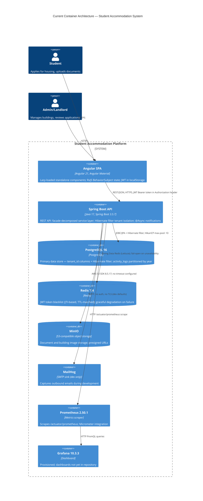
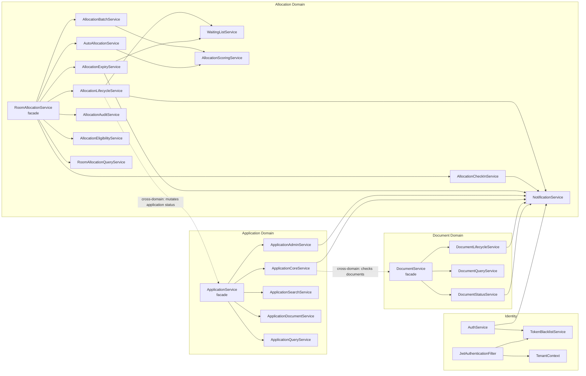
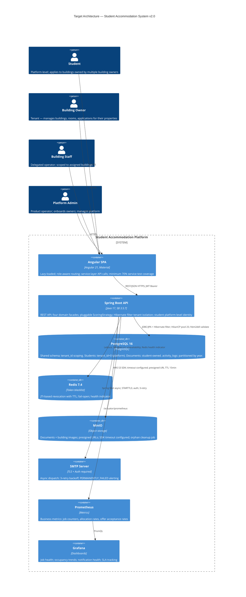
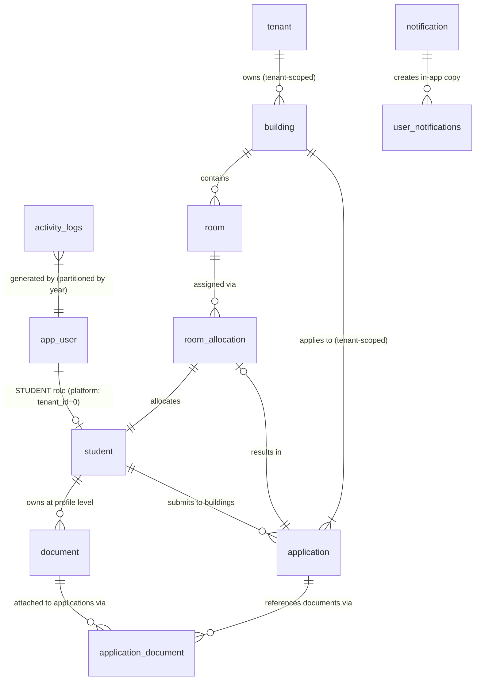
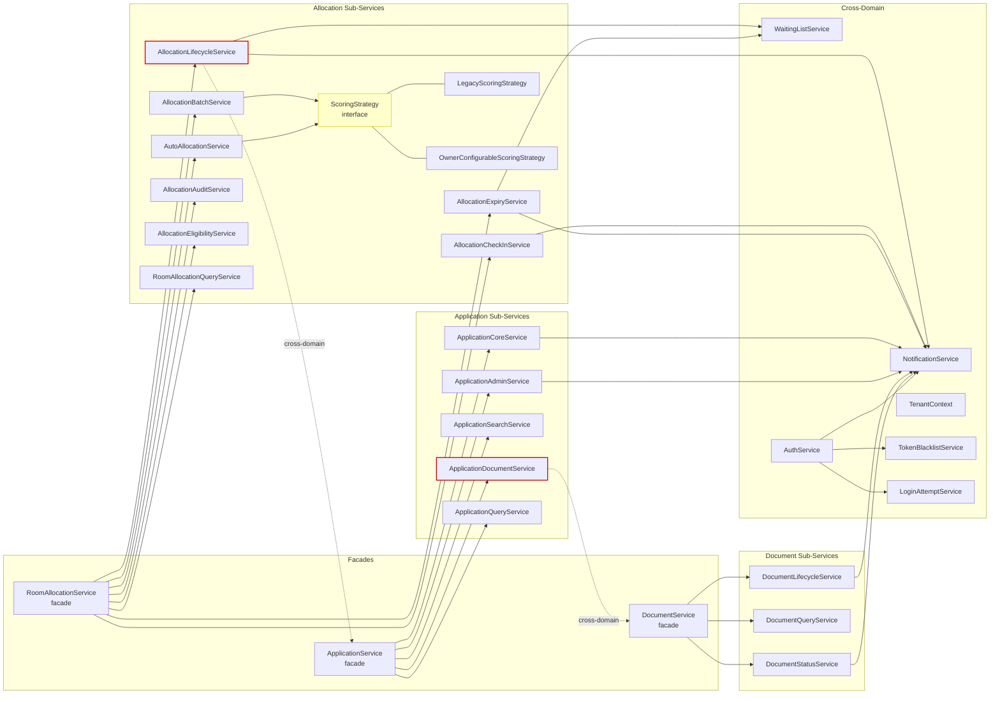

# Technical Stabilisation Document
## Student Accommodation System

### Document Control

| Attribute | Details |
|-----------|---------|
| **Document Title** | Technical Stabilisation Document — Student Accommodation System |
| **Version** | 1.0 |
| **Date** | 2026-02-23 |
| **Author** | Solutions Architect (AI-assisted) |
| **Status** | Draft — Pending Team Review |
| **Input Document** | Requirements.md v2.0 |
| **Codebase Branch** | `feature/verification-report-fixes` (assessed) |

---

## 1. Executive Summary

The Student Accommodation System is a Spring Boot 3.5.7 / Angular 21 / PostgreSQL 16 monolith undergoing a significant product pivot: from a single-tenant university accommodation tool (v1.1) to a **multi-tenant SaaS platform** for private building owners across South Africa (v2.0). The codebase shows clear evidence of active, skilled development — a facade decomposition pattern, working state machines, optimistic locking, Redis-backed JWT token revocation, partitioned audit logs, a Prometheus/Grafana observability stack, and account brute-force protection have all been implemented with care. The team has made intentional, architecturally sound decisions in several areas.

However, the shift to v2.0 exposes **four blocking structural conflicts** that, if not resolved before feature development continues, will force increasingly expensive rework. First, `app_user.tenant_id NOT NULL` scopes every user — including students — to a single tenant. The v2.0 product vision requires students to be **platform-level entities** who apply to buildings owned by multiple tenants; the current schema makes this architecturally impossible. Second, the `document` table hard-links every document to an `application_id NOT NULL`, preventing the platform-level document store that is the system's core differentiator (verified once, trusted everywhere). Third, the `room.room_number` column has a **global unique constraint** — the second building owner to create a room numbered "101" will receive a silent 500 error. Fourth, `hbm2ddl.auto: update` is running concurrently with Flyway migrations, creating a dual schema management conflict that produces silent, untracked schema drift.

On the frontend, a separate concern dominates: **1.5% test coverage** (2 spec files across 133 TypeScript files). Every Angular service hardcodes its API endpoint paths, meaning any backend URL refactoring requires coordinated frontend changes. JWT tokens are stored in `localStorage`, introducing an XSS surface. The admin guard checks `userRole === 'ADMIN'` with a string literal — it will need updating for v2.0's expanded role model.

The recovery plan is clear and sequenced into three phases. Phase 1 addresses the six structural blockers (schema constraints, dual schema management, secrets, SMTP). Phase 2 builds the missing v2.0 data model tables and resolves the student/document architecture conflicts. Phase 3 delivers performance hardening, frontend testing baseline, and operational readiness. The current codebase maturity is **Alpha** — solid architectural skeleton with known structural gaps. Following this plan will bring it to **Production-Ready Beta** within the scope of the prescribed changes.

---

## 2. Current Architecture Assessment

### 2.1 Architecture Overview

The system is a **monolithic Spring Boot backend** serving a **single-page Angular frontend** via a REST API, with PostgreSQL as the primary data store, MinIO for object storage, and Redis for token revocation. All services are containerised via Docker Compose.



**Key Architecture Characteristics:**
- **Pattern:** Layered monolith with facade decomposition within the service layer. `RoomAllocationService`, `ApplicationService`, and `DocumentService` are public facades delegating to package-internal sub-services.
- **Tenant isolation:** Shared schema with `tenant_id` FK on all data tables; enforced via Hibernate Filter + `TenantContext` ThreadLocal populated from JWT `tenantId` claim on each request.
- **Async processing:** `@Async` with custom `notificationExecutor` (core: 10, max: 20, queue: 500).
- **Scheduled jobs:** `@Scheduled` for offer expiry (1h), check-in expiry (1h), batch allocation (6h), notification retry (5m), orphan file cleanup (3am daily). No structured error handling or observability on any job.
- **Observability:** Micrometer → Prometheus → Grafana; structured JSON logging via `logstash-logback-encoder`; `MinioHealthIndicator` and `SmtpHealthIndicator` custom health checks.
- **Security:** JWT (JJWT 0.11.5), BCrypt strength 12, rate limiting filter, account lockout (`failed_login_attempts`, `account_locked_until` columns), Redis token blacklist with fail-open.

---

### 2.2 Component Health Matrix

| Component | Coupling | Complexity | Test Coverage | Fragility | Performance Risk | Security Risk | Overall Health |
|-----------|----------|------------|---------------|-----------|-----------------|--------------|----------------|
| `RoomAllocationService` (facade) | Low | Low | ✅ High | Low | Low | Low | ✅ |
| `AllocationScoringService` | Low | HIGH | ✅ 90% target | 🔴 Hardcoded v1.1 weights | 🔴 N+1 queries | Low | 🔴 |
| `AllocationBatchService` | Medium | HIGH | ✅ Medium | Medium | Medium | Low | ⚠️ |
| `AllocationExpiryService` | Low | Medium | ✅ High | Low | ✅ Partial index | Low | ✅ |
| `ApplicationService` (facade) | Low | Low | ✅ High | Low | Low | Low | ✅ |
| `ApplicationCoreService` | Medium | Medium | ✅ Medium | Medium | Low | Low | ⚠️ |
| `DocumentService` (facade) | Low | Low | ✅ Medium | Low | Low | Low | ✅ |
| `DocumentLifecycleService` | Medium | Medium | ✅ Medium | 🔴 app_id constraint | Medium | Medium | 🔴 |
| `NotificationService` | Low | Medium | ✅ High | Low | Low | Low | ✅ |
| `TokenBlacklistService` | Low | Low | ✅ High | Low | Low | ✅ Low | ✅ |
| `TenantContext` ThreadLocal | Low | Low | ✅ Medium | Low | Low | Medium | ✅ |
| `AuthService` | Medium | Medium | ✅ High | Medium | Low | 🔴 SMTP no TLS | 🔴 |
| `SecurityConfig` | Low | Medium | ✅ Medium | Medium | Low | 🔴 Old role hierarchy | 🔴 |
| `BuildingService` | Low | Low | ✅ Medium | Low | Low | Low | ✅ |
| `ActivityLogService` (partitioned) | Low | Low | Low | Low | ✅ Low | Low | ✅ |
| Schema: `app_user.tenant_id NOT NULL` | — | — | — | 🔴 Blocks v2.0 | — | 🔴 | 🔴 |
| Schema: `document.application_id NOT NULL` | — | — | — | 🔴 Blocks v2.0 | — | — | 🔴 |
| Schema: `room.room_number UNIQUE` global | — | — | — | 🔴 Silent 500 errors | — | — | 🔴 |
| `hbm2ddl.auto: update` + Flyway | — | — | — | 🔴 Schema drift | — | — | 🔴 |
| Flyway relaxed settings | — | — | — | Medium | — | — | ⚠️ |
| Angular frontend (test coverage) | — | — | 🔴 1.5% (2/133 files) | Medium | — | Medium | 🔴 |

**Rating Scale:** ✅ Healthy | ⚠️ Monitor | 🔴 Action Required

---

### 2.3 Fragile Components Analysis

#### 2.3.1 `hbm2ddl.auto: update` Concurrent with Flyway

- **What:** `spring.jpa.properties.hibernate.hbm2ddl.auto: update` instructs Hibernate to inspect entity annotations on every startup and execute `ALTER TABLE` / `CREATE TABLE` statements to align the schema with the entity model.
- **Fragility:** Flyway owns schema evolution. With `hbm2ddl.auto: update` also active, two independent schema managers execute on every startup. Flyway runs its versioned scripts; then Hibernate inspects entities and may add or modify columns that Flyway does not track. Changes made by Hibernate are invisible to Flyway — they are never recorded in a migration file. The result is **silent, untracked schema drift**: the actual database schema no longer matches any Flyway migration, making rollback impossible and future migrations unpredictable. The risk compounds each time entity fields are added or renamed.
- **Blast Radius:** Every service that touches the database. On a bad startup, Hibernate may corrupt a table that Flyway already migrated. Worst case: a `NOT NULL` column added by Hibernate without a default causes `INSERT` failures across unrelated code paths.
- **Evidence:** `application.yml` line 24: `hbm2ddl: auto: update`. Flyway is simultaneously enabled on line 27.
- **Remediation:** Set `hbm2ddl.auto: validate`. Hibernate validates the schema against entities — fails fast on mismatch, makes no changes. Flyway remains sole schema manager.

#### 2.3.2 Schema: `app_user.tenant_id NOT NULL` for Student Accounts

- **What:** Every `app_user` record, including students, has a mandatory `tenant_id` FK. The `TenantContext` Hibernate filter applies to all queries for users scoped to a tenant.
- **Fragility:** In v2.0, students are **platform-level entities** (BR-P05, Requirements.md). A student applies to buildings owned by multiple building owners (different tenants). If a student's `app_user` record is bound to tenant `A`, their JWT carries `tenantId: A`, and the Hibernate filter scopes all their data access to tenant `A`. They cannot see or apply to buildings owned by tenant `B`. The core v2.0 product feature — one student profile, applications to any building on the platform — is architecturally blocked by this constraint.
- **Blast Radius:** Every student-facing flow: application submission across buildings, document reuse across owners, offer acceptance with cross-tenant withdrawal, notification delivery.
- **Evidence:** `V2026_02_19_2100__init_full_schema.sql` line 124: `tenant_id BIGINT NOT NULL` on `app_user`. Requirements.md BR-P05, BR-P07, AUTH-002.
- **Remediation:** See ADR-001. Introduce a `PLATFORM_TENANT_ID = 0` sentinel for student accounts that bypasses tenant filtering.

#### 2.3.3 Schema: `document.application_id NOT NULL`

- **What:** Every `document` record has `application_id BIGINT NOT NULL`, making documents inseparable from a single application.
- **Fragility:** v2.0 requires documents to be platform-level (ST-004, DOC-001): a student uploads their ID once to their profile, attaches it to multiple applications, and once verified by any owner, it is trusted platform-wide (DOC-002). The current constraint means a document cannot exist without an application — contradicting the "upload to profile, reuse everywhere" model that is the system's stated differentiator (Requirements.md Section 1.3, Advantage #2).
- **Blast Radius:** Document upload, document reuse flow (DOC-003), platform-level verification (DOC-002), the entire multi-building application workflow.
- **Evidence:** Migration `V2026_02_19_2100` line 255: `application_id BIGINT NOT NULL`. Requirements.md ST-004, DOC-001 to DOC-003.
- **Remediation:** Make `application_id` nullable. Add `application_document` junction table. See ADR-002 and Section 3.2.2.

#### 2.3.4 Schema: `room.room_number` Global Unique Constraint

- **What:** `room_number VARCHAR(20) NOT NULL UNIQUE` creates a platform-wide unique constraint on room numbers.
- **Fragility:** Room numbers like "101", "A1", "1" will be common across every building on the platform. The moment a second building owner creates a room with a number already in use anywhere on the platform, they receive a database constraint violation that surfaces as a `500 Internal Server Error`. This is a certain production failure that will manifest on day one of the second tenant's onboarding.
- **Blast Radius:** Room creation for every building owner after the first. The platform silently becomes unusable for room management.
- **Evidence:** Migration line 186: `room_number VARCHAR(20) NOT NULL UNIQUE`.
- **Remediation:** Drop the global constraint. Replace with `UNIQUE (building_id, room_number)`. See Section 3.2.3.

#### 2.3.5 `AllocationScoringService` — Hardcoded v1.1 Scoring Weights

- **What:** Scoring constants are `static final` values in the class body (`PREFERRED_BUILDING_BONUS = 100`, `ALTERNATIVE_BUILDING_BONUS = 50`, etc.). The three scoring dimensions — preference match, desirability, accessibility — map to `AllocationRule.preferenceMatchWeight`, `desirabilityWeight`, and `accessibilityWeight`.
- **Fragility:** v2.0 requires owner-configurable rules: FCFS score, university preference, NSFAS priority, and accessibility match — four dimensions none of which correspond to the current v1.1 dimensions (ALLOC-003, BO-006). The scoring algorithm must change fundamentally. There is a 90% test coverage requirement on this class — those tests validate v1.1 behaviour and will need to be retained alongside new tests for the v2.0 strategy.
- **Blast Radius:** All automatic and manual allocation decisions. Every room offer issued to every student on the platform.
- **Evidence:** `AllocationScoringService.java` lines 33–38 (static constants). Requirements.md ALLOC-003, BO-006.
- **Remediation:** Isolate scoring behind a `ScoringStrategy` interface. Implement v2.0 strategy alongside legacy. See ADR-003 and Section 3.4.1.

#### 2.3.6 Scheduled Jobs — No Observability or Error Containment

- **What:** Five `@Scheduled` methods run on fixed intervals. None have try/catch wrappers, structured log output, or Prometheus counters.
- **Fragility:** A runtime exception in any scheduled method propagates to the Spring task scheduler, which logs it and skips the next execution in some configurations. There is no alert when a job silently fails. Operators have no visibility into how many records each job processed, whether it completed successfully, or whether it has been failing for days.
- **Blast Radius:** Offer expiry failures → students stuck with expired offers; no rooms freed; platform stalls. Notification retry failures → PERMANENTLY_FAILED notifications never retried.
- **Evidence:** No try/catch in any `@Scheduled` method. No Micrometer counters on jobs. Grafana has no job health dashboards.
- **Remediation:** Wrap each job in standardised try/catch with structured log entries and `meterRegistry.counter()` increments. See Section 3.4.2.

---

### 2.4 Tight Coupling Analysis



**Problematic Couplings:**

| Coupling | Issue | Severity | Remedy |
|----------|-------|----------|--------|
| `AllocationLifecycleService → ApplicationService` | Allocation lifecycle directly calls `ApplicationService` to mutate application status. Cross-domain write coupling. | Medium | Emit `AllocationStatusChangedEvent`; `ApplicationService` subscribes and updates its own status |
| `AllocationScoringService` — per-room repo calls | `scoreSingleRoom()` calls `roomAttributesRepository.findByRoom_Id()` and `buildingAttributesRepository.findByBuilding_Id()` once per room in a loop | HIGH | Batch-load all attributes before scoring loop |
| `StudentService → AuthService` | `StudentService` injects `AuthService` to get current user. If `AuthService` ever needs `StudentService`, circular dependency occurs | Low | Extract `CurrentUserContext` as a separate thin service |
| Angular: `AuthService` owns document upload + application submission | `auth.service.ts` contains `uploadDocuments()` calling `/documents/upload-multiple` and `submitApplication()` — business operations mixed into the auth service | Medium | Move to `document.service.ts` and `application.service.ts` respectively |

---

### 2.5 Performance Bottleneck Analysis

| # | Area | Current State | Risk | Impact | Recommendation |
|---|------|--------------|------|--------|----------------|
| PB-001 | `AllocationScoringService` N+1 | `scoreSingleRoom()` calls `roomAttributesRepository` and `buildingAttributesRepository` inside loop over every available room | 🔴 HIGH | 100 rooms = 200+ extra queries per allocation run; grows linearly | Batch-load all `RoomAttributes` and `BuildingAttributes` before scoring loop using `findByRoom_IdIn()` and `findByBuilding_IdIn()` |
| PB-002 | HikariCP pool ceiling | `maximum-pool-size: 10` (default) | Medium | Connection starvation at ~50+ concurrent API calls; well below 500-user target | Increase to 25; add connection wait time monitoring in Grafana |
| PB-003 | Async thread pool under notification burst | max 20 threads, queue 500. Allocation batch could trigger 500+ notifications simultaneously | Low | Queue fills → notification delivery delayed, not lost | Monitor queue depth via `/actuator/metrics`; increase max-pool-size to 50 for notification bursts |
| PB-004 | `activity_logs` full-scan | Queries without `tenant_id + timestamp` range filter scan all year partitions | Low | Slow admin activity log queries with large datasets | Enforce range filter in `ActivityLogService.buildSpec()`; index already covers this |
| PB-005 | `room_allocation` expiry scans | Offer expiry job scans `status = 'OFFERED'` | ✅ LOW | Partial index `idx_room_allocation_offer_expiry` already optimises this | No action needed |
| PB-006 | Frontend — no measurement | No Lighthouse baseline, no P95 API timing | Unknown | Cannot validate < 3s on 3G NFR | Run Lighthouse CI; add Micrometer `@Timed` to service methods |

---

### 2.6 Integration Risk Analysis

| Integration | Availability Risk | Failure Isolation | Retry Strategy | Timeout Config | Data Consistency Risk | Security | Overall Risk |
|-------------|------------------|-------------------|----------------|----------------|----------------------|----------|-------------|
| PostgreSQL | LOW — single critical dependency | N/A (hard fail) | HikariCP reconnect | `connection-timeout: 30s` ✅ | ACID + optimistic locking ✅ | Env var credentials ✅ | LOW |
| MinIO | MEDIUM | Full — isolated in `DocumentLifecycleService` | `OrphanFileCleanupJob` recovers orphaned files ✅ | 🔴 Not configured in SDK client | Upload success + DB record failure = orphan (handled by cleanup job) | Access key via env var ✅ | MEDIUM |
| Redis | LOW — graceful degradation | Full — `TokenBlacklistService` swallows all exceptions | N/A | `timeout: 60s` Lettuce config ✅ | Fail-open: blacklisted token not revoked if Redis down | Dev has no Redis auth | LOW |
| SMTP | MEDIUM — async retry mitigates | Full — email failure never blocks API response | 3 retries via `NotificationRetryService` ✅ | Not configured in Spring Mail | After 3 retries → PERMANENTLY_FAILED (acceptable) | 🔴 No TLS, no auth in `application.yml` | 🔴 HIGH in production |
| FF4J | LOW — in-process | N/A | N/A | N/A | Immediate flag changes | JDBC credential reuse ✅ | LOW |
| Google Maps | N/A — removed from codebase | N/A | N/A | N/A | N/A | N/A | ✅ RESOLVED |
| Nominatim (OSM) | MEDIUM — external free API | Full — geocoding feature-flagged; building saved without coordinates on failure | 🔴 No retry implemented | 🔴 No timeout configured | No consistency risk (enrichment only) | No API key required ✅ | LOW |

---

### 2.7 Security Assessment

| # | Concern | Current State | Gap | Severity | Recommendation |
|---|---------|---------------|-----|----------|----------------|
| SEC-001 | JWT token revocation | `TokenBlacklistService` with Redis, JTI-based, TTL-matched, fail-open ✅ | Fail-open means compromised tokens remain valid if Redis is down | Medium | Document the fail-open policy; add Grafana alert on Redis unavailability |
| SEC-002 | SMTP transport security | `starttls.enable: false`, `smtp.auth: false` in `application.yml` | Emails sent in plaintext, unauthenticated | 🔴 CRITICAL for production | Parametrise via env vars; enforce `MAIL_STARTTLS_ENABLE=true` in production |
| SEC-003 | JWT secret default value | Default 512-bit base64 secret hardcoded as fallback in `application.yml` | If `JWT_SECRET` env var not set, known default secret used in production | 🔴 HIGH | Remove the default value; fail application startup if `JWT_SECRET` is absent |
| SEC-004 | Brute force protection | `failed_login_attempts`, `account_locked_until` columns; `LoginAttemptService` exists ✅ | Need to confirm lockout is enforced in the `AuthService.login()` code path | Medium | Verify `LoginAttemptService` is called on every failed login attempt; add test |
| SEC-005 | Role model — v1.1 hierarchy | `UserRole { STUDENT, ADMIN, LANDLORD }`; `SecurityConfig` hierarchy: `ADMIN > LANDLORD > STUDENT` | v2.0 roles `PLATFORM_ADMIN`, `BUILDING_OWNER`, `BUILDING_STAFF` not represented | HIGH | See ADR-004; must be updated before building-owner features are built |
| SEC-006 | Frontend JWT storage | JWT tokens stored in `localStorage` | XSS attack can read localStorage; tokens exposed | Medium | For MVP with single first customer: acceptable. Phase 3: evaluate `HttpOnly` cookie storage |
| SEC-007 | Frontend manual JWT parsing | `JSON.parse(atob(token.split('.')[1]))` in `auth.service.ts` | Manual parsing bypasses library validation; vulnerable to malformed tokens | Low | Use `jwtDecode` library; handle parse errors gracefully |
| SEC-008 | Frontend admin guard string comparison | `currentUser.userRole === 'ADMIN'` | Brittle; breaks silently when roles are renamed to v2.0 names | Medium | Centralise role checks; update guards alongside ADR-004 role migration |
| SEC-009 | Tenant isolation — student cross-tenant | `app_user.tenant_id NOT NULL` for students with Hibernate filter | Students cannot access cross-tenant buildings — correct isolation, wrong for v2.0 | 🔴 CRITICAL | ADR-001 |
| SEC-010 | Tenant isolation — new code | Hibernate filter works for existing entities | Every new JPA entity/repository must include tenant filter | HIGH | Extend `TenantFilterIntegrationTest` with each new entity; reviewed in PR checklist |
| SEC-011 | `postgres_data` volume not mounted | docker-compose.yml defines `postgres_data` volume but `db` service does not mount it | Database data is not persisted; lost when container is removed | HIGH (dev) | Add `volumes: - postgres_data:/var/lib/postgresql/data` to `db` service |

---

## 3. Recovery Architecture Plan

### 3.1 Classification Summary

| Component / Concern | Classification | Priority | Effort | Risk |
|--------------------|---------------|----------|--------|------|
| `hbm2ddl.auto: update` | **Must Refactor** | 🔴 P1 | Low | Low |
| `room.room_number` global unique constraint | **Must Refactor** | 🔴 P1 | Low | Low |
| `system_settings.setting_key` global unique | **Must Refactor** | 🔴 P1 | Low | Low |
| JWT secret — remove default value | **Must Refactor** | 🔴 P1 | Low | Low |
| SMTP production security parametrisation | **Must Refactor** | 🔴 P1 | Low | Low |
| `postgres_data` volume mount in docker-compose | **Must Refactor** | 🔴 P1 | Low | Low |
| Flyway relaxed settings | **Must Refactor** | 🔴 P1 | Low | Low |
| Scheduled jobs observability | **Must Refactor** | 🔴 P1 | Low | Low |
| `app_user.tenant_id` student binding | **Must Refactor** | 🔴 P2 | HIGH | HIGH |
| `document.application_id NOT NULL` | **Must Refactor** | 🔴 P2 | HIGH | HIGH |
| `UserRole` + role hierarchy v2.0 | **Must Refactor** | 🔴 P2 | HIGH | HIGH |
| Missing v2.0 schema tables (7 tables) | **Must Refactor** | P2 | HIGH | Medium |
| `AllocationScoringService` N+1 batch load | **Must Refactor** | P2 | Medium | Low |
| HikariCP pool size (10 → 25) | **Must Refactor** | P2 | Low | Low |
| Frontend test coverage baseline | **Must Refactor** | P2 | HIGH | Low |
| `AllocationScoringService` v2.0 scoring strategy | **Must Isolate** | P2 | HIGH | Medium |
| Scheduled jobs structural observability | **Must Isolate** | P1 | Low | Low |
| Facade pattern (RAS, AppS, DocS) | **Can Remain** | — | — | — |
| State machine enums (`canTransitionTo()`) | **Can Remain** | — | — | — |
| `TokenBlacklistService` (Redis, fail-open) | **Can Remain** | — | — | — |
| `TenantContext` + Hibernate filter | **Can Remain** | — | — | — |
| Activity log partitioning (by year) | **Can Remain** | — | — | — |
| Prometheus + Grafana stack | **Can Remain** | — | — | — |
| MapStruct mappers | **Can Remain** | — | — | — |
| AOP `@LogActivity` aspect | **Can Remain** | — | — | — |
| `NotificationRetryService` | **Can Remain** | — | — | — |
| Migration consolidation (already done) | **Too Risky to Touch Now** | — | — | — |
| FF4J 1.9 (2020 release) | **Too Risky to Touch Now** | P3 | Medium | Medium |
| Frontend localStorage JWT storage | **Too Risky to Touch Now** | P3 | Medium | Low |

---

### 3.2 Must Refactor

#### 3.2.1 Disable Hibernate DDL Auto-Management

- **Current State:** `spring.jpa.properties.hibernate.hbm2ddl.auto: update` — Hibernate silently modifies the schema on startup alongside Flyway.
- **Target State:** `hbm2ddl.auto: validate` — Hibernate validates that the schema matches entities; fails startup on mismatch; makes no changes. Flyway is the sole schema manager.
- **Approach:** Single-line change in `application.yml`. Run the full integration test suite to confirm no entity/migration drift already exists. If drift is found, write a migration to capture Hibernate's changes.
- **Risks During Refactoring:** Hidden Hibernate-added columns not tracked by Flyway will cause `SchemaManagementException` on startup. This surfaces hidden problems — desired outcome.
- **Acceptance Criteria:** Application starts successfully with `hbm2ddl.auto: validate`. No `SchemaManagementException` in startup logs. CI pipeline includes application startup verification.
- **Dependencies:** None.

#### 3.2.2 Decouple Documents from Applications

- **Current State:** `document.application_id BIGINT NOT NULL` — every document must belong to an application.
- **Target State:** Documents are owned by a student at the profile level. A new `application_document` junction table links specific documents to specific applications. `document.application_id` column is removed. Document verification status is stored on `document` and is platform-wide.
- **Approach (incremental):**
  1. Migration: `ALTER TABLE document ALTER COLUMN application_id DROP NOT NULL`
  2. Migration: Create `application_document (id, application_id NOT NULL, document_id NOT NULL, attached_at TIMESTAMP DEFAULT NOW())`
  3. Data migration: `INSERT INTO application_document (application_id, document_id) SELECT application_id, id FROM document WHERE application_id IS NOT NULL`
  4. Update `DocumentRepository` — remove queries filtering by `application_id`
  5. Update `ApplicationDocumentService` — use junction table for document attachment/detachment
  6. Update frontend `document.service.ts` — remove `applicationId` from upload request
  7. Final migration: `ALTER TABLE document DROP COLUMN application_id`
- **Risks:** Steps 1–3 are non-destructive and safe to do first. Steps 4–6 must be coordinated — do not drop column until all code paths are updated.
- **Acceptance Criteria:** Student can upload a document without any active application. The same document can be attached to two different applications. Verified document status persists across all applications it is attached to.
- **Dependencies:** Must be done before v2.0 multi-building application features.

#### 3.2.3 Fix `room.room_number` Uniqueness Scope

- **Current State:** `UNIQUE (room_number)` globally across all rooms on the platform.
- **Target State:** `UNIQUE (building_id, room_number)` — room numbers are unique within a building only.
- **Approach:** Check for existing data conflicts. Then migrate: `ALTER TABLE room DROP CONSTRAINT IF EXISTS room_room_number_key; ALTER TABLE room ADD CONSTRAINT uq_room_number_building UNIQUE (building_id, room_number);`
- **Risks:** If two rooms across different buildings already share a room number, the new constraint insert will succeed (since building_id differs) — no data conflict. Low risk.
- **Acceptance Criteria:** Two buildings can each have a room "101". Room creation succeeds when room number is already used in a different building.
- **Dependencies:** None.

#### 3.2.4 Fix `system_settings.setting_key` Uniqueness Scope

- **Current State:** `UNIQUE (setting_key)` globally — only one tenant can ever have a given setting key.
- **Target State:** `UNIQUE (tenant_id, setting_key)` — each tenant manages its own independent setting namespace.
- **Approach:** `ALTER TABLE system_settings DROP CONSTRAINT system_settings_setting_key_key; ALTER TABLE system_settings ADD CONSTRAINT uq_system_settings_tenant_key UNIQUE (tenant_id, setting_key);`
- **Acceptance Criteria:** Two tenants can each have `auto_allocation_enabled`. Settings are scoped to and readable per tenant.
- **Dependencies:** None.

#### 3.2.5 Remove JWT Secret Default Value

- **Current State:** `jwt.secret: ${JWT_SECRET:jCiWx+J9UA...}` — a default base64 secret is embedded as a fallback.
- **Target State:** `jwt.secret: ${JWT_SECRET}` — no default. Application refuses to start if `JWT_SECRET` is absent.
- **Approach:** Remove the default from `application.yml`. Add a startup `@PostConstruct` check in `JwtConfig`: if `secret` is null or shorter than 32 characters, throw `IllegalStateException("JWT_SECRET environment variable must be set")`. Apply the same pattern to `MAIL_PASSWORD`.
- **Acceptance Criteria:** Application throws a clear startup error if `JWT_SECRET` is not set. All dev environments updated with `.env` file containing the secret.
- **Dependencies:** Update developer documentation and docker-compose dev vars before applying.

#### 3.2.6 Parametrise SMTP Security Configuration

- **Current State:** `starttls.enable: false`, `smtp.auth: false` hardcoded in `application.yml`.
- **Target State:** Both driven by environment variables. Dev environments explicitly set `false` (intentional). Production sets `true`.
- **Approach:** `starttls.enable: ${MAIL_STARTTLS_ENABLE:false}` and `auth: ${MAIL_SMTP_AUTH:false}` in `application.yml`. Add to production deployment checklist: `MAIL_STARTTLS_ENABLE=true`, `MAIL_SMTP_AUTH=true`.
- **Acceptance Criteria:** Production SMTP configuration sends via TLS with authentication. Dev environment continues to use MailHog with no auth.
- **Dependencies:** None.

#### 3.2.7 Fix `postgres_data` Volume Mount

- **Current State:** `docker-compose.yml` declares `postgres_data` volume but the `db` service does not mount it. Database data is lost when the container is stopped or removed.
- **Target State:** `db` service mounts the volume: add `volumes: - postgres_data:/var/lib/postgresql/data` under the `db` service definition.
- **Acceptance Criteria:** Database data persists across `docker-compose down` and `docker-compose up` cycles.
- **Dependencies:** None.

#### 3.2.8 Restore Flyway Safety Settings

- **Current State:** `out-of-order: true`, `validate-on-migrate: false`, `ignore-missing-migrations: true`. These were loosened to accommodate the migration consolidation (55 files replaced with 2).
- **Target State:** `out-of-order: false`, `validate-on-migrate: true`, `ignore-missing-migrations: false`. Safety restored.
- **Approach:** First apply a Flyway baseline at the current consolidated migration version so Flyway treats all earlier versions as "already applied". Then restore safety settings.
- **Acceptance Criteria:** `flyway:validate` passes cleanly. New migrations are applied in strict version order. A deleted migration file causes a startup failure.
- **Dependencies:** Apply after confirming `hbm2ddl.auto: validate` passes (Section 3.2.1) — they must be stable together.

#### 3.2.9 Student Platform-Level Identity

- **Current State:** `app_user.tenant_id NOT NULL` for all users including students.
- **Target State:** Student `app_user` records use `tenant_id = 0` (platform sentinel) that bypasses tenant filtering. See ADR-001 for full decision rationale.
- **Approach:**
  1. Seed `INSERT INTO tenant (id, name, is_active) VALUES (0, 'PLATFORM', true)` (if using sentinel ID)
  2. Migration: `ALTER TABLE app_user ALTER COLUMN tenant_id DROP NOT NULL` — or keep NOT NULL and use `tenant_id = 0`
  3. Modify `TenantContext` filter logic: if `tenantId == 0 (PLATFORM)`, skip the Hibernate filter for the current request
  4. Update `AuthService.signup()` to set `tenant_id = 0` for `STUDENT` role registrations
  5. Update `JwtUtil.generateToken()` to embed `tenantId = 0` for student tokens
- **Risks:** HIGH — this touches the core security isolation mechanism. Mandatory: full regression of `TenantFilterIntegrationTest` and all cross-tenant access tests before merging.
- **Acceptance Criteria:** A student account can see buildings from two different building owner tenants. A student cannot see another student's applications. A building owner cannot see another owner's buildings.
- **Dependencies:** UserRole migration (Section 3.2.10) should happen concurrently.

#### 3.2.10 UserRole and SecurityConfig — v2.0 Role Model

- **Current State:** `UserRole { STUDENT, ADMIN, LANDLORD }`. `SecurityConfig` hierarchy: `ADMIN > LANDLORD > STUDENT`.
- **Target State:** `UserRole { STUDENT, PLATFORM_ADMIN, BUILDING_OWNER, BUILDING_STAFF }`. Hierarchy: `PLATFORM_ADMIN > BUILDING_OWNER > BUILDING_STAFF`. Students remain independent.
- **Approach (incremental, zero-downtime):**
  1. Add `PLATFORM_ADMIN`, `BUILDING_OWNER`, `BUILDING_STAFF` to `UserRole` alongside existing values
  2. Data migration: update existing ADMIN users → PLATFORM_ADMIN; LANDLORD → BUILDING_OWNER
  3. Update `SecurityConfig.roleHierarchy()`
  4. Add `@Deprecated` to `ADMIN` and `LANDLORD`; update all `@PreAuthorize` annotations across all controllers
  5. Update Angular guards: replace `userRole === 'ADMIN'` with role service abstraction
  6. Remove deprecated roles in next release after full regression
- **Risks:** HIGH — role checks are pervasive in controllers and Angular guards. A missed check silently grants or denies access. Full regression test required.
- **Acceptance Criteria:** All existing tests pass with new roles. `PLATFORM_ADMIN` accesses all tenants (audit logged). `BUILDING_OWNER` cannot access another owner's data. `BUILDING_STAFF` scoped to assigned buildings.
- **Dependencies:** Must happen before building-owner multi-tenancy features.

#### 3.2.11 Frontend Test Coverage Baseline

- **Current State:** 2 spec files across 133 TypeScript files — 1.5% coverage. No automated quality gate.
- **Target State:** Critical paths covered: auth flows, allocation state transitions, offer accept/decline, document upload. Minimum 30% component coverage; 70% service coverage.
- **Approach:** Start with services (isolated, no DOM), then critical components. Prioritise: `auth.service.spec.ts` (full), `application.service.spec.ts`, `room-allocation.service.spec.ts`, `document.service.spec.ts`. Add Karma coverage thresholds in `angular.json`.
- **Acceptance Criteria:** CI pipeline enforces minimum coverage thresholds. Every new service file requires a corresponding spec file.
- **Dependencies:** None — can proceed in parallel with backend changes.

---

### 3.3 Can Remain

| Component | Why Acceptable | Trigger for Future Refactoring | Monitoring Required |
|-----------|----------------|-------------------------------|-------------------|
| Facade pattern (`RoomAllocationService`, `ApplicationService`, `DocumentService`) | Clean public API; internals can evolve independently; well-tested | When sub-services require independent deployment | None |
| State machine enums (`canTransitionTo()`) | Validated transitions at code layer; tested | If transitions need visual modelling or external configuration | Unit tests on all transitions |
| `TokenBlacklistService` | Well-implemented; JTI+TTL; fail-open with logging; tested | If Redis SLA cannot meet < 5ms | Alert on Redis ping > 100ms |
| `TenantContext` ThreadLocal | Proven pattern; cleared in filter chain; integration tested | If migrating to WebFlux reactive (ThreadLocal unsafe) | Log missing tenant context errors |
| Activity log partitioning | Forward-thinking; year partitions 2024–2027 created | Add 2028 partition by Dec 2027 | Partition size quarterly |
| Prometheus + Grafana | Already deployed; scraping actuator metrics | If multi-instance deployment needed | Add business metric counters in Phase 3 |
| MapStruct mappers | Compile-time safe; fast; regenerated on build | If mapping needs complex custom logic | Regenerate after entity changes |
| `NotificationRetryService` | 3-retry with interval tracking; PERMANENTLY_FAILED status | If volume requires message queue | Alert on PERMANENTLY_FAILED count |
| AOP `@LogActivity` | Audit logging without polluting business methods | N/A | Verify admin actions produce log entries |
| Partial indexes (`idx_room_allocation_offer_expiry`, `idx_room_allocation_check_in_expiry`) | Optimised scheduled job queries | N/A | Monitor scheduled job execution time |

---

### 3.4 Must Isolate

#### 3.4.1 `AllocationScoringService` — Scoring Strategy Interface

- **Current State:** A concrete class with hardcoded v1.1 scoring constants directly used by `AllocationBatchService` and `AutoAllocationService`.
- **Isolation Boundary:** Extract a `ScoringStrategy` interface:
  ```java
  public interface ScoringStrategy {
      List<ScoredRoom> scoreAvailableRooms(Student student, Application application, Building preferred);
      ScoredRoom scoreSingleRoom(Student student, Application application, Room room, AllocationRule rule);
      boolean satisfiesHardConstraints(Student student, Room room);
  }
  ```
  The current `AllocationScoringService` becomes `LegacyScoringStrategy implements ScoringStrategy` — unchanged, retaining all current tests. The v2.0 `OwnerConfigurableScoringStrategy` implements ALLOC-003 rules (FCFS, university preference, NSFAS priority, accessibility match) as a separate class.
- **Containment Strategy:** `AllocationBatchService` and `AutoAllocationService` depend on `ScoringStrategy` (interface), not the concrete class. Spring `@Primary` selects the active implementation; a feature flag can toggle between them.
- **Long-Term Plan:** Once v2.0 scoring is proven in production, `LegacyScoringStrategy` is removed. Strategy selection can become per-tenant configuration.

#### 3.4.2 Scheduled Jobs — Structured Observability Wrapper

- **Current State:** `@Scheduled` methods fire without any error containment or observability.
- **Isolation Boundary:** Standardised wrapper pattern for all five scheduled methods:
  ```java
  @Scheduled(fixedRateString = "${app.allocation.expiry-check-interval-ms}")
  public void expireOffers() {
      String jobName = "offerExpiry";
      log.info("job={} action=start", jobName);
      try {
          int processed = allocationExpiryService.expireOutstandingOffers();
          log.info("job={} action=complete processed={}", jobName, processed);
          meterRegistry.counter("jobs." + jobName + ".processed").increment(processed);
      } catch (Exception e) {
          log.error("job={} action=failed", jobName, e);
          meterRegistry.counter("jobs." + jobName + ".failures").increment();
      }
  }
  ```
- **Containment Strategy:** Exceptions are swallowed at the scheduler boundary — one job failure does not affect others. All failures produce Prometheus counters for Grafana alerting.
- **Long-Term Plan:** If the platform scales to multiple instances, migrate to Quartz with JDBC backing to prevent duplicate concurrent job execution across instances.

---

### 3.5 Too Risky to Touch Now

| Component | Why Too Risky | Conditions to Reassess | Compensating Controls |
|-----------|--------------|----------------------|----------------------|
| Migration consolidation (55 → 2 files) | Already applied. Rolling back requires dropping and recreating the database with potential data loss. The consolidation is done and stable. | N/A — migration history resets at v2026_02_19 | Apply Flyway baseline; restore `validate-on-migrate: true`; never drop-recreate a populated database |
| FF4J 1.9 (2020) | Deeply integrated (JDBC store, startup initialisation). FF4J 2.x is a breaking API change. Surface area is small — only `auto-allocation` flag. | CVE disclosed for FF4J 1.9 with CVSS ≥ 7.0 | Monitor NVD; wrap FF4J behind `FeatureFlagService` interface so implementation can be swapped without touching call sites |
| `TenantContext` ThreadLocal | Proven, tested, working. Changing tenant isolation mid-development is extreme risk for cross-tenant data leakage. | Moving to WebFlux reactive runtime | Maintain `TenantFilterIntegrationTest`; add coverage for every new entity |
| Frontend `localStorage` JWT | Changing token storage from localStorage to HttpOnly cookies requires backend cookie endpoint changes and frontend auth flow changes. Not blocking for single first customer. | When multi-building-owner is live (expanded attack surface) | CSP headers already configured; input sanitisation; plan migration in Phase 3 |

---

## 4. Target Architecture

### 4.1 Architecture Principles

1. **Flyway is the single schema manager.** No DDL authority is delegated to Hibernate (`hbm2ddl.auto: validate`). Every schema change requires a Flyway migration file checked into version control before any application of the change.

2. **Students are platform-level entities.** Student `app_user` records use `tenant_id = 0` (PLATFORM sentinel). Their data access is governed by ownership (`student_id`, `user_id`), not by tenant filter. A student's data is theirs — not any building owner's.

3. **Documents belong to students, not applications.** A document is an asset in a student's profile. Applications reference documents via the `application_document` junction table. Document verification is stored once at the document level — platform-wide trust.

4. **Tenant isolation is enforced at the data layer, not only the API layer.** The Hibernate filter on `tenant_id` is the last line of defence. Every new JPA entity table with tenant-scoped data must include a `tenant_id` FK and Hibernate filter annotation. The `TenantFilterIntegrationTest` is extended with each new entity.

5. **The facade pattern governs complex domain services.** `RoomAllocationService`, `ApplicationService`, and `DocumentService` expose a stable public API. Internal sub-services are package-private. External callers interact only with the facade.

6. **Scoring is a pluggable strategy.** The allocation engine does not hardcode scoring logic. `ScoringStrategy` is an interface. Implementations are independently deployable and testable.

7. **No business logic in controllers.** Controllers: validate input → call one service method → return response. All orchestration and domain decisions belong in the service layer.

8. **Every integration is fault-tolerant.** MinIO failure does not fail an application. SMTP failure does not fail an allocation. Redis failure does not fail authentication. Each integration has a defined fallback behaviour.

9. **Observability is first-class.** Every scheduled job emits structured log entries and Prometheus counters. Every integration failure is counted. Every state transition is auditable in `activity_logs`.

10. **No environment-specific security defaults.** Secrets have no default values. Security configuration (TLS, auth) is driven entirely from environment variables. Applications refuse to start with missing security configuration.

---

### 4.2 Target Component Architecture



---

### 4.3 Domain Boundaries

| Domain | Packages | Key Services | Key Entities | Notes |
|--------|----------|-------------|-------------|-------|
| **Platform Administration** | `controller/platform.*`, `service/platform.*` | `PlatformAdminService`, `BuildingOwnerService` | `building_owner`, `building_staff` | New for v2.0 (PA-001 to PA-004, BO-001, BO-002) |
| **Identity & Security** | `security.*`, `config.*`, `service/auth.*`, `service/tenant.*` | `AuthService`, `TokenBlacklistService`, `TenantContext`, `LoginAttemptService` | `app_user` (students: tenant_id=0), `email_verification_token`, `password_reset_token` | Students platform-level post ADR-001 |
| **Building & Room Management** | `controller/building.*`, `service/building.*` | `BuildingService`, `RoomService`, `BuildingImageService` | `building`, `room`, `building_attributes`, `room_attributes`, `building_image` | Tenant-scoped to building owner |
| **Application Lifecycle** | `controller/application.*`, `service/application.*` | `ApplicationService` (facade), `ApplicationCoreService`, `ApplicationAdminService` | `application`, `custom_field_answer`, `intake_period` | Per-building-owner application windows |
| **Document Management** | `controller/document.*`, `service/document.*` | `DocumentService` (facade), `DocumentLifecycleService`, `DocumentStatusService` | `document` (student-owned), `document_comment`, `application_document` (junction) | Platform-level ownership post ADR-002 |
| **Allocation Engine** | `service/allocation.*` | `RoomAllocationService` (facade), `AllocationBatchService`, `ScoringStrategy` → `OwnerConfigurableScoringStrategy` | `room_allocation`, `staged_allocations`, `waiting_list_entry`, `allocation_audit_log` | Scoring pluggable per ADR-003 |
| **Notification & Communication** | `service/notification.*`, `controller/notification.*` | `NotificationService`, `NotificationRetryService`, `UserNotificationService` | `notification`, `user_notifications` | Async; SSE for in-app; retry tracked |
| **Analytics & Reporting** | `controller/stats.*`, `service/stats.*` | `AdminStatsService`, `PlatformStatsService` | Aggregates over allocation, application, occupancy | Read-only; no tenant filter bypass |
| **Configuration & Feature Flags** | `config.*`, `service/settings.*` | `SystemSettingService`, `FeatureFlagService` (wraps FF4J) | `system_settings` (per-tenant unique key), FF4J tables | Per-tenant settings post Section 3.2.4 |

---

### 4.4 Data Architecture

#### Key Schema Changes for v2.0

| Change | Migration | Risk |
|--------|-----------|------|
| `app_user.tenant_id` — allow platform sentinel (0) | Constraint change or nullable | Medium |
| `document.application_id` — make nullable | `ALTER COLUMN ... DROP NOT NULL` | Low |
| Add `application_document` junction table | New table | Low |
| `room.room_number` — per-building uniqueness | Drop + add constraint | Low |
| `system_settings.setting_key` — per-tenant uniqueness | Drop + add composite constraint | Low |
| Add `intake_period` table | New table | Low |
| Add `custom_application_field` + `custom_field_answer` | New tables | Low |
| Add `building_owner` + `building_staff` tables | New tables | Low |
| Add `required_document_type` (per-building) | New table | Low |

#### Connection Pool Recommendation

```yaml
hikari:
  maximum-pool-size: 25        # Up from 10; supports 500 concurrent users
  minimum-idle: 10
  connection-timeout: 30000
  idle-timeout: 300000
  max-lifetime: 600000
  leak-detection-threshold: 60000
```

#### Architecturally Significant Entity Relationships



---

### 4.5 Integration Architecture

```mermaid
flowchart LR
  subgraph "Spring Boot API"
    API[REST Controllers]
    SVC[Service Layer\nFacades + Sub-services]
    SCHED[Scheduled Jobs\ntry-catch + Prometheus counters]
  end

  PG[(PostgreSQL 16\nHikariCP pool 25\nhbm2ddl validate)]
  REDIS[(Redis 7.4\nJTI blacklist\nfail-open)]
  MINIO[(MinIO\nS3 SDK\ntimeout TBD)]
  SMTP[SMTP Server\nTLS + Auth\nrequired in prod]
  PROM[Prometheus]
  GRAFANA[Grafana\nAlerts configured]

  API --> SVC
  SVC -->|JDBC/JPA + Hibernate tenant filter| PG
  SVC -->|Lettuce async\nfail-open on error| REDIS
  SVC -->|AWS S3 SDK| MINIO
  SVC -->|@Async Spring Mail\n3-retry exponential backoff| SMTP
  SCHED -->|structured logs + counters| PROM
  SVC -->|Micrometer @Timed| PROM
  PROM --> GRAFANA
```

**Resilience Per Integration:**

| Integration | Pattern | Fallback | Timeout Target |
|-------------|---------|----------|----------------|
| PostgreSQL | Synchronous request-response | Hard fail — no fallback | 30s connection (already configured) |
| Redis | Fail-open blacklist check | Allow request, log warning | 60s (already configured) |
| MinIO | Upload + async orphan cleanup | Retry 3x; error response to client | 30s (to be configured) |
| SMTP | Async fire-and-forget + 3-retry | PERMANENTLY_FAILED status; in-app notification still delivers | 5s connection (to be configured) |
| Nominatim | Optional enrichment | Save building without coordinates | 5s (to be configured) |

---

## 5. Guardrails & Standards

### 5.1 Coding Standards

#### 5.1.1 Backend (Java / Spring Boot)

**Package Structure (enforced):**
```
com.beezhub.student_accommodation
├── config/           — @Configuration beans only
├── controller/       — @RestController; no business logic; one service call per method
├── service/          — Business logic; facades public; sub-services package-private
│   ├── allocation/   — Allocation sub-services
│   ├── application/  — Application sub-services
│   ├── document/     — Document sub-services
│   ├── notification/ — Notification sub-services
│   └── tenant/       — TenantContext and tenant management
├── repository/       — Spring Data JPA repositories only
├── model/
│   ├── entity/       — JPA entities; one class per table; no DTO imports
│   ├── dto/          — Request/Response DTOs; no entity references
│   └── enums/        — Enums with displayName + fromString() + canTransitionTo()
├── mapper/           — MapStruct interfaces; no logic
├── security/         — JWT filter, user details, auth components
├── aspect/           — AOP aspects (@LogActivity)
├── exceptions/       — One class per exception type
├── specification/    — JPA Specifications for dynamic filtering
└── validation/       — Custom validators
```

**Mandatory Rules:**
1. **No business logic in controllers.** Controllers validate input, call one service method, return response.
2. **No entity references in DTOs.** MapStruct converts between layers.
3. **`@Transactional` service methods are atomic.** Never commit mid-method then throw. Each method is all-or-nothing.
4. **Throw domain exceptions.** `ApplicationNotFoundException`, `RoomCapacityExceededException` — never raw `RuntimeException`.
5. **Structured logging.** Format: `log.info("event=offerExpired allocationId={} studentId={} tenantId={}", id, sid, tid)`. INFO for domain events; DEBUG for internal state; WARN for recoverable; ERROR for unhandled.
6. **Every public service method has a test.** Minimum: one happy-path test + one edge-case test.
7. **`@Transactional(readOnly = true)`** on all read-only methods and read-only service classes.
8. **Constructor injection only.** No `@Autowired` field injection. Use Lombok `@RequiredArgsConstructor`.
9. **Every new entity table with tenant data has a `tenant_id` FK and Hibernate filter.** Verified by `TenantFilterIntegrationTest`.

#### 5.1.2 Frontend (Angular / TypeScript)

1. **Lazy loading for every feature module.** All routes use `loadComponent()` for standalone components.
2. **Services own all HTTP calls.** Components never inject `HttpClient` directly.
3. **Unsubscribe with `takeUntilDestroyed()` or `async` pipe.** No unmanaged subscriptions.
4. **Guards enforce role access at route level.** Use a `RoleService.hasRole(Role.BUILDING_OWNER)` abstraction — not inline string comparisons.
5. **No hardcoded API paths in services.** All paths declared as `private readonly` constants at the top of each service, or centralised in an `ApiEndpoints` constant file.
6. **Environment files are the only URL source.** `environment.apiUrl` is the only base URL. No other hardcoded URLs.
7. **Every service file has a corresponding spec file.** Missing spec = PR blocked.

#### 5.1.3 Database

1. **Migration naming:** `V{YYYY_MM_DD_HHMM}__{snake_case_description}.sql`
2. **Index naming:** `idx_{table}_{column(s)}`
3. **Constraint naming:** `pk_{table}`, `fk_{table}_{referenced}`, `uq_{table}_{columns}`, `chk_{table}_{condition}`
4. **All enum columns:** `VARCHAR(255)` — never PostgreSQL native enum types
5. **All lifecycle timestamps:** `TIMESTAMP NOT NULL DEFAULT CURRENT_TIMESTAMP` — never `DATE`
6. **Migrations are immutable once applied.** Write a new migration to fix an applied one.
7. **Add an index when** a column is in a `WHERE` clause returning > 0.1% of rows, or is a FK without an existing index.

---

### 5.2 Design Patterns

| Pattern | When to Use | Example in This System | Anti-Pattern to Avoid |
|---------|------------|----------------------|----------------------|
| **Facade** | Complex domains with many sub-operations | `RoomAllocationService`, `ApplicationService`, `DocumentService` | God-service with 30+ public methods |
| **Repository** | All data access | `RoomAllocationRepository`, `ApplicationRepository` | Direct `EntityManager` usage in services |
| **Service** | Business logic orchestration | `AllocationBatchService`, `ApplicationAdminService` | Business logic in controllers or entities |
| **Strategy** | Interchangeable algorithms | `ScoringStrategy` → `OwnerConfigurableScoringStrategy` | Giant if/else scoring chains |
| **Specification** | Dynamic query building | `ApplicationSpecification` | String-based JPQL concatenation |
| **Spring Events / Observer** | Side effects of business actions | `ApplicationApprovedEvent → NotificationService` | Direct service-to-service calls for cross-domain side effects |
| **State Machine (Enum)** | Status lifecycle management | `ApplicationStatus.canTransitionTo()`, `AllocationStatus.canTransitionTo()` | Direct status assignment without transition validation |
| **MapStruct Mapper** | Entity-DTO conversion | `ApplicationMapper`, `RoomAllocationMapper` | Manual field-by-field assignment in services |
| **ThreadLocal Context** | Per-request contextual data | `TenantContext.setTenantId()` | Passing `tenantId` as parameter through 5 method layers |
| **AOP** | Cross-cutting concerns | `@LogActivity` for audit trail | Duplicated audit logging in every service method |

**Banned Anti-Patterns:**
- **God class:** No service with more than 15 public methods. Decompose using the facade pattern.
- **Anemic state without protection:** All state-bearing enums must implement `canTransitionTo()`. No raw status assignment.
- **Service Locator:** No `ApplicationContext.getBean()` inside business logic.
- **Implicit lazy loading:** All `@OneToMany` and `@ManyToMany` must specify `fetch = FetchType.LAZY` explicitly.

---

### 5.3 API Contract Standards

| Rule | Standard | Example |
|------|----------|---------|
| URL structure | `/api/{scope}/{resource}` — plural nouns, no verbs | `/api/buildings`, `/api/owner/applications`, `/api/platform/owners` |
| HTTP methods | GET (read), POST (create), PUT (full update), PATCH (partial), DELETE (remove), POST on sub-resource (actions) | `POST /api/allocations/{id}/accept` |
| Status codes | 200 (ok), 201 (created), 204 (no content), 400 (validation), 401 (unauthenticated), 403 (wrong tenant / unauthorized), 404 (not found), 409 (conflict/duplicate), 422 (business rule violation / invalid state transition), 500 (server error) | 409 for duplicate room; 422 for invalid state transition |
| Error response | `{ "error": "RESOURCE_NOT_FOUND", "message": "Application 123 not found", "details": [], "timestamp": "2026-..." }` | All `4xx`/`5xx` use `ErrorResponse.java` |
| Pagination | `?page=0&size=20&sort=createdAt,desc` → `{ "content": [...], "totalElements": N, "totalPages": N }` | `GET /api/owner/applications?page=0&size=25` |
| Tenant scoping | Never expose `tenant_id` in URL for owner endpoints — infer from JWT claim | `GET /api/buildings` returns only current owner's buildings |
| State transitions | Action-named sub-resource paths | `POST /api/allocations/{id}/accept` not `PUT /api/allocations/{id}` with `{"status": "ACCEPTED"}` |
| Dates | ISO 8601 strings in all request and response bodies | `"offerExpiryDate": "2026-03-01T10:00:00Z"` |
| OpenAPI docs | Every public endpoint: `@Operation(summary)` and `@ApiResponse` annotations | Swagger UI at `/swagger-ui.html` |

---

### 5.4 Versioning Rules

| Aspect | Rule | Rationale |
|--------|------|-----------|
| Git branching | `main` (production), `develop` (integration), `feature/{ticket-id}-{kebab-description}` | Clear branch purpose; `develop` as integration buffer |
| Commit messages | Conventional Commits: `feat:`, `fix:`, `refactor:`, `test:`, `docs:`, `chore:` | Enables automated changelog; communicates intent clearly |
| Database migrations | `V{YYYY_MM_DD_HHMM}__{snake_case}.sql` — timestamp prefix | Chronological ordering; avoids integer version conflicts across parallel branches |
| API versioning | No versioning for MVP — single `/api/` prefix. When breaking changes required: introduce `/api/v2/` and maintain `/api/v1/` for one release cycle | Pre-launch; no external API consumers requiring version stability yet |
| Release versioning | Semantic Versioning: `MAJOR.MINOR.PATCH` — `0.x.x` until first production release, then `1.0.0` | Clear communication of change impact |
| Breaking DTO changes | Any removal, rename, or type change requires: new migration + mapper update + OpenAPI doc update + frontend service update | Prevents silent client breakage |

---

### 5.5 Dependency Management Rules

| Rule | Details |
|------|---------|
| New dependency evaluation | Before adding: (1) Check NVD for known CVEs; (2) Last release date (unmaintained > 2 years = rejected); (3) License (Apache 2.0, MIT, EPL acceptable; GPL requires legal review); (4) Bundle/JAR size impact |
| Version pinning | All backend deps pinned to exact versions in `build.gradle`. All frontend deps in `package.json` with no `^` or `~` operators |
| Upgrade policy | Monthly dependency review (`./gradlew dependencyUpdates`, `npm outdated`); security patches applied within 72 hours of CVE disclosure with CVSS ≥ 7.0 |
| JJWT | Current `0.11.5` — plan upgrade to `0.12.x` in Phase 3 (breaking API change; coordinate with `JwtUtil` refactor) |
| FF4J | Locked at `1.9`. Wrap behind `FeatureFlagService` interface in Phase 3 |
| Constructor injection | `@RequiredArgsConstructor` + `final` fields. No `@Autowired` field injection anywhere |

---

## 6. Non-Functional Requirements Review

### 6.1 Performance

| NFR | Target | Current State | Gap | Recommendation |
|-----|--------|--------------|-----|----------------|
| API response (P95) | < 500ms | Unknown — no baseline | No APM instrumentation | Add `@Timed` to service methods; create Grafana P95 SLA dashboard |
| Frontend initial load | < 3s on 3G | Unknown — no Lighthouse audit | Not measured | Run Lighthouse CI in build pipeline; enforce score ≥ 80 |
| Batch allocation (50 apps) | < 60s | Unknown — not load tested | `AllocationScoringService` N+1 will degrade under load | Fix PB-001 before load test; profile with 50 realistic applications |
| DB connection wait | < 30s | HikariCP configured ✅ | Pool max = 10 (low for 500-user target) | Increase to 25 per Section 3.2 |

### 6.2 Scalability

| Dimension | Current | Target | Gap | Recommendation |
|-----------|---------|--------|-----|----------------|
| Concurrent users | Untested | 500 | No load testing performed | k6 load test before first building owner goes live |
| Tenants | 1 (default) | 100+ | Phase 1 schema conflicts block second tenant | Complete all Phase 1 items before second tenant onboarding |
| Applications/year | Unknown | 50,000 | Composite index exists ✅; no partitioning yet | Plan range partitioning on `application(created_at)` at 100,000 rows |
| Activity log volume | Partitioned by year ✅ | Millions/year | 2028 partition not yet created | Create 2028 partition by Dec 2027; automate annually |

### 6.3 Reliability

| Concern | Current State | Status |
|---------|--------------|--------|
| SMTP failure | Async + 3-retry + PERMANENTLY_FAILED ✅ | ✅ Acceptable |
| Redis failure | Fail-open with warning log ✅ | ✅ Acceptable; document policy |
| MinIO failure | `OrphanFileCleanupJob` recovers orphaned files ✅; no SDK timeout | ⚠️ Configure SDK timeout |
| DB connection failure | HikariCP reconnect ✅ | ✅ Acceptable for single-instance MVP |
| Concurrent offer accept | Optimistic locking on `Room.version` ✅ | ✅ Verify `ObjectOptimisticLockingFailureException` returns 409 |
| State machine violations | `canTransitionTo()` in enums ✅ | ✅ Add integration test: invalid transition via API → 422 |
| Scheduled job failure | No error containment ❌ | 🔴 Implement Section 3.4.2 |

### 6.4 Observability

| Area | Current State | Gap | Action |
|------|--------------|-----|--------|
| Metrics | Micrometer → Prometheus ✅ | No custom business metrics | Add: `allocation.runs.completed`, `offers.issued`, `offers.accepted`, `offers.expired`, `notifications.permanently_failed` |
| Logging | Logstash JSON encoder ✅ | Scheduled job logs unstructured | Apply `event=jobName action=start/complete/fail processed=N` format |
| Dashboards | Grafana provisioned ✅ | Dashboard JSON files not in repository | Add to `tools/grafana/dashboards/`; commit as code |
| Health checks | `/actuator/health` ✅; Minio + SMTP indicators ✅ | No Redis health indicator | Add `RedisHealthIndicator` custom check |
| Alerting | Not configured | No alerts for job failures, PERMANENTLY_FAILED notifications, high error rates | Configure Grafana alerting rules in Phase 3 |
| Frontend observability | None | No error rate tracking, no user journey analytics | Add error boundary logging; Angular `ErrorHandler` to track client errors |

---

## 7. Risk Register

| # | Risk | Likelihood | Impact | Severity | Mitigation | Owner |
|---|------|-----------|--------|----------|------------|-------|
| RISK-001 | `hbm2ddl.auto: update` causes silent schema drift | HIGH | HIGH | 🔴 CRITICAL | Section 3.2.1 — set `validate` immediately | Backend |
| RISK-002 | `room.room_number` global unique causes 500 on second tenant | CERTAIN | HIGH | 🔴 CRITICAL | Section 3.2.3 — per-building uniqueness | Backend |
| RISK-003 | Student tenant binding blocks cross-tenant applications | HIGH | CRITICAL | 🔴 CRITICAL | ADR-001, Section 3.2.9 | Architecture |
| RISK-004 | `document.application_id NOT NULL` blocks platform-level documents | HIGH | HIGH | 🔴 CRITICAL | ADR-002, Section 3.2.2 | Backend |
| RISK-005 | JWT secret default used in production | MEDIUM | HIGH | 🔴 HIGH | Section 3.2.5 — remove default value | Backend |
| RISK-006 | SMTP without TLS/auth in production | MEDIUM | HIGH | 🔴 HIGH | Section 3.2.6 — parametrise via env vars | DevOps |
| RISK-007 | `postgres_data` volume not mounted — DB data lost | HIGH (dev) | HIGH | 🔴 HIGH | Section 3.2.7 — add volume mount | DevOps |
| RISK-008 | Scheduled jobs silently fail without alerting | MEDIUM | HIGH | 🔴 HIGH | Section 3.4.2 — try/catch + Prometheus | Backend |
| RISK-009 | UserRole not updated for v2.0 before features built | HIGH | HIGH | 🔴 HIGH | ADR-004, Section 3.2.10 | Backend |
| RISK-010 | `AllocationScoringService` v1.1 logic shipped as v2.0 allocation | HIGH | MEDIUM | ⚠️ HIGH | ADR-003, Section 3.4.1 | Architecture |
| RISK-011 | New JPA entities missing tenant filter → data leak | MEDIUM | CRITICAL | ⚠️ HIGH | Extend `TenantFilterIntegrationTest` with each new entity | Backend |
| RISK-012 | Flyway relaxed settings hide migration problems | MEDIUM | MEDIUM | ⚠️ MEDIUM | Section 3.2.8 — restore safety settings | Backend |
| RISK-013 | `system_settings.setting_key` global unique blocks second tenant config | CERTAIN | MEDIUM | ⚠️ MEDIUM | Section 3.2.4 — per-tenant unique | Backend |
| RISK-014 | HikariCP pool exhaustion under load | MEDIUM | HIGH | ⚠️ MEDIUM | Increase max-pool-size to 25 | Backend |
| RISK-015 | Frontend 1.5% test coverage — regressions undetected | HIGH | MEDIUM | ⚠️ MEDIUM | Section 3.2.11 — test coverage baseline + CI gate | Frontend |
| RISK-016 | FF4J 1.9 CVE disclosure | LOW | MEDIUM | ⚠️ LOW | Monitor NVD; wrap behind `FeatureFlagService` interface | Backend |
| RISK-017 | `AllocationScoringService` N+1 queries under allocation batch | MEDIUM | MEDIUM | ⚠️ MEDIUM | PB-001 — batch-load attributes before scoring loop | Backend |

---

## 8. Architecture Decision Records

### ADR-001: Student Identity — Platform-Level Using Sentinel Tenant ID

- **Status:** Proposed
- **Context:** `app_user.tenant_id NOT NULL` scopes every user to one tenant. v2.0 requires students to hold one platform-level account and apply to buildings owned by multiple building owners (different tenants). The `TenantContext` Hibernate filter makes cross-tenant student activity architecturally impossible in the current model. (Requirements.md BR-P05, BR-P07, AUTH-002)
- **Decision:** Introduce a `PLATFORM` tenant with a fixed sentinel ID (e.g., `id = 0` if schema allows, or a fixed UUID-derived bigint). All student `app_user` records receive `tenant_id = 0` (PLATFORM). The `TenantContext` filter logic is updated: if the authenticated user's `tenantId` claim is `0`, the Hibernate filter is not applied for student-owned resources (`document`, `application`, `room_allocation`, `user_notifications`). Tenant-scoped resources (`building`, `room`, `allocation_rule`) continue to be filtered to the building owner's tenant ID embedded in the URL or derived from context.
- **Alternatives Considered:**
  - **Separate `platform_user` table** — Too much schema disruption; breaks all existing student queries.
  - **Nullable `tenant_id` for students** — FK integrity requires a valid tenant reference; sentinel value is cleaner.
  - **Schema-per-tenant** — Too complex for MVP; 100+ schemas unmanageable.
- **Consequences:** The `TenantContext` and filter logic require a code change. A `PLATFORM` tenant record must be seeded. All student-facing repositories that currently rely on tenant filtering must be reviewed — student ownership filtering (by `student_id` / `user_id`) replaces tenant filtering for student-owned tables.
- **Compliance:** `TenantFilterIntegrationTest` must be extended to assert: (1) student can read buildings from two different tenants; (2) student cannot read another student's documents; (3) building owner cannot read another owner's buildings.

---

### ADR-002: Document Ownership — Student Profile Level

- **Status:** Proposed
- **Context:** `document.application_id NOT NULL` ties every document to one application. v2.0 requires documents to be owned by a student profile, reusable across applications, and verified platform-wide. This is Requirements.md's stated core differentiator: "Students upload documents once. Every building owner on the platform benefits." (ST-004, DOC-001 to DOC-003)
- **Decision:** `document.application_id` becomes nullable via migration. A new `application_document` junction table (`id`, `application_id NOT NULL`, `document_id NOT NULL`, `attached_at TIMESTAMP DEFAULT NOW()`) represents the many-to-many relationship between applications and documents. Document verification status (`PENDING`, `VERIFIED`, `REJECTED`) remains on the `document` entity and is platform-wide.
- **Alternatives Considered:**
  - **Separate `profile_document` and `application_document` entity types** — More explicit but doubles document model complexity unnecessarily.
  - **Keep `application_id`, add separate `profile_document` table** — Dual document types create ambiguity and complexity.
- **Consequences:** `DocumentService.uploadDocument()` no longer requires `applicationId`. `ApplicationDocumentService` manages attachments via junction table. The frontend `document.service.ts` request body changes. Existing data is migrated via a data migration step.
- **Compliance:** Integration test: student uploads a document, attaches it to two applications, verifies the same document record is referenced by both. Verified status on the document persists after one application is cancelled.

---

### ADR-003: Allocation Scoring — Pluggable Strategy Interface

- **Status:** Proposed
- **Context:** `AllocationScoringService` is a concrete class with hardcoded v1.1 scoring constants. v2.0 requires owner-configurable rules: FCFS, university preference, NSFAS priority, accessibility match (ALLOC-003, BO-006). The existing class has 90% test coverage — those tests validate v1.1 behaviour and must be preserved.
- **Decision:** Extract a `ScoringStrategy` interface with `scoreAvailableRooms()`, `scoreSingleRoom()`, and `satisfiesHardConstraints()` methods. The existing `AllocationScoringService` is renamed `LegacyScoringStrategy implements ScoringStrategy` — no behaviour changes, all existing tests pass. A new `OwnerConfigurableScoringStrategy` implements v2.0 rules. `AllocationBatchService` and `AutoAllocationService` depend on `ScoringStrategy` (interface). Spring `@Primary` or `@Qualifier` selects the active implementation; a feature flag can toggle between them.
- **Alternatives Considered:**
  - **Extend `AllocationScoringService` directly** — Risks breaking the 90%-covered class and the tests that verify v1.1 correctness.
  - **Feature flag between two concrete classes** — Valid, but the interface approach is testable independently and cleaner.
- **Consequences:** `AllocationScoringServiceTest` is updated to test via the interface contract. New `OwnerConfigurableScoringStrategyTest` added with 90% line coverage requirement. `build.gradle` Jacoco rule extended to both implementations.
- **Compliance:** Both strategy implementations must independently satisfy the 90% line coverage threshold before Phase 2 is closed.

---

### ADR-004: Role Model — v1.1 to v2.0 Incremental Migration

- **Status:** Proposed
- **Context:** `UserRole { STUDENT, ADMIN, LANDLORD }` and `SecurityConfig` hierarchy `ADMIN > LANDLORD > STUDENT` are v1.1 concepts. v2.0 introduces `PLATFORM_ADMIN`, `BUILDING_OWNER`, `BUILDING_STAFF` with distinct, non-overlapping permission scopes. (Requirements.md Section 3.2, Conflicts C-03)
- **Decision:** Incremental zero-downtime migration. Add v2.0 roles to `UserRole` alongside existing values. Annotate `ADMIN` and `LANDLORD` as `@Deprecated`. Data migrate existing users. Update `SecurityConfig.roleHierarchy()`. Update all `@PreAuthorize` and Angular guards. Remove deprecated roles in the following release.
- **Alternatives Considered:**
  - **Big-bang replacement in one PR** — HIGH risk; a single missed `hasRole('ADMIN')` grants incorrect access silently.
  - **Keep old roles as aliases** — Creates ambiguous dual-role system; maintenance burden compounds.
- **Consequences:** Temporary period where both old and new role values coexist. Every controller endpoint must have a role-based access test. Angular role guards must use a `RoleService` abstraction rather than string literals.
- **Compliance:** Before `ADMIN` and `LANDLORD` are removed from the enum, a comprehensive role-access test suite must pass for all controller endpoints.

---

### ADR-005: Schema Management — Flyway Exclusively

- **Status:** Proposed
- **Context:** `hbm2ddl.auto: update` + Flyway both active creates two independent schema managers that can conflict silently.
- **Decision:** Set `hbm2ddl.auto: validate`. Flyway is the sole schema manager. Hibernate validates — does not modify.
- **Alternatives Considered:** `hbm2ddl.auto: none` — fully disables Hibernate DDL; valid. `validate` is preferred because it catches entity/migration drift during development as a startup failure rather than a silent runtime bug.
- **Consequences:** Developers adding entity fields must also write a Flyway migration. Failure to do so causes a startup failure — the desired fast-feedback behaviour.
- **Compliance:** CI pipeline must include application startup verification. `SchemaManagementException` fails the build.

---

### ADR-006: Scheduled Jobs — In-Process with Structured Observability

- **Status:** Accepted
- **Context:** Five `@Scheduled` methods run silently with no error containment, Prometheus metrics, or structured logging.
- **Decision:** Keep `@Scheduled` in-process. Wrap all scheduled method bodies in a standardised try/catch with `log.info("job={} action=start/complete/fail processed={}")` and `meterRegistry.counter()` increments.
- **Alternatives Considered:** Quartz Scheduler — job history, cluster-safe. Overkill for MVP single-instance. Spring Batch — too heavyweight for simple interval jobs.
- **Consequences:** All five scheduled jobs produce Grafana-visible failure counters. No new dependencies required.
- **Compliance:** All scheduled methods must implement the wrapper pattern before Phase 2 work begins.

---

## 9. Implementation Roadmap

### Phase 1: Critical Stabilisation
*These items block all other work or represent immediate production risk. Complete before any v2.0 feature development.*

| # | Change | Addresses |
|---|--------|-----------|
| 1 | Set `hbm2ddl.auto: validate` in `application.yml` | RISK-001, ADR-005 |
| 2 | Fix `room.room_number` — `UNIQUE (building_id, room_number)` | RISK-002 |
| 3 | Fix `system_settings.setting_key` — `UNIQUE (tenant_id, setting_key)` | RISK-013 |
| 4 | Remove JWT secret default value; fail-fast on missing `JWT_SECRET` | RISK-005 |
| 5 | Parametrise SMTP TLS + auth via env vars | RISK-006 |
| 6 | Add `postgres_data` volume mount to docker-compose.yml `db` service | RISK-007 |
| 7 | Restore Flyway: `validate-on-migrate: true`, `out-of-order: false`; apply baseline | RISK-012 |
| 8 | Wrap all 5 scheduled jobs in try/catch with structured logging + Prometheus counters | RISK-008, ADR-006 |

**Prerequisites:** None — all Phase 1 items are independent.

**Gate Criteria:** Application starts with `hbm2ddl.auto: validate`. All 8 items merged and CI passing. No globally-unique `room_number` or `setting_key` constraints remain. Every scheduled job emits Prometheus metrics.

---

### Phase 2: Structural Improvement
*Resolve v2.0 architecture blockers and build the missing data model.*

| # | Change | Addresses |
|---|--------|-----------|
| 1 | Make `document.application_id` nullable; add `application_document` junction table; migrate data | RISK-004, ADR-002 |
| 2 | Resolve student platform-level identity (sentinel tenant, filter update) | RISK-003, ADR-001 |
| 3 | Migrate UserRole to v2.0; update SecurityConfig and all @PreAuthorize; update Angular guards | RISK-009, ADR-004 |
| 4 | Increase HikariCP `maximum-pool-size` to 25 | RISK-014 |
| 5 | Add `intake_period` table migration | BO-003 |
| 6 | Add `building_owner` + `building_staff` tables | BO-001, BO-002, PA-001 |
| 7 | Add `custom_application_field` + `custom_field_answer` tables | BO-004 |
| 8 | Add `required_document_type` table (per-building) | BO-005 |
| 9 | Isolate `AllocationScoringService` behind `ScoringStrategy` interface | RISK-010, ADR-003 |
| 10 | Fix `AllocationScoringService` N+1 — batch-load attributes before scoring loop | RISK-017, PB-001 |
| 11 | Implement `OwnerConfigurableScoringStrategy` (FCFS, university, NSFAS, accessibility) | ALLOC-003, BO-006 |
| 12 | Establish frontend test coverage baseline — service tests first (target: 70% service coverage) | RISK-015 |
| 13 | Extend `TenantFilterIntegrationTest` for all new entity tables | RISK-011 |

**Prerequisites:** Phase 1 complete.

**Gate Criteria:** A second building owner tenant can be onboarded without any constraint violations. A student can apply to buildings from two different tenants. Documents exist at the profile level and can be attached to multiple applications. Allocation scoring uses owner-configured rules. Angular services have 70%+ test coverage.

---

### Phase 3: Enhancement & Optimisation
*Performance hardening, operational readiness, remaining non-critical improvements.*

| # | Change | Addresses |
|---|--------|-----------|
| 1 | Configure MinIO SDK timeout (30s read, 30s write) | SEC-009, integration reliability |
| 2 | Wrap FF4J behind `FeatureFlagService` interface | RISK-016 |
| 3 | Upgrade JJWT `0.11.5` → `0.12.x` | Dependency staleness |
| 4 | Add `RedisHealthIndicator` to `/actuator/health` | SEC-001, observability |
| 5 | Add Grafana alerting rules: job failures, PERMANENTLY_FAILED, error rate > 1% | RISK-008 |
| 6 | Commit Grafana dashboard JSON to repository | Operational readiness |
| 7 | Add `@Timed` to critical service methods for P95 tracking | NFR performance |
| 8 | Run k6 load test: 500 VUs, 30-minute soak — validate scalability NFRs | Scalability |
| 9 | Lighthouse CI audit — validate frontend < 3s load on 3G | NFR performance |
| 10 | Offer expiry reminder notifications (24h before deadline) | NOTIF-001 item 12 |
| 11 | Check-in reminder notifications (24h before check-in deadline) | NOTIF-001 item 13 |
| 12 | Evaluate `HttpOnly` cookie JWT storage to replace `localStorage` | SEC-006 |
| 13 | Plan `application` table partitioning when row count exceeds 100,000 | Scalability |

**Prerequisites:** Phase 2 complete.

---

## 10. Diagrams

### 10.1 Current Architecture (C4 Container)

*See Section 2.1*

---

### 10.2 Target Architecture (C4 Container)

*See Section 4.2*

---

### 10.3 Service Dependency Graph



---

### 10.4 Data Flow Diagram

```mermaid
flowchart TD
  subgraph "Application Submission"
    A([Student submits application]) --> PC{Profile complete?}
    PC -->|No| PE[400: Complete profile]
    PC -->|Yes| IC{Intake period open?}
    IC -->|No| CE[422: Applications closed]
    IC -->|Yes| MC{Under max applications?}
    MC -->|No| ME[422: Max reached]
    MC -->|Yes| DA[Attach documents\nfrom student profile\nvia application_document]
    DA --> SA[(Save application\nstatus=PENDING\ntenant_id=building_owner)]
    SA --> NO[Async: notify owner]
    SA --> AR[201: ApplicationResponse]
  end

  subgraph "Allocation Trigger Flow"
    T([Trigger: approved + docs verified\nOR room freed]) --> FF{auto-allocation\nflag ON?}
    FF -->|No| MO[Manual allocation only]
    FF -->|Yes| FE[Fetch AWAITING_ALLOCATION apps\ntenant-scoped to building]
    FE --> FR[Fetch available rooms\n+ batch-load RoomAttributes\n+ batch-load BuildingAttributes]
    FR --> HC{Pass hard constraints?\ngender, accessibility\nno active offer}
    HC -->|Fail| SK[Skip — re-evaluate when state changes]
    HC -->|Pass| SC[ScoringStrategy.score\nFCFS + university + NSFAS + accessibility]
    SC --> BR[Select highest-scored room]
    BR --> OC{Student has\nexisting offer?}
    OC -->|Yes| EO[Expire previous offer\nDecrement old room occupancy\nFree old room]
    OC -->|No| CO
    EO --> CO[Create OFFERED allocation\nIncrement room occupancy\nSet offer_expiry_date]
    CO --> UA[Application → ALLOCATED]
    UA --> SN[Async: offer email + in-app notification]
  end
```



---

### 10.5 Integration Architecture

```mermaid
flowchart LR
  subgraph "Spring Boot API"
    SVC[Service Layer]
    SCHED[Scheduled Jobs\ntry-catch + Prometheus]
  end

  PG[(PostgreSQL 16\nHikariCP 25\nhbm2ddl validate\nHibernate filter)]
  REDIS[(Redis 7.4\nToken blacklist\nJTI+TTL\nfail-open)]
  MINIO[(MinIO\nDocuments + Images\nOrphan cleanup job\nTimeout 30s)]
  SMTP[SMTP Server\nTLS + Auth\nRequired in prod\n3-retry backoff]
  PROM[Prometheus\n/actuator/prometheus]
  GRAFANA[Grafana\nAlerts: job failures\nPERM_FAILED notifs\nP95 response]
  NOM[Nominatim OSM\nOptional geocoding\nFeature-flagged\nTimeout 5s]

  SVC -->|JDBC/JPA| PG
  SVC -->|Lettuce fail-open| REDIS
  SVC -->|S3 SDK| MINIO
  SVC -->|@Async Spring Mail| SMTP
  SVC -->|REST optional| NOM
  SCHED -->|structured logs + counters| PROM
  SVC -->|Micrometer metrics| PROM
  PROM --> GRAFANA
```

---

### 10.6 Domain Boundary Map

```mermaid
graph TB
  subgraph "Platform Administration Domain"
    PA1[PlatformAdminService]
    PA2[BuildingOwnerService]
    PA3[building_owner table]
    PA4[building_staff table]
  end

  subgraph "Identity and Security Domain"
    ID1[AuthService]
    ID2[TokenBlacklistService]
    ID3[TenantContext\nThreadLocal]
    ID4[LoginAttemptService]
    ID5[app_user\nSTUDENT: tenant_id=0]
  end

  subgraph "Building and Room Domain"
    BR1[BuildingService]
    BR2[RoomService]
    BR3[BuildingImageService]
    BR4[building, room\nbuilding_attributes\nroom_attributes\nbuilding_image]
  end

  subgraph "Application Lifecycle Domain"
    AL1[ApplicationService facade]
    AL2[ApplicationCoreService]
    AL3[ApplicationAdminService]
    AL4[application\ncustom_field_answer\nintake_period]
  end

  subgraph "Document Management Domain"
    DM1[DocumentService facade]
    DM2[DocumentLifecycleService]
    DM3[DocumentStatusService]
    DM4[document - student-owned\napplication_document junction]
  end

  subgraph "Allocation Engine Domain"
    AE1[RoomAllocationService facade]
    AE2[AllocationBatchService]
    AE3[ScoringStrategy interface]
    AE4[room_allocation\nstaged_allocations\nwaiting_list_entry\nallocation_audit_log]
  end

  subgraph "Notification Domain"
    NC1[NotificationService]
    NC2[NotificationRetryService]
    NC3[UserNotificationService]
    NC4[notification\nuser_notifications]
  end

  subgraph "Observability and Configuration Domain"
    OC1[ActivityLogService\npartitioned by year]
    OC2[SystemSettingService\nper-tenant settings]
    OC3[FeatureFlagService\nwraps FF4J]
    OC4[activity_logs\nsystem_settings]
  end

  "Application Lifecycle Domain" -.->|domain event| "Allocation Engine Domain"
  "Allocation Engine Domain" -.->|side effect| "Notification Domain"
  "Application Lifecycle Domain" -.->|side effect| "Notification Domain"
  "Document Management Domain" -.->|side effect| "Notification Domain"
  "Identity and Security Domain" -->|tenant context per request| "Building and Room Domain"
  "Identity and Security Domain" -->|tenant context per request| "Application Lifecycle Domain"
```

---

## 11. Appendix

### 11.1 Requirements Cross-Reference

| Requirement ID | Summary | Architectural Impact | Section / ADR |
|---------------|---------|---------------------|--------------|
| AUTH-001 | JWT with tenant + role claims | `JwtUtil` generates `tenantId` claim ✅ | ADR-005 |
| AUTH-002 | Multi-tenant data isolation | Hibernate filter + TenantContext ✅; student exemption needed | ADR-001, Section 2.3.2 |
| AUTH-003 | Password reset | `password_reset_token` table + `AuthService` ✅ | Section 3.3 |
| ST-004 | Platform-level student document store | `document.application_id NOT NULL` blocks this | ADR-002, Section 3.2.2 |
| DOC-001 | Upload documents to profile, not application | `application_id NOT NULL` constraint | ADR-002 |
| DOC-002 | Platform-level document verification | `document_status` per-document ✅ but `application_id NOT NULL` breaks platform scope | ADR-002 |
| DOC-003 | Document reuse across applications | Blocked by `application_id NOT NULL` | ADR-002 |
| ALLOC-001 | Auto-allocation with hard constraints | `AutoAllocationService`, feature-flagged ✅ | ADR-003, Section 3.4.1 |
| ALLOC-003 | Owner-configurable scoring rules | Current scoring is v1.1 hardcoded | ADR-003 |
| OFFER-002 | One-active-offer rule | `AllocationLifecycleService` handles ✅ | Section 3.3 |
| NOTIF-001 | Email notifications for key events | `NotificationService`, Thymeleaf templates ✅ | Section 3.3 |
| NOTIF-003 | Retry failed emails | `NotificationRetryService`, 3 retries ✅ | Section 3.3 |
| CFG-001 | Runtime feature flags | FF4J with JDBC store ✅ | Section 3.5 |
| CFG-002 | Per-building-owner configuration | `system_settings` exists; global unique key blocks multi-tenant | Section 3.2.4 |
| PA-001 | Building owner registration + approval | No `building_owner` table yet | Phase 2 |
| BO-003 | Per-building intake periods | `academic_year` is v1.1 concept; `intake_period` table missing | Phase 2 |
| BO-004 | Custom application fields | `custom_application_field` table missing | Phase 2 |
| BO-005 | Per-building document requirements | `required_document_type` table missing | Phase 2 |
| BO-006 | Owner-configurable allocation rules | `allocation_rules` table exists ✅; scoring engine needs update | ADR-003 |
| BM-003 | Room management | `room.room_number UNIQUE` globally — production failure | Section 3.2.3 |
| C-01 | Single → multi-tenant | Core architecture pivot | ADR-001, ADR-002, Section 3.2.8–3.2.10, Phases 1+2 |
| C-02 | Academic year → per-building intake | `intake_period` table in Phase 2 | Phase 2 |
| C-03 | Role hierarchy v1.1 → v2.0 | `UserRole.LANDLORD` not updated | ADR-004, Section 3.2.10 |
| C-04 | Per-application → platform-level documents | `document.application_id NOT NULL` | ADR-002, Section 3.2.2 |
| C-05 | Decline limit removed | One-active-offer rule enforced in `AllocationLifecycleService` ✅ | Section 3.3 |
| C-07 | Students per-owner → platform-level | ADR-001 | Phase 2 |
| C-08 | Hardcoded → owner-configurable scoring | ADR-003 | Phase 2 |

---

### 11.2 Technology Evaluation Matrix

| Technology | Purpose | Version | Assessment | Decision | Rationale |
|-----------|---------|---------|------------|----------|-----------|
| JJWT | JWT generation | 0.11.5 | Outdated; `0.12.x` available with breaking API | Upgrade Phase 3 | Working; breaking change needs planned migration |
| FF4J | Feature flags | 1.9 (2020) | Aging; minimal CVE history; small surface area | Keep; wrap interface Phase 3 | Too risky mid-development; interface decouples implementation |
| MapStruct | Entity-DTO | 1.6.3 | Current stable ✅ | Keep | Compile-time safe; fast; excellent |
| Micrometer + Prometheus + Grafana | Observability | Prometheus 2.50.1, Grafana 10.3.3 | Current stable ✅ | Keep; extend with business metrics | Already deployed and collecting data |
| Redis | Token blacklist | 7.4 | Current stable ✅ | Keep; add health indicator | Implemented with graceful degradation |
| MinIO SDK | Object storage | 8.5.17 | Current stable ✅ | Keep; configure timeouts | Fit for purpose |
| H2 | Test-only in-memory DB | Test scope | Current ✅ | Keep for unit tests; add Testcontainers for integration | H2 dialect differences can mask PG-specific bugs |
| Nominatim | Geocoding | External API | Free; no API key; OpenStreetMap | Keep; configure timeout | Replaced Google Maps; appropriate for MVP |
| `logstash-logback-encoder` | Structured logging | 7.4 | Current ✅ | Keep | Enables Elasticsearch ingestion; JSON format for Grafana |

---

### 11.3 Compliance Checklist

| Item | Description | Response | Status |
|------|-------------|----------|--------|
| C-01 | Single → multi-tenant model | ADR-001 (students), ADR-002 (documents), Section 3.2.8–10 (roles), Phases 1+2 | Roadmapped |
| C-02 | Academic year → per-building intake periods | `intake_period` table in Phase 2 | Roadmapped |
| C-03 | Role hierarchy update | ADR-004, Section 3.2.10 | Roadmapped |
| C-04 | Document scope: per-application → platform-level | ADR-002, Section 3.2.2 | Roadmapped |
| C-05 | Decline limit removed | One-active-offer enforced ✅ | Addressed |
| C-06 | Multiple active applications (up to 5) | Multi-application tracked; tenant filter covers isolation | Addressed |
| C-07 | Student pool: per-owner → platform-level | ADR-001 | Roadmapped |
| C-08 | Scoring: hardcoded → owner-configurable | ADR-003, Section 3.4.1 | Roadmapped |
| RISK-001 | `hbm2ddl.auto: update` schema drift | Section 3.2.1 — set `validate` | Phase 1 |
| RISK-002 | `room_number` global unique | Section 3.2.3 | Phase 1 |
| RISK-004 | `document.application_id NOT NULL` | Section 3.2.2, ADR-002 | Phase 2 |
| RISK-005 | JWT secret default value | Section 3.2.5 | Phase 1 |
| RISK-006 | SMTP no TLS/auth | Section 3.2.6 | Phase 1 |
| RISK-007 | `postgres_data` volume not mounted | Section 3.2.7 | Phase 1 |
| RISK-013 | `system_settings` global unique key | Section 3.2.4 | Phase 1 |

---

*Document End*

*Produced through structured codebase analysis (65+ backend test files, 133 frontend TypeScript files, 2 Flyway migrations, `application.yml`, `docker-compose.yml`, `build.gradle`, all key service and entity classes) combined with Requirements.md v2.0 review. Assessment performed on branch `feature/verification-report-fixes`, 2026-02-23.*
