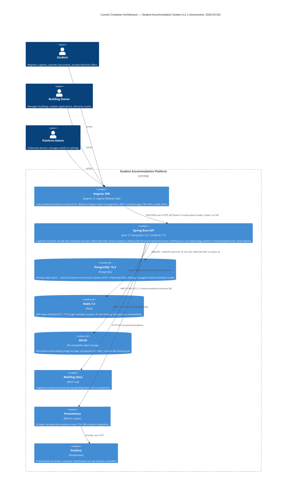
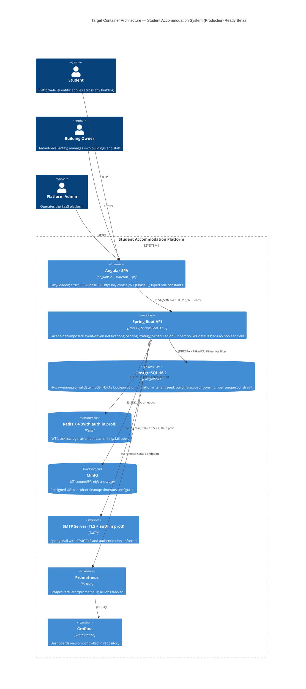
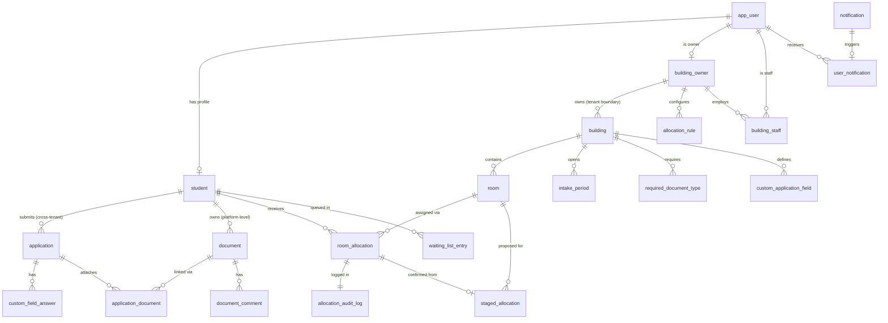
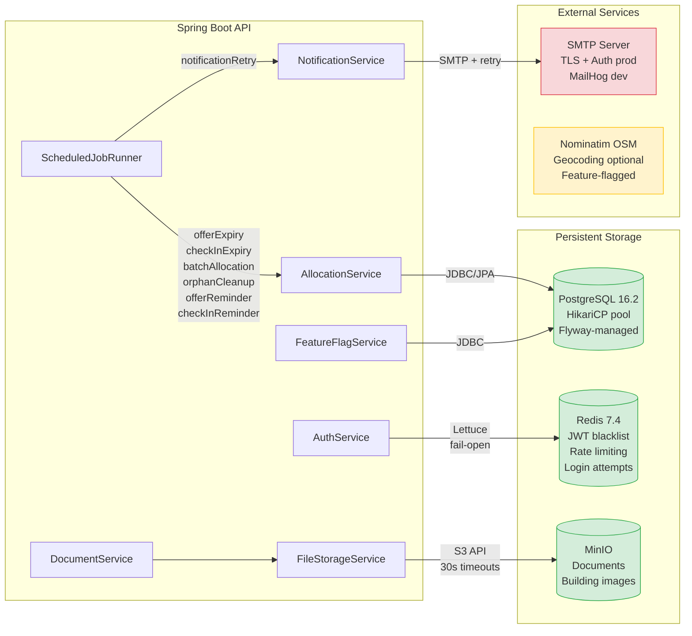
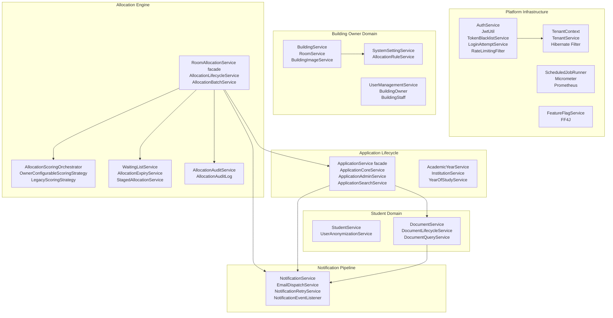

# Technical Stabilisation Document
## Student Accommodation System

### Document Control

| Attribute | Details |
|-----------|---------|
| **Document Title** | Technical Stabilisation Document — Student Accommodation System |
| **Version** | 1.1 |
| **Date** | 2026-03-03 |
| **Author** | Solutions Architect (AI-assisted) |
| **Status** | Draft — Pending Team Review |
| **Input Document** | Requirements.md v2.0 |
| **Previous Version** | v1.0 (2026-02-23) |
| **Codebase Branch Assessed** | `develop` |

---

## 1. Executive Summary

The Student Accommodation System has made **substantial architectural progress** since the v1.0 Technical Stabilisation Document (2026-02-23). All six Phase 1 critical stabilisation items from v1.0 have been resolved: Hibernate DDL auto is now `validate`, Flyway is correctly configured (`out-of-order: false`, `validate-on-migrate: true`), PostgreSQL data is persisted via Docker volume, the scoring engine has been refactored behind a `ScoringStrategy` interface with a configurable v2.0 implementation, scheduled jobs now have full observability (structured logging, Prometheus counters, per-job error containment), and the v2.0 role hierarchy (`PLATFORM_ADMIN > BUILDING_OWNER > BUILDING_STAFF`) is live. Security fundamentals are stronger: Redis-backed JWT blacklisting, IP-based rate limiting on auth endpoints, account lockout via `LoginAttemptService`, and HikariCP pool tuning are all implemented.

The codebase's maturity has advanced from **Alpha** to **Early Beta**. The architectural skeleton is sound. The facade decomposition pattern (ApplicationService, DocumentService, RoomAllocationService), the event-driven notification pipeline (`@TransactionalEventListener` + `@Async`), the Hibernate tenant filter, and the state machine enums with `canTransitionTo()` enforcement are all production-quality patterns. The allocation engine — comprising `AllocationScoringOrchestrator`, `OwnerConfigurableScoringStrategy`, `AllocationBatchService`, and `AllocationLifecycleService` — is the system's most complex domain and is now correctly decomposed, but contains three specific issues requiring targeted remediation.

Three **structural issues remain open** and must be resolved before the platform can scale beyond its first customer. First, `AllocationLifecycleService` still enforces `MAX_DECLINE_COUNT = 2` — a hard-coded v1.1 business rule that conflicts directly with Requirements.md v2.0 requirement OFFER-004 (no decline limit). Second, `getAvailableRoomsForBatch()` performs a full `roomRepository.findAll()` with in-memory capacity filtering — a performance bottleneck that degrades linearly with total room count across all tenants. Third, `confirmBatchAllocationsWithResult()` returns `null` (a developer TODO comment confirms this is unfinished) — a silent contract violation that will cause NPEs in any consumer that acts on the result.

Two **security gaps** remain open: the JWT secret default value in `application.yml` must be removed (application must fail to start without `JWT_SECRET`), and SMTP defaults remain unauthenticated and unencrypted. The frontend presents the largest outstanding structural risk: test coverage is negligible (estimated <5%), Angular services mix business domain logic in unexpected places, and the admin/role guards rely on hardcoded role-name strings that will require coordinated updates as v2.0 roles stabilise.

The implementation roadmap in this document is structured into three phases. Phase 1 addresses the three open structural issues and the two security gaps (all low-to-medium effort, can be delivered in parallel). Phase 2 builds the remaining v2.0 domain model — building owner onboarding, staff permissions, intake periods, per-owner configuration, and platform-level analytics. Phase 3 delivers performance hardening, frontend test coverage baseline, Lighthouse CI integration, and operational readiness gates before the first production tenant is onboarded.

---

## 2. Current Architecture Assessment

### 2.1 Architecture Overview

The system is a **layered monolith** — a single Spring Boot application serving an Angular SPA via REST, with PostgreSQL as the primary data store, MinIO for object storage, Redis for token blacklisting and rate limiting, and SMTP for email notifications. All services are containerised and orchestrated via Docker Compose with persistent volumes and a Prometheus/Grafana observability stack.



**Key Architecture Characteristics:**

| Characteristic | Current Implementation |
|---------------|----------------------|
| **Pattern** | Layered monolith with facade decomposition: `ApplicationService`, `RoomAllocationService`, `DocumentService` are public facades delegating to package-internal sub-services |
| **Multi-tenancy** | Shared schema with `tenant_id` FK; Hibernate `@Filter("tenantFilter")` activated per-request via `TenantFilterConfig`; `TenantContext` ThreadLocal populated from JWT claim |
| **Student scope** | Students use `PLATFORM_TENANT_ID = 0L` sentinel — bypasses tenant filter, allowing cross-tenant building applications |
| **Async/events** | `@TransactionalEventListener(AFTER_COMMIT)` + `@Async("notificationExecutor")` for all notification side-effects; TenantContext propagated into async threads |
| **Scheduled jobs** | `ScheduledJobRunner` owns all `@Scheduled` annotations; each job wrapped in try/catch with structured logging and Prometheus counters; 6 jobs total |
| **Security** | JWT (JJWT 0.12.6); BCrypt strength 12; Redis blacklist; rate limiting (10 req/min on /api/auth/**); account lockout (5 failures, 15-min); role hierarchy PLATFORM_ADMIN > BUILDING_OWNER > BUILDING_STAFF |
| **Observability** | Micrometer → Prometheus → Grafana; `logstash-logback-encoder` structured JSON; `@Timed` on allocation/application service methods; custom health indicators (MinIO, SMTP) |
| **Schema management** | Flyway sole schema manager (16 migrations); `hbm2ddl.auto: validate`; `out-of-order: false`; `validate-on-migrate: true` |

---

### 2.2 Component Health Matrix

| Component | Coupling | Complexity | Test Coverage | Fragility | Performance Risk | Security Risk | Overall Health |
|-----------|----------|------------|---------------|-----------|-----------------|--------------|----------------|
| `RoomAllocationService` (facade) | Low | Low | Medium | Low | Low | Low | ✅ |
| `AllocationLifecycleService` | Medium | HIGH | Medium | ⚠️ Decline limit conflict | Low | Low | ⚠️ |
| `AllocationBatchService` | Medium | HIGH | Medium | ⚠️ Null return method | 🔴 findAll() in loop | Low | 🔴 |
| `AllocationScoringOrchestrator` | Low | Medium | Low | Low | Low | Low | ⚠️ |
| `OwnerConfigurableScoringStrategy` | Low | Medium | Medium | ⚠️ NSFAS keyword match | Low | Low | ⚠️ |
| `LegacyScoringStrategy` | Low | Low | High | Low | Low | Low | ✅ |
| `AllocationExpiryService` | Low | Low | Medium | Low | ✅ Partial index | Low | ✅ |
| `StagedAllocationService` | Medium | HIGH | Low | Low | Low | Low | ⚠️ |
| `ApplicationService` (facade) | Low | Low | High | Low | Low | Low | ✅ |
| `ApplicationCoreService` | Medium | Medium | Medium | Low | Low | Low | ✅ |
| `DocumentService` (facade) | Low | Low | Medium | Low | Low | Low | ✅ |
| `DocumentLifecycleService` | Medium | Medium | Medium | Low | Low | Low | ✅ |
| `NotificationEventListener` | Medium | HIGH | Low | Low | Low | Low | ⚠️ |
| `NotificationRetryService` | Low | Low | Low | 🔴 Deferred (no @Scheduled) | Low | Low | 🔴 |
| `TokenBlacklistService` | Low | Low | Medium | Low | Low | ✅ | ✅ |
| `LoginAttemptService` | Low | Low | Medium | Low | Low | ✅ | ✅ |
| `RateLimitingFilter` | Low | Low | Low | Low | Low | ✅ | ✅ |
| `ScheduledJobRunner` | Low | Low | Medium | Low | Low | Low | ✅ |
| `TenantContext` + Hibernate Filter | Low | Low | Medium | Low | Low | Medium | ✅ |
| `AuthService` | Medium | Medium | High | Low | Low | 🔴 JWT default secret | ⚠️ |
| `SecurityConfig` | Low | Medium | Medium | Low | Low | ⚠️ CSP unsafe-inline | ⚠️ |
| `FeatureFlagService` / FF4J 1.9 | Low | Low | Low | Low | Low | Low | ⚠️ (stale dependency) |
| Angular frontend — test coverage | — | Medium | 🔴 <5% | Medium | — | ⚠️ localStorage JWT | 🔴 |
| Schema: `app_user.tenant_id` sentinel | — | — | — | ⚠️ Platform tenantId=0 | — | — | ⚠️ |
| JWT secret default value | — | — | — | 🔴 Hardcoded fallback | — | 🔴 | 🔴 |
| SMTP auth/TLS defaults | — | — | — | — | — | 🔴 PRODUCTION risk | 🔴 |
| `confirmBatchAllocationsWithResult` | — | — | — | 🔴 Returns null | — | — | 🔴 |

**Rating Scale:** ✅ Healthy | ⚠️ Monitor | 🔴 Action Required

---

### 2.3 Fragile Components Analysis

#### 2.3.1 `AllocationBatchService.getAvailableRoomsForBatch()` — Full Table Scan

- **What:** Retrieves all available rooms for the batch allocation job
- **Fragility:** `roomRepository.findAll()` loads **every room** across **every tenant** into memory, then iterates to count active allocations per room via `roomAllocationRepository.countActiveAllocationsByRoomId(room.getId())` — one additional query per room. This is an O(n) memory allocation + O(n) database round-trips pattern that will degrade linearly as total rooms across the platform grow. A platform with 100 buildings × 30 rooms each = 3,000 queries per allocation batch run.
- **Blast Radius:** Batch allocation job performance; HikariCP connection exhaustion under concurrent batch runs; increased PostgreSQL query load. If the platform grows to 10+ tenants, this becomes a measurable production performance issue.
- **Evidence:** `AllocationScoringOrchestrator.getAvailableRoomsForBatch()` line: `List<Room> allRooms = roomRepository.findAll()`. No pagination, no tenant filter scoping, no JOIN with occupancy count.
- **Remediation:** Replace with a native query: `SELECT r.* FROM room r WHERE r.is_available = true AND (SELECT COUNT(*) FROM room_allocation ra WHERE ra.room_id = r.id AND ra.status IN ('OFFERED','ACCEPTED','ACTIVE')) < r.capacity`. Add index `idx_room_available` on `(is_available, capacity)` if not present. Alternatively use a `@Query` JPQL with `COUNT` subquery that returns only eligible rooms in one database round-trip.

#### 2.3.2 `AllocationBatchService.confirmBatchAllocationsWithResult()` — Null Return

- **What:** A batch confirmation method that is supposed to return batch statistics
- **Fragility:** The method body contains only a developer TODO comment and `return null`. Any controller or service that calls this method and attempts to use the result (e.g., log success count, return HTTP response body) will throw a `NullPointerException`. The `@Transactional` annotation is present but the method does nothing — it appears to be an incomplete refactoring.
- **Blast Radius:** Any endpoint that calls `confirmBatchAllocationsWithResult()` will 500 in production. The `StagedAllocationController` may be exposing this as an HTTP endpoint.
- **Evidence:** `AllocationBatchService.confirmBatchAllocationsWithResult()` — method returns `null` with no implementation.
- **Remediation:** Either complete the implementation (delegate to `StagedAllocationService.confirmBatchAllocations()` and return a constructed `BatchConfirmationResult`) or remove the method and update callers to use `confirmBatchAllocations()` directly. Must be resolved before this endpoint is exercised in testing or production.

#### 2.3.3 `AllocationLifecycleService` — `MAX_DECLINE_COUNT` Business Rule Conflict

- **What:** Enforces a maximum of 2 declines per student before automatically cancelling their application
- **Fragility:** Requirements.md v2.0, OFFER-004 explicitly states: *"No decline limit — student can decline offers. The one-active-offer rule manages abuse."* The v1.1 `MAX_DECLINE_COUNT = 2` logic in `AllocationLifecycleService` is a direct conflict: students who decline 2 offers — a normal behaviour in the v2.0 model — will have their applications automatically cancelled. This constitutes a **silent product bug**: the system behaves in a way that contradicts the documented product requirements without any visible error.
- **Blast Radius:** Any student who declines two offers across the platform has their application cancelled — they must re-apply. This undermines the one-active-offer design and degrades student experience.
- **Evidence:** `AllocationLifecycleService` — `MAX_DECLINE_COUNT` constant and the `declineOffer()` method that uses it.
- **Remediation:** Remove `MAX_DECLINE_COUNT` guard from `declineOffer()`. Application should return to `AWAITING_ALLOCATION` (waiting list) on every decline, not cancel after 2. The one-active-offer rule (OFFER-002) is the abuse prevention mechanism per v2.0 requirements.

#### 2.3.4 `OwnerConfigurableScoringStrategy` — NSFAS Detection via Keyword Matching

- **What:** Determines NSFAS priority bonus by checking if `application.getSpecialRequirements()` contains the text "nsfas" or "bursary"
- **Fragility:** This is a freetext keyword match on a user-entered field. It is brittle, inconsistent, and susceptible to false positives/negatives. A student who types "NSFAS bursary approved" gets the bonus; a student who types "I am funded by NSFAS" may not if the logic is case-sensitive. Additionally, "bursary" is a generic term that includes non-NSFAS funding.
- **Blast Radius:** Allocation scoring decisions — incorrect NSFAS priority scoring affects which students receive rooms first.
- **Evidence:** `OwnerConfigurableScoringStrategy` — NSFAS detection in special requirements freetext field.
- **Remediation:** Add a dedicated `boolean nsfasFunded` boolean field to the `Application` entity (and student profile). Surface this as a structured field in the application form. Remove keyword matching. This aligns with the data model requirement in Requirements.md (ALLOC-003).

#### 2.3.5 `NotificationRetryService` — No Active Schedule

- **What:** The notification retry service exists but its `@Scheduled` annotation is intentionally absent
- **Fragility:** Comments in `ScheduledJobRunner` state that `NotificationRetryService.retryFailedNotifications()` is *"deferred to Phase 3 pending full retry-logic implementation"*. This means PERMANENTLY_FAILED notifications are never retried. The retry mechanism is a MUST requirement (NOTIF-003): *"Maximum 3 retry attempts; after 3 failures → PERMANENTLY_FAILED, Platform Admin alerted."* The service may exist, but without a schedule it does nothing. Emails that fail on first attempt due to transient SMTP issues will never be delivered.
- **Blast Radius:** Critical event notifications (room offers, document verification, application decisions) may silently fail to reach students and owners. No alerting exists to surface this.
- **Evidence:** `ScheduledJobRunner` comment: *"NotificationRetryService.retryFailedNotifications() is intentionally omitted."* No `@Scheduled` on the retry method.
- **Remediation:** Complete the retry logic in `NotificationRetryService`. Add it to `ScheduledJobRunner` with the 5-minute interval. Ensure retry is idempotent (check status before sending, mark SENDING to prevent concurrent retries). Add Platform Admin alert after 3 failures (an in-app `user_notification` to PLATFORM_ADMIN users is sufficient for MVP).

#### 2.3.6 JWT Secret Default Value

- **What:** `application.yml` contains a hardcoded base64 fallback: `secret: ${JWT_SECRET:jvc+...}`
- **Fragility:** If the `JWT_SECRET` environment variable is not set in a deployment environment, the application starts using a publicly-known default secret. All JWT tokens can be forged by anyone who has read this codebase. The v1.0 assessment identified this as HIGH severity; it remains unresolved.
- **Blast Radius:** Complete JWT authentication bypass in any deployment without `JWT_SECRET` set. An attacker can issue valid tokens for any user or role.
- **Evidence:** `application.yml` line 72: `secret: ${JWT_SECRET:jvc+QC/0myyJ9+//...}`
- **Remediation:** Remove the default value entirely. Use `${JWT_SECRET}` — Spring Boot will throw a `IllegalArgumentException` at startup if the env var is absent. Document this in `.env.example` and deployment runbook as a required secret.

---

### 2.4 Tight Coupling Analysis

```mermaid
graph LR
  subgraph "Allocation Domain"
    RAS[RoomAllocationService\nfacade] --> ALS[AllocationLifecycleService]
    RAS --> ABS[AllocationBatchService]
    RAS --> ACS[AllocationCheckInService]
    RAS --> AES[AllocationExpiryService]
    RAS --> WLS[WaitingListService]
    RAS --> AuditS[AllocationAuditService]
    RAS --> RAQS[RoomAllocationQueryService]
    ABS --> ASO[AllocationScoringOrchestrator]
    ASO --> SS[ScoringStrategy interface]
    SS --> OCS[OwnerConfigurableScoringStrategy\n@Primary]
    SS --> LSS[LegacyScoringStrategy]
    ABS --> SAS[StagedAllocationService]
    ALS -.->|@TransactionalEventListener| NEL[NotificationEventListener]
    ACS -.->|@TransactionalEventListener| NEL
    AES -.->|@TransactionalEventListener| NEL
  end

  subgraph "Application Domain"
    AppS[ApplicationService\nfacade] --> AppCore[ApplicationCoreService]
    AppS --> AppAdmin[ApplicationAdminService]
    AppS --> AppSearch[ApplicationSearchService]
    AppS --> AppDoc[ApplicationDocumentService]
    AppS --> AppQuery[ApplicationQueryService]
    AppAdmin -.->|@TransactionalEventListener| NEL
    AppCore -.->|@TransactionalEventListener| NEL
  end

  subgraph "Document Domain"
    DocS[DocumentService\nfacade] --> DocLife[DocumentLifecycleService]
    DocS --> DocQuery[DocumentQueryService]
    DocS --> DocStatus[DocumentStatusService]
    DocStatus -.->|@TransactionalEventListener| NEL
  end

  subgraph "Identity & Security"
    AuthS[AuthService] -.->|@TransactionalEventListener| NEL
    AuthS --> TBL[TokenBlacklistService]
    AuthS --> LAS[LoginAttemptService]
    JAIF[JwtAuthenticationFilter] --> TBL
    JAIF --> TenantCtx[TenantContext\nThreadLocal]
    RLF[RateLimitingFilter] --> LAS
  end

  subgraph "Scheduling"
    SJR[ScheduledJobRunner] --> ABS
    SJR --> AES
    SJR --> OFC[OrphanFileCleanupJob]
    SJR --> ORS[OfferReminderService]
    SJR --> CIRS[CheckInReminderService]
  end

  NEL -->|@Async notificationExecutor| EDS[EmailDispatchService]
  ALS -.->|cross-domain: mutates application status| AppS
```

**Remaining Coupling Concerns:**

| Coupling | Issue | Severity | Remedy |
|----------|-------|----------|--------|
| `AllocationLifecycleService → ApplicationService` | Allocation lifecycle directly calls `ApplicationService` to mutate application status — a cross-domain write dependency | Medium | Already partially decoupled via events; verify the direct call path is fully replaced by `AllocationStatusChangedEvent` |
| `AllocationBatchService → StagedAllocationService` | `AllocationBatchService` delegates staged allocation operations to `StagedAllocationService` but also owns the `confirmBatchAllocationsWithResult` method that's incomplete. Mixed responsibilities. | Low | Move `confirmBatchAllocationsWithResult` into `StagedAllocationService`; `AllocationBatchService` should only orchestrate batch scoring and execution |
| `NotificationEventListener` — 531 lines, 10 event handlers | Single class handling all 10 notification event types. High complexity, low testability, hard to maintain independently | Medium | Split into domain-scoped listeners: `AllocationNotificationListener`, `ApplicationNotificationListener`, `DocumentNotificationListener` |
| Angular `auth.service.ts` — mixed concerns | Auth service contains business-domain operations: document upload, application submission | Medium | Extract to `document.service.ts` and `application.service.ts` |

---

### 2.5 Performance Bottleneck Analysis

| # | Area | Current State | Risk | Impact | Recommendation |
|---|------|--------------|------|--------|----------------|
| PB-001 | `getAvailableRoomsForBatch()` full scan | `roomRepository.findAll()` loads all rooms; N+1 capacity count queries | 🔴 HIGH | 3,000+ queries at 100 buildings × 30 rooms | Replace with a single JOIN query returning only available rooms with capacity |
| PB-002 | `getWaitingListWithScores()` per-entry scoring | Scores every waiting list entry individually in a loop; re-fetches rooms per iteration | Medium | Slow admin dashboard load as waiting list grows | Batch-score the waiting list; cache intermediate scoring matrix |
| PB-003 | Async thread pool — notification bursts | `notificationExecutor`: core 10, max 20, queue 500; `CallerRunsPolicy` on overflow | Low | Queue fills during mass notifications (e.g., building announcement to all residents); caller thread blocks | Monitor `sas.async.queue.size` gauge; increase max-pool to 50 if queue regularly exceeds 80% |
| PB-004 | HikariCP at max 25 under load | 500 concurrent users target; 25 max connections | Medium | Connection starvation during concurrent application submissions | Load test at target concurrency; tune pool if P99 latency degrades |
| PB-005 | Batch allocation transaction scope | Each allocation pair executes in its own `TransactionTemplate` — N transactions for N pairs | Low | Overhead of transaction begin/commit per pair; acceptable for batch-size 50 | Monitor batch duration via `sas.batch.allocation.duration` Prometheus metric |
| PB-006 | No load test baseline | No performance test has been run; 500ms P95 NFR is unverified | 🔴 Unknown | Cannot validate NFRs or detect regressions | Run JMeter/Gatling load test at 500 concurrent users before first production tenant |
| PB-007 | Frontend — no performance baseline | No Lighthouse CI, no bundle size tracking | Medium | Initial load time NFR (<3s on 3G) is unverified | Add Lighthouse CI to GitHub Actions; set performance budget |

---

### 2.6 Integration Risk Analysis

| Integration | Availability Risk | Failure Isolation | Retry Strategy | Timeout Config | Data Consistency Risk | Security | Overall Risk |
|-------------|-----------------|-------------------|---------------|----------------|----------------------|----------|-------------|
| PostgreSQL | LOW — critical | N/A (hard fail) | HikariCP reconnect | `connection-timeout: 30s` ✅ | ACID + optimistic locking + Flyway ✅ | Env var credentials ✅ | LOW |
| MinIO | MEDIUM | ✅ Isolated in FileStorageService | OrphanFileCleanupJob recovers orphans ✅ | `connect: 30s`, `read: 30s`, `write: 30s` ✅ | Upload success + DB record failure = orphan; cleanup job handles | Access key via env var ✅ | MEDIUM |
| Redis | LOW | ✅ Full fail-open; `TokenBlacklistService` and `LoginAttemptService` swallow exceptions | N/A (ephemeral) | `timeout: 60s` (Lettuce) ✅ | Fail-open: blacklisted token not revoked if Redis down | ⚠️ No Redis auth in dev; require `REDIS_PASSWORD` in production | LOW |
| SMTP | MEDIUM — async retry mitigates | ✅ Email failure never blocks API response | 🔴 Retry service deferred (Phase 3) | Not configured in Spring Mail | After retry failure → PERMANENTLY_FAILED (no alert) | 🔴 No TLS, no auth in defaults — CRITICAL for production | 🔴 HIGH in production |
| FF4J | LOW — in-process | N/A | N/A | N/A | Immediate flag changes | JDBC credential reuse from main datasource ✅ | LOW |
| Nominatim (OSM geocoding) | LOW — feature-flagged | ✅ Geocoding failure → building saved without coordinates | 🔴 No retry | 🔴 No timeout configured | No consistency risk (enrichment only) | No API key required | LOW |

---

### 2.7 Security Assessment

| # | Concern | Current State | Gap | Severity | Recommendation |
|---|---------|---------------|-----|----------|----------------|
| SEC-001 | JWT secret default value | `${JWT_SECRET:jvc+...}` fallback in `application.yml` | Known default used if env var absent → JWT forgery possible | 🔴 CRITICAL | Remove default; fail startup if absent. Add startup validation in `JwtConfig` |
| SEC-002 | SMTP transport security | `starttls.enable: ${MAIL_STARTTLS_ENABLE:false}`, `smtp.auth: ${MAIL_SMTP_AUTH:false}` defaults | Dev defaults are unsafe; production deployment must explicitly set env vars | 🔴 CRITICAL | Document `MAIL_STARTTLS_ENABLE=true` and `MAIL_SMTP_AUTH=true` as required for production in `.env.example` and deployment runbook |
| SEC-003 | CSP `unsafe-inline` | SecurityConfig: `script-src 'self' 'unsafe-inline'` | XSS payloads can execute via inline scripts | Medium | Move to nonce-based CSP (Spring Security supports this); defer to Phase 3 given Angular 21 may require adaptation |
| SEC-004 | JWT fail-open on Redis down | `TokenBlacklistService.isBlacklisted()` returns `false` when Redis unavailable | Revoked tokens remain valid during Redis outage | Medium | Document policy; add Grafana alert on Redis connection failure; acceptable for MVP |
| SEC-005 | Frontend localStorage JWT | JWT stored in `localStorage` | XSS can exfiltrate token | Medium | Acceptable for MVP single-customer. Phase 3: evaluate `HttpOnly` cookie + CSRF token |
| SEC-006 | Frontend admin guard — role name check | Angular guards use role-name string comparison | Brittle; must be updated when v2.0 role names stabilise in frontend | Low | Centralise role checks in `AuthService` with typed constants; update guards |
| SEC-007 | No Redis auth in development | `docker-compose.yml` Redis has no password | Dev Redis is open; acceptable for local development | Low | Add `REDIS_PASSWORD` to production `.env.example` |
| SEC-008 | Tenant isolation — student PLATFORM sentinel | Students use `tenant_id = 0` sentinel to bypass filter | The sentinel is a convention, not a schema constraint. Any code that forgets to set `TenantContext` for a student will silently scope to tenant 0 or leak | Medium | Add a `TenantFilterIntegrationTest` for each new entity; enforce in PR checklist |
| SEC-009 | `@Deprecated` ADMIN/LANDLORD roles still functional | `UserRole` has `@Deprecated ADMIN` and `LANDLORD` | Old tokens with deprecated roles will still authenticate during migration window | Low | Set a migration deadline; remove deprecated roles in Flyway migration after all tokens have expired (10h TTL) |

---

## 3. Recovery Architecture Plan

### 3.1 Classification Summary

| Component / Concern | Classification | Priority | Effort | Risk |
|--------------------|---------------|----------|--------|------|
| JWT secret default value | **Must Refactor** | 🔴 P1 | Low | Low |
| SMTP production security | **Must Refactor** | 🔴 P1 | Low | Low |
| `MAX_DECLINE_COUNT` removal | **Must Refactor** | 🔴 P1 | Low | Low |
| `getAvailableRoomsForBatch()` N+1 | **Must Refactor** | 🔴 P1 | Low | Low |
| `confirmBatchAllocationsWithResult` null return | **Must Refactor** | 🔴 P1 | Low | Low |
| `NotificationRetryService` activation | **Must Refactor** | 🔴 P1 | Medium | Low |
| NSFAS boolean field on Application | **Must Refactor** | P2 | Medium | Low |
| `NotificationEventListener` split | **Must Refactor** | P2 | Medium | Low |
| Frontend Angular test baseline | **Must Refactor** | P2 | HIGH | Low |
| Lighthouse CI integration | **Must Refactor** | P2 | Medium | Low |
| Load test baseline | **Must Refactor** | P2 | Medium | Low |
| Grafana dashboards version-controlled | **Must Refactor** | P2 | Medium | Low |
| Scoring Strategy v2.0 (FCFS, university, NSFAS, accessibility) | **Can Remain** | — | — | — |
| `ScoringStrategy` interface + dual implementations | **Can Remain** | — | — | — |
| Facade pattern (RAS, AppS, DocS) | **Can Remain** | — | — | — |
| State machine enums with `canTransitionTo()` | **Can Remain** | — | — | — |
| `TokenBlacklistService` (Redis, fail-open) | **Can Remain** | — | — | — |
| `LoginAttemptService` (Redis, 5 attempts, 15-min lockout) | **Can Remain** | — | — | — |
| `RateLimitingFilter` (10 req/min on /api/auth/**) | **Can Remain** | — | — | — |
| `TenantContext` + Hibernate filter | **Can Remain** | — | — | — |
| `ScheduledJobRunner` observability pattern | **Can Remain** | — | — | — |
| Prometheus / Grafana / Micrometer stack | **Can Remain** | — | — | — |
| MapStruct mappers | **Can Remain** | — | — | — |
| AOP `@LogActivity` aspect | **Can Remain** | — | — | — |
| Flyway migration strategy | **Can Remain** | — | — | — |
| `AllocationLifecycleService → ApplicationService` cross-domain call | **Must Isolate** | P2 | Medium | Low |
| `NotificationEventListener` (monolithic 531 lines) | **Must Isolate** | P2 | Medium | Low |
| CSP `unsafe-inline` | **Too Risky to Touch Now** | P3 | Medium | Medium |
| FF4J 1.9 (2020 release, outdated) | **Too Risky to Touch Now** | P3 | Medium | Medium |
| Frontend localStorage JWT storage | **Too Risky to Touch Now** | P3 | Medium | Low |
| `@Deprecated ADMIN/LANDLORD` role removal | **Too Risky to Touch Now** | P3 | Low | Low |

---

### 3.2 Must Refactor

#### 3.2.1 JWT Secret Default Value Removal
- **Current State:** `application.yml` provides a known base64 default for `JWT_SECRET`
- **Target State:** Application fails at startup with a clear error if `JWT_SECRET` is not set
- **Approach:** Remove the default value from `application.yml`. Add a `@PostConstruct` validation in `JwtConfig` that throws `IllegalStateException` if the secret is shorter than 32 bytes. Update `.env.example` to document the requirement.
- **Risks During Refactoring:** Deployments without the env var set will fail to start — this is the intended behaviour. Ensure all environments (dev, CI, staging) have `JWT_SECRET` set before deploying.
- **Acceptance Criteria:** Application startup fails with a readable error when `JWT_SECRET` is absent. Startup succeeds when a valid secret is provided. The default value does not appear anywhere in version-controlled files.

#### 3.2.2 `MAX_DECLINE_COUNT` Removal
- **Current State:** `AllocationLifecycleService.declineOffer()` cancels the application after 2 declines
- **Target State:** Every decline returns the application to `AWAITING_ALLOCATION`; no cancellation on decline
- **Approach:** Remove the `MAX_DECLINE_COUNT` constant and the conditional that checks it. In `declineOffer()`, always transition application to `AWAITING_ALLOCATION` and re-add to waiting list. Add a unit test verifying that declining 3+ times does not cancel the application.
- **Risks During Refactoring:** Existing applications with 2 declines that were previously cancelled will not be retroactively re-opened. Acceptable — forward-only change.
- **Acceptance Criteria:** Declining an offer returns application to `AWAITING_ALLOCATION` regardless of how many times the student has previously declined. No application is ever cancelled by the system as a consequence of declining an offer.

#### 3.2.3 `getAvailableRoomsForBatch()` Query Optimisation
- **Current State:** `roomRepository.findAll()` + per-room `COUNT` queries
- **Target State:** Single database query returning only rooms with available capacity
- **Approach:** Add a `@Query` to `RoomRepository`: `SELECT r FROM Room r WHERE r.isAvailable = true AND (SELECT COUNT(ra) FROM RoomAllocation ra WHERE ra.room = r AND ra.status IN ('OFFERED','ACCEPTED','ACTIVE')) < r.capacity`. Replace the method body in `AllocationScoringOrchestrator`.
- **Risks During Refactoring:** Query logic must match the existing capacity check exactly. Write an integration test comparing results of old and new implementations against a known data set before switching.
- **Acceptance Criteria:** `getAvailableRoomsForBatch()` executes a single database query. Response time of the batch allocation run does not increase. Integration test confirms returned rooms match expected available set.

#### 3.2.4 `confirmBatchAllocationsWithResult()` Completion
- **Current State:** Returns `null` — unfinished implementation with TODO comments
- **Target State:** Either correctly implemented or removed
- **Approach (recommended):** Move the method to `StagedAllocationService`. Implement by calling `confirmBatchAllocations(batchId, adminId)` and querying the results. Remove the method from `AllocationBatchService`. Update `StagedAllocationController` to call the service directly.
- **Acceptance Criteria:** No method in the codebase returns `null` by design without explicit null documentation. All callers of the batch confirmation endpoint receive a valid, non-null response.

#### 3.2.5 `NotificationRetryService` Activation
- **Current State:** Service exists but has no `@Scheduled` annotation; retry never fires
- **Target State:** Failed notifications retried on 5-minute interval; PERMANENTLY_FAILED notifications trigger Platform Admin alert
- **Approach:** Complete the retry logic (fetch `status = 'FAILED' AND attempt_count < 3`; update status to `RETRYING`; attempt send; update to `SENT` or increment count; mark `PERMANENTLY_FAILED` after 3). Add to `ScheduledJobRunner` with the standard observability wrapper. Add Platform Admin in-app notification on `PERMANENTLY_FAILED`.
- **Acceptance Criteria:** A notification that fails on first attempt is retried within 5 minutes. After 3 failures the status is `PERMANENTLY_FAILED` and a Platform Admin user_notification is created. The retry job is tracked in Prometheus (`sas.jobs.notificationRetry.processed`).

---

### 3.3 Can Remain

| Component | Why Acceptable | Trigger for Future Refactoring | Monitoring |
|-----------|---------------|-------------------------------|------------|
| `ScoringStrategy` interface + dual implementations | Strategy pattern correctly isolates v1.1 and v2.0 scoring; easily extensible | Third scoring variant needed | Unit tests on both strategies |
| Facade pattern (RAS, AppS, DocS) | Decomposition is working; callers are shielded from internal changes | Any facade exceeds 20 methods or 300 lines | PR review line count check |
| State machine enums with `canTransitionTo()` | Transition logic is centralised, tested, and correct for both application and allocation status | New state or transition added | Unit tests for all valid/invalid transitions |
| `TenantContext` + Hibernate filter | Pattern is correct and well-understood; PLATFORM_TENANT_ID sentinel for students is a clean workaround | True per-schema multi-tenancy required | Integration test per new entity |
| `ScheduledJobRunner` observability | Centralised scheduling with per-job error containment and Prometheus metrics is production-quality | More than 10 jobs (consider Quartz) | Grafana job health dashboard |
| `TokenBlacklistService` / `LoginAttemptService` | Redis-backed, fail-open, graceful — correct pattern | Significant authentication load increase | Redis memory usage alert |
| MapStruct mappers | Compile-time generated, type-safe — no runtime cost | N/A | Compiler warnings on unmapped fields |
| Flyway migration strategy | 16 migrations; validate mode; out-of-order: false; naming convention enforced | N/A | Flyway migration failures in startup logs |

---

### 3.4 Must Isolate

#### 3.4.1 `AllocationLifecycleService → ApplicationService` Cross-Domain Call
- **Current State:** Allocation lifecycle directly calls ApplicationService to mutate application status — a cross-domain write coupling that creates a hidden dependency chain
- **Isolation Boundary:** Events (`AllocationStatusChangedEvent`) that `ApplicationService` subscribes to via `@TransactionalEventListener`
- **Containment Strategy:** Verify that no direct service-to-service calls for status mutation remain; replace any remaining with events. Add an architectural test (ArchUnit rule) that forbids `allocation.*` packages from importing `application.*` service classes directly.
- **Long-Term Plan:** Retain event-driven decoupling; as domains grow, consider Spring's ApplicationEventPublisher as the only permitted cross-domain communication channel

#### 3.4.2 `NotificationEventListener` — Split by Domain
- **Current State:** Single 531-line class handles 10 distinct event types across all domains
- **Isolation Boundary:** Split into `AllocationNotificationListener`, `ApplicationNotificationListener`, `DocumentNotificationListener`, `AuthNotificationListener`
- **Containment Strategy:** Each listener handles only its domain's events; all delegate to `EmailDispatchService` for the actual send
- **Long-Term Plan:** If notification volume grows (WhatsApp, SMS), each listener can independently adopt different dispatch strategies without affecting others

---

### 3.5 Too Risky to Touch Now

| Component | Why Too Risky | Conditions to Reassess | Compensating Controls |
|-----------|---------------|----------------------|----------------------|
| CSP `unsafe-inline` | Angular 21 may rely on inline styles/scripts; removing it without testing could break the UI in subtle ways | When Angular updates to support strict CSP natively | Rely on Angular's built-in XSS sanitization; do not allow user-generated HTML rendering |
| FF4J 1.9 (2020) | No breaking change is needed now; upgrade path requires testing all feature flag behaviour | When a security CVE is found in FF4J or when Spring Boot 4 requires it | Pin the version; monitor the FF4J GitHub for CVE announcements |
| Frontend localStorage JWT | Switching to `HttpOnly` cookies requires backend changes (cookie issuance, CSRF protection) and frontend changes; scope is significant | When a second customer is onboarded (increased XSS risk surface) | Enforce HTTPS everywhere; rely on Angular's HTML sanitization; keep JWT expiry short (4h admin, 10h student) |
| `@Deprecated ADMIN/LANDLORD` role cleanup | Active tokens may still carry these roles; removing from security config before all tokens expire causes 401s for legitimate users | After maximum token TTL (10h) has elapsed post-migration OR after a forced re-login event | Keep deprecated roles in hierarchy; log their usage; monitor via Prometheus if any deprecated-role requests are observed |

---

## 4. Target Architecture

### 4.1 Architecture Principles

1. **Tenant isolation is non-negotiable** — Every new entity that holds tenant-scoped data must implement `TenantAware`, carry the Hibernate `@Filter`, and have a corresponding integration test verifying tenant isolation.
2. **Events, not direct calls, for cross-domain state mutation** — No service in the allocation domain may directly call a method in the application or document domain to change their state. Events are the permitted channel.
3. **Fail loudly on missing secrets** — Applications must not start with default secret values. All secrets (JWT, MinIO, SMTP, database) must be provided via environment variables with no fallback.
4. **Schema changes via Flyway only** — `hbm2ddl.auto: validate` is the law. No entity annotations cause schema changes in production. Every schema change has a Flyway migration file.
5. **Facade-first service design** — Each business domain exposes a single public facade (`ApplicationService`, `DocumentService`, `RoomAllocationService`). Internal sub-services are package-private where possible. Controllers import only facades.
6. **Observability on every scheduled job** — Every `@Scheduled` method lives in `ScheduledJobRunner`, is wrapped in try/catch, emits structured log entries, and increments Prometheus counters on completion and failure.
7. **Score, don't hardcode** — All allocation scoring weights and rules are owner-configurable and stored in `allocation_rule`. No scoring constants are hardcoded in business logic classes.
8. **State machines are the only gates** — Application status and allocation status transitions must only be permitted via `canTransitionTo()` checks. No code may set a status field directly without validating the transition.
9. **Tests before tenants** — No production tenant is onboarded until load testing validates the P95 < 500ms NFR and the frontend Lighthouse score meets the < 3s initial load target.
10. **Two-year horizon** — Every design decision is evaluated against a platform with 100 building owners, 10,000 students, and 50,000 applications per year.

---

### 4.2 Target Component Architecture



---

### 4.3 Domain Boundaries

| Domain | Packages | Key Services | Key Entities | External Dependencies |
|--------|----------|-------------|-------------|----------------------|
| Identity & Security | `security.*`, `service/AuthService`, `service/TokenBlacklistService`, `service/LoginAttemptService` | AuthService, JwtUtil, TokenBlacklistService, LoginAttemptService | AppUser, EmailVerificationToken, PasswordResetToken | Redis, BCrypt, JJWT |
| Tenant Management | `service/tenant.*`, `model/entity/Tenant` | TenantService | Tenant, TenantAware | HibernateFilter |
| Building & Room | `service/BuildingService`, `service/RoomService`, `service/BuildingImageService` | BuildingService, RoomService | Building, Room, BuildingImage, BuildingAttributes, RoomAttributes | MinIO |
| Student Profile | `service/StudentService`, `service/UserManagementService` | StudentService, UserManagementService, UserAnonymizationService | Student, AppUser, YearOfStudy, Institution | — |
| Application Lifecycle | `service/application.*` | ApplicationService (facade), ApplicationCoreService, ApplicationAdminService, ApplicationSearchService | Application, CustomApplicationField, CustomFieldAnswer, IntakePeriod | Events |
| Document Management | `service/document.*` | DocumentService (facade), DocumentLifecycleService, DocumentQueryService | Document, DocumentType, DocumentComment, ApplicationDocument, RequiredDocumentType | MinIO |
| Allocation Engine | `service/allocation.*` | RoomAllocationService (facade), AllocationLifecycleService, AllocationBatchService, AllocationScoringOrchestrator, ScoringStrategy | RoomAllocation, StagedAllocation, WaitingListEntry, AllocationRule, AllocationAuditLog | Events, Scheduler |
| Notification | `service/notification.*`, `model/event/*` | NotificationService, EmailDispatchService, NotificationRetryService, NotificationEventListener | Notification, UserNotification | SMTP |
| Scheduling | `service/ScheduledJobRunner` | ScheduledJobRunner, OrphanFileCleanupJob | — | Prometheus |
| Observability | `config/health.*`, Micrometer, Logback | MinioHealthIndicator, SmtpHealthIndicator | — | Prometheus, Grafana |
| Feature Flags | `service/FeatureFlagService`, `config/FF4jConfig` | FF4JFeatureFlagService | — | FF4J, PostgreSQL |

---

### 4.4 Data Architecture

**Schema Quality:** 16 Flyway migrations; clean sequential versioning; Flyway in validate mode. Known schema concerns:

| Concern | Status | Action |
|---------|--------|--------|
| `hbm2ddl.auto: validate` | ✅ Fixed | Maintain |
| `room.room_number` building-scoped unique | ✅ Fixed (V2026_02_24_0001) | Maintain |
| `system_settings.setting_key` tenant-scoped unique | ✅ Fixed (V2026_02_24_0002) | Maintain |
| `document.application_id` decoupled | ✅ Fixed (V2026_02_25_0010, 0011) | Maintain |
| `app_user.tenant_id = 0` for students | ⚠️ Convention, not constraint | Add DB comment; document in onboarding |
| `nsfasFunded` boolean on Application | 🔴 Missing | Add Flyway migration; add entity field |
| Grafana dashboards | 🔴 Not version-controlled | Commit dashboard JSON to `backend/docs/grafana/` |

**Index Strategy:** Critical indexes that must exist:

| Table | Index | Purpose |
|-------|-------|---------|
| `room_allocation` | `idx_room_allocation_offer_expiry` (partial: status='OFFERED') | Offer expiry job |
| `room_allocation` | `(student_id, status)` | Active allocation check per student |
| `room_allocation` | `(room_id, status)` | Capacity count per room |
| `application` | `(tenant_id, status)` | Admin application dashboard |
| `waiting_list_entry` | `(status, created_at)` | FIFO waiting list queries |
| `notification` | `(status, attempt_count)` | Retry job |
| `activity_log` | Partitioned by year (already implemented) | Audit log queries |

**Connection Pool Tuning:**

| Parameter | Current | Target | Rationale |
|-----------|---------|--------|-----------|
| `maximum-pool-size` | 25 | 25–50 (tune after load test) | P99 latency under 500 concurrent users |
| `minimum-idle` | 10 | 10 | Keep warm connections |
| `idle-timeout` | 5 min | 5 min | Recycle before Postgres drops |
| `leak-detection-threshold` | 60s | 60s | Catch unclosed connections |



---

### 4.5 Integration Architecture



**Per-integration resilience:**

| Integration | Pattern | Retry | Timeout | Fallback |
|-------------|---------|-------|---------|---------|
| PostgreSQL | Synchronous request-response | HikariCP auto-reconnect | 30s connection, 60s leak detection | Hard fail — no database = no service |
| MinIO | Synchronous for upload/download; async cleanup | OrphanFileCleanupJob (nightly) | 30s connect/read/write | Upload fails → API returns 503; file not orphaned |
| Redis | Synchronous with fail-open | No retry — ephemeral | Lettuce 60s | Fail-open: blacklist miss is acceptable |
| SMTP | Async fire-and-forget via `@TransactionalEventListener` | 3 retries via `NotificationRetryService` (5-min interval) | Not configured — add `mail.smtp.timeout` | Retry exhausted → `PERMANENTLY_FAILED`, Platform Admin alerted |
| Nominatim | Synchronous | No retry | 🔴 Not configured — add 5s timeout | Feature-flagged → building saved without coordinates |

---

## 5. Guardrails & Standards

### 5.1 Coding Standards

#### 5.1.1 Backend (Java / Spring Boot)

**Package structure (must be followed for all new code):**
```
com.beezhub.student_accommodation/
├── controller/          # REST endpoints only — no business logic
├── service/             # Business logic; sub-packages for complex domains
│   ├── allocation/      # Allocation engine sub-services
│   ├── application/     # Application lifecycle sub-services
│   ├── document/        # Document management sub-services
│   ├── notification/    # Notification delivery sub-services
│   └── tenant/          # Tenant context management
├── repository/          # Spring Data JPA repositories only
├── model/
│   ├── entity/          # JPA entities; no business logic
│   ├── dto/             # Request/response DTOs; no JPA annotations
│   └── enums/           # Enumerations
├── mapper/              # MapStruct mappers only
├── security/            # JWT filter, rate limiting, user details
├── config/              # Spring configuration classes
├── event/               # ApplicationEvent subclasses; no logic
├── exceptions/          # Custom exception hierarchy
├── specification/       # JPA Specification classes
├── validation/          # Custom Bean Validation annotations
├── aspect/              # AOP aspects (logging, activity)
└── util/                # Pure utility functions; no Spring beans
```

**Naming conventions:**
- Services: `{Domain}Service` for facades, `{Domain}{Concern}Service` for sub-services (e.g., `ApplicationAdminService`)
- Events: `{Action}Event` in the `model/event/` package (e.g., `AllocationCreatedEvent`)
- Listeners: `{Domain}NotificationListener` or `{Domain}EventListener`
- DTOs: `{Entity}Request` for input, `{Entity}Response` for output
- Specifications: `{Entity}Specification`
- Exceptions: `{Domain}Exception`, `{Entity}NotFoundException`

**Method length and responsibility:**
- No method exceeds 50 lines. Extract helper methods.
- No service method returns `null` without explicit `@Nullable` annotation and documentation.
- Every `@Transactional` method has a clear comment on its transaction boundary if non-obvious.

**Error handling pattern:**
```java
// Domain exceptions thrown by services — controllers catch via @ExceptionHandler
throw new ApplicationNotFoundException(applicationId);
throw new InvalidAllocationStatusTransitionException(current, target);
throw new TenantIsolationViolationException(requestedTenantId);

// Infrastructure exceptions wrapped
try { minioClient.putObject(...); }
catch (Exception e) { throw new FileStorageException("Upload failed: " + key, e); }
```

**Logging standards:**
- Use structured key=value format: `log.info("job={} action=complete processed={}", jobName, count)`
- NEVER log personally identifiable information (name, email, student number) at WARN or ERROR level
- DEBUG for per-record processing; INFO for job-level summaries; WARN for recoverable failures; ERROR for unrecoverable failures with full stack trace

**Test requirements:**
- Every new service method must have at least one unit test covering the happy path
- Every new state machine transition must have a unit test for valid and invalid cases
- Every new JPA entity with `tenant_id` must have an integration test verifying cross-tenant isolation
- Target: 70% line coverage on service layer; 90% on `AllocationScoringOrchestrator` and `OwnerConfigurableScoringStrategy`

#### 5.1.2 Frontend (Angular / TypeScript)

**Module structure:**
- Feature modules under `features/{feature-name}/` with `components/`, `services/`, `models/`
- Shared reusable components in `shared/`
- Core infrastructure (guards, interceptors, services) in `core/`

**Role checking pattern — single source of truth:**
```typescript
// ✅ Correct — typed constants in auth service
export const ROLES = {
  PLATFORM_ADMIN: 'PLATFORM_ADMIN',
  BUILDING_OWNER: 'BUILDING_OWNER',
  BUILDING_STAFF: 'BUILDING_STAFF',
  STUDENT: 'STUDENT'
} as const;

// ❌ Forbidden — string literals in guards
if (user.role === 'ADMIN') { ... }
```

**Service responsibilities:**
- `AuthService` — authentication only: login, signup, token management, current user
- `ApplicationService` — application CRUD
- `DocumentService` — document upload, download, status
- `AllocationService` — allocation operations
- Mixed-domain operations must live in the domain service, not auth service

**Test requirements:**
- Every Angular service must have a `.spec.ts` with at least one test covering the primary happy path
- Every route guard must have a spec verifying it blocks unauthenticated access
- Target: 50% coverage for the Angular codebase (Phase 2); 70% (Phase 3)

#### 5.1.3 Database

**Migration naming convention:** `V{YYYY_MM_DD_HHMM}__{description}.sql`
- Example: `V2026_03_15_1430__add_nsfas_funded_to_application.sql`
- Description: lowercase, underscore-separated, max 50 chars, describes the change not the reason

**Column naming:**
- Use `snake_case` for all columns
- Boolean columns: `is_{property}` (e.g., `is_available`, `is_active`, `is_nsfas_funded`)
- Timestamp columns: `created_at`, `updated_at`, `deleted_at`
- FK columns: `{entity}_id` (e.g., `building_id`, `tenant_id`, `student_id`)

**Constraint naming:**
- Primary keys: `{table}_pkey`
- Unique constraints: `uq_{table}_{columns}` (e.g., `uq_room_building_number`)
- FK constraints: `fk_{table}_{referenced_table}` (e.g., `fk_room_building`)
- Indexes: `idx_{table}_{columns}` (e.g., `idx_room_allocation_status`)

**When to add an index:**
- Every FK column used in a `WHERE` clause
- Every column in a `WHERE` clause of a scheduled job query
- Every `(tenant_id, {status_or_date})` combination used in filtering queries
- Never add an index speculatively — add when a slow query is identified

---

### 5.2 Design Patterns

| Pattern | When to Use | Example in This System | Anti-Pattern to Avoid |
|---------|------------|----------------------|----------------------|
| **Facade** | A domain has multiple sub-services | `ApplicationService`, `RoomAllocationService`, `DocumentService` | Controllers calling sub-services directly |
| **Repository** | Data access abstraction | `RoomRepository`, `ApplicationRepository`, `WaitingListRepository` | Direct `EntityManager` usage in services |
| **Strategy** | Interchangeable algorithms | `ScoringStrategy` → `OwnerConfigurableScoringStrategy` / `LegacyScoringStrategy` | `if/else` on tenant configuration inside a single scoring method |
| **Domain Event** | Cross-domain side effects | `AllocationCreatedEvent` → `NotificationEventListener` | Direct service-to-service call for notifications |
| **Specification** | Dynamic filter construction | `ApplicationSpecification` with pageable filtering | String-concatenated JPQL; raw `@Query` with dynamic predicates |
| **State Machine Enum** | Enforcing valid status transitions | `ApplicationStatus.canTransitionTo()`, `AllocationStatus.canTransitionTo()` | Setting status fields directly without transition validation |
| **ThreadLocal Context** | Per-request scoped data | `TenantContext` propagated from JWT to Hibernate filter | Passing `tenantId` as a method parameter through 5+ layers |
| **TransactionalEventListener** | Decouple post-commit side effects | Notification dispatch after allocation commit | Sending emails inside the allocation transaction |

**Anti-patterns explicitly banned:**
- **God class** — No service class exceeds 400 lines. If it does, extract sub-services.
- **Service Locator** — No `ApplicationContext.getBean()` in business logic
- **Anemic domain model** — Status transition logic belongs in the enum (already done); do not move it to services
- **Null returns** — Methods that may return nothing must return `Optional<T>`, not `null`

---

### 5.3 API Contract Standards

| Rule | Standard | Example |
|------|----------|---------|
| URL structure | `/api/{domain}/{resource}` — plural nouns, no verbs | `/api/applications`, `/api/buildings/{id}/rooms` |
| HTTP methods | GET (read), POST (create), PUT (full update), PATCH (partial update), DELETE (remove) | `PUT /api/allocations/{id}/accept` is correct; `POST /api/acceptAllocation` is not |
| Status codes | 200 (success with body), 201 (created), 204 (no body), 400 (validation), 401 (unauthenticated), 403 (forbidden), 404 (not found), 409 (conflict), 422 (business rule violation), 500 (server error) | |
| Error response format | `{ "error": "ALLOCATION_DECLINED_LIMIT_EXCEEDED", "message": "Human-readable description", "details": [...] }` | Consistent across all endpoints |
| Pagination | `?page=0&size=20&sort=createdAt,desc` → `{ "content": [...], "totalElements": N, "totalPages": P, "page": 0, "size": 20 }` | |
| Tenant scoping | Tenant ID is never accepted as a request parameter — always resolved from JWT | A building owner cannot request another owner's data by passing a tenantId |
| Breaking change policy | Never change an existing response field name or remove a field without a version bump | Add new fields freely; removing or renaming fields requires version negotiation |
| Swagger documentation | All endpoints must have `@Operation`, `@ApiResponse`, and `@Parameter` annotations for Swagger UI | Missing documentation blocks PR merge |

**Current API URL patterns that must be migrated:**

| Current Pattern | Target Pattern | Priority |
|----------------|---------------|----------|
| `/api/admin/**` | `/api/platform/**` (Platform Admin) or `/api/owner/**` (Building Owner) | P2 |
| `/api/admin/applications` | `/api/owner/applications` | P2 |
| `/api/admin/buildings` | `/api/buildings` (scoped by JWT tenant) | P2 |

---

### 5.4 Versioning Rules

| Aspect | Rule | Rationale |
|--------|------|-----------|
| Git branching | `develop` is the integration branch; `main` is production. Feature branches merge into `develop`. `develop` merges to `main` on release. | Matches current convention in CLAUDE.md |
| Commit messages | Conventional Commits format: `feat(allocation): remove MAX_DECLINE_COUNT`, `fix(security): remove JWT secret default` | Machine-readable; changelogs can be generated |
| API versioning | No version prefix for MVP. When a breaking change is required, add `/v2/` prefix to affected endpoints only | Premature versioning adds complexity; add when the first breaking change is needed |
| Database migrations | `V{YYYY_MM_DD_HHMM}__{description}.sql` strictly enforced; `out-of-order: false` means the timestamp must be later than all existing migrations | Prevents accidental ordering conflicts |
| Release versioning | Semantic Versioning: `MAJOR.MINOR.PATCH`. MAJOR for breaking API changes, MINOR for new features, PATCH for bug fixes | Clear communication of change impact |
| Dependency upgrades | Security patches: within 48h of CVE disclosure. Minor/patch: monthly dependency review. Major: quarterly evaluation with test suite run | Balance security with stability |

---

### 5.5 Dependency Management Rules

| Rule | Details |
|------|---------|
| New dependency evaluation | Assess: CVE history (check Snyk/OSS Index), last release date (abandoned if >18 months), license (Apache 2.0/MIT preferred), bundle/jar size impact |
| Version pinning | All dependencies pinned to exact versions in `build.gradle` and `package.json`; no ranges (`^`, `~`) in production dependencies |
| Upgrade policy | Security patches: within 48 hours of disclosure. Monthly: run `./gradlew dependencyUpdates` and `npm outdated` |
| Backend banned patterns | No `EntityManager` in service layer; no `@Query` with string concatenation; no reflection-based object mapping outside MapStruct |
| Frontend banned patterns | No `any` type without explicit `// eslint-disable-next-line @typescript-eslint/no-explicit-any` comment with justification; no direct DOM manipulation (`document.querySelector`) |
| FF4J | Pin at 1.9 until a deliberate upgrade decision is made; monitor GitHub for CVEs |
| Test dependencies | Testcontainers, JUnit, Mockito via Spring Boot BOM — no version pinning needed for these |

---

## 6. Non-Functional Requirements Review

### 6.1 Performance

| NFR | Target | Current State | Gap | Recommendation |
|-----|--------|--------------|-----|----------------|
| API P95 response time | < 500ms | Unknown — no load test | No baseline established | JMeter/Gatling load test at 500 concurrent users before first production tenant |
| Frontend initial load | < 3s on 3G | Unknown — no Lighthouse | No baseline | Lighthouse CI in GitHub Actions; target score ≥ 85 |
| Batch allocation (50 apps) | < 60s | Unknown — not tested | `findAll()` bottleneck | Fix PB-001; then load test with 50 apps and 200 rooms |
| Notification delivery | < 30s from event | Unknown | No SLA measurement | Add `notification.delivery.latency` histogram to Micrometer |

### 6.2 Scalability

| Dimension | Current | Target | Gap | Recommendation |
|-----------|---------|--------|-----|----------------|
| Concurrent users | Untested | 500 | No load test | Load test with 500 virtual users |
| Building owners (tenants) | 1 (dev) | 100 | No multi-tenant load test | Test with 10 tenants × 50 applications before scaling |
| Applications/year | Unknown | 50,000 | No partitioning planned | Add `activity_log` partitioning by year (already done); monitor `application` table size |
| Waiting list | Small | 500+ students | `getWaitingListWithScores()` scores all entries per call | Batch score; cache intermediate matrix |

### 6.3 Reliability

| Mechanism | Status | Gap |
|-----------|--------|-----|
| ACID transactions | ✅ PostgreSQL + optimistic locking | — |
| Notification retry | 🔴 Service exists; not scheduled | Activate `NotificationRetryService` |
| Scheduled job error containment | ✅ `ScheduledJobRunner` per-job try/catch | — |
| MinIO orphan cleanup | ✅ `OrphanFileCleanupJob` nightly | — |
| Redis fail-open | ✅ All Redis calls graceful | — |
| Offer expiry idempotency | ✅ Partial index + status check | — |

### 6.4 Observability

| Concern | Status | Action |
|---------|--------|--------|
| Structured JSON logging | ✅ `logstash-logback-encoder` | — |
| Prometheus metrics | ✅ Micrometer + `/actuator/prometheus` | — |
| Grafana dashboards | 🔴 Not version-controlled | Commit dashboard JSON to repo |
| Job health metrics | ✅ `sas.jobs.{name}.processed` + `.failures` | Add to Grafana dashboard |
| Allocation batch duration | ✅ `sas.batch.allocation.duration` histogram | Add P95 alert in Grafana |
| Notification delivery latency | 🔴 Not measured | Add `notification.delivery.latency` histogram |
| SMTP health indicator | ✅ Custom health check | — |
| MinIO health indicator | ✅ Custom health check | — |
| Redis health | ⚠️ Relies on Spring Boot Redis health | Add explicit alert on Redis disconnect |

---

## 7. Risk Register

| # | Risk | Likelihood | Impact | Severity | Mitigation | Owner |
|---|------|-----------|--------|----------|------------|-------|
| RISK-001 | JWT secret default used in production | Medium | Critical | 🔴 | Remove default from `application.yml`; fail startup if absent | Architecture |
| RISK-002 | `MAX_DECLINE_COUNT` silently cancels student applications | HIGH (code is active) | HIGH | 🔴 | Remove `MAX_DECLINE_COUNT` guard from `declineOffer()` | Backend |
| RISK-003 | `confirmBatchAllocationsWithResult` returns null → NPE in prod | Medium | HIGH | 🔴 | Complete or remove the method | Backend |
| RISK-004 | `getAvailableRoomsForBatch()` full scan degrades with scale | Medium (grows with tenants) | HIGH | 🔴 | Replace with single-query JOIN before first multi-tenant deployment | Backend |
| RISK-005 | SMTP in production without TLS/auth — emails in plaintext | HIGH (if not configured) | HIGH | 🔴 | Document `MAIL_STARTTLS_ENABLE=true` as required; add startup validation | DevOps |
| RISK-006 | `NotificationRetryService` never fires — failed emails not retried | HIGH (code confirms) | HIGH | 🔴 | Activate retry schedule | Backend |
| RISK-007 | No load test — P95 < 500ms NFR unvalidated before production | HIGH | Medium | ⚠️ | Load test before first production tenant | QA |
| RISK-008 | Multi-tenant data isolation bug — cross-tenant data leak | Low | Critical | 🔴 | Tenant isolation integration test on every new entity | Architecture |
| RISK-009 | NSFAS detection via keyword match — incorrect priority scoring | Medium | Medium | ⚠️ | Add `nsfasFunded` boolean field to Application | Backend |
| RISK-010 | Frontend test coverage ~0% — regressions undetected | HIGH | Medium | ⚠️ | Establish Angular test baseline (50% target) | Frontend |
| RISK-011 | Grafana dashboards not version-controlled — lost on container restart | Medium | Low | ⚠️ | Commit dashboard JSON to repository | DevOps |
| RISK-012 | FF4J 1.9 (2020) — potential CVE, incompatibility with future Spring Boot | Low | Medium | ⚠️ | Monitor FF4J GitHub; plan upgrade path | Architecture |
| RISK-013 | `@Deprecated ADMIN/LANDLORD` roles — residual auth bypass window | Low | Low | ⚠️ | Set migration deadline; remove after 10h token TTL | Backend |

---

## 8. Architecture Decision Records

### ADR-001: Student Accounts as Platform-Level Entities (PLATFORM_TENANT_ID Sentinel)
- **Status:** Accepted
- **Context:** Requirements.md v2.0 requires students to apply to buildings owned by multiple tenants. The original `app_user.tenant_id NOT NULL` schema bound students to a single tenant, blocking cross-tenant applications.
- **Decision:** Students use `tenant_id = 0` (PLATFORM_TENANT_ID) as a sentinel value. The Hibernate tenant filter is bypassed for tenant_id = 0. `TenantContext.PLATFORM_TENANT_ID = 0L` is the shared constant.
- **Alternatives Considered:** (a) Nullable `tenant_id` for students — rejected because it breaks NOT NULL constraints across the schema and complicates filter logic. (b) Schema-per-tenant — rejected as premature complexity for MVP scale.
- **Consequences:** Students can apply to any tenant's building. The sentinel is a convention; any new entity with `TenantAware` that forgets to handle PLATFORM_TENANT_ID will incorrectly scope student data. This must be tested on every new entity.
- **Compliance:** `TenantFilterIntegrationTest` must be extended for each new `TenantAware` entity. PR checklist must include tenant isolation verification.

### ADR-002: ScoringStrategy Interface — Dual Implementation
- **Status:** Accepted
- **Context:** v1.0 `AllocationScoringService` had hardcoded weights incompatible with v2.0's owner-configurable rules (ALLOC-003). The 90% test coverage target on the class required preserving the v1.1 behaviour while adding v2.0.
- **Decision:** Extract `ScoringStrategy` interface. Implement `OwnerConfigurableScoringStrategy` (`@Primary`) for v2.0 FCFS+university+NSFAS+accessibility scoring. Retain `LegacyScoringStrategy` for backward compatibility during transition. The orchestrator (`AllocationScoringOrchestrator`) injects the interface — the active strategy is transparent to it.
- **Alternatives Considered:** (a) Single strategy with feature-flag switch — rejected as it mixes two scoring models into one class. (b) Big-bang rewrite — rejected as higher risk with active users.
- **Consequences:** Two test suites to maintain. `LegacyScoringStrategy` can be removed after `OwnerConfigurableScoringStrategy` is fully validated in production.
- **Compliance:** Both strategies must maintain 90% unit test coverage. `@Primary` annotation on the v2.0 strategy must not change without an ADR.

### ADR-003: Event-Driven Notifications via @TransactionalEventListener
- **Status:** Accepted
- **Context:** Sending emails synchronously inside allocation and application transactions caused two problems: transaction rollback on SMTP failure would roll back the allocation; and email latency blocked the API response.
- **Decision:** All notification side-effects are triggered via domain events published within the business transaction. `NotificationEventListener` listens with `@TransactionalEventListener(AFTER_COMMIT)` and `@Async("notificationExecutor")`. TenantContext is propagated into the async thread.
- **Alternatives Considered:** (a) Message queue (RabbitMQ, Kafka) — rejected as unnecessary infrastructure for MVP scale. (b) Synchronous async (`@Async` without events) — rejected because it doesn't guarantee post-commit execution.
- **Consequences:** Email sending is decoupled from business transactions. Failure in notification does not roll back the business operation. `NotificationRetryService` is required for durability. TenantContext propagation in async threads must be verified on every new listener method.
- **Compliance:** No service class in any domain package may directly call `NotificationService.sendEmail()`. All email dispatches must go through events.

### ADR-004: v2.0 Role Hierarchy — PLATFORM_ADMIN > BUILDING_OWNER > BUILDING_STAFF
- **Status:** Accepted
- **Context:** v1.1 had `ADMIN > LANDLORD > STUDENT`. v2.0 product requirements define four roles with a different semantic model. The `LANDLORD` role maps to `BUILDING_OWNER`; `ADMIN` maps to `PLATFORM_ADMIN`; `BUILDING_STAFF` is new.
- **Decision:** `UserRole` enum now contains `PLATFORM_ADMIN`, `BUILDING_OWNER`, `BUILDING_STAFF`, `STUDENT` as active roles, and `@Deprecated ADMIN`, `@Deprecated LANDLORD` for migration window backward compatibility. `SecurityConfig` role hierarchy: `PLATFORM_ADMIN > BUILDING_OWNER > BUILDING_STAFF`. `STUDENT` is independent.
- **Alternatives Considered:** (a) Hard migration (drop old roles immediately) — rejected because existing JWT tokens carry old role names; immediate removal causes 401s for all logged-in users.
- **Consequences:** The deprecated roles will remain functional for the maximum token TTL window (10 hours). After a forced re-login event (or 10 hours after deployment), deprecated roles can be removed from the security config.
- **Compliance:** No new code should reference `ADMIN` or `LANDLORD` roles. Add a custom Checkstyle rule to flag references to deprecated enum values.

### ADR-005: Scheduled Job Observability via Centralised ScheduledJobRunner
- **Status:** Accepted
- **Context:** v1.0 identified that scattered `@Scheduled` methods with no error handling or metrics created a blind spot: jobs could fail silently for days with no alert.
- **Decision:** All `@Scheduled` annotations live exclusively in `ScheduledJobRunner`. Each job body is called as a method on a domain service. Each call is wrapped in a standardised try/catch that: (a) logs job start and completion with structured key=value, (b) increments `sas.jobs.{name}.processed` with the number of records processed, (c) increments `sas.jobs.{name}.failures` on uncaught exception.
- **Alternatives Considered:** (a) Quartz Scheduler — rejected as over-engineering for < 10 jobs. (b) Per-service `@Scheduled` — rejected because it scatters observability responsibility.
- **Consequences:** Adding a new scheduled job requires: (1) implementing the job body in a domain service, (2) adding the `@Scheduled` wrapper in `ScheduledJobRunner`. No other class may have `@Scheduled` annotations.
- **Compliance:** ArchUnit rule: `@Scheduled` annotations are only permitted in classes named `ScheduledJobRunner`.

### ADR-006: MinIO File Storage with Orphan Cleanup Pattern
- **Status:** Accepted
- **Context:** File upload and database record creation are two separate operations. A failure between them leaves either an orphaned file (upload succeeded, record failed) or a missing file (record exists, upload failed).
- **Decision:** Upload to MinIO first; create database record second. On partial failure, `OrphanFileCleanupJob` runs nightly to reconcile MinIO objects against database records and delete untracked files. Presigned URLs are used for client-side access.
- **Alternatives Considered:** (a) Saga pattern with compensating transaction — rejected as overkill for MVP. (b) Two-phase commit — rejected as unavailable with MinIO S3.
- **Consequences:** A window exists (up to 24 hours) where orphaned files consume MinIO storage. The cleanup job must handle MinIO unavailability gracefully. File keys must be deterministic (or stored in the database) to enable cleanup reconciliation.
- **Compliance:** Never create a MinIO object without immediately following with a database record. All MinIO key generation must use the entity ID as the prefix.

---

## 9. Implementation Roadmap

### Phase 1: Critical Stabilisation (Current Sprint)
Address all items that can cause production failures or silent product bugs.

1. **Remove JWT secret default value** — addresses RISK-001, SEC-001
2. **Remove `MAX_DECLINE_COUNT` from `declineOffer()`** — addresses RISK-002, conflict with OFFER-004
3. **Fix `getAvailableRoomsForBatch()` to use JOIN query** — addresses RISK-004, PB-001
4. **Complete or remove `confirmBatchAllocationsWithResult()`** — addresses RISK-003
5. **Activate `NotificationRetryService`** — addresses RISK-006, NOTIF-003
6. **Document SMTP production requirements in `.env.example`** — addresses RISK-005, SEC-002

**Prerequisites:** None
**Gate Criteria to Phase 2:** All 6 items complete; unit tests added for items 2 and 3; integration test confirms retry activates for failed notifications

---

### Phase 2: Structural Improvement
Strengthen architecture quality, complete v2.0 domain model gaps, and establish quality baselines.

1. **Add `nsfasFunded` boolean to `Application` entity + Flyway migration** — addresses RISK-009, ALLOC-003
2. **Migrate API URL patterns from `/api/admin/**` to `/api/owner/**` and `/api/platform/**`** — addresses API contract (Requirements.md Section 11)
3. **Split `NotificationEventListener` into 3 domain-scoped listeners** — addresses coupling analysis section 2.4
4. **Establish Angular test baseline** — target 50% coverage on `core/` services and all route guards; addresses RISK-010
5. **Add Lighthouse CI to GitHub Actions** — performance budget: initial load < 3s, score ≥ 85; addresses PB-007
6. **Commit Grafana dashboard JSON to repository** — addresses RISK-011, observability gap
7. **Run load test at 500 concurrent users** — validate P95 < 500ms; addresses RISK-007, NFR validation
8. **Add `notification.delivery.latency` Micrometer histogram** — addresses observability gap in section 6.4
9. **Add SMTP timeout configuration** (`mail.smtp.timeout`, `mail.smtp.connectiontimeout`)
10. **Add Nominatim 5-second timeout** in geocoding service HTTP client configuration

**Prerequisites:** Phase 1 complete
**Gate Criteria to Phase 3:** Load test passes; API URLs migrated; test coverage baseline established; no RISK-001 through RISK-006 items open

---

### Phase 3: Enhancement & Optimisation
Performance hardening, security hardening, and operational readiness for multi-tenant growth.

1. **Upgrade FF4J** — evaluate FF4J 2.x or replace with a maintained feature flag library
2. **Evaluate CSP nonce-based policy** — remove `unsafe-inline` from script-src
3. **Evaluate `HttpOnly` cookie JWT storage** — replace localStorage with cookie + CSRF token pattern
4. **Remove `@Deprecated ADMIN/LANDLORD` roles** — after confirmed re-login event or token TTL expiry
5. **Version-control Grafana dashboards with alerting rules** — SMTP failure alert, Redis disconnect alert, job failure alert, allocation batch duration P95 alert
6. **`getWaitingListWithScores()` batch optimisation** — cache intermediate scoring matrix per request
7. **Frontend Angular test coverage to 70%** — include feature module components
8. **Database partitioning review** — evaluate `application` table partitioning if approaching 50,000 rows

**Prerequisites:** Phase 2 complete

---

## 10. Diagrams

### 10.1 Current Architecture (C4 Container)
*(See Section 2.1)*

### 10.2 Target Architecture (C4 Container)
*(See Section 4.2)*

### 10.3 Service Dependency Graph
*(See Section 2.4)*

### 10.4 Data Flow — Application Submission to Room Allocation

```mermaid
flowchart TD
  A([Student submits application]) --> B[ApplicationCoreService.submitApplication]
  B --> C{Intake period\nopen?}
  C -->|No| D[Throw IntakePeriodClosedException]
  C -->|Yes| E{Student at\nmax applications?}
  E -->|Yes| F[Throw MaxApplicationsExceededException]
  E -->|No| G[Create Application - status: PENDING]
  G --> H[Publish ApplicationSubmittedEvent]
  H --> I[@TransactionalEventListener AFTER_COMMIT]
  I --> J[@Async notificationExecutor]
  J --> K[Send confirmation email to student\nSend new-application notification to owner]

  K --> L([Admin reviews application])
  L --> M[ApplicationAdminService.updateStatus - APPROVED]
  M --> N{All required\ndocuments VERIFIED?}
  N -->|No| O[Status stays APPROVED - awaiting docs]
  N -->|Yes| P[Publish ApplicationApprovedEvent]
  P --> Q[AllocationLifecycleService\ncreateRoomAllocation]
  Q --> R{Available\nroom found?}
  R -->|No| S[Add to WaitingListEntry\nApplication status: AWAITING_ALLOCATION]
  R -->|Yes| T{Student already\nhas active offer?}
  T -->|Yes| U[Expire old offer\nFree old room\nNotify next waiting student]
  U --> V
  T -->|No| V[Create RoomAllocation - status: OFFERED\nIncrement room occupancy\nPublish AllocationCreatedEvent]
  V --> W[@Async: Send offer notification to student]
  W --> X([Student accepts or declines])
  X -->|Accept| Y[AllocationLifecycleService.acceptOffer\nStatus: ACCEPTED\nWithdraw all other applications\nSet check-in deadline]
  X -->|Decline| Z[AllocationLifecycleService.declineOffer\nStatus: DECLINED\nDecrement occupancy\nApplication: AWAITING_ALLOCATION\nOffer next waiting student]
  X -->|Ignore| AA[ScheduledJobRunner.runOfferExpiry every 1h\nAllocationExpiryService.expireOffers\nStatus: EXPIRED\nDecrement occupancy\nApplication: AWAITING_ALLOCATION]
  Y --> AB([Owner/Staff checks student in])
  AB --> AC[AllocationCheckInService.checkIn\nStatus: ACTIVE]
  AC --> AD([Owner/Staff checks student out])
  AD --> AE[AllocationLifecycleService.checkOut\nStatus: COMPLETED\nDecrement occupancy\nTrigger WaitingList for freed room])
```

### 10.5 Integration Architecture
*(See Section 4.5)*

### 10.6 Domain Boundary Map



---

## 11. Appendix

### 11.1 Requirements Cross-Reference

| Requirement ID | Summary | Architectural Impact | Decision/Section Reference |
|---------------|---------|---------------------|---------------------------|
| ALLOC-003 | Owner-configurable scoring (FCFS, university, NSFAS, accessibility) | ScoringStrategy interface; NSFAS boolean field on Application | ADR-002; Section 3.2; RISK-009 |
| OFFER-004 | No decline limit — one-active-offer rule manages abuse | Remove `MAX_DECLINE_COUNT` from `declineOffer()` | RISK-002; Section 3.2.2 |
| NOTIF-003 | Email retry — 3 attempts; Platform Admin alert on PERMANENTLY_FAILED | `NotificationRetryService` activation; alert on exhaustion | RISK-006; Section 3.2.5 |
| AUTH-001 | JWT with 256-bit minimum secret | Remove default JWT secret; fail startup if absent | RISK-001; SEC-001; ADR-004 |
| AUTH-002 | Multi-tenant data isolation | PLATFORM_TENANT_ID sentinel; Hibernate filter; tenant test per entity | ADR-001; SEC-008 |
| ST-004 | Platform-level document store | Document-application decoupling (V2026_02_25_0010) | Section 2.3 |
| PA-001 | Platform Admin reviews building owner registrations | `PLATFORM_ADMIN` role in SecurityConfig hierarchy; new endpoints `/api/platform/**` | ADR-004; Section 5.3 |
| BO-006 | Owner-configurable allocation rules | `AllocationRule` entity; `OwnerConfigurableScoringStrategy` | ADR-002 |
| CFG-002 | Per-building-owner configuration | `SystemSetting` + tenant scope; per-owner `AllocationRule` | Section 4.3 |

### 11.2 Technology Evaluation Matrix

| Technology | Purpose | Pros | Cons | Decision | Rationale |
|-----------|---------|------|------|----------|-----------|
| Redis | JWT blacklist, rate limiting, login attempts | Fast, proven, simple, already in stack | Additional infrastructure dependency | ✅ Retained | Required; already implemented correctly |
| FF4J 1.9 | Runtime feature flags | In-process, JDBC-backed, no extra infra | 2020 release; minimal maintenance; outdated | ⚠️ Monitor | Replace in Phase 3 if CVE found or Spring Boot 4 breaks compat |
| Nominatim OSM | Building geocoding | Free, no API key, GDPR-friendly | Rate-limited (1 req/s), no SLA, no timeout configured | ⚠️ Acceptable for MVP | Feature-flagged; add 5-second timeout; acceptable for MVP volume |
| Quartz Scheduler | Advanced job scheduling | Clustering, persistence, history | Significant complexity increase | ❌ Not now | `ScheduledJobRunner` + Prometheus is sufficient below 10 jobs |
| Kafka/RabbitMQ | Reliable async messaging | Durable, distributed, replay | Significant infrastructure and operational overhead | ❌ Not now | Spring Events + retry pattern sufficient for MVP; revisit at 10k+ notifications/day |

### 11.3 Phase 1 Gap Resolution Status (from v1.0 Architecture.md)

| Gap from v1.0 | Description | Status in v1.1 Assessment |
|---------------|-------------|--------------------------|
| `hbm2ddl.auto: update` | Dual schema management | ✅ RESOLVED — now `validate` |
| Flyway relaxed settings | `out-of-order: true`, `validate-on-migrate: false` | ✅ RESOLVED — `out-of-order: false`, `validate-on-migrate: true` |
| `postgres_data` volume | Database data lost on container restart | ✅ RESOLVED — volume mounted |
| `AllocationScoringService` N+1 | Per-room attribute queries in loop | ✅ RESOLVED — batch attribute loading in `OwnerConfigurableScoringStrategy` |
| `AllocationScoringService` hardcoded weights | v1.1 constants, no owner configurability | ✅ RESOLVED — `ScoringStrategy` interface + `OwnerConfigurableScoringStrategy` |
| Scheduled jobs observability | No try/catch, no metrics on any job | ✅ RESOLVED — `ScheduledJobRunner` with full observability pattern |
| UserRole hierarchy | `ADMIN > LANDLORD > STUDENT` | ✅ RESOLVED — `PLATFORM_ADMIN > BUILDING_OWNER > BUILDING_STAFF` |
| HikariCP pool size (10) | Insufficient for 500-user target | ✅ RESOLVED — now max 25 |
| MinIO timeout not configured | SDK had no timeout | ✅ RESOLVED — 30s connect/read/write |
| `document.application_id NOT NULL` | Documents locked to one application | ✅ RESOLVED — decoupled via migrations V2026_02_25_0010/0011 |
| `room.room_number` global unique | Silent 500 on second building owner | ✅ RESOLVED — V2026_02_24_0001: per-building unique |
| `system_settings.setting_key` global | Silent conflict across tenants | ✅ RESOLVED — V2026_02_24_0002: per-tenant unique |
| JWT token revocation missing | No server-side revocation | ✅ RESOLVED — `TokenBlacklistService` + Redis |
| Account lockout / brute force | No protection | ✅ RESOLVED — `LoginAttemptService` + `RateLimitingFilter` |
| JWT secret default value | Known fallback in application.yml | 🔴 OPEN — must be removed (Phase 1) |
| SMTP auth/TLS defaults | Unauthenticated, plaintext | 🔴 OPEN — document as required production config |
| Frontend test coverage ~1.5% | No Angular test baseline | 🔴 OPEN — Phase 2 target: 50% |

### 11.4 New Issues Identified in v1.1 Assessment (Not in v1.0)

| Issue | Section | Priority |
|-------|---------|----------|
| `MAX_DECLINE_COUNT` conflict with OFFER-004 | 2.3.3 | 🔴 P1 |
| `getAvailableRoomsForBatch()` full table scan | 2.3.1 | 🔴 P1 |
| `confirmBatchAllocationsWithResult()` returns null | 2.3.2 | 🔴 P1 |
| `NotificationRetryService` has no active schedule | 2.3.5 | 🔴 P1 |
| NSFAS detection via keyword matching | 2.3.4 | ⚠️ P2 |
| `NotificationEventListener` — 531 lines, 10 handlers | 2.4 | ⚠️ P2 |
| `getWaitingListWithScores()` per-entry scoring loop | 2.5 | ⚠️ P2/P3 |
| CSP `unsafe-inline` scripts | 2.7 | ⚠️ P3 |
| Grafana dashboards not version-controlled | 6.4 | ⚠️ P2 |
| No load test baseline established | 6.1 | ⚠️ P2 |

---

**Document End**

*This document was produced through an AI-assisted architectural assessment combining static analysis of the codebase (develop branch, 2026-03-03) with structured evaluation against Requirements.md v2.0. All findings are based on observed code; all recommendations are prescriptive and actionable.*
