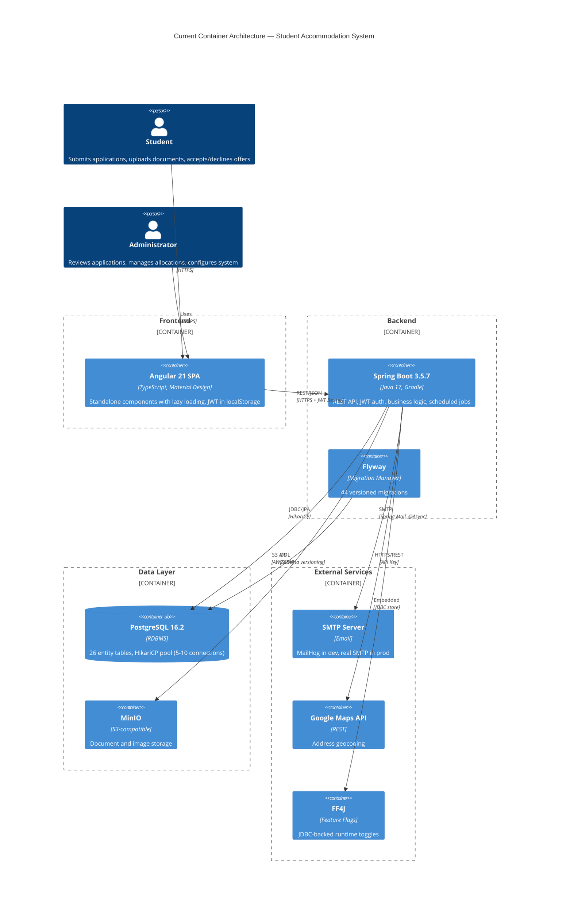
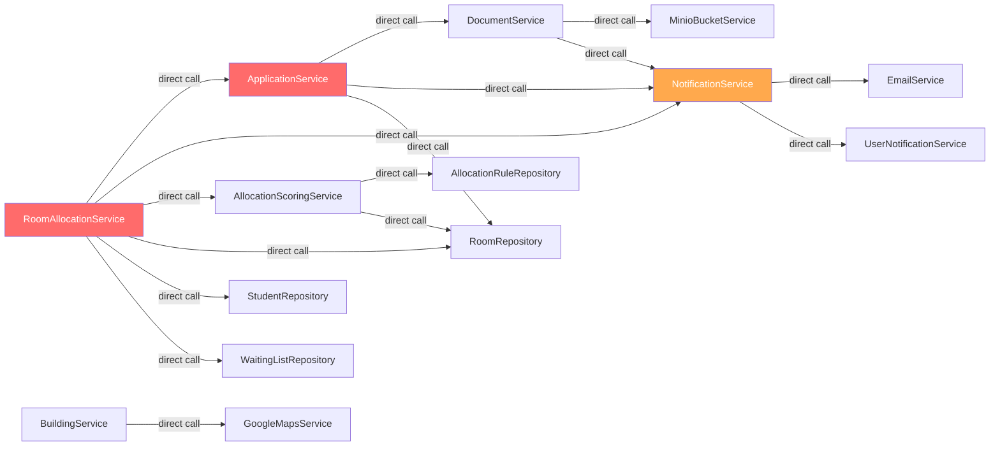
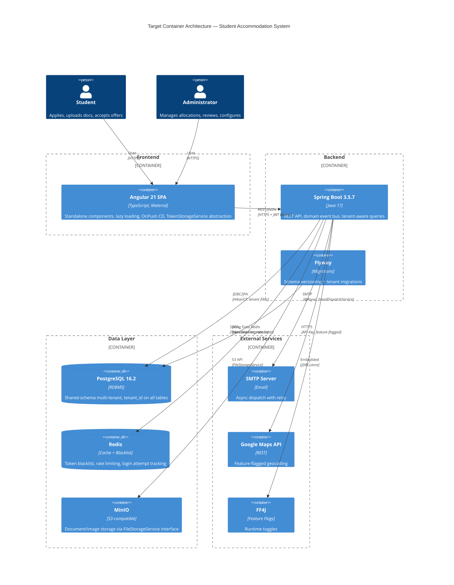
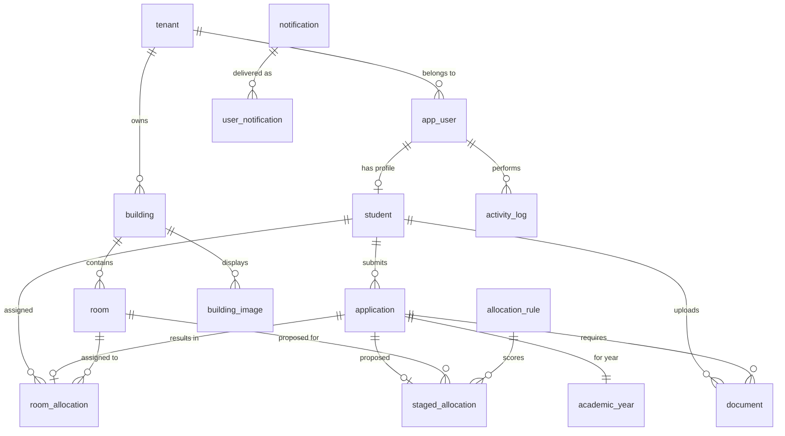
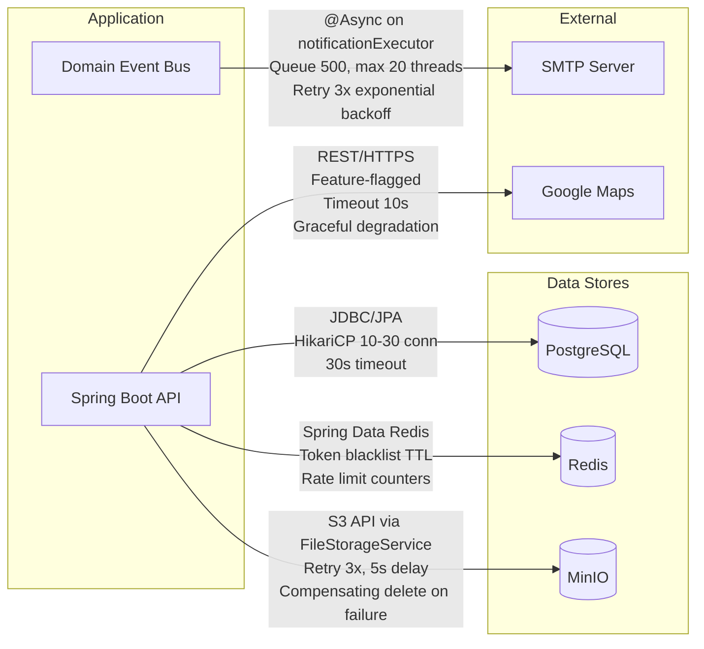
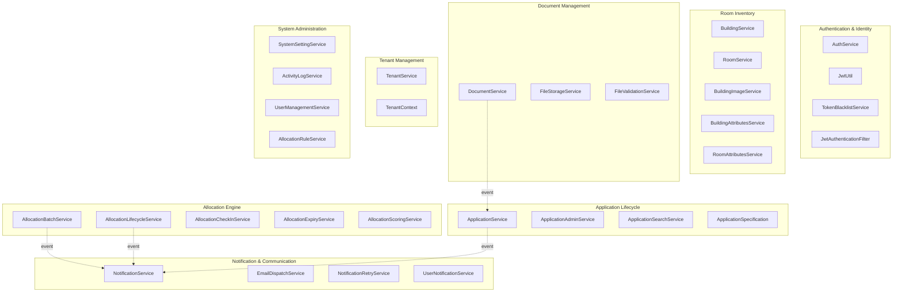

# Technical Stabilisation Document
## Student Accommodation System

### Document Control
- **Version:** 1.0
- **Date:** 2026-02-12
- **Author:** Solutions Architect (AI-assisted)
- **Status:** Draft — Pending Team Review
- **Input Document:** Requirements.md v1.1

---

### 1. Executive Summary

The Student Accommodation System is a monolithic Spring Boot 3.5.7 / Angular 21 application backed by PostgreSQL 16, MinIO object storage, and SMTP email delivery. It manages the full student housing lifecycle: application submission → document verification → allocation scoring → offer management → occupancy tracking. The system is deployed via Docker Compose and targets multi-tenant SaaS operation for private accommodation providers serving South African universities.

**Assessment Findings:** The system has a solid foundation — well-structured JWT authentication with role hierarchy, comprehensive custom exception handling (27 exception types), JPA Specifications for dynamic filtering, optimistic locking on critical entities, and MapStruct-based DTO mapping. However, the assessment reveals several architectural risks that must be addressed before production SaaS deployment. The three most critical findings are: (1) **security gaps** — no JWT token revocation, no brute-force protection, no file upload malware scanning; (2) **God class fragility** — `RoomAllocationService` (2,013 lines, 50+ methods) and `ApplicationService` (1,080 lines, 40+ methods) concentrate too much logic, creating high coupling and test difficulty; and (3) **incomplete multi-tenancy** — the system lacks tenant isolation required for shared-schema SaaS operation.

**Trajectory:** The system is at **early production maturity** — functional for single-tenant operation but not yet hardened for multi-tenant SaaS. The recovery plan prescribes three phases: (1) Critical Stabilisation addressing security and state machine integrity, (2) Structural Improvement implementing multi-tenancy and decomposing God classes, and (3) Enhancement & Optimization for observability, performance tuning, and operational readiness. With disciplined execution of this plan, the system can reach production SaaS readiness.

---

### 2. Current Architecture Assessment

#### 2.1 Architecture Overview

The system follows a classic three-tier architecture: Angular SPA frontend communicating via REST/JSON with a Spring Boot monolithic backend, persisting to PostgreSQL with file storage in MinIO. All services are containerised via Docker Compose. Authentication is stateless JWT with role-based access control. Async processing handles email notifications and scheduled batch allocation.



#### 2.2 Component Health Matrix

| Component | Coupling | Complexity | Test Coverage | Fragility | Performance Risk | Security Risk | Overall Health |
|-----------|----------|-----------|---------------|-----------|-----------------|--------------|----------------|
| AuthService | Low | Medium | Medium | Low | Low | HIGH | ⚠️ |
| RoomAllocationService | HIGH | HIGH | Low | HIGH | HIGH | Low | 🔴 |
| ApplicationService | HIGH | HIGH | Low | HIGH | Medium | Low | 🔴 |
| AllocationScoringService | Medium | HIGH | Low | HIGH | Medium | Low | 🔴 |
| NotificationService | Medium | HIGH | Low | Medium | Medium | Low | ⚠️ |
| DocumentService | Low | Medium | Low | Medium | Medium | Medium | ⚠️ |
| EmailService | Low | Low | Low | Low | Low | Low | ✅ |
| BuildingService | Low | Low | Low | Low | Low | Low | ✅ |
| RoomService | Low | Low | Low | Low | Low | Low | ✅ |
| StudentService | Low | Low | Low | Low | Low | Low | ✅ |
| SecurityConfig | Low | Medium | Low | Medium | Low | HIGH | ⚠️ |
| JwtUtil | Low | Low | Low | Low | Low | HIGH | ⚠️ |
| ActivityLogService | Low | Low | Low | Low | Medium | Low | ✅ |
| BuildingImageService | Low | Low | Low | Low | Low | Low | ✅ |
| AcademicYearService | Low | Low | Low | Low | Low | Low | ✅ |
| SystemSettingService | Low | Low | Low | Low | Low | Low | ✅ |
| WaitingListService | Low | Medium | Low | Medium | Low | Low | ⚠️ |
| GoogleMapsService | Low | Low | Low | Low | Low | Low | ✅ |
| UserManagementService | Low | Low | Low | Low | Low | Medium | ⚠️ |

**Rating Scale:** Low = ✅ Healthy | Medium = ⚠️ Monitor | HIGH = 🔴 Action Required

#### 2.3 Fragile Components Analysis

##### 2.3.1 RoomAllocationService — God Class
- **What:** Central service managing the entire allocation lifecycle — batch allocation, manual allocation, offer acceptance/decline, check-in/move-out, expiry, cancellation, and 4 scheduled jobs.
- **Fragility:** 2,013 lines, 50+ methods, direct dependencies on 7+ repositories and services. Combines scheduling, state management, business rules, scoring orchestration, and notification triggering in a single class. Any change risks unintended side effects across the allocation lifecycle.
- **Blast Radius:** Failure affects all allocation operations — batch processing, offer management, occupancy tracking, room availability. Downstream: NotificationService, room occupancy counts, application status transitions.
- **Evidence:** `backend/src/main/java/com/beezhub/student_accommodation/service/RoomAllocationService.java` — 2,013 lines. Contains `@Scheduled` methods for batch allocation (6hr), offer expiry (1hr), and check-in expiry (1hr) alongside CRUD and lifecycle methods.
- **Remediation:** Decompose into focused services: `AllocationBatchService` (scheduling + batch logic), `AllocationLifecycleService` (offer accept/decline/expire), `AllocationCheckInService` (check-in/move-out), `AllocationExpiryService` (scheduled expiry jobs). See Section 3.2.1.

##### 2.3.2 ApplicationService — God Class
- **What:** Manages application CRUD, status transitions, validation, search, and admin operations.
- **Fragility:** 1,080 lines, 40+ methods. Mixes student-facing operations (submit, withdraw) with admin operations (approve, reject, status update) and search/filtering logic. Dependencies on DocumentRepository, RoomRepository, NotificationService create coupling chains.
- **Blast Radius:** Failure affects application submission, review workflow, status transitions (10 states), and downstream allocation eligibility.
- **Evidence:** `backend/src/main/java/com/beezhub/student_accommodation/service/ApplicationService.java` — 1,080 lines.
- **Remediation:** Extract `ApplicationAdminService` for admin operations, `ApplicationSearchService` for search/filter logic. Keep `ApplicationService` focused on student-facing CRUD and status transitions.

##### 2.3.3 AllocationStatus Enum — Missing State Machine
- **What:** Defines 9 allocation statuses (OFFERED, ACCEPTED, DECLINED, EXPIRED, CHECK_IN_EXPIRED, ACTIVE, COMPLETED, TERMINATED, CANCELLED).
- **Fragility:** Unlike `ApplicationStatus` which has a `canTransitionTo()` method enforcing valid transitions, `AllocationStatus` has no transition validation. Status changes are made directly in service methods with no compile-time or runtime enforcement of valid transitions.
- **Blast Radius:** Invalid allocation status transitions could corrupt data — e.g., transitioning from COMPLETED back to OFFERED, or skipping ACCEPTED to go directly to ACTIVE. Room occupancy counts depend on correct status transitions.
- **Evidence:** `ApplicationStatus.java` has `canTransitionTo()` at line 46-62. `AllocationStatus.java` has no equivalent method.
- **Remediation:** Add `canTransitionTo()` method to `AllocationStatus` enum mirroring the `ApplicationStatus` pattern. Add `validateStatusTransition()` calls in `RoomAllocationService` before any status change.

##### 2.3.4 NotificationService — Overloaded
- **What:** Handles all notification logic — 10+ async email methods, template selection, in-app notification creation, retry scheduling.
- **Fragility:** 1,435 lines, 35+ methods. Combines email orchestration, template rendering, notification persistence, and retry logic. All notification methods are `@Async` on a single executor with queue capacity of 100.
- **Blast Radius:** If the async queue fills (100 capacity), notification tasks are rejected. Email failures during batch allocation (which can trigger 100+ notifications) could exhaust the queue. No monitoring or alerting on queue depth.
- **Evidence:** `AsyncConfiguration.java` — core pool: 5, max: 10, queue: 100. `NotificationService.java` — 1,435 lines with 10+ `@Async` methods.
- **Remediation:** Increase queue capacity to 500+. Extract `EmailOrchestrationService` for template selection and sending. Add queue depth monitoring. Consider dedicated executor for batch notifications vs. individual notifications.

##### 2.3.5 Student Entity — EAGER Loading
- **What:** JPA entity for student profile data.
- **Fragility:** Has 3 EAGER-loaded associations (AppUser, Institution, YearOfStudy). Every query that touches Student loads these associations, even when not needed.
- **Blast Radius:** N+1 query problems when loading lists of students (e.g., admin user list, allocation lists). Performance degradation scales linearly with student count.
- **Evidence:** `Student.java` — `@ManyToOne` with default fetch type (EAGER for `@ManyToOne`) on AppUser, Institution, YearOfStudy relationships.
- **Remediation:** Change all associations to `FetchType.LAZY`. Use `@EntityGraph` or JPQL `JOIN FETCH` in repository queries where eager loading is actually needed.

#### 2.4 Tight Coupling Analysis



**Problematic Coupling Chains:**

1. **Allocation → Application → Notification:** `RoomAllocationService` calls `ApplicationService` to update application status, which triggers `NotificationService`. A failure in notification can propagate back through the chain. **Remedy:** Use Spring Application Events to decouple notification triggering from business logic.

2. **Document → Application → Notification:** Document approval triggers application status change, which triggers notification. Three services coupled for a single user action. **Remedy:** `DocumentService` should publish a `DocumentApprovedEvent`; `ApplicationService` listens and updates status; `NotificationService` listens and sends email. Each service operates independently.

3. **RoomAllocationService Fan-Out:** Depends on 7+ repositories and services directly. Any change to any dependency risks breaking allocation logic. **Remedy:** Decompose into focused services (Section 3.2.1) and use domain events for side effects.

4. **CORS Configuration Redundancy:** Both `SecurityConfig.java` and a separate `CorsFilter.java` configure CORS. Conflicting CORS configs can cause hard-to-debug request failures. **Remedy:** Remove `CorsFilter.java`, consolidate all CORS config in `SecurityConfig`.

#### 2.5 Performance Bottleneck Analysis

| # | Area | Current State | Risk Level | Impact | Recommendation |
|---|------|---------------|-----------|--------|----------------|
| PB-001 | Student EAGER loading | 3 EAGER associations on Student entity | HIGH | N+1 queries on any student list (admin, allocation, search). Multiplied by number of students. | Change to LAZY, use `@EntityGraph` for specific queries |
| PB-002 | Batch allocation query | Fetches all APPROVED applications per batch cycle | MEDIUM | With 500+ applications, full table scan possible. No composite index on `(status, academic_year_id)` confirmed in migrations. | Add composite index `idx_application_status_year ON application(status, academic_year_id)` |
| PB-003 | Async queue capacity | Queue capacity 100, max threads 10 | MEDIUM | Batch allocation for 100+ students triggers 100+ notification tasks simultaneously. Queue rejection possible. | Increase queue to 500, add monitoring, consider dedicated batch executor |
| PB-004 | Notification polling | Frontend polls every 30 seconds for notifications | LOW | 500 concurrent users × 30s polling = ~17 requests/second to notification endpoint. Manageable but wasteful. | Phase 3: Migrate to WebSocket/SSE for real-time push (addresses GAP-009) |
| PB-005 | MinIO presigned URLs | Presigned URLs generated on-demand per document view | LOW | Under normal load this is fine. Bulk document review could generate many presigned URL requests. | Cache presigned URLs client-side for their 1-hour validity period |
| PB-006 | HikariCP pool sizing | Min 5, max 10 connections (application.yml) | MEDIUM | 500 concurrent users with complex queries could exhaust 10 connections. Default pool too small for production. | Increase to min 10, max 30 for production. Monitor with Actuator metrics. |
| PB-007 | Activity log growth | Append-only table with no partitioning | LOW (growing) | Currently small, but activity_log will grow unbounded. After 10M+ rows, queries degrade. | Plan table partitioning by month/year when volume exceeds 1M rows |

#### 2.6 Integration Risk Analysis

| Integration | Availability Risk | Failure Isolation | Retry Strategy | Timeout Config | Data Consistency Risk | Security | Overall Risk |
|-------------|-------------------|-------------------|----------------|---------------|----------------------|----------|-------------|
| PostgreSQL | LOW | N/A (critical path) | HikariCP connection retry | 30s connection timeout | Transaction-based ACID | Credentials via env vars | LOW |
| MinIO | MEDIUM | Partial — doc upload blocks but doesn't cascade | 3 retries in MinioBucketService | Not explicitly configured | Upload succeeds but DB record may fail (no distributed transaction) | Access/secret key in env vars | MEDIUM |
| SMTP (Email) | MEDIUM | Good — @Async + retry mechanism isolates failures | 3 retries with exponential backoff (5/15/30 min) | Not explicitly configured | Notification table tracks state; email loss doesn't corrupt data | SMTP credentials in env vars | LOW |
| Google Maps API | LOW | Good — geocoding failure allows manual lat/lng entry | No retry implemented | Not configured | No consistency risk; optional data enrichment | API key in env vars | LOW |
| FF4J | LOW | Good — flag query failure defaults to disabled | N/A (embedded) | N/A | No consistency risk | Admin console access not restricted | LOW |

**Key Integration Risk:** MinIO upload + database record creation is not atomic. If the file uploads successfully to MinIO but the subsequent database INSERT fails (e.g., transaction rollback), an orphaned file exists in MinIO with no database reference. **Remedy:** Implement a compensating transaction pattern — on DB failure, attempt MinIO file deletion. Add a scheduled cleanup job to detect and remove orphaned files.

#### 2.7 Security Assessment

| # | Security Concern | Current State | Gap | Severity | Recommendation |
|---|-----------------|---------------|-----|----------|----------------|
| SEC-001 | JWT token revocation | No server-side revocation mechanism | Compromised tokens valid until expiry (up to 10h for students, 4h for admins) | **CRITICAL** | Implement Redis-based token blacklist with TTL matching token expiry. Blacklist on: password change, account disable, explicit logout. (Addresses GAP-001) |
| SEC-002 | Brute-force protection | No rate limiting on auth endpoints | Unlimited login attempts enable credential stuffing | **HIGH** | Implement account lockout after 5 failed attempts within 15 minutes. Add rate limiting (e.g., Bucket4j or Spring Security's built-in) on `/api/auth/**` endpoints. (Addresses GAP-002) |
| SEC-003 | File upload scanning | No malware scanning on uploaded documents | Malicious files could compromise admin users viewing documents | **MEDIUM** | Phase 2: Integrate ClamAV scanning for all file uploads before MinIO storage. (Addresses GAP-003) |
| SEC-004 | JWT in localStorage | Frontend stores JWT in localStorage | Vulnerable to XSS attacks — any injected script can steal the token | **MEDIUM** | Phase 2: Migrate to httpOnly secure cookies for token storage, or implement Content Security Policy headers to mitigate XSS risk |
| SEC-005 | CORS configuration | Dual CORS config (SecurityConfig + CorsFilter). Default allows `localhost:3000,3000,8080` | Misconfiguration risk; port 3000 may not be intentional | **LOW** | Remove CorsFilter.java, consolidate in SecurityConfig. Production must restrict to actual frontend domain only. |
| SEC-006 | Actuator endpoints | `/actuator/health` and `/actuator/info` publicly accessible | Info endpoint may leak sensitive application metadata | **LOW** | Restrict `/actuator/**` to ADMIN role or internal network. Keep only `/actuator/health` public for container health checks. |
| SEC-007 | Admin seed password | Initial admin password seeded via Flyway migration (V2025_11_29_1001, V2025_11_29_1002) | Password visible in migration SQL file committed to repository | **MEDIUM** | Use environment variable for seed password. Add `must_change_password=true` flag (already exists) to force change on first login. |
| SEC-008 | .env committed | `.env` file with real dev API keys committed to repository | Credential exposure in version control | **HIGH** | Add `.env` to `.gitignore`. Rotate all exposed credentials. Use `.env.example` for template only. |

### 3. Recovery Architecture Plan

#### 3.1 Classification Summary

| Component/Concern | Classification | Priority | Effort | Risk |
|-------------------|---------------|----------|--------|------|
| JWT token revocation (SEC-001) | Must Refactor | HIGH | Medium | Low |
| Brute-force protection (SEC-002) | Must Refactor | HIGH | Low | Low |
| AllocationStatus state machine (2.3.3) | Must Refactor | HIGH | Low | Low |
| .env credential exposure (SEC-008) | Must Refactor | HIGH | Low | Low |
| RoomAllocationService God class (2.3.1) | Must Refactor | HIGH | High | Medium |
| ApplicationService God class (2.3.2) | Must Refactor | MEDIUM | Medium | Medium |
| AllocationScoringService testing | Must Refactor | HIGH | Medium | Low |
| NotificationService overload (2.3.4) | Must Refactor | MEDIUM | Medium | Low |
| Student EAGER loading (2.3.5) | Must Refactor | MEDIUM | Low | Low |
| CORS config redundancy (2.4) | Must Refactor | LOW | Low | Low |
| Multi-tenancy (shared-schema) | Must Refactor | HIGH | High | Medium |
| MinIO orphan cleanup (2.6) | Must Isolate | MEDIUM | Low | Low |
| File upload scanning (SEC-003) | Must Isolate | MEDIUM | Medium | Low |
| JWT localStorage storage (SEC-004) | Must Isolate | MEDIUM | Medium | Medium |
| Notification polling → WebSocket (PB-004) | Must Isolate | LOW | Medium | Low |
| BuildingService CRUD | Can Remain | LOW | N/A | N/A |
| RoomService CRUD | Can Remain | LOW | N/A | N/A |
| EmailService | Can Remain | LOW | N/A | N/A |
| MapStruct mappers | Can Remain | LOW | N/A | N/A |
| JPA Specifications | Can Remain | LOW | N/A | N/A |
| ActivityLogService | Can Remain | LOW | N/A | N/A |
| GoogleMapsService | Can Remain | LOW | N/A | N/A |
| Flyway migration strategy | Can Remain | LOW | N/A | N/A |
| Docker Compose deployment | Can Remain | LOW | N/A | N/A |
| Frontend standalone components | Can Remain | LOW | N/A | N/A |
| Angular Material UI | Can Remain | LOW | N/A | N/A |
| Admin seed migration (SEC-007) | Too Risky to Touch Now | LOW | Low | Medium |

#### 3.2 Must Refactor

##### 3.2.1 RoomAllocationService Decomposition
- **Current State:** 2,013-line God class with 50+ methods handling batch allocation, manual allocation, offer lifecycle, check-in/move-out, expiry jobs, and waiting list management. 4 `@Scheduled` methods embedded in the same class as CRUD operations.
- **Target State:** Four focused services:
  - `AllocationBatchService` — batch allocation scheduling, eligibility checks, staged allocation creation
  - `AllocationLifecycleService` — offer accept/decline, manual allocation, cancellation
  - `AllocationCheckInService` — check-in, move-out, termination
  - `AllocationExpiryService` — scheduled offer expiry, check-in expiry jobs
  - `RoomAllocationService` retained as a thin facade delegating to the above for backward compatibility
- **Approach:** Incremental. Extract one sub-service at a time, starting with `AllocationExpiryService` (lowest coupling, easiest to extract). Run existing tests after each extraction. Update injection points in controllers.
- **Risks During Refactoring:** Transaction boundaries may shift when logic moves between classes. Scheduled job annotations must move correctly. Injection cycles possible if services cross-reference.
- **Acceptance Criteria:** No method in any allocation service exceeds 30 lines. Each service has <300 lines. All existing API contracts unchanged. Test coverage ≥70% on each extracted service.
- **Dependencies:** None — can begin immediately.

##### 3.2.2 ApplicationService Decomposition
- **Current State:** 1,080-line class mixing student CRUD, admin review operations, status transitions, and search/filter logic.
- **Target State:** Three focused services:
  - `ApplicationService` — student-facing: create, submit, withdraw, view own applications
  - `ApplicationAdminService` — admin-facing: approve, reject, status update, bulk operations
  - `ApplicationSearchService` — search, filtering, pagination using `ApplicationSpecification`
- **Approach:** Incremental. Extract `ApplicationSearchService` first (pure query logic, no side effects). Then extract admin operations.
- **Risks During Refactoring:** Admin controller endpoints reference `ApplicationService` directly — must update injection. Status transition logic shared between student and admin flows.
- **Acceptance Criteria:** Each service <400 lines. All API contracts unchanged. Status transition validation centralized in `ApplicationStatus.canTransitionTo()`.
- **Dependencies:** None — can begin immediately, parallelizable with 3.2.1.

##### 3.2.3 AllocationStatus State Machine Enforcement
- **Current State:** `AllocationStatus` enum defines 9 statuses but has no `canTransitionTo()` method. Status changes are made directly in service code with no transition validation.
- **Target State:** `AllocationStatus` enum with `canTransitionTo()` method defining valid transitions:
  - OFFERED → ACCEPTED, DECLINED, EXPIRED, CANCELLED
  - ACCEPTED → ACTIVE, CHECK_IN_EXPIRED, CANCELLED
  - ACTIVE → COMPLETED, TERMINATED, CANCELLED
  - DECLINED, EXPIRED, CHECK_IN_EXPIRED, COMPLETED, TERMINATED, CANCELLED → (terminal, no transitions)
- **Approach:** Big-bang — small, self-contained change. Add method to enum, add validation calls before all status changes in service layer.
- **Risks During Refactoring:** Existing code may perform transitions not captured in the state machine (indicating bugs). These must be found and fixed.
- **Acceptance Criteria:** Every allocation status change in the codebase passes through `AllocationStatus.canTransitionTo()`. `InvalidStatusException` thrown for violations. Unit tests cover all valid and invalid transitions.
- **Dependencies:** Should be done before or alongside 3.2.1 (RoomAllocationService decomposition).

##### 3.2.4 JWT Token Revocation (Redis Blacklist)
- **Current State:** JWT tokens are stateless. No mechanism to invalidate tokens on password change, account disable, or logout. Compromised tokens remain valid up to 10 hours.
- **Target State:** Redis-based token blacklist. On password change, account disable, or explicit logout, the JWT `jti` (token ID) is added to Redis with TTL matching remaining token lifetime. `JwtAuthenticationFilter` checks Redis before accepting a token.
- **Approach:** Incremental.
  1. Add Redis dependency (Spring Data Redis) and Docker Compose service
  2. Add `jti` claim to JWT generation in `JwtUtil`
  3. Create `TokenBlacklistService` wrapping Redis operations
  4. Update `JwtAuthenticationFilter` to check blacklist
  5. Add blacklist calls to `AuthService.logout()`, `AuthService.changePassword()`, `UserManagementService.disableUser()`
- **Risks During Refactoring:** Redis unavailability must not block authentication — implement fallback (accept token if Redis is down, log warning). Adds infrastructure dependency.
- **Acceptance Criteria:** Tokens are invalidated within 1 second of logout/password change/disable. Redis failure degrades gracefully (tokens accepted with warning log). Unit and integration tests cover blacklist flow.
- **Dependencies:** Redis added to Docker Compose.

##### 3.2.5 Brute-Force Protection
- **Current State:** No rate limiting on authentication endpoints. Unlimited login attempts allowed.
- **Target State:** Account lockout after 5 failed login attempts within 15 minutes. Lockout duration: 15 minutes. Rate limiting on `/api/auth/**` endpoints: 10 requests per minute per IP.
- **Approach:** Implement using Spring Security's event system (`AuthenticationFailureBadCredentialsEvent`) + Redis counter for failed attempts. Add `account_locked_until` field to `app_user` table via Flyway migration.
- **Risks During Refactoring:** Must handle distributed lockout (multiple app instances) — Redis counter is the correct approach. Must not lock out legitimate users during batch operations.
- **Acceptance Criteria:** 6th failed login attempt within 15 minutes returns 429 TOO_MANY_REQUESTS. Successful login resets counter. Admin can unlock accounts. Lockout status visible in admin user management.
- **Dependencies:** Redis (shared with 3.2.4).

##### 3.2.6 AllocationScoringService — Test Coverage
- **Current State:** 630-line scoring service with no dedicated unit tests. The scoring algorithm (preference match 40%, desirability 30%, accessibility 30%) is the core business value of the system.
- **Target State:** ≥90% unit test coverage on AllocationScoringService. Tests covering: each scoring component independently, combined scoring, edge cases (missing preferences, tied scores, zero weights), boundary conditions (score 0 and 100).
- **Approach:** Write tests first (TDD for any refactoring). Extract scoring components into testable strategy classes if needed.
- **Risks During Refactoring:** May discover scoring bugs during test writing. These are better found now than in production.
- **Acceptance Criteria:** ≥90% line coverage on scoring logic. All 3 scoring components tested independently. Tie-breaking logic tested. Edge cases documented in tests.
- **Dependencies:** None.

##### 3.2.7 Student Entity EAGER Loading Fix
- **Current State:** Student entity has 3 EAGER-loaded associations (AppUser, Institution, YearOfStudy), causing N+1 queries on every student list query.
- **Target State:** All associations `FetchType.LAZY`. Repository methods that need related data use `@EntityGraph` or `JOIN FETCH` explicitly.
- **Approach:** Change fetch types in entity. Run all existing tests. Fix any `LazyInitializationException` by adding `@EntityGraph` to affected repository methods.
- **Risks During Refactoring:** Some service methods may access lazy associations outside transaction scope, causing `LazyInitializationException`. These must be identified and fixed with fetch joins.
- **Acceptance Criteria:** No EAGER fetch types on Student entity. No N+1 queries detectable in SQL logging during standard operations (list students, view application, allocation list).
- **Dependencies:** None.

##### 3.2.8 .env Credential Cleanup
- **Current State:** `.env` file with real dev API keys committed to repository.
- **Target State:** `.env` added to `.gitignore`. All exposed credentials rotated. Only `.env.example` with placeholder values in repository.
- **Approach:** Immediate.
  1. Add `.env` to `.gitignore`
  2. Remove `.env` from git tracking (`git rm --cached .env`)
  3. Rotate all API keys (Google Maps, MinIO, JWT secret)
  4. Update README with setup instructions referencing `.env.example`
- **Risks During Refactoring:** None — straightforward file operation.
- **Acceptance Criteria:** `.env` not in repository. `.env.example` contains only placeholder values. All previously exposed credentials rotated.
- **Dependencies:** None — highest priority, do first.

##### 3.2.9 NotificationService Decomposition
- **Current State:** 1,435-line service handling email orchestration, template selection, in-app notifications, and retry logic. Async queue capacity of 100 risks rejection under batch load.
- **Target State:** Three focused services:
  - `NotificationService` — orchestration: decide what to send, create notification records
  - `EmailDispatchService` — template rendering and SMTP sending
  - `NotificationRetryService` — retry logic and scheduled retry job
  - Async queue increased to 500. Separate executor for batch notifications.
- **Approach:** Incremental. Extract retry logic first (self-contained scheduled job). Then extract email dispatch.
- **Risks During Refactoring:** Async boundary must be preserved — email sending must remain non-blocking.
- **Acceptance Criteria:** Each service <500 lines. Batch allocation of 100+ students does not exhaust notification queue. Retry logic independently testable.
- **Dependencies:** Can begin after 3.2.1.

##### 3.2.10 Multi-Tenancy Implementation (Phase 2)
- **Current State:** Minimal tenant isolation. `institution` table exists, `building` has a many-to-many with `institution`, but no global tenant filtering. Queries do not filter by tenant.
- **Target State:** Shared-schema multi-tenancy with `tenant_id` (representing building owner/accommodation provider) as discriminator column on all tenant-scoped tables. Tenant context set from JWT claims. Hibernate filters or Spring AOP automatically apply tenant filtering to all queries. Building owners are the primary tenants; their relationship with institutions is managed outside the system.
- **Approach:** Incremental across Phase 2.
  1. **[DONE]** Design tenant model: `tenant` table (id, name, config). Add `tenant_id` FK to 14 tables: app_user, building, room, application, room_allocation, staged_allocations, document, notification, user_notifications, system_settings, allocation_rules, waiting_list_entry, activity_logs, academic_year.
  2. Implement `TenantContext` (ThreadLocal) set by `JwtAuthenticationFilter` from JWT claims.
  3. Implement Hibernate tenant filter (`@FilterDef` + `@Filter`) or Spring Data JPA `Specification` base class that auto-appends tenant predicate.
  4. Update all admin endpoints to enforce tenant scoping.
  5. **[DONE]** Add tenant-aware data migration for existing records (Backfill Default Tenant).
- **Risks During Refactoring:** Every query must be verified for tenant filtering — missing a single query leaks data across tenants. Migration of existing data to tenant-scoped records requires careful planning.
- **Acceptance Criteria:** No cross-tenant data leakage. All list/search endpoints return only tenant-scoped data. Admin users scoped to their tenant. Tenant context automatically applied — developers cannot accidentally bypass it.
- **Dependencies:** Phase 1 complete (security, stability). Redis infrastructure in place. Database schema changes (Task 2.07) complete.

#### 3.3 Can Remain

| Component | Why Acceptable | Trigger for Future Refactoring | Monitoring Required |
|-----------|---------------|-------------------------------|-------------------|
| BuildingService (202 lines) | Small, focused, single responsibility. Clean CRUD operations with Google Maps integration. | If building management grows to include complex rules (pricing, availability windows). | None |
| RoomService (174 lines) | Small, focused. Room CRUD with occupancy tracking. | If room management adds complex availability rules or dynamic pricing. | Monitor occupancy update race conditions under load. |
| EmailService (317 lines) | Clean separation — handles only SMTP sending with Thymeleaf templates. No business logic. | If email templates proliferate (>20) or multi-channel support needed (SMS, push). | Monitor SMTP send latency and failure rate. |
| MapStruct Mappers (12 mappers) | Clean entity-to-DTO mapping. Low complexity. ApplicationMapper has one expression-based mapping (full name concatenation) which is acceptable. | If mappings become complex (>5 custom mappings per mapper) or bidirectional mapping needed. | None |
| JPA Specifications (9 specs) | Well-implemented dynamic query building pattern. ApplicationSpecification is the most complex (nested joins) but follows the pattern correctly. | If query complexity grows, consider QueryDSL. If performance issues arise, profile generated SQL. | Log slow queries (>500ms) |
| ActivityLogService (342 lines) | Clean AOP-based audit logging. Single responsibility. | If log volume exceeds 10M rows — implement partitioning. If real-time log streaming needed. | Monitor table growth rate. |
| GoogleMapsService (175 lines) | Simple REST client for geocoding. Feature-flagged. Failure degrades gracefully. | If additional mapping features needed (directions, distance matrix). | Monitor API key quota usage. |
| Flyway Migration Strategy | 44 well-structured migrations following `V{YYYY_MM_DD_HHMM}__{description}.sql` convention. | If team size grows (>5 developers), consider migration conflict detection. If rollback capability needed, add undo migrations. | Monitor migration execution time on startup. |
| Docker Compose Deployment | Adequate for development and small-scale production. Multi-stage Dockerfile with non-root user and health checks. | If scaling beyond single server — migrate to Kubernetes or Docker Swarm. | Container health check status. |
| Frontend Standalone Components | Modern Angular 21 pattern with lazy loading. OnPush change detection for performance. Clean separation of smart/presentational components. | If component count exceeds 100 — consider micro-frontend architecture. | Bundle size (monitor with webpack-bundle-analyzer). |
| Angular Material UI | Consistent design system. Responsive. Well-maintained library. | If custom design system required for white-labeling (multi-tenant branding). | None |

#### 3.4 Must Isolate

##### 3.4.1 MinIO File Storage — Orphan Cleanup
- **Current State:** File upload to MinIO and database record creation are not atomic. A failed DB transaction after successful MinIO upload leaves orphaned files. No cleanup mechanism exists.
- **Isolation Boundary:** Create `FileStorageService` interface abstracting MinIO operations. Implement `OrphanFileCleanupJob` (scheduled daily) that scans MinIO for files without matching database records.
- **Containment Strategy:** `FileStorageService` wraps all MinIO calls with try-catch and compensating delete on DB failure. Orphan cleanup job handles any slips.
- **Long-Term Plan:** When migrating to cloud (AWS S3, Azure Blob), swap `FileStorageService` implementation without changing business logic.

##### 3.4.2 File Upload Security — Malware Scanning
- **Current State:** Uploaded files are stored without malware scanning. Relies on infrastructure-level protection.
- **Isolation Boundary:** Create `FileValidationService` interface with `scanFile(InputStream)` method. Initial implementation: no-op (pass-through). Phase 2 implementation: ClamAV integration.
- **Containment Strategy:** All file uploads route through `FileValidationService` before MinIO storage. If scanning fails, file is quarantined (stored in separate bucket) pending manual review.
- **Long-Term Plan:** Integrate ClamAV container in Docker Compose. Implement async scanning for large files. Add file type verification (magic bytes, not just extension).

##### 3.4.3 Frontend Token Storage
- **Current State:** JWT stored in localStorage, accessible to any JavaScript running on the page. Vulnerable to XSS.
- **Isolation Boundary:** Create `TokenStorageService` abstraction in Angular. Current implementation: localStorage. Future implementation: httpOnly cookie or in-memory with refresh token.
- **Containment Strategy:** All token read/write operations go through `TokenStorageService`. Content Security Policy headers added to mitigate XSS risk.
- **Long-Term Plan:** Phase 2: Implement refresh token rotation with short-lived access tokens (15 min) stored in memory + httpOnly refresh token cookie.

##### 3.4.4 Real-Time Notifications
- **Current State:** Frontend polls every 30 seconds for notifications. Works but wastes bandwidth and has up to 30-second delay for urgent notifications.
- **Isolation Boundary:** `NotificationService` (frontend) already abstracts the notification data source via `notifications$` observable. Backend notification endpoint unchanged.
- **Containment Strategy:** Current polling continues to work. When WebSocket/SSE is implemented, only the data source in `NotificationService` changes — all consuming components remain unchanged.
- **Long-Term Plan:** Phase 3: Add Spring WebSocket endpoint for real-time notification push. Update Angular `NotificationService` to connect via WebSocket with polling fallback. (Addresses GAP-009)

#### 3.5 Too Risky to Touch Now

| Component | Why Too Risky | Conditions to Reassess | Compensating Controls |
|-----------|---------------|----------------------|----------------------|
| Admin seed migration (V2025_11_29_1001/1002) | Modifying executed Flyway migrations can corrupt migration checksums and break all existing deployments. The seed password in the migration is a historical artifact. | Never modify executed migrations. Address via new migration or environment-based seed. | `must_change_password=true` flag forces password change on first login. Document that seed password must be changed immediately after deployment. |

### 4. Target Architecture

#### 4.1 Architecture Principles

1. **Single Responsibility** — Every class has one reason to change. Services under 400 lines. Methods under 30 lines. No God classes.
2. **Domain Event-Driven Side Effects** — Business actions (allocation created, document approved) publish Spring Application Events. Side effects (notifications, status updates) handled by event listeners, not direct service calls.
3. **Defense in Depth** — Security at every layer: JWT validation + token blacklist + role-based access + tenant isolation + input validation + output sanitization.
4. **Graceful Degradation** — External service failures (email, MinIO, Google Maps) must not block core business operations. Failures are queued for retry or flagged for manual intervention.
5. **Tenant Isolation by Default** — All data queries scoped to tenant automatically via Hibernate filters. Developers cannot accidentally bypass tenant boundaries.
6. **Observability First** — Every service operation is logged, metered, and traceable. Production issues discoverable without debugging.
7. **Evolutionary Architecture** — Monolith with clean domain boundaries. Services can be extracted to microservices if/when scale demands, without rewriting business logic.
8. **Fail Fast, Recover Gracefully** — Invalid state transitions, constraint violations, and configuration errors detected at startup or first use, not in production under load.

#### 4.2 Target Component Architecture



#### 4.3 Domain Boundaries

| Domain | Packages | Key Services | Key Entities | External Dependencies |
|--------|----------|-------------|-------------|----------------------|
| Authentication & Identity | `security.*`, `service.AuthService` | AuthService, JwtUtil, TokenBlacklistService | AppUser, Student, EmailVerificationToken, PasswordResetToken | Redis (blacklist), BCrypt |
| Application Lifecycle | `service.application.*` | ApplicationService, ApplicationAdminService, ApplicationSearchService | Application, AcademicYear | — |
| Allocation Engine | `service.allocation.*` | AllocationBatchService, AllocationLifecycleService, AllocationCheckInService, AllocationExpiryService, AllocationScoringService | RoomAllocation, StagedAllocation, AllocationRule, WaitingListEntry | Scheduler |
| Room Inventory | `service.building.*`, `service.room.*` | BuildingService, RoomService, BuildingImageService, BuildingAttributesService, RoomAttributesService | Building, Room, BuildingImage, BuildingAttributes, RoomAttributes | MinIO (images), Google Maps |
| Document Management | `service.document.*` | DocumentService, FileStorageService, FileValidationService | Document, DocumentType | MinIO (files) |
| Notification & Communication | `service.notification.*` | NotificationService, EmailDispatchService, NotificationRetryService, UserNotificationService | Notification, UserNotification | SMTP |
| Tenant Management | `service.tenant.*` | TenantService, TenantContext | Tenant | — |
| System Administration | `service.admin.*` | SystemSettingService, ActivityLogService, UserManagementService, AllocationRuleService | SystemSetting, ActivityLog, AllocationRule | — |
| Reference Data | `service.reference.*` | AcademicYearService, InstitutionService, YearOfStudyService, AccommodationTypeService | AcademicYear, Institution, YearOfStudy, AccommodationType | — |

#### 4.4 Data Architecture

**Schema Design Quality:** The current schema is well-normalized with 26 entities across 6 logical domains. Foreign key constraints, unique constraints, and check constraints are properly defined in Flyway migrations. The `V{YYYY_MM_DD_HHMM}__description.sql` naming convention is followed consistently across 44 migrations.

**Index Strategy:**
The following indexes should be added or verified (some may already exist):

| Index | Table | Columns | Purpose |
|-------|-------|---------|---------|
| `idx_application_status_year` | application | (status, academic_year_id) | Allocation pool queries |
| `idx_allocation_status_expiry` | room_allocation | (status, offer_expiry_date) | Offer expiry scheduled job |
| `idx_allocation_status_checkin` | room_allocation | (status, check_in_deadline) | Check-in expiry scheduled job |
| `idx_activity_log_user_date` | activity_log | (user_id, created_at DESC) | Audit trail queries |
| `idx_notification_user_read` | user_notification | (user_id, is_read) | Unread notification count |
| `idx_room_building_available` | room | (building_id, is_available, current_occupancy) | Room availability search |
| `idx_application_student` | application | (student_id) | Student application lookup |
| `idx_tenant_scoped` | all tenant tables | (tenant_id) | Tenant-scoped queries (Phase 2) |

**Migration Management:** Flyway with `baseline-on-migrate=true`. 44 migrations tracked. No rollback migrations (undo scripts). For Phase 2 multi-tenancy, a dedicated migration adds `tenant_id` columns and backfills existing data with a default tenant.

**Data Partitioning:** Plan partitioning for `activity_log` by year when table exceeds 1M rows. Consider partitioning `notification` and `user_notification` by month for the same reason.

**Connection Pool Tuning:** Current HikariCP settings (min 5, max 10) are undersized for production. Target: min 10, max 30 for single-instance production. Monitor connection wait times via Actuator.



#### 4.5 Integration Architecture



**Integration Patterns:**

| Integration | Pattern | Resilience Strategy | Monitoring |
|-------------|---------|--------------------|-----------| 
| PostgreSQL | Synchronous request-response | HikariCP connection pool retry, 30s timeout, transaction rollback on failure | Actuator datasource metrics, slow query logging (>500ms) |
| Redis | Synchronous request-response | Graceful degradation — if Redis unavailable, tokens accepted (log warning), rate limiting disabled | Redis connection health check, blacklist hit/miss ratio |
| MinIO | Synchronous with compensating action | 3 retries with 5s delay. On DB failure after upload, attempt file deletion. Daily orphan cleanup job. | Upload latency, failure rate, orphan file count |
| SMTP | Async fire-and-forget with retry | @Async dispatch, 3 retries with exponential backoff (5/15/30 min), PERMANENTLY_FAILED after exhaustion | Notification table status distribution, retry queue depth, permanently failed count |
| Google Maps | Synchronous with graceful degradation | Feature-flagged. Failure allows manual coordinate entry. 10s timeout. | API quota usage, failure rate |

### 5. Guardrails & Standards

#### 5.1 Coding Standards

##### 5.1.1 Backend (Java / Spring Boot)

**Package Structure:**
```
com.beezhub.student_accommodation/
├── config/          # @Configuration classes only
├── controller/      # REST controllers — no business logic
├── exceptions/      # Custom exception classes
├── mapper/          # MapStruct mappers only
├── model/
│   ├── dto/         # Request/Response DTOs
│   ├── entity/      # JPA entities
│   └── enums/       # Enum types
├── repository/      # Spring Data JPA repositories
├── security/        # JWT, filters, user details
├── service/
│   ├── allocation/  # AllocationBatchService, AllocationLifecycleService, etc.
│   ├── application/ # ApplicationService, ApplicationAdminService, etc.
│   ├── notification/# NotificationService, EmailDispatchService, etc.
│   ├── document/    # DocumentService, FileStorageService, etc.
│   ├── tenant/      # TenantService, TenantContext
│   └── ...          # Other domain services
├── specification/   # JPA Specifications for dynamic queries
├── validation/      # Custom constraint validators
├── aspect/          # AOP aspects (audit logging)
└── util/            # Utility classes (stateless, no Spring dependencies)
```

**Class Rules:**
- Services: Max 400 lines. If a service exceeds this, it must be decomposed.
- Methods: Max 30 lines. Extract private helper methods for complex logic.
- Controllers: Max 200 lines. Controllers contain only request mapping, validation delegation, and response assembly. No business logic.
- DTOs: Immutable where possible. Use Java records for simple DTOs.
- Entities: No business logic in entities. Only JPA annotations, field declarations, and lifecycle callbacks (`@PrePersist`, `@PreUpdate`).

**Naming Conventions:**
- Classes: `PascalCase`. Services suffixed with `Service`. Controllers with `Controller`. Repositories with `Repository`.
- Methods: `camelCase`. CRUD: `create*`, `get*`/`find*`, `update*`, `delete*`. Business operations: verb-noun (`approveApplication`, `allocateRoom`, `expireOffers`).
- Constants: `UPPER_SNAKE_CASE`.
- Database columns: `snake_case`. Foreign keys: `{referenced_table}_id`.
- Flyway migrations: `V{YYYY_MM_DD_HHMM}__{description}.sql`.

**Exception Handling:**
- Throw domain-specific exceptions (`ApplicationNotFoundException`, `RoomCapacityExceededException`) from services.
- Never throw generic `RuntimeException` or `Exception` from service layer.
- `RestResponseExceptionHandler` (global `@ControllerAdvice`) maps all domain exceptions to HTTP status codes.
- Log exceptions at ERROR level in the global handler. Do not log and rethrow in service methods.
- Never expose stack traces in API responses.

**Logging Standards:**
- Use SLF4J (`@Slf4j` Lombok annotation).
- `DEBUG` — method entry/exit for complex operations, query parameters.
- `INFO` — business events (application submitted, allocation created, batch started/completed).
- `WARN` — recoverable failures (email send failed, retrying; Redis unavailable, degrading).
- `ERROR` — unrecoverable failures (database connection lost, critical data inconsistency).
- Include context in log messages: `log.info("Batch allocation completed: batchId={}, allocated={}, skipped={}", batchId, count, skipped)`.
- Never log sensitive data (passwords, tokens, personal information).

**Test Requirements:**
- Minimum 70% line coverage per service class (enforced by Jacoco).
- AllocationScoringService: minimum 90% coverage.
- Unit tests for all state machine transitions (ApplicationStatus, AllocationStatus).
- Integration tests for: authentication flow, application submission, allocation lifecycle, document upload.
- Test naming: `methodName_scenario_expectedResult()` (e.g., `acceptOffer_expiredOffer_throwsInvalidStatusException()`).

##### 5.1.2 Frontend (Angular / TypeScript)

**Component Structure:**
```
features/
├── admin/
│   ├── building-management/
│   │   ├── building-management.component.ts    # Smart component
│   │   ├── building-management.component.html
│   │   ├── building-management.component.scss
│   │   └── building-management.component.spec.ts
│   └── ...
├── dashboard/
└── auth/

core/
├── guards/          # Route guards (auth, admin, student, email-verified)
├── interceptors/    # HTTP interceptors (auth, error, token-expiry)
├── models/          # TypeScript interfaces matching backend DTOs
└── services/        # Singleton services (auth, notification, error-handling)

shared/
├── components/      # Reusable presentational components
├── pipes/           # Custom pipes
└── material.module.ts  # Centralized Material imports
```

**Component Rules:**
- Use standalone components (no NgModules for features).
- Smart components inject services and manage state. Presentational components receive `@Input()` and emit `@Output()`.
- Use `ChangeDetectionStrategy.OnPush` on all components.
- Use `inject()` function for dependency injection (not constructor injection).
- Component TypeScript files: max 300 lines. Extract complex logic to services.

**State Management:**
- Use RxJS BehaviorSubjects in services for reactive state. No NgRx (not justified for current complexity).
- Expose state as readonly observables (`asObservable()`).
- Cache lookup data (institutions, years of study) in services with `clearCache()` on logout.

**Error Handling:**
- Global `errorInterceptor` handles all HTTP errors. Components do not catch HTTP errors unless they need custom handling.
- Display errors via `MatSnackBar` (5-second duration).
- Silent errors: Use `X-Silent-Error` header for background requests (e.g., notification polling).

**API Calls:**
- All HTTP calls go through typed services in `core/services/`.
- Return `Observable<T>` from service methods (not `Promise<T>`).
- Unsubscribe from observables in `ngOnDestroy` or use `takeUntilDestroyed()`.

##### 5.1.3 Database

**Migration Standards:**
- Naming: `V{YYYY_MM_DD_HHMM}__{description}.sql` (double underscore separator).
- One migration per logical change. Do not combine unrelated schema changes.
- Include `IF NOT EXISTS` / `IF EXISTS` guards for idempotency where possible.
- Never modify an executed migration. Create a new migration for corrections.
- Add indexes in the same migration as the table or in a dedicated index migration.

**Index Naming:** `idx_{table}_{column1}_{column2}`
**Constraint Naming:** `fk_{table}_{referenced_table}`, `uk_{table}_{column}`, `ck_{table}_{constraint_description}`
**Column Standards:** `snake_case`. Timestamps: `created_at`, `updated_at` (UTC). Soft deletes: `deleted_at`. Booleans: `is_` prefix (`is_active`, `is_available`). Currency: `DECIMAL(10,2)`.

#### 5.2 Design Patterns

| Pattern | When to Use | Example in This System | Anti-Pattern to Avoid |
|---------|------------|----------------------|----------------------|
| Repository | Data access abstraction | `RoomRepository`, `ApplicationRepository` | Direct `EntityManager` usage in services |
| Service | Business logic orchestration | `AllocationLifecycleService`, `ApplicationService` | Business logic in controllers or entities |
| Specification | Dynamic query building | `ApplicationSpecification`, `RoomSpecification` | String-based JPQL concatenation |
| Strategy | Interchangeable algorithms | Allocation scoring components (preference, desirability, accessibility) | Giant if/else chains in scoring |
| Domain Event | Side effects of business actions | `AllocationCreatedEvent` → `NotificationService` listener | Direct service-to-service calls for notifications |
| Facade | Backward-compatible API | `RoomAllocationService` delegating to focused sub-services | Clients depending on internal service structure |
| Template Method | Shared workflow steps | Scheduled job base class (fetch → process → log) | Duplicated scheduling boilerplate |
| State Machine | Status transitions | `ApplicationStatus.canTransitionTo()`, `AllocationStatus.canTransitionTo()` | Ad-hoc status changes without validation |

#### 5.3 API Contract Standards

| Rule | Standard | Example |
|------|----------|---------|
| URL structure | `/api/{domain}/{resource}` (plural nouns, no verbs in path) | `/api/applications`, `/api/admin/buildings` |
| HTTP methods | GET (read), POST (create), PUT (full update/action), DELETE (remove) | `PUT /api/allocations/{id}/accept` |
| Status codes | 200 (success), 201 (created), 204 (no content), 400 (validation), 401 (unauthenticated), 403 (forbidden), 404 (not found), 409 (conflict), 429 (rate limited), 500 (server error) | — |
| Error response | `{ "error": "ERROR_CODE", "message": "Human-readable message", "details": [...] }` | `{ "error": "ROOM_CAPACITY_EXCEEDED", "message": "Room 101 is at full capacity", "details": [] }` |
| Pagination | `?page=0&size=20&sort=createdAt,desc` → response: `{ "content": [...], "totalElements": N, "totalPages": N }` | Spring Data Page response |
| Timestamps | ISO 8601 UTC: `"2026-02-12T08:55:00Z"` | All `createdAt`, `updatedAt` fields |
| IDs | Numeric auto-increment for internal entities. UUID for tokens and external-facing references. | Application ID: numeric. Verification token: UUID. |
| Versioning | No API versioning for now. When breaking changes needed, use URI versioning: `/api/v2/...` | — |
| Documentation | All endpoints documented via SpringDoc OpenAPI annotations (`@Operation`, `@ApiResponse`) | Swagger UI at `/swagger-ui.html` |

#### 5.4 Versioning Rules

| Aspect | Rule | Rationale |
|--------|------|-----------|
| Git branching | GitFlow: `main` (production), `develop` (integration), `feature/*`, `hotfix/*`, `release/*` | Clear separation of stable and in-progress code. Matches existing branch strategy. |
| Commit messages | Conventional Commits: `feat:`, `fix:`, `refactor:`, `docs:`, `test:`, `chore:` | Enables automated changelogs and semantic versioning. |
| API versioning | No versioning initially. URI versioning (`/api/v2/`) when first breaking change needed. | Premature versioning adds complexity. Current system has no external API consumers. |
| Database migrations | `V{YYYY_MM_DD_HHMM}__{description}.sql` | Flyway convention, chronological ordering, prevents conflicts. |
| Release versioning | Semantic Versioning (MAJOR.MINOR.PATCH) | MAJOR: breaking changes. MINOR: new features. PATCH: bug fixes. |

#### 5.5 Dependency Management Rules

| Rule | Details |
|------|---------|
| New dependency evaluation | Must assess: (1) Security — CVE history, last security audit. (2) Maintenance — last release within 6 months, active issue response. (3) License — compatible with project (MIT, Apache 2.0 preferred). (4) Size — impact on build time and artifact size. |
| Version pinning | All dependencies pinned to exact versions in `build.gradle` and `package.json`. No version ranges (`^`, `~`). |
| Upgrade policy | Monthly dependency review. Security patches (CVEs with CVSS ≥7.0) applied within 48 hours. Non-security updates batched monthly. |
| Banned patterns | No runtime reflection-based serialization (use Jackson/Gson explicitly). No direct HTTP clients in service layer (wrap in dedicated client services). No `Thread.sleep()` in production code. |
| Frontend dependencies | No state management libraries (NgRx, Akita) unless complexity justifies it. No CSS frameworks beyond Angular Material. No jQuery or similar DOM manipulation libraries. |
| Backend dependencies | No alternative web frameworks (Micronaut, Quarkus) alongside Spring. No alternative ORMs alongside JPA/Hibernate. One JSON library (Jackson, already included via Spring Boot). |

### 6. Non-Functional Requirements Review

#### 6.1 Performance

| NFR | Target | Current State | Gap | Recommendation |
|-----|--------|--------------|-----|----------------|
| API response 95th percentile | <500ms | Unknown — no metrics collection | No measurement infrastructure | Add Spring Boot Actuator `micrometer` metrics. Log request timing via `HandlerInterceptor`. Target: P95 <500ms for CRUD, <2s for reports. |
| Frontend initial load | <3s on 3G | Unknown — no Lighthouse audit performed | No measurement | Run Lighthouse audit. Current lazy loading and AOT compilation are good. Verify gzip compression enabled in nginx. |
| Batch allocation (500 apps) | <2 min | Unknown — not load tested | No load testing performed | Profile batch allocation with realistic data. Add composite index on `application(status, academic_year_id)`. Implement sub-batch processing (100 per sub-batch). |
| Database query response | <100ms for simple queries | Unknown — `show-sql` enabled in dev but no profiling | No slow query detection | Enable Hibernate statistics in dev. Add slow query logging (>500ms). Review generated SQL for N+1 patterns. |
| File upload response | <5s for 10MB file | Unknown — depends on MinIO network latency | No measurement | Test with max file size. Consider streaming upload for large files. |

#### 6.2 Scalability

| Dimension | Current Capacity | Target | Gap | Recommendation |
|-----------|-----------------|--------|-----|----------------|
| Concurrent users | Untested | 500 | No load testing performed | Conduct load test with k6 or JMeter. Tune HikariCP pool (increase to max 30). Monitor thread pool saturation. |
| Data volume (applications/year) | Unknown | 50,000 | No partitioning strategy | Monitor table sizes quarterly. Plan activity_log partitioning at 1M rows. Application table should handle 50K with proper indexing. |
| Tenant count | 1 (single tenant) | 10+ tenants on shared schema | No multi-tenancy implementation | Phase 2: Implement shared-schema multi-tenancy. Design tenant-aware query layer. |
| File storage | Unknown | 500GB (est. 50K docs × 10MB) | No capacity monitoring | Monitor MinIO disk usage. Plan storage scaling or lifecycle policies (archive old documents). |
| Async throughput | Queue 100, max 10 threads | Queue 500, max 20 threads | Under-provisioned for batch scenarios | Increase queue capacity to 500. Add second executor for batch operations. |

#### 6.3 Reliability

**Error Handling Completeness:** ✅ Good — 27 custom exception types with `RestResponseExceptionHandler` mapping to HTTP status codes. All exceptions caught at the global handler level. No stack traces leaked to clients.

**Retry Mechanism Coverage:** ⚠️ Partial — Email notifications have retry (3 attempts, exponential backoff). MinIO uploads have retry (3 attempts). Google Maps has no retry (acceptable — feature-flagged and non-critical). Database operations rely on HikariCP connection retry.

**Transaction Boundaries:** ⚠️ Needs Review — Service methods use `@Transactional` but transaction scope may be too broad in God classes. After decomposition (3.2.1, 3.2.2), verify that each service method has the appropriate transaction scope.

**Data Consistency Guarantees:** ⚠️ Partial — Optimistic locking (`@Version`) on Application, Room, and Document entities protects against concurrent updates. However, MinIO file upload + DB record creation is not atomic (see 3.4.1). Room occupancy increment/decrement operations should be verified for thread safety under concurrent allocation.

**Graceful Degradation:** ✅ Good — Email failures don't block business operations (async). Google Maps failure allows manual coordinate entry. Feature flags can disable batch allocation and geocoding.

#### 6.4 Observability

**Logging:** ⚠️ Basic — SLF4J logging in place via `@Slf4j`. No structured logging (JSON format). No correlation IDs for request tracing across async operations. Recommendation: Add MDC (Mapped Diagnostic Context) for request ID, user ID, and tenant ID. Consider structured logging (Logback JSON encoder) for production.

**Metrics:** ❌ Minimal — Spring Actuator enabled but only `health`, `info`, `metrics` endpoints exposed. No custom business metrics (allocation count, email success rate, queue depth). Recommendation: Add Micrometer counters for: allocations created/accepted/declined, emails sent/failed, batch allocation duration, login attempts.

**Health Checks:** ✅ Basic — `/actuator/health` endpoint configured with Docker health check (every 30s). Shows DB connection status. Recommendation: Add custom health indicators for MinIO connectivity, SMTP connectivity, and Redis connectivity (after adding).

**Alerting:** ❌ None — No alerting infrastructure. Permanently failed notifications create a record but no alert. Recommendation: Phase 3: Integrate with alerting system (PagerDuty, Slack webhook, or email to admin on critical failures).

**Distributed Tracing:** ❌ None — Not needed for monolith currently. If horizontal scaling or service extraction occurs, add Spring Cloud Sleuth / Micrometer Tracing.

### 7. Risk Register

| # | Risk | Likelihood | Impact | Severity | Mitigation | Owner |
|---|------|-----------|--------|----------|------------|-------|
| RISK-001 | JWT token compromise with no revocation | Medium | High | **Critical** | Implement Redis-based token blacklist (3.2.4). Reduce student token expiry to 4 hours. | Architecture |
| RISK-002 | Brute-force credential stuffing attack | Medium | High | **Critical** | Implement account lockout + rate limiting (3.2.5). | Architecture |
| RISK-003 | Credential exposure from committed .env file | High | Medium | **High** | Remove .env from repo, rotate credentials (3.2.8). | DevOps |
| RISK-004 | Invalid allocation status transition corrupts data | Medium | High | **High** | Implement AllocationStatus state machine (3.2.3). | Backend |
| RISK-005 | RoomAllocationService change causes cascade failure | Medium | High | **High** | Decompose God class (3.2.1). Add comprehensive tests. | Backend |
| RISK-006 | Scoring algorithm produces incorrect allocations | Medium | High | **High** | Add ≥90% test coverage on AllocationScoringService (3.2.6). | Backend |
| RISK-007 | Cross-tenant data leakage (multi-tenancy) | Low (not yet multi-tenant) | Critical | **High** | Implement shared-schema multi-tenancy with automatic tenant filtering (3.2.10). | Architecture |
| RISK-008 | Batch allocation timeout under load (>500 apps) | Medium | Medium | **Medium** | Add composite index, sub-batch processing, timeout config. | Backend |
| RISK-009 | Notification queue exhaustion during batch | Medium | Medium | **Medium** | Increase queue to 500, add dedicated batch executor (3.2.9). | Backend |
| RISK-010 | N+1 queries on Student entity degrade performance | High | Medium | **Medium** | Fix EAGER loading to LAZY (3.2.7). | Backend |
| RISK-011 | MinIO orphaned files accumulate storage | Low | Low | **Low** | Implement orphan cleanup job (3.4.1). | Backend |
| RISK-012 | Malicious file upload via documents | Low | Medium | **Medium** | Implement ClamAV scanning (3.4.2). | Infrastructure |
| RISK-013 | XSS attack steals JWT from localStorage | Low | High | **Medium** | Isolate token storage (3.4.3). Add CSP headers. | Frontend |
| RISK-014 | HikariCP pool exhaustion under load | Medium | High | **Medium** | Increase pool to max 30. Add connection wait monitoring. | DevOps |
| RISK-015 | Flyway migration failure blocks deployment | Low | High | **Medium** | Test migrations in staging before production. Never modify executed migrations. | DevOps |

### 8. Architecture Decision Records (ADRs)

#### ADR-001: Redis-Based JWT Token Blacklist
- **Status:** Accepted
- **Context:** JWT tokens are stateless. GAP-001 identifies that compromised tokens remain valid until expiry (up to 10 hours). Password changes, account disables, and logouts do not invalidate existing tokens. This is a critical security gap for a SaaS platform.
- **Decision:** Implement a Redis-based token blacklist. When a token must be revoked (logout, password change, account disable), its `jti` (JWT ID) is added to Redis with a TTL matching the remaining token lifetime. `JwtAuthenticationFilter` checks Redis for blacklisted tokens before accepting authentication.
- **Alternatives Considered:**
  - *In-memory Caffeine cache:* Simpler, no Redis dependency. Rejected because: lost on restart, doesn't work with horizontal scaling, doesn't persist across deployments.
  - *Refresh token rotation:* More secure (short-lived access tokens). Rejected because: significantly more complex, requires frontend changes, premature for current scale. Can be added later on top of the blacklist.
  - *Database-backed blacklist:* Uses existing PostgreSQL. Rejected because: every API request adds a DB query, increasing latency and connection pool pressure.
- **Consequences:** Adds Redis as infrastructure dependency. Redis failure must degrade gracefully (accept tokens). Increases Docker Compose service count from 4 to 5. Redis memory usage is minimal (only revoked tokens, with TTL auto-cleanup).
- **Compliance:** Addresses GAP-001, SEC-001, RISK-001 from this document and Requirements.md.

#### ADR-002: Shared-Schema Multi-Tenancy
- **Status:** Accepted
- **Context:** The system targets multi-tenant SaaS operation for private accommodation providers (building owners). Currently no tenant isolation exists. Building owners are the primary tenants — their relationship with educational institutions is managed outside this system.
- **Decision:** Implement shared-schema multi-tenancy with a `tenant_id` discriminator column on all tenant-scoped tables. Tenant context extracted from JWT claims and applied automatically via Hibernate filters or Spring AOP. A `tenant` table stores tenant configuration (name, settings overrides).
- **Alternatives Considered:**
  - *Per-instance deployment:* Deploy separate Docker Compose stack per tenant. Simplest approach. Rejected because: high infrastructure cost beyond ~10 tenants, operational burden of N deployments, no cross-tenant reporting capability.
  - *Schema-per-tenant:* Each tenant gets a PostgreSQL schema. Rejected because: high complexity (dynamic schema routing, migration management per schema), limited tooling support in Spring Data JPA, and unnecessary isolation level for this use case.
- **Consequences:** Requires `tenant_id` column on ~15 tables. Every query must be tenant-aware — Hibernate filter provides automatic enforcement. Existing data must be migrated to a default tenant. Cross-tenant admin features (super-admin) needed for platform-level management. Phase 2 implementation.
- **Compliance:** Addresses AMB-006, INST-001, and the multi-tenant SaaS requirement from Requirements.md.

#### ADR-003: Allocation Engine Decomposition
- **Status:** Accepted
- **Context:** `RoomAllocationService` is a 2,013-line God class containing batch allocation, offer lifecycle, check-in management, and 4 scheduled jobs. This violates the Single Responsibility Principle and creates high coupling and test difficulty. The allocation engine is the core business value of the system.
- **Decision:** Decompose into 4 focused services (`AllocationBatchService`, `AllocationLifecycleService`, `AllocationCheckInService`, `AllocationExpiryService`) with `RoomAllocationService` retained as a thin facade for backward compatibility.
- **Alternatives Considered:**
  - *Leave as-is with better testing:* Rejected because testing a 2,013-line class with 50+ methods is impractical. New developers cannot reason about the class. Bug fixes carry high regression risk.
  - *Full CQRS pattern:* Separate read/write models. Rejected because: premature complexity for current scale. Decomposition into focused services achieves the same cohesion improvement without architectural overhead.
- **Consequences:** Incremental migration — controllers can be updated one at a time. Transaction boundaries may shift and must be verified. Scheduled job annotations must be moved to correct sub-service classes.
- **Compliance:** Addresses fragility findings 2.3.1, RISK-005, and architecture principle #1 (Single Responsibility).

#### ADR-004: AllocationStatus State Machine Enforcement
- **Status:** Accepted
- **Context:** `ApplicationStatus` has a `canTransitionTo()` method enforcing valid transitions. `AllocationStatus` has no equivalent — status changes are made directly in service code without validation. With 9 allocation statuses, invalid transitions could corrupt room occupancy data.
- **Decision:** Add `canTransitionTo()` method to `AllocationStatus` enum. Validate all status transitions before applying them. Throw `InvalidStatusException` for invalid transitions.
- **Alternatives Considered:**
  - *Spring Statemachine library:* Full state machine framework. Rejected because: heavy dependency for a simple enum-based transition check. The `canTransitionTo()` pattern already works well for `ApplicationStatus`.
  - *Database-level constraints:* Trigger-based transition validation. Rejected because: business logic belongs in application layer, not database triggers.
- **Consequences:** May surface existing bugs where invalid transitions occur silently. These bugs must be fixed, which is the point.
- **Compliance:** Addresses finding 2.3.3, RISK-004, BR-007 (state transition enforcement).

#### ADR-005: Domain Events for Side Effects
- **Status:** Proposed
- **Context:** Current implementation has direct service-to-service calls for side effects (e.g., allocation created → NotificationService called directly). This creates tight coupling chains (Section 2.4).
- **Decision:** Use Spring Application Events (`ApplicationEventPublisher`) for side effects. Business services publish domain events (e.g., `AllocationCreatedEvent`, `DocumentApprovedEvent`). Listeners handle side effects (notifications, status updates, audit logging).
- **Alternatives Considered:**
  - *Message broker (RabbitMQ, Kafka):* Full async messaging. Rejected because: premature for monolith. Spring Application Events provide the same decoupling within a single JVM. Can migrate to message broker if/when services are extracted.
  - *Keep direct calls:* Rejected because coupling chains make services hard to test and modify independently.
- **Consequences:** Side effects become eventually consistent (event listeners run after the publishing transaction). Event handlers must be idempotent. Debugging requires understanding the event flow.
- **Compliance:** Addresses coupling findings in Section 2.4, architecture principle #2 (Domain Event-Driven Side Effects).

### 9. Implementation Roadmap

#### Phase 1: Critical Stabilisation
*Changes that must happen first to address CRITICAL and HIGH severity security and stability issues.*

1. **Remove .env from repository and rotate credentials** — addresses SEC-008, RISK-003
2. **Implement AllocationStatus state machine** (`canTransitionTo()`) — addresses RISK-004, finding 2.3.3
3. **Add AllocationScoringService unit tests** (≥90% coverage) — addresses RISK-006
4. **Add Redis to Docker Compose** — prerequisite for items 5 and 6
5. **Implement JWT token blacklist** (Redis-based) — addresses GAP-001, SEC-001, RISK-001
6. **Implement brute-force protection** (account lockout + rate limiting) — addresses GAP-002, SEC-002, RISK-002
7. **Fix Student entity EAGER loading** — addresses RISK-010, PB-001
8. **Remove duplicate CorsFilter** — addresses SEC-005, coupling finding 2.4
9. **Add composite database indexes** (PB-002) — addresses batch allocation performance
10. **Increase async queue capacity** to 500 and max threads to 20 — addresses PB-003, RISK-009

**Prerequisites:** None
**Gate Criteria:** All CRITICAL and HIGH security risks mitigated. AllocationStatus transitions validated. Scoring service has ≥90% test coverage. Redis operational. No regression in existing functionality.

#### Phase 2: Structural Improvement
*Changes that improve architecture quality, enable multi-tenancy, and reduce technical debt.*

1. **Decompose RoomAllocationService** into 4 focused services — addresses finding 2.3.1, RISK-005
2. **Decompose ApplicationService** into 3 focused services — addresses finding 2.3.2
3. **Decompose NotificationService** into 3 focused services — addresses finding 2.3.4
4. **Implement domain events** for notification decoupling — addresses coupling in Section 2.4
5. **Implement shared-schema multi-tenancy** (tenant table, tenant_id columns, Hibernate filters, TenantContext) — addresses ADR-002
6. **Implement FileStorageService interface** with orphan cleanup — addresses finding 3.4.1
7. **Implement FileValidationService interface** (no-op initially, ClamAV later) — addresses finding 3.4.2, GAP-003
8. **Implement TokenStorageService** abstraction in frontend — addresses finding 3.4.3, SEC-004
9. **Add Jacoco coverage thresholds** (70% minimum per service) — enforce test quality
10. **Increase HikariCP pool** to min 10, max 30 for production — addresses PB-006, RISK-014

**Prerequisites:** Phase 1 complete
**Gate Criteria:** All God classes decomposed (no service >400 lines). Multi-tenancy operational with no cross-tenant data leakage. File storage abstracted. Test coverage ≥70% on all services.

#### Phase 3: Enhancement & Optimization
*Changes that improve performance, observability, and operational readiness.*

1. **Add structured logging** (JSON format, MDC with request ID, user ID, tenant ID) — addresses observability gaps in 6.4
2. **Add Micrometer business metrics** (allocation counts, email rates, batch duration) — addresses observability gaps in 6.4
3. **Implement WebSocket/SSE** for real-time notifications — addresses GAP-009, PB-004
4. **Conduct load testing** (k6 or JMeter, 500 concurrent users) — addresses scalability gaps in 6.2
5. **Implement activity_log table partitioning** (by year) — addresses PB-007
6. **Add custom health indicators** (MinIO, SMTP, Redis) — addresses observability in 6.4
7. **Conduct accessibility audit** (WCAG 2.1 Level AA) — addresses GAP-006
8. **Implement data anonymization** for deleted users — addresses GAP-013
9. **Add Prometheus metrics export** + Grafana dashboards — addresses operational monitoring
10. **Implement allocation status history table** — addresses GAP-004

**Prerequisites:** Phase 2 complete

### 10. Diagrams

#### 10.1 Current Architecture (C4 Container)
*See Section 2.1 for the current architecture diagram.*

#### 10.2 Target Architecture (C4 Container)
*See Section 4.2 for the target architecture diagram.*

#### 10.3 Service Dependency Graph
*See Section 2.4 for the service dependency graph showing coupling.*

#### 10.4 Data Flow Diagram

```mermaid
flowchart TD
    subgraph "Application Submission"
        S1[Student submits application] --> V1[Validate profile + academic year]
        V1 --> D1[Create DRAFT application]
        D1 --> U1[Upload documents to MinIO]
        U1 --> S2[Submit → status SUBMITTED]
        S2 --> N1[Async: Send confirmation email]
    end

    subgraph "Document Verification"
        A1[Admin reviews document] --> A2{Approve or Reject?}
        A2 -->|Approve| C1[Update doc status APPROVED]
        C1 --> C2{All docs approved?}
        C2 -->|Yes| C3[Auto-transition app → APPROVED]
        C3 --> N2[Async: Send approval email]
        C2 -->|No| C4[Wait for remaining docs]
        A2 -->|Reject| R1[Update doc status REJECTED]
        R1 --> N3[Async: Send rejection email]
    end

    subgraph "Batch Allocation"
        B1[Scheduled job triggers] --> B2[Fetch APPROVED applications]
        B2 --> B3[Apply hard constraints]
        B3 --> B4[Score with AllocationScoringService]
        B4 --> B5[Create staged allocations]
        B5 --> B6[Admin reviews staged allocations]
        B6 -->|Approve| B7[Create room_allocation OFFERED]
        B7 --> B8[Increment room occupancy]
        B8 --> N4[Async: Send offer email]
    end

    subgraph "Offer Lifecycle"
        O1[Student views offer] --> O2{Accept or Decline?}
        O2 -->|Accept| O3[Status → ACCEPTED]
        O3 --> O4[Set check-in deadline]
        O4 --> N5[Async: Send acceptance email]
        O2 -->|Decline| O5[Status → DECLINED]
        O5 --> O6[Decrement occupancy]
        O6 --> O7{Decline count >= 2?}
        O7 -->|Yes| O8[App → AUTO_CANCELLED]
        O7 -->|No| O9[App → APPROVED pool]
    end
```



#### 10.5 Integration Architecture
*See Section 4.5 for the integration architecture diagram.*

#### 10.6 Domain Boundary Map



### 11. Appendix

#### 11.1 Requirements Cross-Reference

| Requirement ID | Requirement Summary | Architectural Impact | Decision/Section Reference |
|---------------|--------------------|--------------------|---------------------------|
| AUTH-001 | User signup with JWT | Token management, blacklist strategy | ADR-001, Section 3.2.4 |
| AUTH-003 | JWT authentication | Token revocation, security posture | ADR-001, SEC-001 |
| AUTH-004 | Role-based access control | Tenant-aware RBAC | ADR-002, Section 3.2.10 |
| AUTH-007 | Session timeout | Token expiry + blacklist coordination | ADR-001 |
| APP-004 | Application status transitions | State machine enforcement pattern | Section 2.3.3, 5.2 |
| ALLOC-001 | Allocation scoring | Test coverage, strategy pattern | Section 3.2.6, ADR-003 |
| ALLOC-003 | Batch allocation scheduling | Service decomposition, performance | ADR-003, PB-002 |
| ALLOC-006 | Offer acceptance/decline | AllocationStatus state machine | ADR-004, Section 3.2.3 |
| ALLOC-007 | Offer expiry automation | Scheduled job isolation | ADR-003, Section 3.2.1 |
| DOC-001 | Document uploads | MinIO integration resilience | Section 3.4.1, 3.4.2 |
| NOTIF-001 | Email notifications | Service decomposition, async capacity | Section 3.2.9, PB-003 |
| NOTIF-003 | Notification retry | Retry service extraction | Section 3.2.9 |
| INST-001 | Multi-institution support | Multi-tenancy architecture | ADR-002, Section 3.2.10 |
| BLDG-006 | Room occupancy tracking | State machine + transaction integrity | ADR-004, Section 6.3 |

#### 11.2 Technology Evaluation Matrix

| Technology | Purpose | Pros | Cons | Decision | Rationale |
|-----------|---------|------|------|----------|-----------|
| Redis | Token blacklist, rate limiting, login attempt tracking | Fast (sub-ms lookups), proven, TTL auto-cleanup, supports horizontal scaling | Additional infrastructure, operational overhead | **Adopt** | Required for token revocation (GAP-001) and brute-force protection (GAP-002). Minimal memory footprint for blacklist use case. |
| ClamAV | File upload malware scanning | Open-source, containerizable, well-maintained | Adds Docker container, scanning latency (1-5s per file) | **Adopt (Phase 2)** | Addresses GAP-003. Isolate behind FileValidationService interface for optional deployment. |
| Micrometer | Application metrics | Already included via Spring Boot Actuator, Prometheus-compatible | Requires metric definition and dashboard setup | **Adopt (Phase 3)** | Essential for production observability. No additional dependency needed. |
| k6 / JMeter | Load testing | Essential for capacity validation. k6: scriptable in JS. JMeter: GUI-based. | Learning curve, test data setup | **Adopt (Phase 3)** | Must validate 500 concurrent user target before production SaaS launch. |
| WebSocket (Spring) | Real-time notifications | Eliminates polling overhead, instant notifications | Connection management, fallback needed for unreliable networks | **Adopt (Phase 3)** | Addresses GAP-009. Frontend NotificationService already abstracted for easy swap. |
| NgRx | Frontend state management | Powerful, predictable state | High complexity, boilerplate, premature for current needs | **Reject** | RxJS BehaviorSubjects in services are sufficient. Re-evaluate if frontend state complexity grows significantly. |

#### 11.3 Compliance Checklist

| Gap ID | Description | Architectural Response | Status |
|--------|-------------|----------------------|--------|
| GAP-001 | Token revocation mechanism | Redis-based JWT blacklist (ADR-001, Section 3.2.4) | Addressed |
| GAP-002 | Account lockout after failed logins | Redis-backed login attempt tracking + account lockout (Section 3.2.5) | Addressed |
| GAP-003 | Malware scanning for uploads | FileValidationService interface with ClamAV integration (Section 3.4.2) | Addressed |
| GAP-004 | Allocation history & audit trail | Allocation status history table (Phase 3, item 10) | Addressed |
| GAP-005 | Student communication preferences | Deferred to Phase 3 — notification preferences UI and backend logic | Acknowledged |
| GAP-006 | Accessibility (WCAG 2.1 AA) | Accessibility audit planned in Phase 3, item 7 | Addressed |
| GAP-007 | Mobile app | No architectural change needed — responsive web app sufficient for MVP. PWA conversion Phase 3+ | Acknowledged |
| GAP-008 | Payment integration | Out of scope per stakeholder decision. No architectural impact. | N/A |
| GAP-009 | Real-time notifications | WebSocket/SSE implementation planned for Phase 3, item 3. Frontend already abstracted. | Addressed |
| GAP-010 | Bulk operations for admin | Addressed by service decomposition (batch approve, bulk actions in admin services) | Addressed |
| GAP-011 | Dashboard analytics for students | Deferred — low priority, no architectural impact. Can be added as API endpoint. | Acknowledged |
| GAP-012 | Multi-language support | Deferred — requires Angular i18n setup and backend message externalization. Phase 3+ | Acknowledged |
| GAP-013 | Data anonymization for deleted users | Planned for Phase 3, item 8. Replace user details with "Deleted User #{id}", retain audit data. | Addressed |

---

**Document End**

