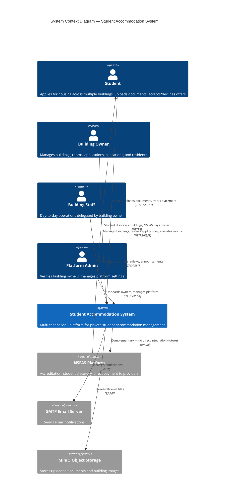
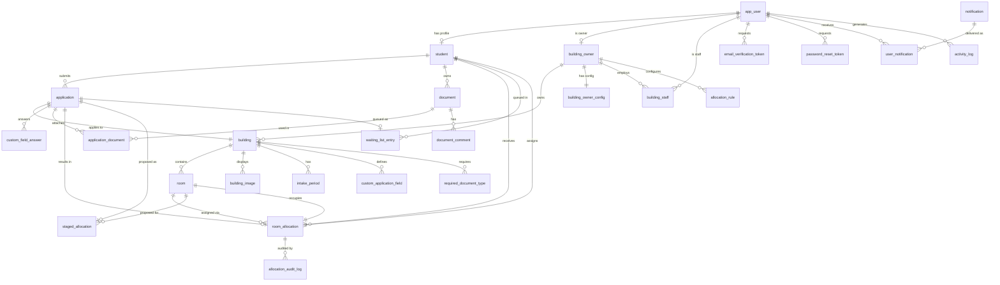
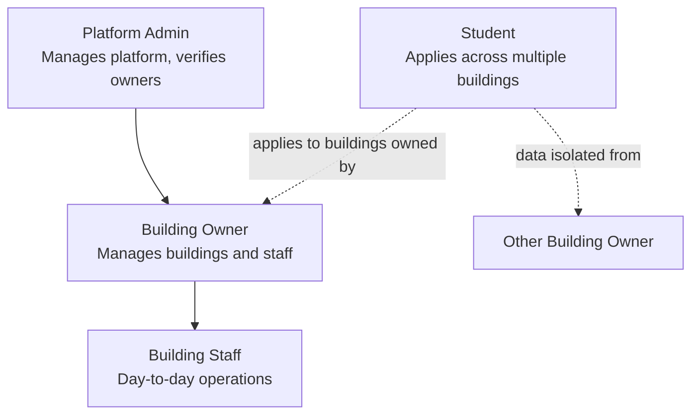
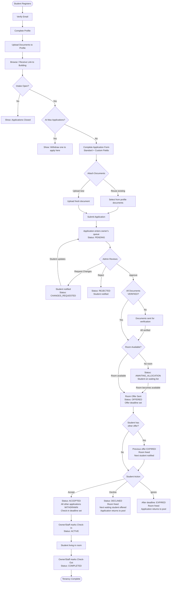
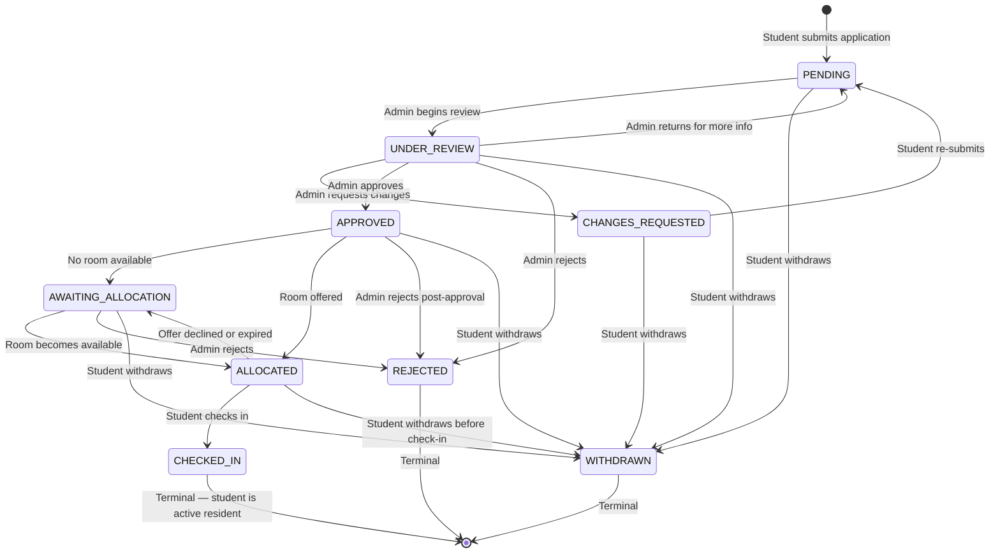
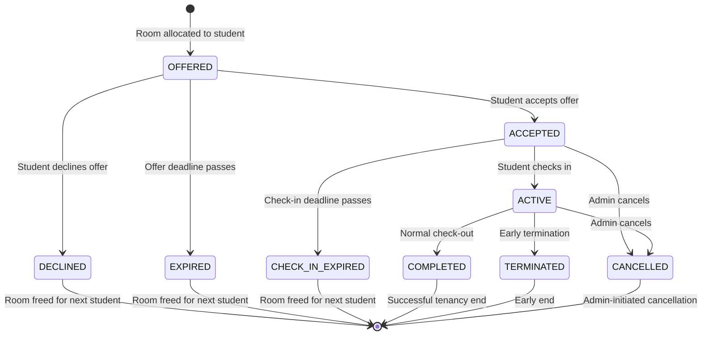
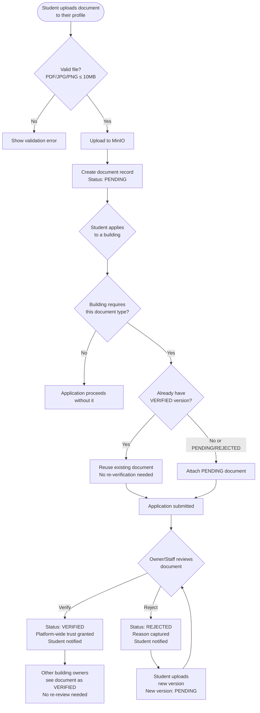
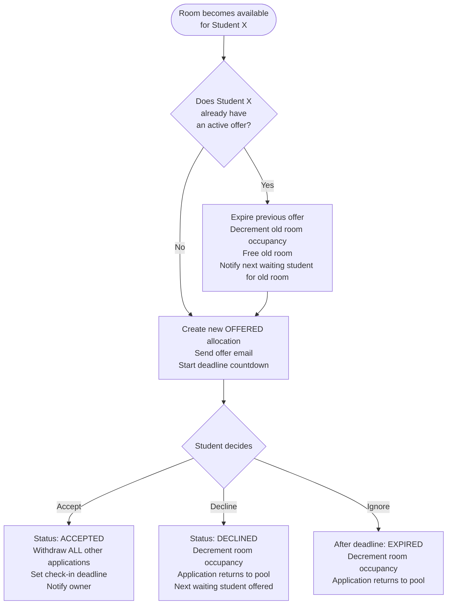
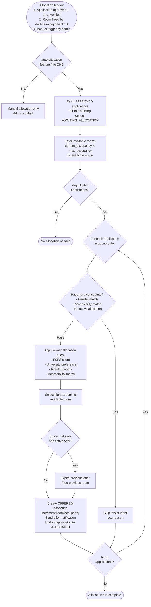
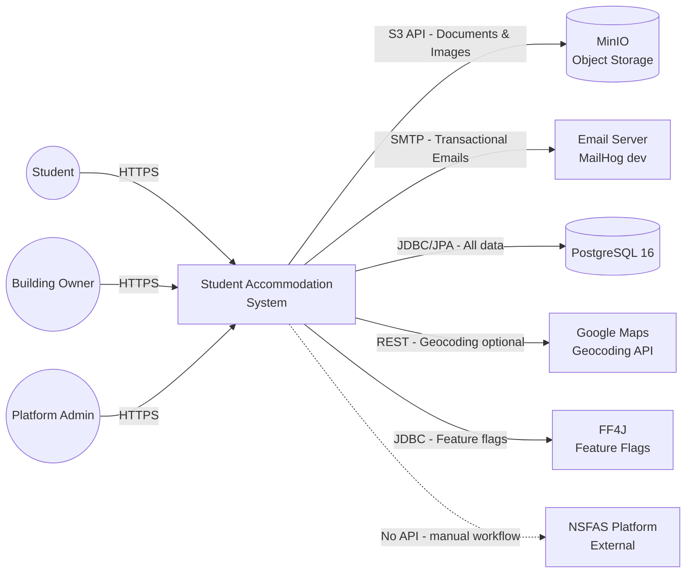

# Business Requirements Document
## Student Accommodation System

---

## Document Control

| **Attribute**        | **Details**                                                                 |
|----------------------|-----------------------------------------------------------------------------|
| **Document Title**   | Business Requirements Document — Student Accommodation System               |
| **Version**          | 2.0                                                                         |
| **Date**             | 2026-02-23                                                                  |
| **Author**           | Senior Business Analyst (Product Discovery + Codebase Analysis)            |
| **Status**           | Draft — Incorporating Product Discovery Decisions                           |
| **Classification**   | Internal — Business Requirements                                            |
| **Project**          | Student Accommodation System (Working Title — Branding TBD)                |
| **Technology Stack** | Spring Boot 3.5.7, Java 17, Angular 21, PostgreSQL 16, MinIO, FF4J         |
| **Previous Version** | v1.1 — Single-tenant codebase specification (superseded by this document)  |

> **NOTE TO ARCHITECT:** Version 2.0 supersedes v1.1. The previous document described a single-tenant system. This document reflects the product vision established through structured product discovery. Significant architectural changes are required. All differences between v1.1 and v2.0 are intentional product decisions, not errors.

---

## 1. Executive Summary

### 1.1 Purpose

This document defines the business requirements for a **multi-tenant SaaS platform** for private student accommodation providers in South Africa. The platform enables building owners to manage the full student housing lifecycle — from application intake and document verification through intelligent room allocation, occupancy tracking, and resident communication — from a single dashboard.

### 1.2 The Problem We Are Solving

Private student accommodation providers in South Africa face a fragmented, manual, and inefficient process for filling their buildings:

- **Building owners** advertise through word of mouth, Facebook groups, physical signage, and agents. They collect applications via WhatsApp, email, and walk-ins. They track everything on spreadsheets. They manually decide who gets which room. Students accept rooms and ghost — leaving beds empty with no replacement mechanism. No data exists to improve the next cycle.
- **Students** walk around neighbourhoods looking for accommodation. They don't know which buildings have availability. They message multiple landlords on WhatsApp and hedge their bets by accepting multiple offers.
- **The market outcome:** Buildings sit partially empty. One building owner in the Vaal region was unable to fill 30 beds consistently and sold the building. Students sleep in unsuitable conditions or go without.

The NSFAS platform (profprod.nsfas.org.za) addresses accreditation, student discovery, and direct payment to providers — but does **not** provide operational management tools. Building owners need a system to run their business after students find them.

### 1.3 Our Solution

A purpose-built **operations platform** for private student accommodation providers:

- Students create **one profile and one document store** that they carry across all applications
- Building owners receive applications through the platform, verify documents, and let the system automatically allocate rooms based on configurable rules
- When a student accepts one offer, all other pending applications are automatically withdrawn — eliminating ghosting
- Building owners see real-time occupancy, communicate with residents, and gain data to make smarter decisions each cycle
- The platform grows more valuable as more building owners join — the shared student pool means more pre-verified students available to every owner

### 1.4 Primary Launch Market

**Vaal Triangle region, South Africa** — serving building owners accredited with:
- Vaal University of Technology (VUT)
- North-West University (NWU) Vaal Campus

**First customer:** One 30-bed building owner in the Vaal region (the product owner's brother). This building is the proof of concept and case study for expansion.

### 1.5 Relationship to NSFAS Platform

This product **complements, not competes with**, the NSFAS Student Housing Management App:

| **NSFAS Platform Handles**         | **Our Platform Handles**                    |
|------------------------------------|---------------------------------------------|
| Building accreditation and grading | Application intake and processing           |
| Student discovery and listing      | Document verification and management        |
| Direct payment to providers (5% fee deducted) | Intelligent room allocation          |
| NSFAS funding verification         | Occupancy tracking and check-in/check-out   |
| Regulatory compliance (DHET)       | Resident communication and announcements    |
|                                    | Analytics and operational reporting         |
|                                    | Team management for building staff          |

Building owners operate on both platforms. NSFAS brings them students and pays them. We help them manage everything about running the accommodation business.

---

## 2. Product Vision & Business Context

### 2.1 Value Proposition

**For building owners:**
> "Automate your room allocation, track real-time occupancy, digitise your paperwork, and manage your entire accommodation business from one dashboard — whether you have 30 beds or 500."

**For students:**
> "Find and compare verified student accommodation near your university. Apply once. Track your placement in real time."

### 2.2 Unfair Advantages

| # | Advantage | Description |
|---|-----------|-------------|
| 1 | **Intelligent automatic allocation** | The scoring and rules engine fills beds faster and fairer than manual decisions. No other SA tool does this for small/mid operators. |
| 2 | **Shared verified student pool** | Students verify their documents once. Every building owner on the platform benefits. This compounds: more owners → more students → more owners. |
| 3 | **Simplicity** | Built for the 30-bed operator with no dedicated IT staff. Not enterprise software with enterprise complexity. |
| 4 | **End-to-end** | One platform from application to check-out. No spreadsheets, no WhatsApp threads, no separate tools. |

### 2.3 Business Model

| Item | Detail                                                                                                                                  |
|------|-----------------------------------------------------------------------------------------------------------------------------------------|
| **Who pays** | Building owners (B2B SaaS)                                                                                                              |
| **Who is free** | Students                                                                                                                                |
| **Revenue model** | R50 per student per month (matching market benchmark — Jez Software pricing)                                                            |
| **Minimum** | No minimum — serve operators from 10 beds upward (Jez Software requires 50 students minimum; we serve smaller operators they ignore)    |
| **Setup** | TBD — potentially R3,000 once-off setup fee (to be validated with first customers)                                                      |
| **Free trial** | TBD — 14-day free trial                                                                                                                  |
| **Pricing evolution** | Pricing model to be validated post-launch. System tracks bed counts and occupancy to support any future model (per-bed, tiered, hybrid). |

### 2.4 Competitive Landscape

| Competitor | Type | Strength | Weakness | Our Response |
|-----------|------|----------|----------|--------------|
| **NSFAS Platform** | Government marketplace | Mandatory for NSFAS students; owns payment channel | No operational management tools | Complement, not compete — integrate workflows |
| **DigsConnect** | Marketplace (70,000+ beds) | Huge student base, university partnerships, mobile app | Listing only — no operations management for owners | We are the operations layer, not the marketplace |
| **Jez Software** | Management software (JHB focus) | SA-specific, established, rent collection | Minimum 50 students; JHB-focused; post-occupancy only | No minimum, pre-occupancy allocation, Vaal market |
| **StarRez** | Enterprise global platform | Full-featured, integrated payments | Too complex and expensive for small/mid operators | Simplicity and affordability for our market |
| **Spreadsheets + WhatsApp** | Status quo | Free, familiar | Manual, error-prone, no data, no automation | Automation and data insights that pay for themselves |

### 2.5 Go-To-Market Strategy

1. **Phase 1 (Now):** Deploy for first customer (Vaal building owner — proof of concept)
2. **Phase 2 (Post-proof):** Use first customer's results as case study to onboard other Vaal region building owners near VUT and NWU
3. **Phase 3:** Expand to other regions through direct outreach and university accommodation office relationships

---

## 3. Stakeholders & Actors

### 3.1 Primary Stakeholders

| **Stakeholder**              | **Role**                                  | **Key Interests**                                           |
|------------------------------|-------------------------------------------|-------------------------------------------------------------|
| Building Owner               | Primary paying customer                   | Fill beds fast, reduce admin, NSFAS compliance, data        |
| Students                     | Primary end-user (free)                   | Find accommodation, track application, simple experience    |
| Platform Operator            | Us — the product company                  | Onboard building owners, ensure quality, grow student pool  |
| Building Staff               | Day-to-day operators for building owners  | Simple tools to manage check-ins, document reviews, comms   |
| NSFAS                        | External regulatory and payment body      | Compliance, payment accuracy, accredited buildings only     |

### 3.2 System Actors & Role Hierarchy

```
PLATFORM ADMIN
    └── BUILDING OWNER
            └── BUILDING STAFF
STUDENT (independent — applies across multiple building owners)
```

#### **PLATFORM ADMIN** (Product Operator — Us)

**Responsibilities:**
- Verify and onboard new building owners before they go live
- Set up the first building for each new owner (onboarding assistance)
- Manage platform-wide settings (student application limit, platform policies)
- Access platform-wide analytics
- Manage platform feature flags
- Handle escalated disputes between students and building owners

**Permissions:**
- Full access to all building owner accounts (support/audit purposes)
- Approve/reject building owner registrations
- Configure platform-wide defaults
- View all activity logs across the platform

**Access Constraints:**
- Cannot modify student data without audit log
- All platform admin actions are logged

#### **BUILDING OWNER** (Primary Paying Customer)

**Responsibilities:**
- Manage their buildings and rooms
- Define application requirements (fields, documents, rules)
- Configure allocation rules (FCFS, university preference, gender, NSFAS priority)
- Set intake periods (fixed window or rolling)
- Review and verify student documents
- Monitor occupancy and communicate with residents
- Invite and manage building staff

**Permissions:**
- Full CRUD on their own buildings, rooms, applications, and allocations
- Configure their own intake periods, document requirements, and allocation rules
- View and verify documents for their applicants
- Send announcements to residents of their buildings
- Invite staff members with defined permission sets
- Export their own data and reports

**Access Constraints:**
- Cannot see other building owners' data
- Cannot see students' applications to other owners' buildings
- Must be verified by Platform Admin before going live

#### **BUILDING STAFF** (Delegated by Building Owner)

**Responsibilities:**
- Day-to-day management tasks delegated by building owner
- Typical tasks: check-in/check-out, document review, responding to announcements

**Permissions (configurable by building owner):**
- Subset of building owner permissions
- Example restricted staff: can check-in students but cannot configure allocation rules
- Example full staff: can do everything except invite other staff or change billing

**Access Constraints:**
- Scoped to buildings they are explicitly assigned to by the owner
- Cannot exceed the permissions granted by their building owner

#### **STUDENT** (Free User)

**Responsibilities:**
- Complete profile and upload documents
- Browse and apply to buildings on the platform
- Respond to room offers within deadlines
- Confirm check-in and departure

**Permissions:**
- Create and manage their own profile
- Upload and manage their own documents
- View buildings and submit applications (up to platform-configured maximum, default 5)
- Accept or decline room offers
- View in-app notifications
- Communicate through the platform (future)

**Access Constraints:**
- Cannot access other students' data
- Cannot access building owner management features
- Cannot have more than the platform-configured maximum active applications simultaneously
- Can only hold ONE active room offer at any time — accepting one auto-withdraws all other applications

#### **LANDLORD Role (Current Codebase)**
> [CONFLICT] The current codebase implements `ADMIN > LANDLORD > STUDENT` hierarchy with LANDLORD minimally implemented. In the product vision, the equivalent role is BUILDING OWNER with full operations capability. The codebase's LANDLORD role should be evolved into BUILDING OWNER in the target architecture. The current ADMIN role maps to PLATFORM ADMIN.

---

## 4. System Context

### 4.1 System Overview

A multi-tier web application with multi-tenant data isolation:

- **Frontend Layer:** Angular 21 SPA — responsive web + PWA capability
- **API Layer:** Spring Boot 3.5.7 REST API with JWT authentication and tenant isolation
- **Data Layer:** PostgreSQL 16 with Flyway-managed schema, tenant-scoped data access
- **Storage Layer:** MinIO S3-compatible object storage for documents and building images
- **Communication Layer:** SMTP email + in-app notifications (WhatsApp in Phase 2)
- **Infrastructure:** Docker containers for all services

### 4.2 Context Diagram



### 4.3 External Dependencies

| **System**          | **Purpose**                              | **Integration Method** | **Criticality** | **Notes**                    |
|---------------------|------------------------------------------|------------------------|-----------------|------------------------------|
| SMTP Server         | Email notification delivery              | Spring Mail (SMTP)     | High            | MailHog for dev/test         |
| MinIO               | Document and image storage               | AWS S3 SDK             | High            |                              |
| PostgreSQL          | Primary data persistence                 | JDBC/JPA               | Critical        |                              |
| NSFAS Platform      | Accreditation and payments               | None (manual)          | External        | No API available; future goal|
| Google Maps API     | Building address geocoding               | REST API               | Low             | Feature-flagged; optional    |

---

## 5. MVP Scope Definition

### 5.1 What Is In MVP

The MVP delivers a complete, working product for a single building owner with one or more buildings. It must be simple enough to set up and use without technical support after the initial onboarding.

| # | MVP Capability | Description |
|---|---------------|-------------|
| 1 | **Platform Admin onboarding** | Platform admin verifies building owners, sets up their first building |
| 2 | **Building & room management** | Owner manages buildings, rooms, gender rules, floor layouts |
| 3 | **Intake period configuration** | Owner sets fixed application window or rolling admissions per building |
| 4 | **Custom application form** | Owner defines fields students must complete when applying |
| 5 | **Custom document requirements** | Owner defines which documents are required for their buildings |
| 6 | **Student registration & profile** | Students sign up, verify email, complete profile once, reuse everywhere |
| 7 | **Student document store** | Students upload documents once; reuse across applications; platform-level verification |
| 8 | **Application management** | Students apply to buildings; owners see all applications in one dashboard |
| 9 | **Document verification** | Owner or staff reviews student documents; once verified, trusted across platform |
| 10 | **Automatic room allocation** | Configurable rules engine allocates rooms (FCFS, university preference, gender, NSFAS status) |
| 11 | **Manual allocation override** | Owner/staff can manually assign rooms; logged as override |
| 12 | **Offer management** | Students receive offer, accept or decline within owner-configurable deadline |
| 13 | **One-active-offer rule** | When student accepts one offer, all other pending applications auto-withdrawn |
| 14 | **Real-time occupancy dashboard** | Owner sees which rooms are occupied, available, or offered |
| 15 | **Simple check-in / check-out** | Staff marks student as checked in / checked out with one action |
| 16 | **Resident communication** | Owner/staff sends announcements to all residents of a building |
| 17 | **Team management** | Owner invites staff with configurable permissions |
| 18 | **Email + in-app notifications** | Key events trigger email and in-app notifications |
| 19 | **Basic analytics** | Occupancy rate, application counts, source university breakdown, time-to-fill |
| 20 | **Responsive web + PWA** | Works on desktop and mobile browsers; installable as PWA |

### 5.2 What Is NOT In MVP (Phase 2 — First 6 Months Post-Launch)

| Feature | Rationale |
|---------|-----------|
| Maintenance request management | Real but not critical for getting students in beds |
| NSFAS payment tracking | Important but requires NSFAS data access |
| Lease/contract management | Valuable but not MVP-blocking |
| WhatsApp notifications | High impact but API complexity |
| Advanced analytics (year-over-year, no-show rates) | Needs data from at least one cycle first |
| Waiting list automation | Manual override sufficient for MVP |
| Bulk building/room CSV import | Not needed until multi-building scale |

### 5.3 Long-Term Roadmap (12+ Months)

| Feature | Description |
|---------|-------------|
| Student discovery / public listings | Students browse and find buildings without referral |
| NSFAS integration | Sync student data if NSFAS opens APIs |
| University admin portal | Universities manage their students' accommodation |
| Student-to-student features | Room swaps, roommate matching |
| Rent collection / payment processing | If NSFAS payment model changes |
| Native mobile app (iOS/Android) | After PWA validates mobile demand |
| Multi-language support | Afrikaans, Zulu, Sotho |
| Tenancy agreement generation | PDF contracts per student |
| Maintenance management | Track and resolve maintenance requests |

---

## 6. Functional Requirements

> **Convention:** Requirements marked `[MVP]` are in scope for the initial launch. Requirements marked `[PHASE 2]` are planned for the first 6 months post-launch. Requirements marked `[ROADMAP]` are long-term goals.

---

### 6.1 Platform Administration

| **ID** | **Requirement** | **Priority** | **Acceptance Criteria** | **Edge Cases** | **Dependencies** | **Source** | **Phase** |
|--------|----------------|--------------|-------------------------|----------------|------------------|------------|-----------|
| PA-001 | The system shall allow Platform Admins to review and approve building owner registrations | MUST | • Building owner submits registration with: business name, contact details, accreditation proof<br>• Platform Admin receives notification of new registration<br>• Platform Admin can approve or reject with reason<br>• Approved owners gain access to the platform<br>• Rejected owners receive email with reason | • Owner registers with invalid accreditation → reject with guidance<br>• Owner re-applies after rejection → allowed<br>• Owner is already registered → 409 error | Email notification system | New requirement from product discovery | MVP |
| PA-002 | The system shall allow Platform Admins to set up the first building for new building owners | MUST | • During onboarding, Platform Admin accesses owner's account (with audit log)<br>• Platform Admin creates building, rooms, and initial configuration on behalf of owner<br>• Owner notified when setup is complete<br>• Owner can see and manage everything after setup<br>• Setup must be completable in under 30 minutes | • Owner requests changes to setup → they do it themselves after handover<br>• Setup incomplete → owner can complete it<br>• Platform Admin makes error → owner can correct | PA-001 | New requirement from product discovery | MVP |
| PA-003 | The system shall allow Platform Admins to configure platform-wide defaults | MUST | • Configurable defaults: student application limit (default 5), offer expiry minimum/maximum, document verification policy<br>• Changes apply to all new building owner configurations<br>• Existing owners unaffected by default changes until they reset their settings | • Invalid default value → validation error<br>• Default changes mid-cycle → apply to new cycles only | — | New requirement from product discovery | MVP |
| PA-004 | The system shall provide Platform Admins with platform-wide analytics | SHOULD | • Total buildings on platform, total beds, total students registered<br>• Platform occupancy rate across all buildings<br>• Applications submitted per month<br>• Building owners by region<br>• Revenue metrics (students × R20 = MRR) | • No data yet (new platform) → show empty state | PA-001 | New requirement from product discovery | MVP |

---

### 6.2 Building Owner Onboarding & Account Management

| **ID** | **Requirement** | **Priority** | **Acceptance Criteria** | **Edge Cases** | **Dependencies** | **Source** | **Phase** |
|--------|----------------|--------------|-------------------------|----------------|------------------|------------|-----------|
| BO-001 | The system shall allow building owners to register on the platform | MUST | • Owner provides: business name, owner full name, email, password, phone number, region/city<br>• Owner uploads accreditation proof (NSFAS accreditation letter)<br>• Account created with PENDING status<br>• Owner receives "under review" email<br>• Platform Admin notified of new registration | • Duplicate email → 409 error<br>• Missing accreditation proof → validation error | Email notification | New requirement | MVP |
| BO-002 | The system shall allow building owners to manage their team (Building Staff) | MUST | • Owner invites staff via email<br>• Owner assigns permission set: FULL (all operations except billing/team management) or RESTRICTED (check-in/check-out only, document review only, etc.)<br>• Staff member receives invitation email with setup link<br>• Staff can be assigned to specific buildings<br>• Owner can revoke access at any time | • Staff invitation expires after 48 hours<br>• Staff already has an account → link to existing account<br>• Staff leaves organisation → owner revokes access<br>• Owner has no buildings yet → can still invite staff | BO-001 | New requirement | MVP |
| BO-003 | The system shall allow building owners to configure their intake periods | MUST | • Owner configures per building:<br>&nbsp;&nbsp;- Mode: Fixed Window or Rolling<br>&nbsp;&nbsp;- If Fixed: application open date and close date<br>&nbsp;&nbsp;- If Rolling: always accepting, no date restriction<br>• Multiple intake periods per building per year (e.g., Jan intake, July intake)<br>• Students cannot apply outside open windows (for Fixed mode) | • No active intake → student sees "Applications currently closed"<br>• Intake period expires mid-application → application still submitted if form was started<br>• Owner sets close date in the past → validation error | BO-001 | Replaces platform-wide academic year in v1.1 | MVP |
| BO-004 | The system shall allow building owners to define custom application fields | MUST | • Owner creates custom form fields for their buildings:<br>&nbsp;&nbsp;- Field types: text, number, dropdown, checkbox, date<br>&nbsp;&nbsp;- Each field: label, required/optional, help text<br>&nbsp;&nbsp;- Display order configurable<br>• Standard fields always included: student name, university, year of study, room preference, gender, accessibility needs, emergency contact<br>• Custom fields appear in the student application form for that building | • Field deleted after students have answered it → retain historical answers<br>• Field type changed → validate existing answers<br>• No custom fields → standard fields only | BO-001 | New requirement from product discovery | MVP |
| BO-005 | The system shall allow building owners to define required documents | MUST | • Owner configures required document types per building:<br>&nbsp;&nbsp;- Document name (e.g., "NSFAS Approval Letter")<br>&nbsp;&nbsp;- Description (guidance for students)<br>&nbsp;&nbsp;- Required or optional<br>• Students applying to the building must upload all required documents<br>• If student already has a matching document type verified on the platform, they are prompted to reuse or upload fresh | • Owner adds new required document mid-cycle → existing applicants notified to upload<br>• Owner removes required document → existing applications unaffected<br>• No documents required → application-only workflow | BO-001 | Replaces fixed document types in v1.1 | MVP |
| BO-006 | The system shall allow building owners to configure allocation rules | MUST | • Owner configures allocation priority per building:<br>&nbsp;&nbsp;- First Come First Served (application submission date)<br>&nbsp;&nbsp;- University preference (select which universities get priority)<br>&nbsp;&nbsp;- NSFAS-funded students (confirmed funding gets priority)<br>&nbsp;&nbsp;- Accessibility needs (students requiring accessible rooms matched first)<br>• Owner assigns weight/priority order to each rule<br>• Default if unconfigured: FCFS only | • No rules configured → FCFS is the default<br>• Conflicting rules → system applies in priority order<br>• Rule changes mid-cycle → applies to next allocation run, not current offers | BO-001 | Replaces hardcoded scoring weights in v1.1 | MVP |

---

### 6.3 Building & Room Management

| **ID** | **Requirement** | **Priority** | **Acceptance Criteria** | **Edge Cases** | **Dependencies** | **Source** | **Phase** |
|--------|----------------|--------------|-------------------------|----------------|------------------|------------|-----------|
| BM-001 | The system shall allow building owners to create and manage multiple buildings | MUST | • Owner creates building with:<br>&nbsp;&nbsp;- Name (required, unique within owner's account)<br>&nbsp;&nbsp;- Address (street, city, postal code)<br>&nbsp;&nbsp;- Total floors<br>&nbsp;&nbsp;- Description (max 1000 chars)<br>&nbsp;&nbsp;- Gender policy (MALE_ONLY, FEMALE_ONLY, MIXED — overridable at floor/room level)<br>• Multiple buildings per owner from day one — no artificial limit<br>• Building appears in owner's dashboard immediately | • Duplicate building name (within same owner) → 409 error<br>• Delete building with active students → blocked: "Students are currently placed in this building"<br>• Building has rooms with active allocations → cannot delete | BO-001 | `BuildingService.java`, updated for multi-tenant | MVP |
| BM-002 | The system shall support building images | SHOULD | • Owner uploads multiple images per building<br>• Images stored in MinIO<br>• One image marked as primary<br>• Display order configurable<br>• Supported formats: JPG, PNG (max 5MB per image) | • Max images exceeded (20) → error<br>• Delete primary image → next image auto-promoted | BM-001, MinIO | `BuildingImageService.java` | MVP |
| BM-003 | The system shall allow building owners to manage rooms | MUST | • Owner creates rooms within a building:<br>&nbsp;&nbsp;- Room number (unique within building)<br>&nbsp;&nbsp;- Floor number (≤ building total floors)<br>&nbsp;&nbsp;- Room type (SINGLE, DOUBLE, TRIPLE, QUAD)<br>&nbsp;&nbsp;- Max occupancy<br>&nbsp;&nbsp;- Gender restriction (overrides building-level: MALE_ONLY, FEMALE_ONLY, MIXED)<br>&nbsp;&nbsp;- Accessibility compliant (boolean)<br>&nbsp;&nbsp;- Available/unavailable flag (for maintenance)<br>• Rooms can be created individually or in bulk (floor range) | • Room number duplicate in same building → 409 error<br>• Floor > total_floors → validation error<br>• Room has active allocation → cannot delete | BM-001 | `RoomService.java` | MVP |
| BM-004 | The system shall track real-time room occupancy | MUST | • Each room displays: current occupancy, max occupancy, available capacity<br>• Occupancy incremented when offer is created (OFFERED status)<br>• Occupancy decremented when offer declines, expires, or is cancelled<br>• Owner sees live occupancy dashboard: total beds, occupied, available, offered<br>• Colour-coded status: green (available), amber (offered), red (full) | • Occupancy goes negative → data integrity error, alert Platform Admin<br>• Occupancy exceeds max → block allocation, alert owner<br>• Room marked unavailable → excluded from allocation pool | BM-003 | `RoomService.java`, `RoomAllocationService.java` | MVP |

---

### 6.4 Student Registration & Profile

| **ID** | **Requirement** | **Priority** | **Acceptance Criteria** | **Edge Cases** | **Dependencies** | **Source** | **Phase** |
|--------|----------------|--------------|-------------------------|----------------|------------------|------------|-----------|
| ST-001 | The system shall allow students to register with email and password | MUST | • Student provides: first name, last name, email, password (min 8 chars)<br>• Password hashed using BCrypt (strength 12)<br>• Verification email sent with UUID token (24h expiry)<br>• JWT token issued on signup<br>• Student role assigned by default | • Duplicate email → 409 CONFLICT<br>• Invalid email format → 400 BAD REQUEST<br>• Email service failure → account created, no email (async retry) | Email service | `AuthService.signup()` | MVP |
| ST-002 | The system shall require email verification before platform access | MUST | • Verification link sent on signup<br>• Token has 24-hour expiry (configurable)<br>• On click: email verified, student redirected to profile setup<br>• Unverified students cannot submit applications<br>• Student can resend verification email | • Expired token → show resend option<br>• Already verified → redirect to dashboard<br>• Token reuse → error | ST-001 | `AuthService.verifyEmail()` | MVP |
| ST-003 | The system shall require students to complete their profile before applying | MUST | • Profile required fields: phone number, date of birth, gender, university, year of study<br>• Emergency contact: name, relationship, phone, email<br>• Optional: special requirements, dietary requirements<br>• Profile completion checked before application submission<br>• Profile can be updated at any time | • Incomplete profile → blocked from applying with "Complete your profile" message<br>• Future DOB → validation error<br>• Profile update while application active → allowed | ST-002 | `StudentService.java`, `profile-setup.component.ts` | MVP |
| ST-004 | The system shall maintain a platform-level student document store | MUST | • Students upload documents to their profile (not per-application)<br>• Each document: type name, file, upload date, verification status<br>• Documents persist across all applications<br>• Verification is platform-level: once verified by any owner or Platform Admin, status is VERIFIED across the platform<br>• Students can upload new versions of existing documents | • Student uploads expired document → owner can still see it and reject it<br>• Document verified by Owner A — trusted by Owner B automatically<br>• Student uploads new version → old version retained for audit, new version is active | ST-002 | Significant change from v1.1 (was per-application) | MVP |
| ST-005 | The system shall allow students to delete their accounts | SHOULD | • Student submits delete request with password confirmation<br>• Cascading: active applications withdrawn, waiting list entries removed, allocations cancelled<br>• Documents retained for audit (soft delete, owner can still see for completed applications)<br>• User profile and personal data hard deleted<br>• Confirmation email sent | • Active allocation → warn student: "You have an active room placement. Deleting your account will cancel it."<br>• Pending offer → offer cancelled, room freed, next student notified | All user entities | `AuthService.deleteAccount()` | MVP |

---

### 6.5 Application Management

| **ID** | **Requirement** | **Priority** | **Acceptance Criteria** | **Edge Cases** | **Dependencies** | **Source** | **Phase** |
|--------|----------------|--------------|-------------------------|----------------|------------------|------------|-----------|
| APP-001 | The system shall allow students to apply to buildings on the platform | MUST | • Student browses buildings (those they have been referred to or know about in MVP)<br>• Student selects a building and completes the application form:<br>&nbsp;&nbsp;- Standard fields: room type preference, gender, accessibility needs, emergency contact<br>&nbsp;&nbsp;- Building owner custom fields<br>• Application submitted and enters owner's review queue<br>• Student can have up to platform-configured maximum active applications (default 5)<br>• Application must be submitted during the building's open intake period (Fixed mode) | • Student already at max applications → "You have reached the maximum of 5 active applications. Withdraw one to apply here."<br>• Intake period closed → "Applications for this building are currently closed."<br>• Student profile incomplete → redirect to profile setup<br>• Email not verified → redirect to verification | ST-003 (profile complete), BO-003 (intake open) | New requirement (multi-tenant) | MVP |
| APP-002 | The system shall prevent duplicate applications to the same building | MUST | • Student cannot have more than one active application to the same building at the same time<br>• Active statuses: PENDING, UNDER_REVIEW, APPROVED, AWAITING_ALLOCATION<br>• Student can re-apply after their previous application is REJECTED, WITHDRAWN, or EXPIRED | • Student tries to re-apply while active → "You already have an active application to this building."<br>• Previous application rejected → student can apply again | APP-001 | New requirement (multi-tenant) | MVP |
| APP-003 | The system shall provide building owners with an application management dashboard | MUST | • Owner sees all applications to their buildings in one view<br>• Filter by: building, status, university, submission date, application ID<br>• Sort by: submission date, status<br>• Bulk actions: approve, reject, request documents<br>• Click application → view full details including student profile, documents, custom field answers | • No applications → empty state with "No applications yet. Share your building link with students."<br>• Large volume (100+) → paginate at 25 per page<br>• New application → in-app notification to owner | APP-001 | `ApplicationService.java`, `ApplicationController.java` | MVP |
| APP-004 | The system shall track application status transitions | MUST | **Valid statuses and transitions:**<br>• `PENDING` → `UNDER_REVIEW`, `APPROVED`, `REJECTED`, `WITHDRAWN`<br>• `UNDER_REVIEW` → `PENDING`, `CHANGES_REQUESTED`, `APPROVED`, `REJECTED`<br>• `CHANGES_REQUESTED` → `PENDING`, `WITHDRAWN`<br>• `APPROVED` → `AWAITING_ALLOCATION`, `REJECTED`, `WITHDRAWN`<br>• `AWAITING_ALLOCATION` → `ALLOCATED`, `REJECTED`, `WITHDRAWN`<br>• `ALLOCATED` → `CHECKED_IN`, `WITHDRAWN` (if student hasn't checked in yet)<br>• `CHECKED_IN` → (terminal)<br>• `REJECTED` → (terminal)<br>• `WITHDRAWN` → (terminal, student-initiated)<br>• Invalid transitions blocked with 400 BAD REQUEST | • Concurrent status updates → optimistic locking<br>• Admin attempts invalid transition → error with valid next states<br>• Student withdraws application after offer accepted → separate flow (cancel allocation) | APP-001 | `ApplicationStatus.java` — updated state machine | MVP |
| APP-005 | The system shall allow students to withdraw their applications | MUST | • Student can withdraw applications in: PENDING, UNDER_REVIEW, CHANGES_REQUESTED, APPROVED, AWAITING_ALLOCATION states<br>• Confirmation dialog shown<br>• If application was ALLOCATED (offer outstanding), declining the offer is the mechanism — not withdrawal<br>• Application status → WITHDRAWN<br>• Owner notified | • Cannot withdraw CHECKED_IN application → "You are already checked in. Contact the building owner."<br>• Cannot withdraw REJECTED/WITHDRAWN → already terminal | APP-001 | `ApplicationService.withdrawApplication()` | MVP |

---

### 6.6 Document Management

| **ID** | **Requirement** | **Priority** | **Acceptance Criteria** | **Edge Cases** | **Dependencies** | **Source** | **Phase** |
|--------|----------------|--------------|-------------------------|----------------|------------------|------------|-----------|
| DOC-001 | The system shall allow students to upload documents to their profile | MUST | • Student uploads documents from their profile (not per-application)<br>• Supported formats: PDF, JPG, JPEG, PNG<br>• Max file size: 10MB per file<br>• Files stored in MinIO<br>• Document record created with status PENDING<br>• Student can have multiple documents of the same type (e.g., two enrollment proofs) | • File too large → 400 "File exceeds 10MB limit"<br>• Unsupported format → 400 "Only PDF, JPG, PNG accepted"<br>• MinIO unavailable → retry 3 times, then error | ST-002, MinIO | `DocumentService.uploadDocument()` | MVP |
| DOC-002 | The system shall implement platform-level document verification | MUST | • Document verification status is platform-wide — not per building or per application<br>• Statuses: `PENDING` → `VERIFIED` or `REJECTED`<br>• Any authorised party can verify: Building Owner, Building Staff (if permitted), or Platform Admin<br>• Who verified and when is recorded<br>• Once VERIFIED, the document is trusted for all applications across the platform<br>• A VERIFIED document shown to a new building owner is marked "Verified by platform" | • Owner A verifies document → Owner B sees it as VERIFIED without re-reviewing<br>• Student uploads new version of verified document → new version is PENDING, old version retained<br>• VERIFIED document used in multiple applications → single verification covers all | DOC-001 | Major change from v1.1 — platform-level not per-application | MVP |
| DOC-003 | The system shall allow students to reuse existing documents when applying | MUST | • When student applies to a building that requires documents they already have:<br>&nbsp;&nbsp;- System shows: "You have already uploaded [Document Type]. Use this one or upload a new one?"<br>&nbsp;&nbsp;- If document is VERIFIED → student can reuse with one click<br>&nbsp;&nbsp;- If document is PENDING/REJECTED → student prompted to upload fresh<br>• Student selects which documents to attach to the application | • Document expired (e.g., ID expires) → student should upload fresh; system shows expiry warning<br>• Owner requires document that student hasn't uploaded → student must upload before submitting | DOC-001, APP-001 | New requirement from product discovery | MVP |
| DOC-004 | The system shall notify students when documents are verified or rejected | MUST | • Email and in-app notification sent on: VERIFIED, REJECTED (with reason)<br>• Rejection reason captured by verifier (max 500 chars) and included in notification<br>• Student can upload a new version to replace a rejected document | • SMTP unavailable → in-app notification still works, email retried<br>• Student has no email → in-app only | DOC-002, notification system | `NotificationService.java` | MVP |
| DOC-005 | The system shall allow verifiers to add comments on documents | SHOULD | • Owner/staff can add comments to documents (max 500 chars per comment)<br>• Student notified of new comment<br>• Comments ordered by creation date, newest first<br>• Verifier can delete their own comments | • Comment on deleted document → error<br>• Student replies to comment → future feature | DOC-002 | `DocumentComment.java` | MVP |

---

### 6.7 Room Allocation Engine

| **ID** | **Requirement** | **Priority** | **Acceptance Criteria** | **Edge Cases** | **Dependencies** | **Source** | **Phase** |
|--------|----------------|--------------|-------------------------|----------------|------------------|------------|-----------|
| ALLOC-001 | The system shall automatically allocate rooms based on building owner rules | MUST | • When an application is APPROVED and documents are VERIFIED:<br>&nbsp;&nbsp;1. System applies hard constraints (see ALLOC-002)<br>&nbsp;&nbsp;2. System scores eligible students against available rooms using owner-configured rules<br>&nbsp;&nbsp;3. Highest-scoring student-room match creates a room offer (status OFFERED)<br>&nbsp;&nbsp;4. If no rooms available → application moves to AWAITING_ALLOCATION<br>• Auto-allocation triggers:<br>&nbsp;&nbsp;- When admin approves an application<br>&nbsp;&nbsp;- When all required documents are VERIFIED<br>&nbsp;&nbsp;- When a room becomes available (decline, expiry, check-out)<br>• Feature-flag controlled: `auto-allocation` | • No eligible rooms → student notified: "No rooms currently available. You are on the waiting list."<br>• Allocation tie → FCFS tiebreaker (earliest application wins)<br>• Feature flag disabled → admin must allocate manually | APP-004 (APPROVED), DOC-002 (VERIFIED docs) | `RoomAllocationService.java`, `AllocationScoringService.java` | MVP |
| ALLOC-002 | The system shall apply hard constraints before allocation | MUST | • **Hard constraints** — student-room pair must satisfy all of these:<br>&nbsp;&nbsp;1. Application status = APPROVED<br>&nbsp;&nbsp;2. All required documents = VERIFIED<br>&nbsp;&nbsp;3. Student has no active allocation (OFFERED, ACCEPTED, ACTIVE)<br>&nbsp;&nbsp;4. Room has available capacity (current_occupancy < max_occupancy)<br>&nbsp;&nbsp;5. Room is marked available (is_available = true)<br>&nbsp;&nbsp;6. Gender compatibility: room gender restriction matches student gender<br>&nbsp;&nbsp;7. Accessibility: if student requires accessible room, room must be accessibility_compliant = true<br>• Constraints evaluated before any scoring<br>• Applications failing constraints are skipped (not excluded — re-evaluated when constraints change) | • Student requires accessible room, none available → added to waiting list<br>• Room gender restriction MIXED → any student eligible<br>• Hard constraint failure logged for reporting | ALLOC-001 | `AllocationScoringService.java` | MVP |
| ALLOC-003 | The system shall score applications using owner-configured allocation rules | MUST | • **Scoring components (owner-configurable weights):**<br>&nbsp;&nbsp;1. **FCFS Score:** Earlier application date = higher score (always included)<br>&nbsp;&nbsp;2. **University Preference:** Owner specifies priority universities; student from priority university = bonus points<br>&nbsp;&nbsp;3. **NSFAS Priority:** Confirmed NSFAS funding = bonus points<br>&nbsp;&nbsp;4. **Accessibility Match:** Student requires + room compliant = bonus points<br>• Final score = weighted sum of applicable components<br>• Tiebreaker: application submission date (earliest first)<br>• If owner has no rules configured → FCFS only | • Rule weights invalid (don't sum to 100%) → validation error on save<br>• New rule applied → affects next run, not current offers<br>• Student has no university set → university preference score = 0 | BO-006 (allocation rules) | `AllocationScoringService.java` — updated from v1.1 | MVP |
| ALLOC-004 | The system shall allow admins to manually allocate rooms with override logging | MUST | • Owner/staff selects an APPROVED application and a specific available room<br>• System validates hard constraints (ALLOC-002)<br>• If constraint fails → warning shown with option to override<br>• Override reason required (max 500 chars)<br>• Manual allocation and any overrides logged in `allocation_audit_log`<br>• Allocation created with status OFFERED | • Room has pending staged allocation → "This room has a proposed allocation. Approve or reject it first."<br>• Student already has active offer → error "Student already has an outstanding offer"<br>• Override attempted → reason required before proceeding | ALLOC-002 | `RoomAllocationService.manualAllocate()` | MVP |
| ALLOC-005 | The system shall manage a waiting list for applications with no available rooms | SHOULD | • When auto-allocation finds no eligible rooms → application moves to AWAITING_ALLOCATION<br>• Waiting list is FIFO within each priority tier<br>• When a room becomes available (decline, check-out, expiry) → system auto-offers to next eligible waiting student<br>• Student notified of position in queue (1st in queue, 2nd in queue, etc.) | • Multiple students waiting for specific room type → matched by score then FCFS<br>• Student withdraws application while waiting → removed from queue<br>• Student on waiting list receives offer from another building → their acceptance auto-withdraws this waiting list entry | ALLOC-001 | `WaitingListEntry.java` | PHASE 2 |

---

### 6.8 Offer Management

| **ID** | **Requirement** | **Priority** | **Acceptance Criteria** | **Edge Cases** | **Dependencies** | **Source** | **Phase** |
|--------|----------------|--------------|-------------------------|----------------|------------------|------------|-----------|
| OFFER-001 | The system shall notify students of room offers with owner-configurable deadline | MUST | • When a room is allocated (status OFFERED):<br>&nbsp;&nbsp;- Email and in-app notification sent to student<br>&nbsp;&nbsp;- Notification includes: building name, room details, floor, room type, offer deadline<br>&nbsp;&nbsp;- Offer deadline = current date + owner-configured offer_expiry_days (default 7, configurable per building)<br>• Student dashboard shows: offer details, accept/decline buttons, countdown to expiry | • Student not online → email is primary channel, in-app when they log in<br>• Email delivery fails → in-app notification still visible, email retried | ALLOC-001, notification system | `NotificationService.java` | MVP |
| OFFER-002 | The system shall enforce the one-active-offer platform rule | MUST | • At any point in time, a student can hold **exactly one** active offer (status OFFERED) across the entire platform<br>• When a student receives a new offer → if they already have an outstanding offer from a different building, the new offer replaces the old one (old offer → EXPIRED, room freed, next waiting student notified)<br>• This rule prevents students from accumulating multiple offers and ghosting | • Student has pending offer and receives new one → notify: "You have been offered a room at [Building B]. Your previous offer at [Building A] has been released."<br>• Race condition: two owners offer same student simultaneously → first offer wins, second allocation cancelled | ALLOC-001 | New requirement from product discovery | MVP |
| OFFER-003 | The system shall allow students to accept room offers | MUST | • Student clicks "Accept" on their dashboard<br>• System validates: offer not expired, student has no other active allocation<br>• Allocation status → ACCEPTED<br>• **All other pending applications across all buildings automatically withdrawn** (key multi-tenant rule)<br>• Student notified of acceptance<br>• Building owner notified of acceptance<br>• Check-in deadline set: acceptance date + owner-configured check_in_expiry_days (default 7) | • Student accepts after expiry → "This offer has expired. It is no longer available."<br>• System error during auto-withdrawal of other applications → retry; partial failure logged | OFFER-001 | `RoomAllocationService.acceptOffer()` — updated for multi-tenant | MVP |
| OFFER-004 | The system shall allow students to decline room offers | MUST | • Student clicks "Decline" on their dashboard<br>• Decline reason required: dropdown (Too expensive, Too far, Found other accommodation, Other) + optional text (max 255 chars)<br>• Allocation status → DECLINED<br>• Room occupancy decremented<br>• Room freed for next waiting student<br>• Application returns to AWAITING_ALLOCATION (remains on waiting list)<br>• No decline limit — student can decline offers. The one-offer rule (OFFER-002) manages abuse. | • Decline after expiry → offer already expired, nothing to decline<br>• Student declines and immediately receives another offer from same building → allowed | OFFER-001 | `RoomAllocationService.declineOffer()` — decline limit removed | MVP |
| OFFER-005 | The system shall automatically expire unresponsive offers | MUST | • Scheduled job runs every 1 hour<br>• Finds OFFERED allocations where offer_expiry_date < now<br>• Updates allocation status: OFFERED → EXPIRED<br>• Decrements room occupancy<br>• Application status → AWAITING_ALLOCATION (re-enters waiting list)<br>• Student and owner notified of expiry | • Job failure → retries on next run (idempotent)<br>• Student attempts to accept expired offer → "This offer has expired."<br>• Offer expires while student is typing accept → optimistic locking prevents double-accept | OFFER-001 | `AllocationExpiryService.java` | MVP |
| OFFER-006 | The system shall track check-in deadlines and expire missed check-ins | MUST | • After acceptance, check_in_deadline = acceptance_date + owner-configured check_in_expiry_days<br>• Scheduled job runs every 1 hour<br>• Finds ACCEPTED allocations where check_in_deadline < now<br>• Updates allocation status → CHECK_IN_EXPIRED<br>• Decrements room occupancy<br>• Application status → AWAITING_ALLOCATION<br>• Student and owner notified | • Student checks in on deadline day → race condition, allow check-in if before midnight<br>• Owner marks check-in before deadline → job skips this allocation (already ACTIVE) | OFFER-003 | `AllocationExpiryService.java` | MVP |

---

### 6.9 Occupancy Management

| **ID** | **Requirement** | **Priority** | **Acceptance Criteria** | **Edge Cases** | **Dependencies** | **Source** | **Phase** |
|--------|----------------|--------------|-------------------------|----------------|------------------|------------|-----------|
| OCC-001 | The system shall provide a real-time occupancy dashboard | MUST | • Building owner/staff sees for each building:<br>&nbsp;&nbsp;- Total beds, occupied beds, available beds, beds with outstanding offers<br>&nbsp;&nbsp;- Per-room status: who is in each room (name, university, since date)<br>&nbsp;&nbsp;- Visual floor plan or list view<br>• Live updates — no manual refresh needed | • Building has no rooms → "Add rooms to start managing occupancy"<br>• All rooms full → show "Building Full" status prominently | BM-004 | New requirement from product discovery | MVP |
| OCC-002 | The system shall provide a simple check-in action | MUST | • Owner/staff finds student in the system (by name or application ID)<br>• Clicks "Check In" — one action<br>• Allocation status → ACTIVE<br>• Check-in date recorded<br>• Room occupancy confirmed as occupied<br>• Student notified | • Student shows up before check-in deadline → allowed<br>• Student without confirmed offer shows up → flag to owner, manual process<br>• Multiple staff checking in same student simultaneously → idempotent | OFFER-003 (allocation ACCEPTED) | `RoomAllocationService.checkIn()` — simplified from v1.1 | MVP |
| OCC-003 | The system shall provide a simple check-out action | MUST | • Owner/staff finds active student in the system<br>• Clicks "Check Out" — captures: actual move-out date, and optionally any notes<br>• Allocation status → COMPLETED<br>• Room occupancy decremented<br>• Room returned to available pool<br>• Waiting list checked — if students waiting for this room type, auto-offer triggered | • Early check-out → allowed, just capture date<br>• Student leaves without notice → owner marks as checked out, notes captured<br>• Formal inspection workflow → Phase 2 | OCC-002 | `RoomAllocationService.checkOut()` — simplified from v1.1 | MVP |
| OCC-004 | The system shall allow admin cancellation of allocations | SHOULD | • Owner/staff can cancel any non-completed allocation<br>• Cancellation reason required<br>• Allocation status → CANCELLED<br>• Room occupancy decremented if room was reserved<br>• Student notified<br>• Application returned to pool if student should be re-allocated | • Cancellation of ACTIVE allocation (student currently living there) → confirmation required: "This will remove a current resident. Are you sure?"<br>• Bulk cancellation (e.g., building closure) → multi-select and batch cancel | OCC-001 | `RoomAllocationService.cancelAllocation()` | MVP |

---

### 6.10 Notification System

| **ID** | **Requirement** | **Priority** | **Acceptance Criteria** | **Edge Cases** | **Dependencies** | **Source** | **Phase** |
|--------|----------------|--------------|-------------------------|----------------|------------------|------------|-----------|
| NOTIF-001 | The system shall send email notifications for key events | MUST | **Email notification triggers:**<br>1. Student signup → welcome email<br>2. Email verification token<br>3. Password reset token<br>4. Application submitted → student confirmation<br>5. Application approved → student notified<br>6. Application rejected → student notified with reason<br>7. Document verified → student notified<br>8. Document rejected → student notified with reason<br>9. Room offer sent → student notified with deadline<br>10. Offer accepted → student confirmation<br>11. Offer declined → student confirmation<br>12. Offer expiry reminder → 24 hours before deadline<br>13. Check-in deadline reminder → 24 hours before deadline<br>14. Building owner: new application received<br>15. Building owner: document uploaded for review<br>• Sent asynchronously via @Async | • SMTP server down → queued for retry (NOTIF-003)<br>• Invalid email → log, mark FAILED, no retry<br>• Template error → log, send plain text fallback | SMTP configured | `NotificationService.java`, Thymeleaf templates | MVP |
| NOTIF-002 | The system shall support in-app notifications | MUST | • Notifications stored in `user_notification` table<br>• Student dashboard shows unread count badge<br>• Notifications panel: title, message, timestamp, read status<br>• Click notification → mark as read, navigate to relevant page<br>• Paginated (20 per page) | • >999 unread → show "999+" badge<br>• Notification for deleted entity → show generic message | Authentication | `UserNotificationService.java`, `notifications` component | MVP |
| NOTIF-003 | The system shall retry failed email notifications | MUST | • Failed email attempts logged with status FAILED<br>• Retry job runs every 5 minutes<br>• Maximum 3 retry attempts<br>• After 3 failures → status PERMANENTLY_FAILED, Platform Admin alerted<br>• Retry only for transient errors (SMTP timeout, network issues) | • All retries exhausted → Platform Admin receives alert<br>• Retry during maintenance → continues retrying | NOTIF-001 | `NotificationRetryService.java` | MVP |
| NOTIF-004 | The system shall support resident announcements | MUST | • Building owner/staff creates announcement: title, message<br>• Sent to all students currently checked in to a specific building<br>• Delivered via email and in-app notification simultaneously<br>• Owner can see who received the announcement | • Building has no checked-in residents → "No current residents to notify"<br>• Announcement to specific floor or room type → Phase 2 | NOTIF-001, OCC-002 | New requirement from product discovery | MVP |

---

### 6.11 Analytics & Reporting

| **ID** | **Requirement** | **Priority** | **Acceptance Criteria** | **Edge Cases** | **Dependencies** | **Source** | **Phase** |
|--------|----------------|--------------|-------------------------|----------------|------------------|------------|-----------|
| RPT-001 | The system shall provide building owners with an occupancy dashboard | MUST | • Real-time metrics:<br>&nbsp;&nbsp;- Total beds, occupied, available, offered<br>&nbsp;&nbsp;- Occupancy rate % (occupied / total)<br>&nbsp;&nbsp;- Per-building breakdown for owners with multiple buildings<br>• Trend: occupancy over last 30 days (line chart) | • No data yet (new building) → show empty state with guidance | BM-004 | `AdminStatsService.java` — updated for multi-tenant | MVP |
| RPT-002 | The system shall track application source analytics | MUST | • Number of applications received per university<br>• Conversion rate: applications → approved → allocated → checked in<br>• This tells owners which universities send the most reliable students | • No applications yet → empty state | APP-003 | New requirement from product discovery | MVP |
| RPT-003 | The system shall track time-to-fill metrics | SHOULD | • Average days from application open to first student checked in<br>• Average days from offer sent to acceptance<br>• No-show rate: accepted offers where student did not check in | • Requires at least one completed cycle to show meaningful data | OCC-002, OCC-003 | New requirement from product discovery | MVP |
| RPT-004 | The system shall provide platform-wide analytics to Platform Admins | SHOULD | • Total building owners, total buildings, total beds<br>• Platform-wide occupancy rate<br>• New registrations per month (owners and students)<br>• Monthly recurring revenue estimate (student count × R20) | • No owners yet → show "0 building owners onboarded" | PA-004 | New requirement from product discovery | MVP |

---

### 6.12 System Configuration & Feature Flags

| **ID** | **Requirement** | **Priority** | **Acceptance Criteria** | **Edge Cases** | **Dependencies** | **Source** | **Phase** |
|--------|----------------|--------------|-------------------------|----------------|------------------|------------|-----------|
| CFG-001 | The system shall support runtime feature flags | MUST | • Feature flags managed via FF4J:<br>&nbsp;&nbsp;- `auto-allocation` — enable/disable allocation engine<br>&nbsp;&nbsp;- `geocoding-enabled` — enable/disable Google Maps geocoding<br>• Flags toggle in real-time without restart<br>• Flag changes logged in activity_log | • Disable auto-allocation → manual allocation only<br>• Disable geocoding → buildings saved without coordinates | FF4J configured | `FF4jConfig.java` | MVP |
| CFG-002 | The system shall support per-building-owner configuration | MUST | • Each building owner independently configures:<br>&nbsp;&nbsp;- Offer expiry days (default 7, min 3, max 30)<br>&nbsp;&nbsp;- Check-in expiry days (default 7, min 1, max 14)<br>&nbsp;&nbsp;- Application limit per student (platform default: 5)<br>&nbsp;&nbsp;- Allocation rules and weights<br>&nbsp;&nbsp;- Document requirements<br>&nbsp;&nbsp;- Intake periods | • Invalid value → validation error<br>• Owner changes settings mid-cycle → applies to next allocation run | BO-001 | New requirement — replaces global system settings in v1.1 | MVP |

---

### 6.13 Authentication & Security

| **ID** | **Requirement** | **Priority** | **Acceptance Criteria** | **Edge Cases** | **Dependencies** | **Source** | **Phase** |
|--------|----------------|--------------|-------------------------|----------------|------------------|------------|-----------|
| AUTH-001 | The system shall authenticate all users via JWT tokens | MUST | • JWT generated on login with: user ID, email, role, tenant ID (building owner ID if applicable)<br>• Token expiry: 10 hours (students), 4 hours (building owners/staff/platform admins)<br>• Token validated on every API request<br>• Role + tenant scoping enforced on every request | • Expired token → 401, redirect to login<br>• Tampered token → 401<br>• Concurrent logins → allowed (stateless JWT) | — | `JwtUtil.java`, `SecurityConfig.java` | MVP |
| AUTH-002 | The system shall enforce multi-tenant data isolation | MUST | • Building owner can only access their own buildings, rooms, applications, documents<br>• Students can only see their own profile, applications, and notifications<br>• Platform Admin can access all tenants (with audit logging)<br>• API-level enforcement: every data query scoped by tenant ID<br>• URL manipulation to access other tenants' data → 403 FORBIDDEN | • Building owner tries to access another owner's building ID → 403<br>• Staff member accesses building not assigned to them → 403 | AUTH-001 | New requirement — critical for multi-tenant | MVP |
| AUTH-003 | The system shall support password reset | MUST | • Forgot password flow: email entered → reset token generated (UUID, 24h expiry)<br>• Email sent with reset link<br>• User submits new password → token validated, password updated<br>• Non-existent email → generic success response (prevent email enumeration) | • Expired reset token → error with option to resend<br>• Token already used → error | Email service | `AuthService.requestPasswordReset()` | MVP |

---

## 7. Non-Functional Requirements

| **Category** | **Requirement** | **Priority** | **Acceptance Criteria** |
|--------------|----------------|--------------|-------------------------|
| **Performance** | API response time | MUST | 95% of API requests respond within 500ms; batch allocation for 50 students completes within 60 seconds |
| **Performance** | Frontend load time | MUST | Initial page load < 3 seconds on 3G; lazy loading for all feature modules |
| **Scalability** | Multi-tenancy | MUST | System supports 100+ building owners without cross-tenant data leakage; validated by data access tests |
| **Scalability** | Concurrent users | SHOULD | 500 concurrent users without degradation; HikariCP connection pool (min 10, max 50) |
| **Scalability** | Data volume | SHOULD | Handle 50,000 applications per year across all tenants |
| **Security** | Authentication | MUST | JWT with 256-bit minimum secret; BCrypt strength 12; HTTPS enforced in production |
| **Security** | Tenant isolation | MUST | All database queries include tenant_id scoping; penetration tested before launch |
| **Security** | Data protection | MUST | SQL injection prevention (JPA parameterized queries); XSS prevention (Angular sanitization) |
| **Security** | Password policy | MUST | Minimum 8 characters; BCrypt hashed; no storage of plaintext |
| **Availability** | Uptime | SHOULD | 99% during business hours (8am-8pm); health check at /actuator/health |
| **Reliability** | Notification retry | MUST | Failed emails retried up to 3 times; no critical event permanently lost |
| **Reliability** | Data integrity | MUST | Foreign keys enforced; optimistic locking on critical entities; ACID compliance |
| **Usability** | Mobile experience | MUST | Fully functional on mobile browsers; PWA installable; 44px minimum touch targets |
| **Usability** | Onboarding speed | MUST | New building owner setup completable in under 30 minutes by owner after initial Platform Admin setup |
| **Usability** | Accessibility | SHOULD | WCAG 2.1 Level AA; keyboard navigation; screen reader compatible |
| **Maintainability** | Test coverage | SHOULD | Unit test coverage ≥ 70%; critical allocation logic ≥ 90% |
| **Portability** | Deployment | MUST | Docker Compose for all environments; no hardcoded secrets; Flyway migrations |
| **Compliance** | Audit trail | MUST | All admin actions logged; allocation overrides logged with reason; immutable logs |
| **Compliance** | Data privacy | MUST | Student data isolated per tenant; account deletion cascade; data export on request |

---

## 8. Data Model

### 8.1 Entity Domains

**1. Platform Administration**
- `platform_admin` — Platform operator accounts
- `building_owner` — Registered and verified building owner organisations

**2. User Management**
- `app_user` — All user accounts (students, building owners, staff, platform admins)
- `student` — Student profile (phone, DOB, gender, university, emergency contact)
- `building_staff` — Staff members linked to a building owner with permission set
- `email_verification_token` — Email verification tokens
- `password_reset_token` — Password reset tokens

**3. Building Owner Configuration**
- `building_owner_config` — Per-owner settings (offer expiry, check-in expiry, etc.)
- `intake_period` — Per-building application windows (fixed or rolling)
- `custom_application_field` — Owner-defined fields for application forms
- `required_document_type` — Owner-defined document requirements per building
- `allocation_rule` — Owner-configured allocation scoring rules

**4. Building & Room Inventory**
- `building` — Buildings (name, address, total_floors, gender_policy, owner_id)
- `building_image` — Building photos
- `room` — Rooms (number, type, occupancy, gender_restriction, accessibility_compliant)

**5. Applications & Documents**
- `application` — Student housing applications per building
- `custom_field_answer` — Student answers to owner-defined custom fields
- `document` — Platform-level document store (per student, not per application)
- `document_comment` — Verifier comments on documents
- `application_document` — Junction: which documents are attached to which application

**6. Allocation & Occupancy**
- `room_allocation` — Final room assignments with full lifecycle
- `waiting_list_entry` — Queue for students without available rooms
- `allocation_audit_log` — Audit trail for admin allocation overrides
- `staged_allocation` — Proposed allocations pending admin review

**7. Communication & Logging**
- `notification` — Email notification records with retry tracking
- `user_notification` — In-app notifications per user
- `activity_log` — All system actions with user, timestamp, IP
- `system_setting` — Platform-wide configuration key-value pairs

### 8.2 Entity Relationship Diagram



### 8.3 Key Relationships

| **Relationship** | **Cardinality** | **Multi-tenant Rule** |
|------------------|-----------------|----------------------|
| building_owner → building | 1:N | Owner sees only their buildings |
| building → application | 1:N | Owner sees only applications to their buildings |
| student → document | 1:N | Documents are platform-level, not per-owner |
| student → application | 1:N | Student can apply to multiple buildings |
| application → room_allocation | 1:0..1 | One allocation per application |
| student → room_allocation | 1:0..1 ACTIVE | Student can only be ACTIVE in one room at a time |

---

## 9. Business Rules

### Platform Rules (Apply Across All Tenants)

1. **BR-P01:** A student may hold a maximum of [platform-configured] active applications simultaneously across all buildings (default: 5).
2. **BR-P02:** A student may hold exactly ONE active room offer (status OFFERED) at any time across the entire platform. Receiving a new offer automatically expires the previous outstanding offer.
3. **BR-P03:** When a student accepts a room offer, ALL their other pending applications across ALL buildings are automatically withdrawn.
4. **BR-P04:** There is NO limit on the number of times a student may decline room offers. The one-active-offer rule (BR-P02) prevents abuse.
5. **BR-P05:** Student profile and documents are platform-level (shared across all applications). A student does not re-create their profile per building owner.
6. **BR-P06:** Document verification is platform-level. A document verified by any authorised party is trusted by all building owners on the platform.
7. **BR-P07:** Building owners cannot see other building owners' data, students' applications to other buildings, or other owners' configurations.
8. **BR-P08:** A building owner must be verified by a Platform Admin before their buildings are visible or accessible to students.
9. **BR-P09:** Students are free. Building owners pay R20 per student per month (pricing under validation).

### Building Owner Configuration Rules

10. **BR-O01:** Each building owner independently configures: offer expiry days, check-in expiry days, document requirements, custom application fields, and allocation rules.
11. **BR-O02:** Each building can have its own intake period (fixed window with open/close dates, or rolling/always-open).
12. **BR-O03:** Building owners can manage multiple buildings. There is no cap on number of buildings per owner.
13. **BR-O04:** Building owner can invite building staff with configurable permission sets. Staff permissions cannot exceed the owner's own permissions.
14. **BR-O05:** Gender restriction applies at: building level (default) → floor level → room level (most specific wins).

### Allocation Rules

15. **BR-A01:** Automatic allocation only triggers when: (1) application is APPROVED, AND (2) all required documents for that building are VERIFIED.
16. **BR-A02:** Hard constraints must ALL pass before a student-room pair is scored. Failing a hard constraint means the student is skipped (not rejected — re-evaluated when constraints change).
17. **BR-A03:** Gender compatibility is a hard constraint: room gender restriction must match student gender (MIXED rooms accept any gender).
18. **BR-A04:** Accessibility is a hard constraint: if student requires accessible accommodation, room must be accessibility_compliant = true.
19. **BR-A05:** Manual allocation overrides are allowed by owner/staff. All overrides are logged with a mandatory reason in the allocation_audit_log.
20. **BR-A06:** Room occupancy is incremented when an offer is created (status OFFERED). The room is reserved immediately to prevent double-allocation.
21. **BR-A07:** Room occupancy is decremented when an offer is DECLINED, EXPIRED, or CANCELLED.
22. **BR-A08:** A room with is_available = false is excluded from the allocation pool but remains visible in the owner's room management view.

### Offer & Occupancy Rules

23. **BR-OF01:** Offer expiry period is configurable per building owner (default 7 days, min 3, max 30).
24. **BR-OF02:** Check-in deadline is configurable per building owner (default 7 days from acceptance, min 1, max 14).
25. **BR-OF03:** A student who does not respond to an offer within the expiry period has their offer EXPIRED. Their application returns to AWAITING_ALLOCATION (waiting list).
26. **BR-OF04:** A student who accepts but does not check in within the check-in deadline has their allocation marked CHECK_IN_EXPIRED. Their application returns to AWAITING_ALLOCATION.
27. **BR-OF05:** Check-in is a simple one-action confirmation by owner/staff. No complex inspection form required in MVP.
28. **BR-OF06:** Check-out is a simple one-action confirmation by owner/staff, capturing the actual move-out date.

### Document Rules

29. **BR-D01:** Each building owner defines their own required document types. There are no platform-mandated universal documents in MVP.
30. **BR-D02:** Maximum file size: 10MB per file.
31. **BR-D03:** Supported file formats: PDF, JPG, JPEG, PNG.
32. **BR-D04:** When a student applies to a building, they select which documents from their profile to attach. If they have a VERIFIED document of the required type, they are prompted to reuse it.
33. **BR-D05:** Documents are never hard-deleted. They are soft-deleted (deleted_at timestamp) and retained for audit.
34. **BR-D06:** Document resubmission is unlimited — students can upload as many versions as needed.

### Authentication & Security Rules

35. **BR-S01:** Passwords: minimum 8 characters, BCrypt hashed (strength 12), no maximum length.
36. **BR-S02:** JWT expiry: 10 hours (students), 4 hours (building owners, staff, platform admins).
37. **BR-S03:** Email verification is mandatory before any platform functionality is accessible.
38. **BR-S04:** All API responses enforce tenant isolation — data queries are scoped to the authenticated user's tenant.
39. **BR-S05:** All platform admin access to building owner data is logged in activity_log.

### Notification Rules

40. **BR-N01:** Email notifications sent asynchronously — failures do not block the triggering operation.
41. **BR-N02:** Failed emails retried up to 3 times (exponential backoff: 5 min, 15 min, 30 min).
42. **BR-N03:** After 3 failed retries, notification marked PERMANENTLY_FAILED and Platform Admin alerted.
43. **BR-N04:** In-app notifications delivered regardless of email status.

---

## 10. System Workflow Diagrams

### 10.1 Multi-Tenant Role Hierarchy



### 10.2 Student Application Journey — End to End



### 10.3 Application Status State Machine



### 10.4 Room Allocation Status State Machine



### 10.5 Document Verification Flow (Platform-Level)



### 10.6 One-Active-Offer Rule Flow



### 10.7 Allocation Engine Flow



### 10.8 Integration Diagram



---

## 11. API Surface Area

> **Note:** The following represents the target API surface area for the MVP. The current codebase `/api/admin/**` pattern needs to be refactored to support multi-tenant endpoints.

### Authentication (Public)

| Method | Path | Role | Request | Response | Description |
|--------|------|------|---------|----------|-------------|
| POST | /api/auth/signup | Public | SignupRequest | AuthResponse | Register student account |
| POST | /api/auth/login | Public | LoginRequest | LoginResponse | Authenticate any user |
| POST | /api/auth/verify-email | Public | token (query) | 200/404 | Verify email token |
| POST | /api/auth/resend-verification | Public | email | 200 | Resend verification email |
| POST | /api/auth/forgot-password | Public | email | 200 | Request password reset |
| POST | /api/auth/reset-password | Public | ResetPasswordRequest | 200 | Reset password with token |

### Building Owner Registration

| Method | Path | Role | Request | Response | Description |
|--------|------|------|---------|----------|-------------|
| POST | /api/owners/register | Public | OwnerRegistrationRequest | 201 | Register building owner |
| GET | /api/owners/me | BUILDING_OWNER | — | OwnerResponse | Get own owner profile |
| PUT | /api/owners/me | BUILDING_OWNER | UpdateOwnerRequest | OwnerResponse | Update owner profile |
| GET | /api/platform/owners | PLATFORM_ADMIN | pageable | Page\<OwnerResponse\> | List all owners |
| POST | /api/platform/owners/{id}/approve | PLATFORM_ADMIN | — | 200 | Approve owner registration |
| POST | /api/platform/owners/{id}/reject | PLATFORM_ADMIN | reason | 200 | Reject owner registration |

### Building Management

| Method | Path | Role | Request | Response | Description |
|--------|------|------|---------|----------|-------------|
| GET | /api/buildings | BUILDING_OWNER | pageable + filters | Page\<BuildingResponse\> | List own buildings |
| POST | /api/buildings | BUILDING_OWNER | BuildingRequest | BuildingResponse | Create building |
| GET | /api/buildings/{id} | BUILDING_OWNER | — | BuildingResponse | Get building |
| PUT | /api/buildings/{id} | BUILDING_OWNER | BuildingRequest | BuildingResponse | Update building |
| DELETE | /api/buildings/{id} | BUILDING_OWNER | — | 204 | Delete building |
| POST | /api/buildings/{id}/images | BUILDING_OWNER | MultipartFile[] | 201 | Upload building images |
| GET | /api/buildings/{id}/rooms | BUILDING_OWNER | pageable | Page\<RoomResponse\> | List rooms |
| POST | /api/buildings/{id}/rooms | BUILDING_OWNER | RoomRequest | RoomResponse | Create room |
| PUT | /api/buildings/{id}/rooms/{roomId} | BUILDING_OWNER | RoomRequest | RoomResponse | Update room |
| DELETE | /api/buildings/{id}/rooms/{roomId} | BUILDING_OWNER | — | 204 | Delete room |

### Applications

| Method | Path | Role | Request | Response | Description |
|--------|------|------|---------|----------|-------------|
| POST | /api/buildings/{id}/apply | STUDENT | ApplicationRequest | ApplicationResponse | Submit application |
| GET | /api/applications/mine | STUDENT | — | List\<ApplicationResponse\> | Student's applications |
| DELETE | /api/applications/{id} | STUDENT | — | 200 | Withdraw application |
| GET | /api/owner/applications | BUILDING_OWNER | pageable + filters | Page\<ApplicationResponse\> | All incoming applications |
| GET | /api/owner/applications/{id} | BUILDING_OWNER | — | ApplicationFullResponse | Full application details |
| PUT | /api/owner/applications/{id}/status | BUILDING_OWNER | StatusUpdateRequest | ApplicationResponse | Update application status |

### Documents

| Method | Path | Role | Request | Response | Description |
|--------|------|------|---------|----------|-------------|
| GET | /api/documents/mine | STUDENT | — | List\<DocumentResponse\> | Student's document store |
| POST | /api/documents | STUDENT | MultipartFile + metadata | DocumentResponse | Upload document to profile |
| DELETE | /api/documents/{id} | STUDENT | — | 200 | Soft-delete document |
| PUT | /api/documents/{id}/verify | BUILDING_OWNER | VerificationRequest | DocumentResponse | Verify document (platform-level) |
| POST | /api/documents/{id}/comments | BUILDING_OWNER | CommentRequest | CommentResponse | Add comment to document |

### Allocations & Offers

| Method | Path | Role | Request | Response | Description |
|--------|------|------|---------|----------|-------------|
| POST | /api/allocations | BUILDING_OWNER | AllocationRequest | AllocationResponse | Manual allocation |
| GET | /api/allocations/mine | STUDENT | — | List\<AllocationResponse\> | Student's allocations |
| POST | /api/allocations/{id}/accept | STUDENT | — | AllocationResponse | Accept room offer |
| POST | /api/allocations/{id}/decline | STUDENT | DeclineRequest | AllocationResponse | Decline room offer |
| POST | /api/allocations/{id}/checkin | BUILDING_OWNER | — | AllocationResponse | Mark student as checked in |
| POST | /api/allocations/{id}/checkout | BUILDING_OWNER | CheckoutRequest | AllocationResponse | Mark student as checked out |
| POST | /api/allocations/{id}/cancel | BUILDING_OWNER | CancelRequest | AllocationResponse | Cancel allocation |

### Notifications & Communication

| Method | Path | Role | Request | Response | Description |
|--------|------|------|---------|----------|-------------|
| GET | /api/notifications | Authenticated | pageable | Page\<NotificationResponse\> | Get in-app notifications |
| PUT | /api/notifications/{id}/read | Authenticated | — | 200 | Mark notification as read |
| PUT | /api/notifications/read-all | Authenticated | — | 200 | Mark all as read |
| POST | /api/owner/announcements | BUILDING_OWNER | AnnouncementRequest | 201 | Send building announcement |

### Analytics

| Method | Path | Role | Request | Response | Description |
|--------|------|------|---------|----------|-------------|
| GET | /api/owner/stats/occupancy | BUILDING_OWNER | buildingId? | OccupancyStatsResponse | Occupancy dashboard |
| GET | /api/owner/stats/applications | BUILDING_OWNER | filters | ApplicationStatsResponse | Application analytics |
| GET | /api/platform/stats | PLATFORM_ADMIN | — | PlatformStatsResponse | Platform-wide stats |

---

## 12. Configuration Parameters

| **Parameter** | **Default** | **Scope** | **Description** |
|---------------|-------------|-----------|-----------------|
| `jwt.expiration-time-ms` | 36000000 (10h) | Platform | Student JWT token expiry |
| `jwt.admin-expiration-time-ms` | 14400000 (4h) | Platform | Admin/Owner/Staff JWT expiry |
| `jwt.secret` | — | Platform | JWT signing secret (min 256-bit) |
| `app.email-verification.expiry-hours` | 24 | Platform | Email verification token expiry |
| `app.password-reset.expiry-hours` | 24 | Platform | Password reset token expiry |
| `app.allocation.offer-expiry-days` | 7 | Per-owner default | Default offer response window |
| `app.allocation.check-in-expiry-days` | 7 | Per-owner default | Default check-in window after acceptance |
| `app.allocation.batch-interval-ms` | 21600000 (6h) | Platform | Auto-allocation job interval |
| `app.allocation.batch-size` | 50 | Platform | Max applications per allocation run |
| `app.notification.retry-delay-minutes` | 5 | Platform | Notification retry interval |
| `app.student.max-applications` | 5 | Platform | Max active applications per student |
| `app.offer.min-expiry-days` | 3 | Platform | Minimum offer expiry owners can set |
| `app.offer.max-expiry-days` | 30 | Platform | Maximum offer expiry owners can set |
| `spring.servlet.multipart.max-file-size` | 10MB | Platform | Max single file upload size |
| `spring.servlet.multipart.max-request-size` | 20MB | Platform | Max total upload request size |
| `minio.bucket-name` | student-accommodation-bucket | Platform | MinIO storage bucket |
| `app.features.auto-allocation.enabled` | true | Platform | Initial auto-allocation feature flag state |
| `app.features.geocoding.enabled` | false | Platform | Initial geocoding feature flag state |

---

## 13. Risks & Assumptions

### 13.1 Risks

| # | Risk | Likelihood | Impact | Mitigation |
|---|------|-----------|--------|------------|
| R-01 | NSFAS introduces API for third-party integration — if we haven't designed for it, catching up is hard | Medium | Medium | Design data model to accommodate NSFAS student IDs and funding status from day one |
| R-02 | Building owners don't have NSFAS accreditation — our platform loses its NSFAS student market | Medium | High | Platform can serve non-NSFAS students (private funding) — build without hard NSFAS dependency |
| R-03 | Students don't have reason to create accounts until a building owner tells them to | Medium | High | Building owner sends students a direct link to their building application page — reduces cold start friction |
| R-04 | Jez Software (Johannesburg) expands into Vaal region before we establish | Low | Medium | First-mover advantage; our brother's building is proof of concept; move fast |
| R-05 | Multi-tenant data isolation bug causes one owner to see another's data | Low | Critical | Security testing before launch; row-level security in database; automated penetration testing |
| R-06 | NSFAS changes payment rules — removes direct payment to owners, changes accreditation | Low | High | Monitor NSFAS policy changes; design around payment as a future integration, not current dependency |
| R-07 | First customer (brother's building) has too few students to validate the platform | Low | Medium | 30 beds is sufficient to test the full workflow. A single successful cycle is the proof. |

### 13.2 Assumptions

| # | Assumption | Validation Method |
|---|-----------|-------------------|
| A-01 | Students will use the platform if building owners direct them to it | Validate with brother's first student intake cycle |
| A-02 | Building owners in the Vaal region will pay R20/student/month for operational automation | Validate with 3-5 building owners in pilot |
| A-03 | NSFAS does not currently offer an API for third-party integrations | Check NSFAS developer portal; verify with building owners who use both platforms |
| A-04 | The one-active-offer rule will reduce no-shows compared to today's ad-hoc process | Measure no-show rate in first cycle vs. brother's historical experience |
| A-05 | Platform-level document verification is acceptable to building owners (trusting another owner's verification) | Confirm with 3 building owners during design validation |
| A-06 | R20/student/month is priced appropriately for the value delivered | A/B test pricing with first 10 building owners |

### 13.3 Conflicts with Current Codebase (v1.1)

| # | Conflict | v1.1 Behaviour | v2.0 Target Behaviour |
|---|---------|----------------|----------------------|
| C-01 | Tenant model | Single tenant — one admin, one set of buildings | Multi-tenant — each building owner is a separate tenant |
| C-02 | Academic year | Single platform-wide academic year with application window | Per-building-owner intake periods (fixed or rolling) |
| C-03 | Role hierarchy | `ADMIN > LANDLORD > STUDENT` | `PLATFORM_ADMIN > BUILDING_OWNER > BUILDING_STAFF > STUDENT` |
| C-04 | Document verification | Per-application verification | Platform-level verification — verified once, trusted everywhere |
| C-05 | Decline limit | Hard limit of 2 declines → application cancelled | No decline limit — one-active-offer rule replaces this |
| C-06 | Application scope | Student has one active application total | Student has up to 5 active applications across different buildings |
| C-07 | Student pool | Students belong to one building owner's system | Students are platform-level — apply to any building |
| C-08 | Allocation scoring | Weighted preference/desirability/accessibility (hardcoded) | Owner-configurable rules (FCFS, university preference, NSFAS, accessibility) |

---

## 14. Glossary

| **Term** | **Definition** |
|----------|---------------|
| Building Owner | A registered and verified private student accommodation provider using the platform. The paying SaaS customer. |
| Building Staff | Team members invited by a building owner to perform day-to-day operations on their behalf. |
| Platform Admin | The product company's team — responsible for onboarding, quality, and platform operations. |
| Student Pool | The shared database of student profiles and verified documents accessible to all building owners on the platform. |
| One-Active-Offer Rule | Platform-level rule: a student can hold only one active room offer at any time. Accepting one withdraws all other applications. |
| FCFS | First Come, First Served — allocation rule that prioritises students who applied earliest. |
| NSFAS | National Student Financial Aid Scheme — South African government body that funds eligible students and pays accommodation providers directly. |
| Intake Period | A configured period during which a building accepts student applications. Can be a fixed window (open date to close date) or rolling (always open). |
| Hard Constraint | An allocation rule that must be satisfied for a student-room pair to be eligible. Failing a hard constraint disqualifies the pairing entirely. |
| Platform-Level Verification | Document verification that is recognised across the entire platform — not scoped to a single building owner. |
| Tenant | A building owner and their associated data (buildings, rooms, applications, staff). Each tenant's data is isolated from other tenants. |
| NSFAS Platform | The South African government's student housing portal (profprod.nsfas.org.za) — separate from our product. Handles accreditation, discovery, and payments. |
| VUT | Vaal University of Technology — primary target institution in the launch market. |
| NWU | North-West University — primary target institution in the launch market. |
| PWA | Progressive Web App — a web application that can be installed on a mobile device's home screen for an app-like experience. |
| MRR | Monthly Recurring Revenue — total active students × R20. Primary revenue metric. |
| Occupancy Rate | current_occupancy / max_occupancy × 100%. Primary operational metric for building owners. |

---

## 15. Appendix: Source File Inventory

### Current Codebase Files Analysed

The following files from the existing codebase informed the technical sections of this document:

**Backend — Core Services**
- `AuthService.java`, `AuthController.java`
- `ApplicationService.java`, `ApplicationController.java`
- `RoomAllocationService.java`, `AllocationScoringService.java`
- `DocumentService.java`, `DocumentController.java`
- `BuildingService.java`, `RoomService.java`
- `NotificationService.java`, `EmailService.java`
- `StudentService.java`, `UserManagementService.java`
- `AllocationRuleService.java`, `WaitingListService.java`
- `ActivityLogService.java`, `ActivityLogAspect.java`

**Backend — Entities**
- `Application.java`, `ApplicationStatus.java`
- `RoomAllocation.java`, `AllocationStatus.java`
- `Document.java`, `DocumentStatus.java`
- `Building.java`, `Room.java`, `RoomAttributes.java`
- `Student.java`, `AppUser.java`
- `Notification.java`, `UserNotification.java`
- `WaitingListEntry.java`, `StagedAllocation.java`
- `AllocationAuditLog.java`, `ActivityLog.java`

**Configuration**
- `SecurityConfig.java`, `JwtUtil.java`
- `MinioConfig.java`, `FF4jConfig.java`
- `application.yml`

**Database Migrations (Flyway)**
- `V2025_05_14_2136__init_db.sql`
- `V2025_05_14_2154__create_email_verification_tokens_table.sql`
- `V2025_05_14_2154__create_password_reset_tokens_table.sql`
- `V2025_10_19_2200__create_waiting_list_table.sql`
- `V2025_11_19_1200__create_buildings_table.sql`
- `V2025_11_19_1230__create_building_attributes_table.sql`
- `V2025_11_19_1245__create_building_images_table.sql`
- `V2025_11_19_1315__create_room_attributes_table.sql`
- `V2025_11_19_1400__create_notifications_table.sql`
- `V2025_11_19_1415__create_user_notifications_table.sql`
- `V2026_01_15_1000__create_system_settings_table.sql`
- `V2026_01_20_1200__create_allocation_rules_table.sql`
- `V2026_01_20_1400__create_staged_allocations_table.sql`
- `V2026_02_05_1300__add_activity_log_table.sql`
- `V2026_02_05_1900__create_academic_year_table.sql`
- `V2026_02_05_1930__create_institution_table.sql`
- `V2026_02_05_1945__create_year_of_study_table.sql`
- `V2026_02_06_1000__update_allocation_lifecycle.sql`
- `V2026_02_10_1000__add_decline_tracking.sql`
- `V2026_02_10_1100__add_expiry_dates.sql`

**Frontend**
- Angular routing configuration
- All feature module components (`auth/`, `admin/`, `dashboard/`, `student/`)
- Core guards, interceptors, and services

---

*This document was produced through structured product discovery (60 questions across product vision, market, business model, user workflows, and technical scope) combined with comprehensive codebase analysis. It supersedes version 1.1 which was a single-tenant software specification.*
