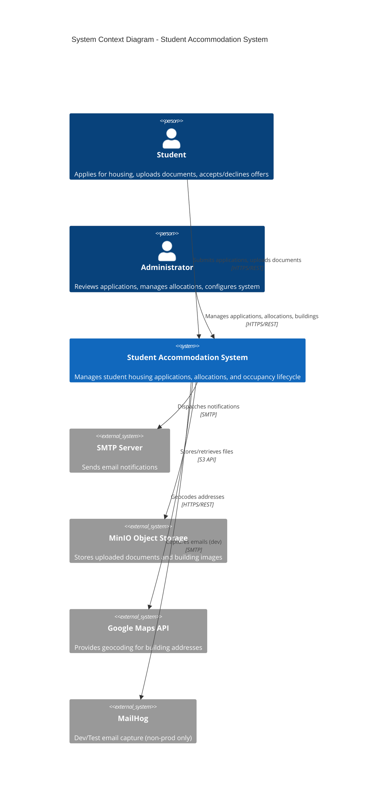
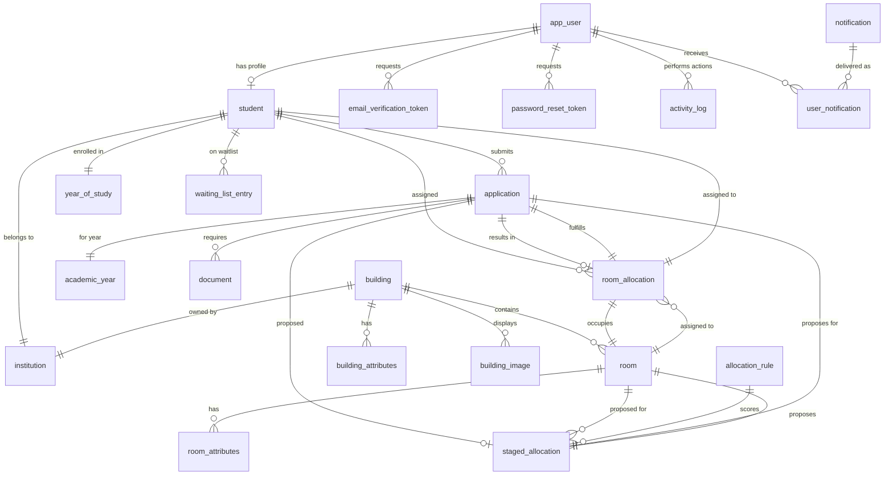
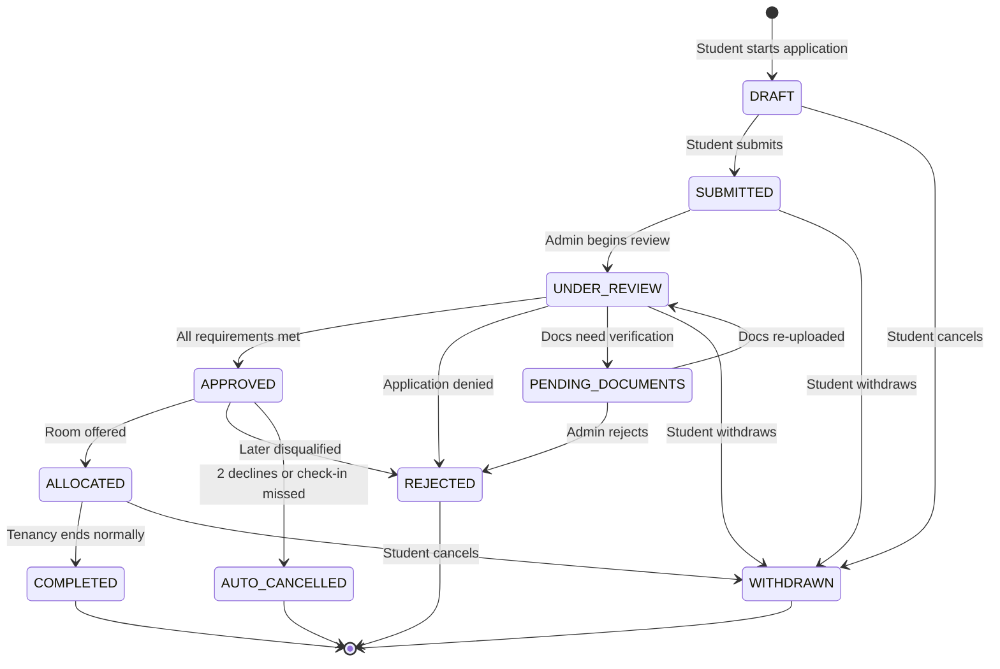
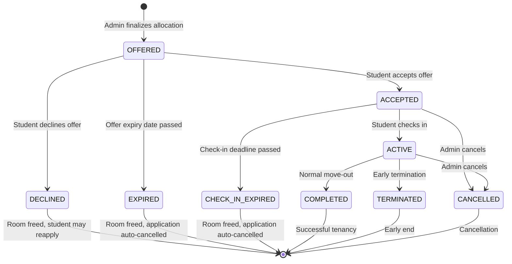
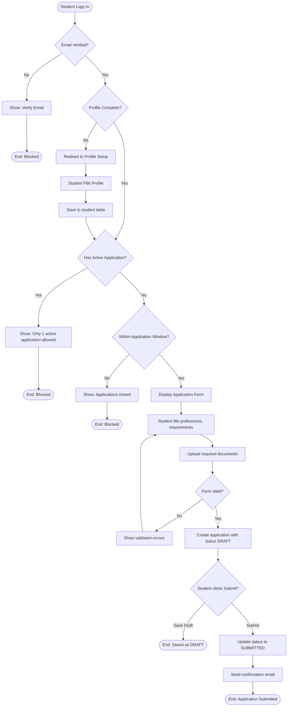
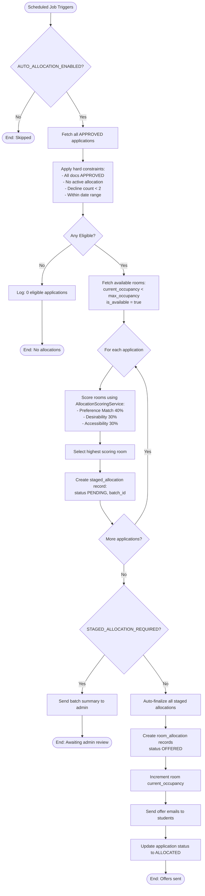
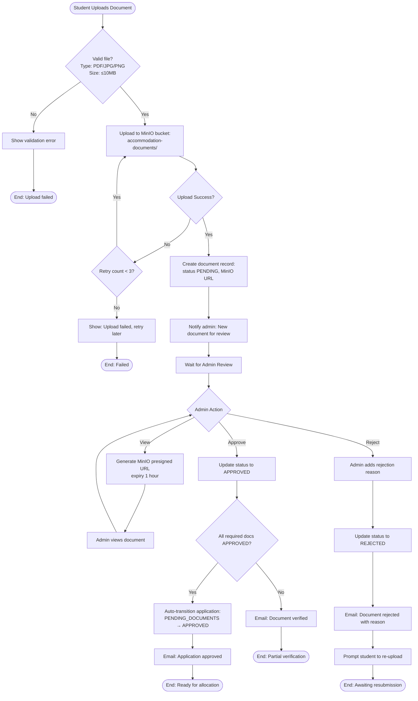
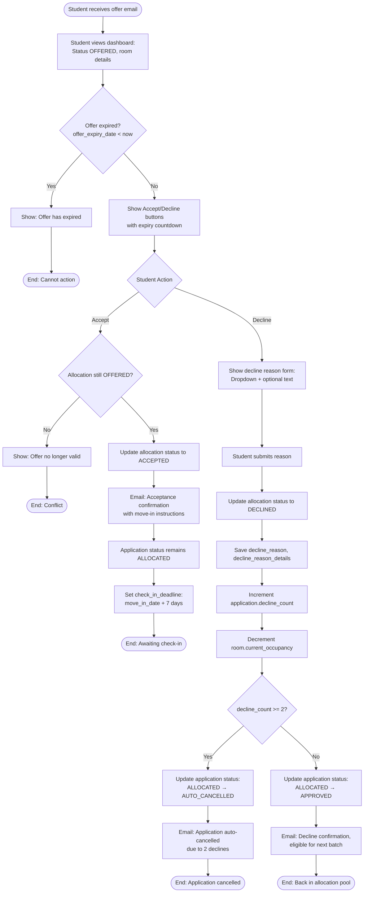
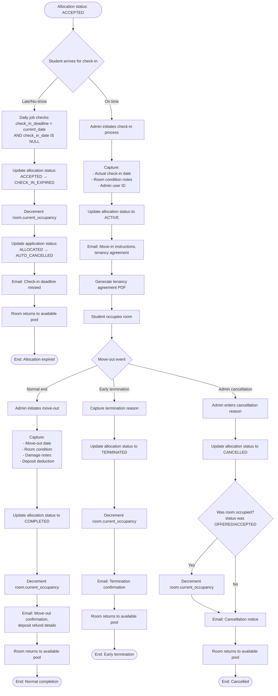

# Business Requirements Document
## Student Accommodation System

---

## Document Control

| **Attribute**        | **Details**                                      |
|----------------------|--------------------------------------------------|
| **Document Title**   | Business Requirements Document - Student Accommodation System |
| **Version**          | 1.1                                              |
| **Date**             | 2026-02-12                                       |
| **Author**           | Senior Business Analyst (Claude - Clarity)       |
| **Status**           | Draft - Stakeholder Clarifications Incorporated  |
| **Classification**   | Internal - Business Requirements                 |
| **Project**          | Student Accommodation System                     |
| **Technology Stack** | Spring Boot 3.5.7, Java 17, Angular 21, PostgreSQL 16, MinIO, FF4J |

---

## Executive Summary

### Purpose
This Business Requirements Document (BRD) provides a comprehensive analysis of the Student Accommodation System, a multi-tenant SaaS platform designed to streamline privately-owned student accommodation management. The system serves building owners who gain accreditation from educational institutions and automates the complete lifecycle of student housing from application submission through room allocation, document verification, and occupancy management.

### Business Context
Privately-owned student accommodation providers face challenges in:
- Processing high volumes of housing applications during peak enrollment periods across multiple accredited institutions
- Fairly allocating limited room inventory based on multiple criteria
- Managing document verification workflows at scale
- Providing transparent communication to students about application status
- Tracking occupancy lifecycle from move-in through check-out
- Serving multiple institutions from a single platform while maintaining per-institution configuration

This system addresses these challenges through automated allocation scoring, staged batch processing, dual-channel notifications, role-based administration, and multi-tenant architecture. Students are funded through NSFAS (National Student Financial Aid Scheme), which pays building owners directly — payment processing is outside the scope of this system.

### Scope
The system encompasses:
1. **Student-Facing Capabilities**: Application submission, document upload, profile management, allocation acceptance/decline
2. **Administrative Functions**: Application review, manual/batch allocation, building/room management, rule configuration, reporting
3. **Automated Processes**: Batch allocation engine, offer expiry monitoring, notification dispatch, check-in deadline tracking
4. **Integration Points**: Google Maps geocoding, MinIO file storage, SMTP email delivery, FF4J feature flags

### Key Business Drivers
- **Efficiency**: Reduce manual effort in allocation decisions through automated scoring
- **Fairness**: Apply consistent, configurable rules to all applications
- **Transparency**: Provide real-time status updates and clear communication
- **Compliance**: Maintain audit trails and document verification workflows
- **Scalability**: Support batch processing for high-volume periods

### Critical Business Rules
1. Applications cannot auto-allocate until all required documents are APPROVED
2. Students may decline a configurable maximum number of offers (default 2) per application before application is AUTO_CANCELLED; decline count resets per application
3. Offers expire after a configurable number of days (default 7, configurable per institution) from allocation date if not accepted
4. Check-in must occur within 7 days (configurable) of check-in date
5. Allocation scoring uses weighted rules: preference match, desirability, accessibility needs (equal weights 1.0 by default, configurable via allocation rules)
6. ADMIN role supersedes LANDLORD supersedes STUDENT in hierarchy
7. Room occupancy is incremented when offer is created (OFFERED status) — room is reserved immediately
8. Manual allocation is blocked if room has a pending staged allocation — admin must reject staged allocation first
9. Document resubmissions are unlimited — no cap on re-upload attempts
10. Pending applications are auto-cancelled on academic year end; all allocations are automatically checked out

---

## Stakeholders & Actors

### Primary Stakeholders

| **Stakeholder**              | **Role**                                | **Key Interests**                                     |
|------------------------------|-----------------------------------------|-------------------------------------------------------|
| Accommodation Office Manager | System owner, policy setter             | Fair allocation, efficiency, reporting, compliance    |
| IT Department                | Technical owner, maintainer             | System reliability, security, data integrity          |
| Student Affairs Office       | User support, student advocacy          | User experience, transparency, accessibility          |
| Finance Office               | Billing integration (future)            | Payment tracking, revenue management                  |
| University Leadership        | Strategic oversight                     | KPIs, student satisfaction, resource utilization      |

### System Actors

#### **STUDENT** (Primary User)
**Responsibilities:**
- Submit housing applications with preferences
- Upload required verification documents
- Accept/decline room offers within expiry period
- Complete profile setup after email verification
- Monitor application status and notifications

**Permissions:**
- Create/view/withdraw own applications
- Upload/view own documents
- Accept/decline own allocations
- Update own profile
- View in-app notifications

**Access Constraints:**
- Cannot access applications until email verified
- Cannot submit application without completing profile
- Cannot view other students' data
- Cannot modify submitted applications (only withdraw)

#### **ADMIN** (Superuser)
**Responsibilities:**
- Review and approve/reject applications
- Verify uploaded documents
- Execute manual and batch allocations
- Manage buildings, rooms, and attributes
- Configure allocation rules and system settings
- Monitor system activity and generate reports
- Manage user accounts

**Permissions:**
- Full CRUD on all entities
- Execute staged allocation batches
- Override allocation decisions
- Access all system logs and reports
- Manage feature flags (via FF4J)
- Delete user accounts (with cascading cleanup)

**Access Constraints:**
- Must re-authenticate for sensitive operations
- Actions are logged in activity_log table
- Cannot bypass state transition validations

#### **LANDLORD / BUILDING OWNER** (Planned — Future Role)
**Description:** Represents privately-owned building owners who gain accreditation from educational institutions. This role is planned for future implementation to enable building owners to manage their properties directly within the SaaS platform.

**Planned Responsibilities:**
- Manage buildings and rooms they own
- View applications and allocations for their properties
- Report maintenance issues
- View occupancy and revenue reports for their properties

**Planned Permissions:**
- Create/update buildings and rooms they own
- View allocations for their properties
- Limited reporting access (own properties only)

**Access Constraints:**
- Cannot access system-wide data or other owners' properties
- Cannot execute allocations (admin function)
- Role hierarchy: ADMIN > LANDLORD > STUDENT

---

## System Context

### System Overview
The Student Accommodation System is a multi-tier web application deployed via Docker Compose, comprising:

- **Frontend Layer**: Angular 21 SPA with Material Design UI
- **API Layer**: Spring Boot 3.5.7 REST API with JWT authentication
- **Data Layer**: PostgreSQL 16 with Flyway-managed schema
- **Storage Layer**: MinIO S3-compatible object storage for documents/images
- **Communication Layer**: SMTP email server + in-app notifications
- **Infrastructure**: Docker containers for all services, MailHog for dev/test email

### Context Diagram



### External Dependencies

| **System**          | **Purpose**                              | **Integration Method** | **Criticality** |
|---------------------|------------------------------------------|------------------------|-----------------|
| SMTP Server         | Email notification delivery              | Spring Mail (SMTP)     | High            |
| MinIO               | Document and image storage               | AWS S3 SDK             | High            |
| Google Maps API     | Geocoding building addresses             | REST API               | Medium          |
| PostgreSQL          | Primary data persistence                 | JDBC/JPA               | Critical        |
| MailHog             | Development email testing                | SMTP (dev only)        | Low             |

---

## Functional Requirements

### 1. User Authentication & Authorization

| **ID** | **Requirement** | **Priority** | **Acceptance Criteria** | **Edge Cases** | **Dependencies** | **Source** |
|--------|----------------|--------------|-------------------------|----------------|------------------|------------|
| AUTH-001 | The system shall support user signup with email and password | MUST | • User provides unique email, password (min 8 chars), first name, last name<br>• System validates email uniqueness<br>• Password is hashed using BCrypt (strength 12)<br>• Verification email sent with UUID token<br>• User record created with STUDENT role by default<br>• JWT token issued upon signup | • Duplicate email → 409 CONFLICT error<br>• Invalid email format → 400 BAD REQUEST<br>• Password too weak → validation error<br>• Email service failure → user created but no email sent (async) | - Email notification system<br>- SMTP configuration | `AuthService.signup()`<br>`AuthController.signup()`<br>`V2025_05_14_2136__init_db.sql` |
| AUTH-002 | The system shall require email verification before profile access | MUST | • Verification token is UUID stored in `email_verification_token` table<br>• Token has 24-hour expiry (configurable via `jwt.verification-token-expiry`)<br>• User clicks email link with token<br>• System validates token and marks user as verified<br>• User can now access student dashboard | • Expired token → error message, option to resend<br>• Invalid token → 404 NOT FOUND<br>• Already verified → redirect to login<br>• Token reuse attempt → error | AUTH-001 | `AuthService.verifyEmail()`<br>`EmailVerificationToken.java`<br>`V2025_05_14_2154__create_email_verification_tokens_table.sql` |
| AUTH-003 | The system shall authenticate users via JWT tokens | MUST | • User provides email and password<br>• System validates credentials<br>• JWT token generated with user ID, email, role<br>• Token expiry: 36000 seconds (10 hrs) for STUDENT, 14400 seconds (4 hrs) for ADMIN<br>• Token includes claims: userId, email, role<br>• Frontend stores token in localStorage | • Invalid credentials → 401 UNAUTHORIZED<br>• Unverified email → 403 FORBIDDEN with specific message<br>• Expired token → 401, frontend redirects to login<br>• Concurrent logins allowed (stateless tokens) | - JWT secret configuration<br>- BCrypt password encoder | `AuthService.login()`<br>`JwtUtil.generateToken()`<br>`application.yml (jwt.secret, jwt.expiration)` |
| AUTH-004 | The system shall protect endpoints with role-based access control | MUST | • Public endpoints: /api/auth/** (login, signup, forgot-password, verify-email)<br>• Student endpoints: /api/applications/**, /api/documents/**, /api/profile/** require STUDENT or higher<br>• Admin endpoints: /api/admin/** require ADMIN role<br>• Role hierarchy: ADMIN > LANDLORD > STUDENT<br>• Unauthorized access → 403 FORBIDDEN | • Token missing → 401 UNAUTHORIZED<br>• Token tampered → 401<br>• Insufficient role → 403<br>• OPTIONS requests allowed (CORS preflight) | AUTH-003 | `SecurityConfig.java`<br>`JwtAuthenticationFilter.java`<br>`UserRole.java` |
| AUTH-005 | The system shall support password reset workflow | MUST | • User requests reset by providing email<br>• System generates UUID reset token, stores in `password_reset_token` table<br>• Token has 24-hour expiry<br>• Email sent with reset link containing token<br>• User submits new password with token<br>• System validates token, updates password (BCrypt hashed), deletes token | • Non-existent email → generic success message (security: prevent email enumeration)<br>• Expired token → error, option to request new<br>• Token reuse → error after first use<br>• Multiple pending tokens → latest token invalidates previous | AUTH-001<br>Email notification system | `AuthService.requestPasswordReset()`<br>`AuthService.resetPassword()`<br>`V2025_05_14_2154__create_password_reset_tokens_table.sql` |
| AUTH-006 | The system shall allow users to delete their accounts | SHOULD | • User submits delete request with password confirmation<br>• System validates password<br>• Cascading deletion: room_allocations, waiting_list_entry, application, document, user_notification, notification, email_verification_token, password_reset_token<br>• Hard delete of app_user and student records<br>• Async email confirmation sent<br>• Frontend clears localStorage and redirects to login | • Incorrect password → 401 error<br>• User has active allocation → confirm warning, still allow deletion<br>• User has pending applications → confirm warning<br>• Admin deletion requires super-admin approval (not implemented) | - All user-owned entities | `AuthService.deleteAccount()`<br>`UserController.deleteAccount()` |
| AUTH-007 | The system shall enforce session timeout based on token expiry | MUST | • Frontend checks token expiry on page load and before API calls<br>• TokenExpiryInterceptor detects 401 responses<br>• User redirected to login with session expired message<br>• No server-side session storage (stateless JWT) | • User idle beyond expiry → forced logout<br>• Token refresh not implemented (user must re-login)<br>• Multiple tabs → all tabs logged out when token expires | AUTH-003 | `token-expiry.interceptor.ts`<br>`auth.interceptor.ts` |

### 2. Student Profile Management

| **ID** | **Requirement** | **Priority** | **Acceptance Criteria** | **Edge Cases** | **Dependencies** | **Source** |
|--------|----------------|--------------|-------------------------|----------------|------------------|------------|
| PROF-001 | The system shall require profile completion before application submission | MUST | • After email verification, user redirected to profile setup<br>• Required fields: phone number, date of birth, gender, nationality, emergency contact (name, relationship, phone, email)<br>• Optional fields: dietary requirements, special requirements<br>• Profile saved to `student` table linked to `app_user` via user_id<br>• Profile completion status tracked | • User skips profile → blocked from application form with message<br>• Invalid phone format → validation error<br>• Future DOB → validation error<br>• Missing required fields → form validation errors | AUTH-002 (email verification) | `StudentService.createOrUpdateProfile()`<br>`profile-setup.component.ts`<br>`V2025_05_14_2136__init_db.sql (student table)` |
| PROF-002 | The system shall allow students to update their profile | SHOULD | • Student accesses profile page from dashboard<br>• Can update all profile fields except user_id<br>• Changes saved immediately<br>• Success message displayed<br>• Updated profile reflected in applications | • Update while application pending → allowed, warn if critical changes<br>• Update emergency contact → notify old and new contact (future)<br>• Concurrent updates → last write wins (optimistic locking not implemented) | PROF-001 | `StudentService.updateProfile()`<br>`profile.component.ts` |
| PROF-003 | The system shall display student application history on dashboard | MUST | • Dashboard shows all applications for logged-in student<br>• Displays: application ID, status, accommodation type, move-in date, submission date<br>• Grouped by status (pending, approved, rejected, withdrawn)<br>• Click application → view details page | • No applications → show empty state with "Start Application" CTA<br>• Paginated if >20 applications<br>• Real-time status updates via periodic refresh (30s interval) | PROF-001<br>Application system | `dashboard.component.ts`<br>`ApplicationService.getMyApplications()` |
| PROF-004 | The system shall display student allocations and offers | MUST | • Dashboard shows active allocations with status<br>• Offer pending → display accept/decline buttons, expiry countdown<br>• Accepted → display room details, move-in instructions<br>• Declined → display decline reason, option to reapply<br>• Expired → display message, auto-withdrawal notice | • Multiple offers → should not occur (system constraint), show error if detected<br>• Offer expires while viewing → disable accept button, show expiry message<br>• Already accepted → hide other offers | PROF-003<br>Room allocation system | `dashboard.component.ts`<br>`AllocationService.getMyAllocations()` |

### 3. Housing Application Submission

| **ID** | **Requirement** | **Priority** | **Acceptance Criteria** | **Edge Cases** | **Dependencies** | **Source** |
|--------|----------------|--------------|-------------------------|----------------|------------------|------------|
| APP-001 | The system shall allow students to submit housing applications | MUST | • Student completes application form with:<br>&nbsp;&nbsp;- Accommodation type (SINGLE, SHARED, STUDIO, APARTMENT)<br>&nbsp;&nbsp;- Preferred move-in date (must be future date)<br>&nbsp;&nbsp;- Duration in months (3, 6, 9, 12)<br>&nbsp;&nbsp;- Preferred room type (SINGLE, DOUBLE, TRIPLE, QUAD)<br>&nbsp;&nbsp;- Special requirements (text field, max 500 chars)<br>• Application created with status DRAFT initially<br>• Student clicks "Submit" → status changes to SUBMITTED<br>• Confirmation email sent<br>• Application assigned unique ID (auto-increment) | • Duplicate active application → block with error "You already have a pending application"<br>• Invalid move-in date (past) → validation error<br>• Application during closed period → check academic_year.application_end_date<br>• Incomplete profile → redirect to profile setup<br>• Document upload failure → application saved as DRAFT, prompt retry | PROF-001 (profile complete)<br>AUTH-002 (email verified) | `ApplicationService.createApplication()`<br>`ApplicationController.submitApplication()`<br>`application-form.component.ts`<br>`V2025_05_14_2136__init_db.sql (application table)` |
| APP-002 | The system shall validate applications against business rules | MUST | • Student can have max 1 active application (statuses: SUBMITTED, UNDER_REVIEW, APPROVED, PENDING_DOCUMENTS)<br>• Move-in date must be within current academic year window<br>• Duration must match allowed values (3, 6, 9, 12 months)<br>• Room type must be valid enum value<br>• Special requirements max 500 characters<br>• All required documents must be uploaded before submission | • Student tries to submit 2nd application → 400 BAD REQUEST "Active application already exists"<br>• Move-in date outside academic year → 400 "Move-in date must be between {start} and {end}"<br>• Invalid duration → 400 "Duration must be 3, 6, 9, or 12 months"<br>• No documents → application saved as PENDING_DOCUMENTS | APP-001 | `ApplicationService.validateApplication()`<br>`ApplicationValidator.java` |
| APP-003 | The system shall allow students to withdraw applications | MUST | • Student clicks "Withdraw" on SUBMITTED or UNDER_REVIEW application<br>• Confirmation dialog displayed<br>• Status changed to WITHDRAWN<br>• Withdrawal reason captured (optional, max 255 chars)<br>• Notification sent to student and admin<br>• Allocated room (if any) released back to available pool | • Cannot withdraw APPROVED application → show error, contact admin<br>• Cannot withdraw ALLOCATED application → must decline allocation instead<br>• Already withdrawn → button disabled<br>• Withdrawal after batch allocation started → allocation cancelled if not yet finalized | APP-001 | `ApplicationService.withdrawApplication()`<br>`ApplicationStatus.canTransitionTo(WITHDRAWN)` |
| APP-004 | The system shall track application status transitions | MUST | • Valid transitions defined in ApplicationStatus enum:<br>&nbsp;&nbsp;- DRAFT → SUBMITTED, WITHDRAWN<br>&nbsp;&nbsp;- SUBMITTED → UNDER_REVIEW, WITHDRAWN<br>&nbsp;&nbsp;- UNDER_REVIEW → APPROVED, REJECTED, PENDING_DOCUMENTS, WITHDRAWN<br>&nbsp;&nbsp;- PENDING_DOCUMENTS → UNDER_REVIEW, REJECTED<br>&nbsp;&nbsp;- APPROVED → ALLOCATED, REJECTED, AUTO_CANCELLED<br>&nbsp;&nbsp;- ALLOCATED → COMPLETED, WITHDRAWN<br>• Invalid transitions blocked with 400 BAD REQUEST<br>• Status history logged in activity_log table | • Admin tries invalid transition → error with valid next states<br>• Concurrent status updates → optimistic locking (@Version field)<br>• Status transition while batch processing → queue for retry | APP-001 | `ApplicationStatus.canTransitionTo()`<br>`ApplicationService.updateStatus()`<br>`V2026_02_05_1300__add_activity_log_table.sql` |
| APP-005 | The system shall link applications to academic years | MUST | • Each application references academic_year_id<br>• Academic year defines:<br>&nbsp;&nbsp;- Year name (e.g., "2025-2026")<br>&nbsp;&nbsp;- Start date and end date<br>&nbsp;&nbsp;- Application window (application_start_date, application_end_date)<br>• Applications submitted outside window → rejected with message<br>• Current academic year auto-selected in form | • No active academic year → show error, disable application submission<br>• Multiple overlapping academic years → use earliest start date<br>• Academic year changes mid-application → application remains linked to original year | APP-001 | `AcademicYearService.getCurrentAcademicYear()`<br>`V2026_02_05_1900__create_academic_year_table.sql` |

### 4. Document Management & Verification

| **ID** | **Requirement** | **Priority** | **Acceptance Criteria** | **Edge Cases** | **Dependencies** | **Source** |
|--------|----------------|--------------|-------------------------|----------------|------------------|------------|
| DOC-001 | The system shall require document uploads for applications | MUST | • Required document types:<br>&nbsp;&nbsp;- PROOF_OF_ENROLLMENT (university acceptance letter)<br>&nbsp;&nbsp;- IDENTIFICATION (passport/national ID)<br>&nbsp;&nbsp;- PROOF_OF_PAYMENT (deposit receipt) - optional based on institution<br>• Student uploads files via drag-drop or file picker<br>• Supported formats: PDF, JPG, JPEG, PNG (max 10MB per file)<br>• Files uploaded to MinIO bucket `accommodation-documents/`<br>• Document record created in `document` table with status PENDING | • File too large → 400 "File exceeds 10MB limit"<br>• Unsupported format → 400 "Only PDF, JPG, PNG allowed"<br>• MinIO connection failure → retry 3 times, then error message<br>• Duplicate document type → replace existing or add as version (configurable) | APP-001<br>MinIO storage configured | `DocumentService.uploadDocument()`<br>`DocumentController.uploadDocument()`<br>`V2025_05_14_2136__init_db.sql (document table)`<br>`MinIOConfig.java` |
| DOC-002 | The system shall allow admins to verify documents | MUST | • Admin views document list in application review page<br>• Each document shows: type, filename, upload date, status, preview thumbnail<br>• Admin clicks "View" → document opens in new tab (MinIO presigned URL)<br>• Admin actions: Approve, Reject, Request Changes<br>• Status changes: PENDING → APPROVED or REJECTED<br>• Comments captured (max 500 chars) for rejections<br>• Notification sent to student on status change | • Document already approved → show warning before reverting<br>• Multiple documents of same type → verify all before approving application<br>• Document deleted from MinIO → show error, re-upload required<br>• Presigned URL expired → regenerate (default 1 hour expiry) | DOC-001<br>ADMIN role | `DocumentService.verifyDocument()`<br>`DocumentController.updateDocumentStatus()`<br>`document-verification.component.ts` |
| DOC-003 | The system shall trigger auto-allocation when all documents approved | MUST | • After admin approves last PENDING document for an application<br>• System checks if ALL required documents are APPROVED<br>• Application status auto-transitions: PENDING_DOCUMENTS → APPROVED<br>• Application added to allocation pool for next batch run<br>• Student notified of approval and allocation timeline | • Some documents rejected → application remains PENDING_DOCUMENTS<br>• Document re-uploaded after rejection → status resets to PENDING<br>• Batch allocation disabled (feature flag) → admin must manually allocate | DOC-002<br>APP-004 (status transitions) | `DocumentService.checkAllDocumentsApproved()`<br>`ApplicationService.updateStatus(APPROVED)`<br>`FF4J feature flag: AUTO_ALLOCATION_ENABLED` |
| DOC-004 | The system shall retain documents for audit purposes | SHOULD | • Documents never hard-deleted from MinIO<br>• Soft delete flag in `document` table (deleted_at timestamp)<br>• Deleted documents hidden from student view but visible to admin with "Deleted" tag<br>• Retention policy: 7 years (configurable via system_setting) | • Student deletes document while under review → admin notified, review paused<br>• Application withdrawn → documents retained<br>• User account deleted → documents anonymized (user_id → NULL) or retained with reference | DOC-001 | `DocumentService.deleteDocument()` (soft delete)<br>`V2025_05_14_2136__init_db.sql (document.deleted_at)` |
| DOC-005 | The system shall support document comments and revision requests | SHOULD | • Admin adds comments to documents (max 500 chars per comment)<br>• Comments stored in `document_comment` table linked to document_id<br>• Student receives notification with comment<br>• Student uploads revised document → new document record created, linked to original via `previous_version_id`<br>• Version history displayed in admin view | • Multiple revisions → show all versions with timestamps<br>• Comment on deleted document → error<br>• Student uploads new version without fixing issue → admin can reject again | DOC-002 | `DocumentService.addComment()`<br>`document-comments.component.ts` |

### 5. Room Allocation Engine

| **ID** | **Requirement** | **Priority** | **Acceptance Criteria** | **Edge Cases** | **Dependencies** | **Source** |
|--------|----------------|--------------|-------------------------|----------------|------------------|------------|
| ALLOC-001 | The system shall score applications using allocation rules | MUST | • Allocation scoring algorithm with 3 components:<br>&nbsp;&nbsp;1. **Preference Match Score** (40% weight):<br>&nbsp;&nbsp;&nbsp;&nbsp;- Room type matches student preference: +40 points<br>&nbsp;&nbsp;&nbsp;&nbsp;- Accommodation type matches: +30 points<br>&nbsp;&nbsp;&nbsp;&nbsp;- Building attributes match special requirements: +20 points<br>&nbsp;&nbsp;2. **Desirability Score** (30% weight):<br>&nbsp;&nbsp;&nbsp;&nbsp;- Application submission date (earlier = higher score)<br>&nbsp;&nbsp;&nbsp;&nbsp;- Student year of study (graduating years prioritized)<br>&nbsp;&nbsp;3. **Accessibility Score** (30% weight):<br>&nbsp;&nbsp;&nbsp;&nbsp;- Special needs documented: +30 points<br>&nbsp;&nbsp;&nbsp;&nbsp;- Building accessibility features match: +20 points<br>• Total score range: 0-100<br>• Weights configurable in `allocation_rule` table | • Tied scores → use application submission timestamp (earlier wins)<br>• Missing preferences → score based on available data only<br>• Invalid rule weights → validation error on rule save<br>• Rule changes mid-batch → use rules from batch start time | APP-004 (APPROVED status)<br>DOC-003 (all docs approved) | `AllocationScoringService.calculateScore()`<br>`V2026_01_20_1200__create_allocation_rules_table.sql`<br>`AllocationRule.java` |
| ALLOC-002 | The system shall apply hard constraints before scoring | MUST | • Hard constraints (must all be true):<br>&nbsp;&nbsp;1. Application status = APPROVED<br>&nbsp;&nbsp;2. All required documents status = APPROVED<br>&nbsp;&nbsp;3. Student has no active allocation (status OFFERED, ACCEPTED, ACTIVE)<br>&nbsp;&nbsp;4. Student decline count < 2<br>&nbsp;&nbsp;5. Room is available (occupancy < max_occupancy)<br>&nbsp;&nbsp;6. Move-in date is within room availability window<br>&nbsp;&nbsp;7. Application not withdrawn or expired<br>• Applications failing constraints excluded from scoring<br>• Failure reason logged for reporting | • Constraint violation during batch → skip application, log reason<br>• Constraint changes mid-batch → re-validate before finalization<br>• Manual allocation can override constraints (admin warning shown) | ALLOC-001 | `AllocationService.validateConstraints()`<br>`AllocationService.getEligibleApplications()` |
| ALLOC-003 | The system shall execute batch allocation on schedule | MUST | • Batch allocation runs every 6 hours (configurable via `allocation.batch-interval-ms`)<br>• Job fetches all APPROVED applications<br>• Applications scored and ranked per ALLOC-001<br>• Staged allocations created in `staged_allocation` table with status PENDING<br>• Admin notification sent with batch summary<br>• Batch ID logged for tracking<br>• Job disabled if `allocation.batch-enabled=false` | • No eligible applications → job completes with "0 allocations" log<br>• Job overlap → prevent via @Scheduled fixedDelay (next run waits for completion)<br>• Job failure mid-execution → rollback staged allocations, retry on next interval<br>• Batch size > 1000 → process in sub-batches of 100 | ALLOC-002<br>System scheduler enabled | `AllocationBatchService.executeBatchAllocation()`<br>`@Scheduled(fixedDelayString = "${allocation.batch-interval-ms}")`<br>`V2026_01_20_1400__create_staged_allocations_table.sql` |
| ALLOC-004 | The system shall allow admin review of staged allocations | MUST | • Admin views staged allocations dashboard<br>• Each staged allocation shows: student name, application ID, proposed room, score, batch ID<br>• Admin actions:<br>&nbsp;&nbsp;- Approve → create final allocation, update room occupancy, send offer email<br>&nbsp;&nbsp;- Reject → delete staged allocation, add reason to application notes<br>&nbsp;&nbsp;- Modify → change room assignment, recalculate if needed<br>• Bulk approve/reject actions available<br>• Staged allocations expire after 48 hours (configurable) | • Admin modifies room → check new room availability before saving<br>• Room becomes unavailable during review → show warning, disallow approval<br>• Staged allocation expired → hide from dashboard, auto-deleted by cleanup job<br>• Approve all → confirm dialog if batch >50 | ALLOC-003<br>ADMIN role | `AllocationService.approveStagedAllocation()`<br>`AllocationService.rejectStagedAllocation()`<br>`staged-allocations.component.ts` |
| ALLOC-005 | The system shall create final allocations and send offers | MUST | • Admin approves staged allocation → creates `room_allocation` record<br>• Allocation fields populated:<br>&nbsp;&nbsp;- student_id, application_id, room_id<br>&nbsp;&nbsp;- Status: OFFERED<br>&nbsp;&nbsp;- Move-in date (from application)<br>&nbsp;&nbsp;- Offer expiry date: move-in date - 7 days (configurable via `allocation.offer-expiry-days`)<br>&nbsp;&nbsp;- Check-in deadline: move-in date + 7 days<br>• Room occupancy incremented (current_occupancy += 1)<br>• Offer email sent to student with room details, accept/decline links, expiry date<br>• Application status updated: APPROVED → ALLOCATED | • Room becomes full after staged approval → error, retry with next best room<br>• Email send failure → allocation created, notification queued for retry (max 3 attempts)<br>• Multiple staged allocations for same student → error, admin must resolve<br>• Offer expiry date in past → validation error, adjust move-in date | ALLOC-004<br>Email notification system<br>Room availability | `AllocationService.finalizeAllocation()`<br>`NotificationService.sendOfferEmail()`<br>`V2026_02_10_1100__add_expiry_dates.sql` |
| ALLOC-006 | The system shall track offer acceptance/decline | MUST | • Student receives offer email with accept/decline buttons<br>• **Accept Action**:<br>&nbsp;&nbsp;- Allocation status: OFFERED → ACCEPTED<br>&nbsp;&nbsp;- Confirmation email sent with move-in instructions<br>&nbsp;&nbsp;- Application status: ALLOCATED → ALLOCATED (no change)<br>&nbsp;&nbsp;- Room marked as reserved for student<br>• **Decline Action**:<br>&nbsp;&nbsp;- Allocation status: OFFERED → DECLINED<br>&nbsp;&nbsp;- Decline reason required (dropdown + optional text, max 255 chars)<br>&nbsp;&nbsp;- Student decline count incremented in application table<br>&nbsp;&nbsp;- Room occupancy decremented (current_occupancy -= 1)<br>&nbsp;&nbsp;- If decline count = 2, application status → AUTO_CANCELLED<br>&nbsp;&nbsp;- If decline count < 2, application returns to APPROVED pool for next batch | • Accept after expiry → error "Offer has expired"<br>• Decline 3rd time → should not occur (2nd decline auto-cancels), show error if attempted<br>• Accept/decline while allocation in different status → 409 CONFLICT<br>• Network failure during accept → idempotent retry allowed within 1 hour | ALLOC-005 | `AllocationService.acceptOffer()`<br>`AllocationService.declineOffer()`<br>`V2026_02_10_1000__add_decline_tracking.sql`<br>`V2026_02_06_1000__update_allocation_lifecycle.sql` |
| ALLOC-007 | The system shall expire unresponsive offers automatically | MUST | • Scheduled job runs every 1 hour (configurable)<br>• Finds allocations with:<br>&nbsp;&nbsp;- Status = OFFERED<br>&nbsp;&nbsp;- offer_expiry_date < current_timestamp<br>• Updates allocation status: OFFERED → EXPIRED<br>• Decrements room occupancy<br>• Application status: ALLOCATED → AUTO_CANCELLED<br>• Expiry notification sent to student<br>• Room returned to available pool | • Offer expires during student's accept action → accept attempt fails with expiry message<br>• Batch expiry >1000 allocations → process in chunks of 100<br>• Job failure → retries on next run (idempotent) | ALLOC-005<br>System scheduler | `AllocationExpiryService.expireOffers()`<br>`@Scheduled(cron = "0 0 * * * *")` (hourly)<br>`AllocationStatus.EXPIRED` |
| ALLOC-008 | The system shall support manual allocation by admin | SHOULD | • Admin selects APPROVED application<br>• Admin selects available room from dropdown (filtered by preferences if possible)<br>• Admin clicks "Allocate" → bypasses scoring, creates allocation immediately<br>• Status: OFFERED<br>• Offer email sent<br>• Manual allocation logged in activity_log with admin user ID | • Room not available → error "Room is full"<br>• Application not APPROVED → error "Application must be approved first"<br>• Application has active offer → confirm override previous offer (status OFFERED → CANCELLED) | APP-004 (APPROVED status)<br>ADMIN role | `AllocationService.manualAllocate()`<br>`admin-allocations.component.ts` |
| ALLOC-009 | The system shall manage waiting lists | SHOULD | • When no suitable room available, application added to `waiting_list_entry` table<br>• Waiting list ordered by: priority (manual admin priority), then score, then application date<br>• When room becomes available (decline/withdrawal), top waiting list entry notified<br>• Entry remains on waiting list until room offered or application withdrawn<br>• Max waiting time: 90 days (configurable) → after expiry, notify student to reapply | • Waiting list position changes → notify student of new position (daily digest)<br>• Room freed → allocate to highest priority waiting list entry, not new applicants<br>• Multiple students waiting for same room type → FIFO within same priority | ALLOC-002 (constraints check) | `WaitingListService.addToWaitingList()`<br>`WaitingListService.processWaitingList()`<br>`V2025_10_19_2200__create_waiting_list_table.sql` |

### 6. Building & Room Management

| **ID** | **Requirement** | **Priority** | **Acceptance Criteria** | **Edge Cases** | **Dependencies** | **Source** |
|--------|----------------|--------------|-------------------------|----------------|------------------|------------|
| BLDG-001 | The system shall allow admins to create and manage buildings | MUST | • Admin creates building with:<br>&nbsp;&nbsp;- Name (required, max 100 chars, unique)<br>&nbsp;&nbsp;- Address (street, city, postal code, country)<br>&nbsp;&nbsp;- Total floors (positive integer)<br>&nbsp;&nbsp;- Description (max 1000 chars)<br>&nbsp;&nbsp;- Latitude/longitude (auto-populated via Google Maps Geocoding API)<br>• Building saved to `building` table<br>• Building ID auto-generated (UUID or auto-increment)<br>• Audit log created with admin user ID | • Duplicate building name → 409 CONFLICT "Building name already exists"<br>• Geocoding API failure → allow manual lat/lng entry or save without coordinates<br>• Invalid address → validation error, prompt correction<br>• Building has rooms → block delete, show error "Delete all rooms first" | ADMIN role<br>Google Maps API configured | `BuildingService.createBuilding()`<br>`BuildingController.createBuilding()`<br>`V2025_11_19_1200__create_buildings_table.sql`<br>`GoogleMapsService.geocodeAddress()` |
| BLDG-002 | The system shall support building attribute management | MUST | • Admin assigns attributes to buildings via `building_attributes` table<br>• Available attributes (stored as key-value pairs):<br>&nbsp;&nbsp;- Has elevator (boolean)<br>&nbsp;&nbsp;- Has laundry (boolean)<br>&nbsp;&nbsp;- Has parking (boolean)<br>&nbsp;&nbsp;- Has wheelchair access (boolean)<br>&nbsp;&nbsp;- Has gym (boolean)<br>&nbsp;&nbsp;- Has common room (boolean)<br>&nbsp;&nbsp;- Distance to campus (meters, integer)<br>&nbsp;&nbsp;- Utilities included (boolean)<br>• Attributes used in allocation scoring (ALLOC-001) | • Attribute value invalid type → validation error<br>• Custom attributes → support dynamic key-value (future enhancement)<br>• Attribute changes → affect future allocations only, not existing | BLDG-001 | `BuildingAttributeService.updateAttributes()`<br>`V2025_11_19_1230__create_building_attributes_table.sql` |
| BLDG-003 | The system shall support building image uploads | SHOULD | • Admin uploads multiple images per building<br>• Images stored in MinIO bucket `building-images/`<br>• Image metadata in `building_image` table: building_id, image_url, display_order, is_primary<br>• Primary image displayed in search results<br>• Max 20 images per building<br>• Supported formats: JPG, JPEG, PNG (max 5MB per file)<br>• Bulk upload supported (drag-drop multiple files) | • Max images exceeded → 400 "Maximum 20 images per building"<br>• File too large → 400 "Image exceeds 5MB limit"<br>• MinIO failure → retry 3 times, show error if all fail<br>• Delete primary image → auto-promote next image by display_order | BLDG-001<br>MinIO configured | `BuildingImageService.uploadImages()`<br>`V2025_11_19_1245__create_building_images_table.sql`<br>`building-images.component.ts` |
| BLDG-004 | The system shall allow admins to create and manage rooms | MUST | • Admin creates room within a building:<br>&nbsp;&nbsp;- Room number (required, unique within building, max 20 chars)<br>&nbsp;&nbsp;- Floor number (integer, must be ≤ building.total_floors)<br>&nbsp;&nbsp;- Room type (SINGLE, DOUBLE, TRIPLE, QUAD)<br>&nbsp;&nbsp;- Max occupancy (integer, must match room type default: SINGLE=1, DOUBLE=2, TRIPLE=3, QUAD=4, but can be overridden)<br>&nbsp;&nbsp;- Current occupancy (auto-calculated, read-only in form)<br>&nbsp;&nbsp;- Monthly rent (decimal, 2 decimal places, min 0)<br>&nbsp;&nbsp;- Description (max 500 chars)<br>&nbsp;&nbsp;- Is available (boolean, default true)<br>• Room saved to `room` table linked to building_id | • Duplicate room number in building → 409 "Room number already exists in this building"<br>• Floor > total_floors → validation error<br>• Max occupancy < current occupancy → error "Cannot reduce max below current occupancy"<br>• Room has allocations → block delete, show "Room has active allocations" | BLDG-001<br>ADMIN role | `RoomService.createRoom()`<br>`RoomController.createRoom()`<br>`V2025_05_14_2136__init_db.sql (room table)` |
| BLDG-005 | The system shall support room attribute management | SHOULD | • Admin assigns attributes to rooms via `room_attributes` table<br>• Available attributes:<br>&nbsp;&nbsp;- Has private bathroom (boolean)<br>&nbsp;&nbsp;- Has balcony (boolean)<br>&nbsp;&nbsp;- Has AC (boolean)<br>&nbsp;&nbsp;- Has heating (boolean)<br>&nbsp;&nbsp;- Is furnished (boolean)<br>&nbsp;&nbsp;- Has kitchenette (boolean)<br>&nbsp;&nbsp;- Has desk (boolean)<br>&nbsp;&nbsp;- Has wardrobe (boolean)<br>&nbsp;&nbsp;- Square meters (decimal, 1 decimal place)<br>• Attributes displayed in room search results<br>• Attributes used in allocation preference matching | • Attribute changes → apply to future searches immediately<br>• Custom attributes → support dynamic schema (future)<br>• Bulk attribute update → apply same attributes to multiple rooms | BLDG-004 | `RoomAttributeService.updateAttributes()`<br>`V2025_11_19_1315__create_room_attributes_table.sql` |
| BLDG-006 | The system shall track room availability and occupancy | MUST | • Room availability calculated as: available_capacity = max_occupancy - current_occupancy<br>• current_occupancy auto-incremented when allocation status → OFFERED<br>• current_occupancy auto-decremented when allocation status → DECLINED, EXPIRED, CANCELLED<br>• is_available flag manually set by admin (for maintenance, renovations)<br>• Rooms with available_capacity = 0 hidden from allocation pool<br>• Occupancy report shows: building, room, current/max occupancy, % utilization | • Occupancy < 0 → data integrity error, trigger alert, prevent operation<br>• Occupancy > max → data integrity error, block allocation<br>• is_available = false → hide from allocation but show in admin list with "Unavailable" tag | BLDG-004<br>ALLOC-005 (occupancy changes) | `RoomService.updateOccupancy()`<br>`RoomService.getAvailableRooms()`<br>`AllocationService.incrementOccupancy()` |
| BLDG-007 | The system shall support bulk room creation | SHOULD | • Admin selects building, defines room range (e.g., Floor 1, Rooms 101-120)<br>• System generates rooms with auto-incremented room numbers<br>• Bulk attributes applied to all created rooms (room type, rent, max occupancy)<br>• Preview displayed before creation<br>• Created rooms added in single transaction (all or nothing) | • Partial range already exists → show warning, skip duplicates<br>• Transaction failure mid-creation → rollback all, show error<br>• Large bulk (>100 rooms) → confirm dialog, process in batches of 50 | BLDG-004<br>ADMIN role | `RoomService.bulkCreateRooms()`<br>`bulk-room-creation.component.ts` |

### 7. Notification System

| **ID** | **Requirement** | **Priority** | **Acceptance Criteria** | **Edge Cases** | **Dependencies** | **Source** |
|--------|----------------|--------------|-------------------------|----------------|------------------|------------|
| NOTIF-001 | The system shall send email notifications for key events | MUST | • Email notification templates (Thymeleaf .html files in `resources/templates/emails/`):<br>&nbsp;&nbsp;1. `welcome.html` - After signup<br>&nbsp;&nbsp;2. `email-verification.html` - Email verification token<br>&nbsp;&nbsp;3. `password-reset.html` - Password reset token<br>&nbsp;&nbsp;4. `application-submitted.html` - Application confirmation<br>&nbsp;&nbsp;5. `application-approved.html` - Application approved, entering allocation pool<br>&nbsp;&nbsp;6. `application-rejected.html` - Application rejected with reason<br>&nbsp;&nbsp;7. `document-verified.html` - Document approved/rejected<br>&nbsp;&nbsp;8. `room-allocated.html` - Offer sent with accept/decline links<br>&nbsp;&nbsp;9. `allocation-accepted.html` - Confirmation with move-in details<br>&nbsp;&nbsp;10. `allocation-declined.html` - Decline confirmation<br>&nbsp;&nbsp;11. `offer-expiry-reminder.html` - 24 hours before offer expires<br>• Emails sent via Spring Mail (SMTP configured in application.yml)<br>• Async processing via @Async annotation | • SMTP server down → notification queued in `notification` table, retry mechanism (NOTIF-003)<br>• Invalid recipient email → log error, mark notification as FAILED<br>• Template rendering error → log error, send plain text fallback<br>• Email size >1MB → validation error (shouldn't occur with templates) | SMTP configured<br>AsyncConfig enabled | `NotificationService.sendEmail()`<br>`EmailService.sendTemplatedEmail()`<br>`AsyncConfig.java`<br>`application.yml (spring.mail.*)` |
| NOTIF-002 | The system shall support in-app notifications | SHOULD | • Notifications stored in `notification` table with fields:<br>&nbsp;&nbsp;- notification_id (UUID)<br>&nbsp;&nbsp;- user_id (recipient)<br>&nbsp;&nbsp;- type (NotificationType enum)<br>&nbsp;&nbsp;- title (max 100 chars)<br>&nbsp;&nbsp;- message (max 500 chars)<br>&nbsp;&nbsp;- is_read (boolean, default false)<br>&nbsp;&nbsp;- created_at (timestamp)<br>• Student dashboard shows unread notification count badge<br>• Notification bell icon in header<br>• Click notification → mark as read, navigate to relevant page<br>• Notifications paginated (20 per page) | • User deleted → cascade delete notifications (ON DELETE CASCADE)<br>• Notification for deleted entity (e.g., withdrawn application) → show generic message<br>• >1000 unread notifications → show "999+" badge<br>• Mark all as read → confirm if >50 notifications | User authentication | `NotificationService.createNotification()`<br>`user-notifications.component.ts`<br>`V2025_11_19_1400__create_notifications_table.sql` |
| NOTIF-003 | The system shall implement notification retry mechanism | MUST | • Failed email sends logged in `notification` table with status FAILED<br>• Retry job runs every 5 minutes<br>• Retries up to 3 times per notification<br>• Exponential backoff: 1st retry after 5 min, 2nd after 15 min, 3rd after 30 min<br>• After 3 failures, status → PERMANENTLY_FAILED, admin alerted<br>• Retry only for transient errors (SMTP timeout, network issues), not for invalid email addresses | • All retries exhausted → admin notification sent (ironically via email to support address)<br>• Retry during SMTP maintenance window → continue retrying<br>• Duplicate email sent (network issue + retry) → acceptable, no deduplication<br>• Notification content changes → use snapshot from original send attempt | NOTIF-001<br>Scheduled jobs enabled | `NotificationRetryService.retryFailedNotifications()`<br>`@Scheduled(fixedDelay = 300000)` (5 min)<br>`NotificationStatus enum` |
| NOTIF-004 | The system shall support notification preferences | COULD | • Student configures preferences in profile settings:<br>&nbsp;&nbsp;- Email notifications enabled/disabled per type<br>&nbsp;&nbsp;- In-app notifications enabled/disabled per type<br>&nbsp;&nbsp;- Notification frequency (immediate, daily digest, weekly digest)<br>• Preferences stored in `notification_preference` table<br>• Default: all notifications enabled, immediate delivery | • Disable all notifications → show warning "You may miss critical updates"<br>• Critical notifications (offer expiry) → always sent regardless of preferences<br>• Daily digest → sent at 9 AM user's local time (timezone from profile)<br>• Weekly digest → sent Monday 9 AM | NOTIF-002<br>User profile | `NotificationPreferenceService.updatePreferences()`<br>`notification-settings.component.ts` |
| NOTIF-005 | The system shall log all notification attempts | MUST | • Every notification attempt logged in `user_notification` table (junction table):<br>&nbsp;&nbsp;- user_id, notification_id<br>&nbsp;&nbsp;- sent_at (timestamp)<br>&nbsp;&nbsp;- delivery_status (SENT, FAILED, PENDING)<br>&nbsp;&nbsp;- failure_reason (text, nullable)<br>• Admin can view notification history per user<br>• Audit trail for compliance (proof of communication) | • Log retention → keep for 1 year, then archive to cold storage<br>• High volume → partition table by month<br>• Query performance → index on (user_id, sent_at DESC) | NOTIF-001 | `NotificationLogService.logAttempt()`<br>`V2025_11_19_1415__create_user_notifications_table.sql` |

### 8. Occupancy Lifecycle Management

| **ID** | **Requirement** | **Priority** | **Acceptance Criteria** | **Edge Cases** | **Dependencies** | **Source** |
|--------|----------------|--------------|-------------------------|----------------|------------------|------------|
| OCC-001 | The system shall track check-in deadlines | MUST | • After student accepts offer (allocation status → ACCEPTED):<br>&nbsp;&nbsp;- check_in_deadline = move_in_date + 7 days (configurable via `allocation.check-in-expiry-days`)<br>&nbsp;&nbsp;- Student must check in before deadline<br>• Admin marks student as checked in → allocation status: ACCEPTED → ACTIVE<br>• Check-in process captures: actual check-in date, admin user ID, room condition notes<br>• Confirmation email sent with tenancy start date | • Student checks in early (before move-in date) → allowed, warn admin<br>• Student checks in late (after deadline) → allowed, but flag as late, possible penalty<br>• Check-in without admin present → allow self-check-in via mobile app (future) | ALLOC-006 (offer acceptance)<br>ADMIN role for manual check-in | `AllocationService.checkIn()`<br>`AllocationStatus.ACTIVE`<br>`V2026_02_06_1000__update_allocation_lifecycle.sql (check_in_date field)` |
| OCC-002 | The system shall expire allocations with missed check-ins | MUST | • Scheduled job runs daily at midnight<br>• Finds allocations with:<br>&nbsp;&nbsp;- status = ACCEPTED<br>&nbsp;&nbsp;- check_in_deadline < current_date<br>&nbsp;&nbsp;- check_in_date is NULL (not checked in)<br>• Updates allocation status: ACCEPTED → CHECK_IN_EXPIRED<br>• Decrements room current_occupancy<br>• Application status → AUTO_CANCELLED<br>• Expiry notification sent to student<br>• Room returned to available pool | • Student checks in on expiry day → race condition, allow check-in, cancel job for that allocation<br>• Batch expiry >500 allocations → process in chunks<br>• Grace period → configurable extra days beyond deadline (default 0) | OCC-001<br>System scheduler | `AllocationExpiryService.expireCheckIns()`<br>`@Scheduled(cron = "0 0 0 * * *")` (daily midnight)<br>`AllocationStatus.CHECK_IN_EXPIRED` |
| OCC-003 | The system shall track move-out and tenancy completion | MUST | • Admin initiates move-out process for allocation<br>• Move-out fields captured:<br>&nbsp;&nbsp;- Actual move-out date<br>&nbsp;&nbsp;- Room condition (dropdown: Excellent, Good, Fair, Poor)<br>&nbsp;&nbsp;- Damages noted (text, max 1000 chars)<br>&nbsp;&nbsp;- Deposit deduction amount (decimal, 0 if no damages)<br>• Allocation status: ACTIVE → COMPLETED<br>• Room current_occupancy decremented<br>• Move-out confirmation email sent with deposit refund details | • Early termination (before contract end) → status TERMINATED instead of COMPLETED<br>• Student leaves without notice → admin marks as TERMINATED, flag account<br>• Damages dispute → link to dispute resolution workflow (future) | OCC-001 (allocation active) | `AllocationService.moveOut()`<br>`AllocationStatus.COMPLETED`<br>`V2026_02_06_1000__update_allocation_lifecycle.sql (move_out_date, room_condition)` |
| OCC-004 | The system shall support allocation cancellation | SHOULD | • Admin can cancel allocation at any status except COMPLETED, TERMINATED<br>• Cancellation reason required (max 500 chars)<br>• Allocation status → CANCELLED<br>• If room was occupied (status OFFERED or ACCEPTED), decrement current_occupancy<br>• Cancellation email sent to student<br>• Application status depends on stage:<br>&nbsp;&nbsp;- If OFFERED → return to APPROVED pool<br>&nbsp;&nbsp;- If ACCEPTED/ACTIVE → status AUTO_CANCELLED | • Cancellation during check-in → confirm with admin<br>• Bulk cancellation (e.g., building closure) → support multi-select, batch cancel<br>• Cancelled allocation → cannot be reactivated, new allocation required | ADMIN role | `AllocationService.cancelAllocation()`<br>`AllocationStatus.CANCELLED` |
| OCC-005 | The system shall generate tenancy agreements | COULD | • After check-in (status ACTIVE), auto-generate tenancy agreement PDF<br>• Agreement includes: student details, room details, tenancy period, rent, terms & conditions<br>• PDF generated from template using iText or similar<br>• Stored in MinIO bucket `agreements/`<br>• Downloadable from student dashboard and admin panel<br>• Digital signature support (future: e-signature integration) | • Template changes → apply to new agreements only<br>• PDF generation failure → log error, retry, fallback to manual agreement<br>• Multi-language support → use student's preferred language from profile | OCC-001 (check-in complete)<br>PDF library configured | `AgreementService.generateAgreement()`<br>`TenancyAgreementTemplate.jrxml` |

### 9. Reporting & Analytics

| **ID** | **Requirement** | **Priority** | **Acceptance Criteria** | **Edge Cases** | **Dependencies** | **Source** |
|--------|----------------|--------------|-------------------------|----------------|------------------|------------|
| RPT-001 | The system shall provide application statistics dashboard | MUST | • Admin dashboard displays:<br>&nbsp;&nbsp;- Total applications by status (pie chart)<br>&nbsp;&nbsp;- Applications over time (line chart, last 12 months)<br>&nbsp;&nbsp;- Application approval rate (%)<br>&nbsp;&nbsp;- Average application processing time (days)<br>&nbsp;&nbsp;- Top 5 preferred room types<br>&nbsp;&nbsp;- Top 5 preferred buildings<br>• Filters: date range, academic year, application status<br>• Export to CSV, PDF | • No data for date range → show empty state "No applications in this period"<br>• Large dataset (>10k applications) → aggregate by week/month instead of day<br>• Real-time updates → refresh every 60 seconds | ADMIN role<br>Application data | `ReportService.getApplicationStats()`<br>`analytics-dashboard.component.ts` |
| RPT-002 | The system shall provide occupancy reports | MUST | • Occupancy report shows:<br>&nbsp;&nbsp;- Total rooms vs occupied rooms (by building, by room type)<br>&nbsp;&nbsp;- Occupancy rate % (current_occupancy / total_capacity)<br>&nbsp;&nbsp;- Vacant rooms list with details<br>&nbsp;&nbsp;- Projected occupancy (based on pending offers)<br>&nbsp;&nbsp;- Revenue by building (sum of rent for occupied rooms)<br>• Filters: building, room type, floor, date<br>• Export to Excel with charts | • Occupancy > 100% → data error, highlight in red, investigate<br>• Projected occupancy → include OFFERED + ACCEPTED allocations<br>• Historical occupancy → time series chart for trend analysis | ADMIN role<br>Room and allocation data | `ReportService.getOccupancyReport()`<br>`occupancy-report.component.ts` |
| RPT-003 | The system shall provide allocation performance metrics | SHOULD | • Allocation metrics dashboard:<br>&nbsp;&nbsp;- Batch allocation success rate (% of applications allocated per batch)<br>&nbsp;&nbsp;- Average allocation score by batch<br>&nbsp;&nbsp;- Offer acceptance rate (% of offers accepted vs declined/expired)<br>&nbsp;&nbsp;- Average time from application to allocation (days)<br>&nbsp;&nbsp;- Waiting list size over time<br>&nbsp;&nbsp;- Decline reasons breakdown (pie chart)<br>• Filters: batch ID, date range, academic year<br>• Drill-down to individual batches | • No batch runs → show "No allocation batches executed"<br>• Low acceptance rate → trigger alert for admin review<br>• Batch comparison → compare current batch to previous batches | ALLOC-003 (batch allocation)<br>ADMIN role | `ReportService.getAllocationMetrics()`<br>`allocation-analytics.component.ts` |
| RPT-004 | The system shall provide document verification metrics | SHOULD | • Document verification report:<br>&nbsp;&nbsp;- Total documents uploaded by type<br>&nbsp;&nbsp;- Approval rate by document type (%)<br>&nbsp;&nbsp;- Average verification time (hours from upload to approval/rejection)<br>&nbsp;&nbsp;- Pending documents count and age (days since upload)<br>&nbsp;&nbsp;- Top rejection reasons<br>• Alerts if pending documents > 72 hours old | • High rejection rate → indicate training need for students<br>• Long verification time → indicate bottleneck, add more reviewers | DOC-001, DOC-002<br>ADMIN role | `ReportService.getDocumentMetrics()`<br>`document-analytics.component.ts` |
| RPT-005 | The system shall support custom report generation | COULD | • Admin defines custom report with:<br>&nbsp;&nbsp;- Data source (applications, allocations, rooms, students)<br>&nbsp;&nbsp;- Selected fields (multi-select dropdown)<br>&nbsp;&nbsp;- Filters (dynamic based on data source)<br>&nbsp;&nbsp;- Sort order<br>&nbsp;&nbsp;- Output format (CSV, Excel, PDF)<br>• Report saved as template for reuse<br>• Scheduled reports sent via email (daily, weekly, monthly) | • Complex queries → timeout after 60 seconds, prompt to add filters<br>• Large result set (>100k rows) → limit to 100k, suggest pagination or narrower filters<br>• Invalid filter combination → validation error | ADMIN role | `ReportService.generateCustomReport()`<br>`custom-report-builder.component.ts` |

### 10. System Administration

| **ID** | **Requirement** | **Priority** | **Acceptance Criteria** | **Edge Cases** | **Dependencies** | **Source** |
|--------|----------------|--------------|-------------------------|----------------|------------------|------------|
| ADMIN-001 | The system shall allow admins to manage user accounts | MUST | • Admin views user list with filters: role, status, registration date<br>• Admin can:<br>&nbsp;&nbsp;- View user profile and application history<br>&nbsp;&nbsp;- Reset user password (generates reset token, sends email)<br>&nbsp;&nbsp;- Disable user account (soft delete, user cannot login)<br>&nbsp;&nbsp;- Enable disabled account<br>&nbsp;&nbsp;- Change user role (STUDENT ↔ LANDLORD, escalate to ADMIN requires super-admin)<br>&nbsp;&nbsp;- Delete user account (hard delete with cascade, requires confirmation)<br>• All actions logged in activity_log | • Delete user with active allocation → confirm dialog, explain consequences<br>• Disable user during active session → user logged out immediately (implement token blacklist or reduce token expiry)<br>• Change role → existing allocations/applications unaffected<br>• Super-admin role → hardcoded in application.yml, cannot be assigned via UI | ADMIN role | `UserManagementService.manageUser()`<br>`AdminController.manageUsers()`<br>`user-management.component.ts` |
| ADMIN-002 | The system shall support allocation rule configuration | MUST | • Admin configures allocation rules in `allocation_rule` table<br>• Each rule has:<br>&nbsp;&nbsp;- rule_name (e.g., "Preference Match Weight")<br>&nbsp;&nbsp;- rule_type (PREFERENCE_MATCH, DESIRABILITY, ACCESSIBILITY)<br>&nbsp;&nbsp;- weight (decimal 0-1, sum of all weights must = 1.0)<br>&nbsp;&nbsp;- is_active (boolean)<br>&nbsp;&nbsp;- priority (integer, for tie-breaking)<br>• UI displays rules with weight sliders, live validation of sum = 1.0<br>• Changes apply to next batch allocation, not retroactive | • Sum of weights ≠ 1.0 → validation error "Weights must total 100%"<br>• Deactivate all rules → error "At least one rule must be active"<br>• Rule changes during batch execution → use rules from batch start time (snapshot) | ALLOC-001 (scoring algorithm)<br>ADMIN role | `AllocationRuleService.updateRules()`<br>`allocation-rules.component.ts`<br>`V2026_01_20_1200__create_allocation_rules_table.sql` |
| ADMIN-003 | The system shall allow system settings configuration | MUST | • System settings stored in `system_setting` table (key-value pairs)<br>• Configurable settings:<br>&nbsp;&nbsp;- `offer_expiry_days` (default 7)<br>&nbsp;&nbsp;- `check_in_expiry_days` (default 7)<br>&nbsp;&nbsp;- `max_decline_count` (default 2)<br>&nbsp;&nbsp;- `batch_allocation_interval_hours` (default 6)<br>&nbsp;&nbsp;- `notification_retry_max_attempts` (default 3)<br>&nbsp;&nbsp;- `document_retention_years` (default 7)<br>&nbsp;&nbsp;- `password_reset_token_expiry_hours` (default 24)<br>• UI displays settings with input validation (type, min/max)<br>• Changes take effect immediately (no restart required) | • Invalid value type (string for integer setting) → validation error<br>• Extreme values (e.g., offer_expiry_days = 0) → show warning, allow if confirmed<br>• Concurrent updates → optimistic locking with @Version<br>• Missing critical setting → use hardcoded default from application.yml | ADMIN role | `SystemSettingService.updateSetting()`<br>`V2026_01_15_1000__create_system_settings_table.sql`<br>`system-settings.component.ts` |
| ADMIN-004 | The system shall provide activity log viewer | MUST | • Activity log captures:<br>&nbsp;&nbsp;- user_id (actor), action (enum: CREATE, UPDATE, DELETE, LOGIN, LOGOUT, APPROVE, REJECT, ALLOCATE, etc.)<br>&nbsp;&nbsp;- entity_type (Application, Allocation, Document, User, etc.)<br>&nbsp;&nbsp;- entity_id, timestamp, IP address, user agent<br>&nbsp;&nbsp;- changes_json (before/after values for updates)<br>• Admin views logs with filters: user, action, entity type, date range<br>• Search by entity ID (e.g., find all actions on application #123)<br>• Export logs to CSV for audit | • High volume (millions of logs) → pagination with 100 per page, indexed queries<br>• Sensitive data in changes_json → mask passwords, tokens<br>• Log retention → archive logs >1 year old to separate table/storage | ADMIN role | `ActivityLogService.log()`<br>`ActivityLogAspect.java` (AOP for auto-logging)<br>`V2026_02_05_1300__add_activity_log_table.sql`<br>`activity-log.component.ts` |
| ADMIN-005 | The system shall support feature flag management | SHOULD | • Feature flags managed via FF4J console: http://localhost:8080/ff4j-web-console<br>• Key flags:<br>&nbsp;&nbsp;- `AUTO_ALLOCATION_ENABLED` (enable/disable batch allocation)<br>&nbsp;&nbsp;- `GEOCODING_ENABLED` (enable/disable Google Maps geocoding)<br>&nbsp;&nbsp;- `NOTIFICATION_RETRY_ENABLED` (enable/disable retry mechanism)<br>&nbsp;&nbsp;- `STAGED_ALLOCATION_REQUIRED` (require admin review before finalization)<br>• Flags toggle in real-time without restart<br>• Flag audit log (who changed, when, old/new value) | • Disable AUTO_ALLOCATION during maintenance → batch jobs skip execution<br>• Disable GEOCODING → buildings save without coordinates, warning shown<br>• Flag changes → logged in activity_log | ADMIN role<br>FF4J configured | `FF4jConfig.java`<br>`@ConditionalOnFeature` annotations in services<br>FF4J web console |

### 11. Academic Year Management

| **ID** | **Requirement** | **Priority** | **Acceptance Criteria** | **Edge Cases** | **Dependencies** | **Source** |
|--------|----------------|--------------|-------------------------|----------------|------------------|------------|
| AY-001 | The system shall allow admins to define academic years | MUST | • Admin creates academic year with:<br>&nbsp;&nbsp;- Year name (e.g., "2025-2026", max 20 chars, unique)<br>&nbsp;&nbsp;- Start date (must be future date if creating new)<br>&nbsp;&nbsp;- End date (must be after start date)<br>&nbsp;&nbsp;- Application window: application_start_date, application_end_date<br>&nbsp;&nbsp;- Is active (boolean, only 1 can be active at a time)<br>• Application window must be within academic year dates<br>• Academic year saved to `academic_year` table | • Overlapping academic years → allowed but warn admin<br>• Application window outside year dates → validation error<br>• Set active while another active → deactivate previous automatically<br>• Delete academic year with applications → block delete, show error | ADMIN role | `AcademicYearService.createAcademicYear()`<br>`V2026_02_05_1900__create_academic_year_table.sql`<br>`academic-year.component.ts` |
| AY-002 | The system shall enforce application window restrictions | MUST | • Students can only submit applications during application window:<br>&nbsp;&nbsp;- current_date >= application_start_date AND current_date <= application_end_date<br>• Outside window → application form disabled with message "Applications for {year} will open on {start_date}" or "Applications for {year} have closed on {end_date}"<br>• Applications submitted before window closes remain valid | • Application in progress when window closes → allow completion within 24 hours grace period<br>• No active academic year → all applications blocked, show error<br>• Admin override → admin can manually create application outside window | AY-001<br>APP-001 | `AcademicYearService.isWithinApplicationWindow()`<br>`ApplicationService.validateApplicationWindow()` |
| AY-003 | The system shall auto-transition academic years | SHOULD | • Scheduled job runs daily at midnight<br>• Checks if current_date > active_year.end_date<br>• Deactivates expired academic year<br>• Activates next academic year if start_date <= current_date<br>• Admin notification sent for year transition<br>• All pending applications → status updated with notes | • No next academic year defined → send alert to admin<br>• Gap between years → no active year during gap, applications blocked<br>• Year transition mid-batch allocation → complete current batch before transition | AY-001<br>System scheduler | `AcademicYearService.transitionAcademicYear()`<br>`@Scheduled(cron = "0 0 0 * * *")` |

### 12. Institution & Reference Data Management

| **ID** | **Requirement** | **Priority** | **Acceptance Criteria** | **Edge Cases** | **Dependencies** | **Source** |
|--------|----------------|--------------|-------------------------|----------------|------------------|------------|
| INST-001 | The system shall support multiple institutions | COULD | • Institution table with fields:<br>&nbsp;&nbsp;- institution_id (UUID)<br>&nbsp;&nbsp;- name (max 200 chars, unique)<br>&nbsp;&nbsp;- code (max 20 chars, unique, e.g., "UNIV001")<br>&nbsp;&nbsp;- address, city, country<br>&nbsp;&nbsp;- contact_email, contact_phone<br>&nbsp;&nbsp;- logo_url (MinIO path)<br>• Student linked to institution via institution_id<br>• Buildings linked to institution<br>• Multi-tenancy isolation (students see only their institution's data) | • Single institution deployment → hide institution selector, use default<br>• Multi-institution → require institution selection at signup<br>• Transfer student between institutions → admin action, data migration | Multi-tenancy architecture | `InstitutionService.createInstitution()`<br>`V2026_02_05_1930__create_institution_table.sql` |
| INST-002 | The system shall manage year of study reference data | SHOULD | • Year of study table (year_of_study):<br>&nbsp;&nbsp;- year_id (auto-increment)<br>&nbsp;&nbsp;- year_name (e.g., "Year 1", "Freshman", "Final Year")<br>&nbsp;&nbsp;- year_order (integer 1-5 for sorting)<br>&nbsp;&nbsp;- institution_id (nullable, for institution-specific values)<br>• Used in student profile and allocation scoring (graduating years prioritized)<br>• Admin can add/edit/delete year values | • Delete year with students → block delete or reassign students first<br>• Different institution naming (Year 1 vs Freshman) → support institution-specific values | INST-001 | `YearOfStudyService.manageYearOfStudy()`<br>`V2026_02_05_1945__create_year_of_study_table.sql` |

### 13. Search & Filtering

| **ID** | **Requirement** | **Priority** | **Acceptance Criteria** | **Edge Cases** | **Dependencies** | **Source** |
|--------|----------------|--------------|-------------------------|----------------|------------------|------------|
| SEARCH-001 | The system shall support room search with filters | MUST | • Student searches available rooms with filters:<br>&nbsp;&nbsp;- Room type (multi-select: SINGLE, DOUBLE, TRIPLE, QUAD)<br>&nbsp;&nbsp;- Building (multi-select)<br>&nbsp;&nbsp;- Rent range (min-max sliders)<br>&nbsp;&nbsp;- Attributes (checkboxes: private bathroom, AC, furnished, etc.)<br>&nbsp;&nbsp;- Distance to campus (max distance slider)<br>&nbsp;&nbsp;- Available from date<br>• Results show: room number, building, type, rent, attributes, availability<br>• Sort by: rent (low/high), distance, room size, availability date<br>• Pagination: 20 rooms per page | • No results → show "No rooms match your criteria. Try adjusting filters."<br>• All filters applied → complex query, use JPA Specifications for performance<br>• Rent filter with outliers → cap max at 99th percentile for UI slider | BLDG-004 (rooms)<br>BLDG-005 (attributes) | `RoomService.searchRooms()`<br>`RoomSpecification.java`<br>`room-search.component.ts` |
| SEARCH-002 | The system shall support application search for admins | MUST | • Admin searches applications with filters:<br>&nbsp;&nbsp;- Status (multi-select)<br>&nbsp;&nbsp;- Student name/email (text search)<br>&nbsp;&nbsp;- Application ID (exact match)<br>&nbsp;&nbsp;- Submission date range<br>&nbsp;&nbsp;- Accommodation type, room type<br>&nbsp;&nbsp;- Academic year<br>• Results table: ID, student, status, submission date, move-in date, actions<br>• Sort by: submission date, status, move-in date<br>• Bulk actions: approve, reject, assign to batch | • Text search on name → case-insensitive, partial match<br>• Large result set (>1000) → limit to 1000, suggest narrower filters<br>• Export search results → CSV with all filtered records | ADMIN role<br>APP-001 (applications) | `ApplicationService.searchApplications()`<br>`ApplicationSpecification.java`<br>`application-search.component.ts` |
| SEARCH-003 | The system shall support global search | SHOULD | • Global search bar in header (admin only)<br>• Searches across: students (name, email), applications (ID), allocations (ID), buildings (name), rooms (number)<br>• Results grouped by entity type<br>• Click result → navigate to detail page<br>• Max 5 results per entity type, link to "See all X results" | • Empty query → show recent items (last 5 viewed)<br>• Special characters in query → escape for SQL injection prevention<br>• Search performance → use database full-text search or Elasticsearch (future) | ADMIN role | `GlobalSearchService.search()`<br>`global-search.component.ts` |

### 14. Frontend User Experience

| **ID** | **Requirement** | **Priority** | **Acceptance Criteria** | **Edge Cases** | **Dependencies** | **Source** |
|--------|----------------|--------------|-------------------------|----------------|------------------|------------|
| FE-001 | The system shall provide responsive design | MUST | • Application fully functional on:<br>&nbsp;&nbsp;- Desktop (≥1024px): sidebar navigation, multi-column layouts<br>&nbsp;&nbsp;- Tablet (768px-1023px): collapsible sidebar, 2-column layouts<br>&nbsp;&nbsp;- Mobile (≤767px): bottom navigation, single-column, hamburger menu<br>• Angular Material components used for responsive breakpoints<br>• Touch-friendly UI on mobile (44px min touch target size)<br>• No horizontal scrolling on any device | • Portrait/landscape orientation → layouts adjust<br>• Small mobile (≤375px) → test on iPhone SE, adjust font sizes if needed<br>• Print view → hide navigation, expand content | Angular Material | `responsive.scss`<br>`@media` queries in component styles<br>`LayoutModule` (Angular CDK) |
| FE-002 | The system shall implement route guards | MUST | • Route guards protect pages:<br>&nbsp;&nbsp;- `AuthGuard` → all protected routes, redirects to /login if no token<br>&nbsp;&nbsp;- `EmailVerifiedGuard` → student routes, redirects to /verify-email if not verified<br>&nbsp;&nbsp;- `AdminGuard` → admin routes (/admin/**), checks ADMIN role<br>&nbsp;&nbsp;- `StudentGuard` → student routes, checks STUDENT role<br>• Guards check JWT token validity (not expired)<br>• Failed guard → redirect with return URL for post-login navigation | • Token expires during session → guard detects, redirects to login<br>• Role insufficient → 403 page with message "You don't have permission"<br>• Email not verified → banner on all pages with "Verify your email" CTA | AUTH-003 (JWT tokens) | `auth.guard.ts`<br>`admin.guard.ts`<br>`student.guard.ts`<br>`email-verified.guard.ts` |
| FE-003 | The system shall implement error handling interceptors | MUST | • HTTP interceptors:<br>&nbsp;&nbsp;- `AuthInterceptor` → adds Authorization header with JWT token to all requests<br>&nbsp;&nbsp;- `ErrorInterceptor` → catches HTTP errors, displays user-friendly messages<br>&nbsp;&nbsp;- `TokenExpiryInterceptor` → detects 401 responses, clears token, redirects to login<br>• Error messages mapped:<br>&nbsp;&nbsp;- 400 → show validation errors from backend response<br>&nbsp;&nbsp;- 401 → "Session expired, please login again"<br>&nbsp;&nbsp;- 403 → "You don't have permission to access this resource"<br>&nbsp;&nbsp;- 404 → "Resource not found"<br>&nbsp;&nbsp;- 500 → "An error occurred. Please try again later."<br>• Toast notifications for errors (Material Snackbar) | • Network error (no internet) → "Network error. Check your connection."<br>• Timeout → "Request timed out. Please try again."<br>• Multiple errors in quick succession → debounce, show single toast<br>• Critical errors → option to send error report to admin | AUTH-003 | `auth.interceptor.ts`<br>`error.interceptor.ts`<br>`token-expiry.interceptor.ts` |
| FE-004 | The system shall provide loading states | SHOULD | • Loading indicators for async operations:<br>&nbsp;&nbsp;- Global loader (top progress bar) for route navigation<br>&nbsp;&nbsp;- Component-level spinners for data fetching<br>&nbsp;&nbsp;- Button loading state (spinner + disabled) for form submissions<br>&nbsp;&nbsp;- Skeleton loaders for list/table data<br>• Minimum display time: 300ms (prevent flicker for fast responses)<br>• Timeout: 30 seconds → show error message | • Slow network → show loading for full duration<br>• Multiple concurrent requests → show loading until all complete<br>• Cancel request → stop loading immediately | - | `loading.service.ts`<br>`loading.interceptor.ts`<br>`MatProgressBar`, `MatSpinner` |
| FE-005 | The system shall implement form validation | MUST | • Client-side validation using Angular Reactive Forms:<br>&nbsp;&nbsp;- Required fields → "This field is required"<br>&nbsp;&nbsp;- Email format → "Please enter a valid email address"<br>&nbsp;&nbsp;- Password strength → "Password must be at least 8 characters"<br>&nbsp;&nbsp;- Date validation → "Move-in date must be in the future"<br>&nbsp;&nbsp;- Custom validators (e.g., password confirmation match)<br>• Validation messages display on blur or submit attempt<br>• Disable submit button if form invalid<br>• Server-side validation errors mapped to form fields | • Field becomes valid → clear error message immediately<br>• Backend validation fails → map errors to fields if possible, else show toast<br>• Form submitted while invalid → focus first invalid field | - | `Validators` (Angular Forms)<br>`Custom validators`<br>`form-validation.service.ts` |
| FE-006 | The system shall support dark mode | COULD | • Theme toggle in user profile settings<br>• Themes: Light (default), Dark, Auto (follows OS preference)<br>• Theme stored in localStorage<br>• Angular Material theme switching<br>• Custom CSS variables for brand colors in both themes | • OS theme changes → auto theme updates if "Auto" selected<br>• Theme preference per user → save in backend profile (future)<br>• High contrast mode → accessibility enhancement | - | `theme.service.ts`<br>`light-theme.scss`, `dark-theme.scss` |

### 15. Data Import/Export

| **ID** | **Requirement** | **Priority** | **Acceptance Criteria** | **Edge Cases** | **Dependencies** | **Source** |
|--------|----------------|--------------|-------------------------|----------------|------------------|------------|
| IMPORT-001 | The system shall support bulk building import | SHOULD | • Admin uploads CSV file with columns: name, address, city, postal_code, country, total_floors, description<br>• File validated: max 1000 rows, required columns present, valid data types<br>• Preview displayed with row count, detected errors<br>• Import creates buildings in single transaction<br>• Import summary: X created, Y failed with error reasons | • Duplicate building names → skip or rename (e.g., "Building A (2)")<br>• Invalid geocoding → save without coordinates, flag for manual update<br>• Large file (>10MB) → reject, suggest splitting | BLDG-001<br>ADMIN role | `BuildingImportService.importFromCSV()`<br>`file-upload.component.ts` |
| IMPORT-002 | The system shall support bulk room import | SHOULD | • Admin uploads CSV: building_name, room_number, floor, room_type, max_occupancy, monthly_rent, description<br>• File validated, buildings matched by name<br>• Preview with error highlighting (unknown building, duplicate room)<br>• Bulk insert rooms<br>• Import summary report | • Building not found → error "Building '{name}' does not exist"<br>• Room already exists → skip or update existing<br>• Partial failure → rollback transaction, fix errors, re-upload | BLDG-004<br>ADMIN role | `RoomImportService.importFromCSV()` |
| IMPORT-003 | The system shall support bulk student import | COULD | • Admin uploads CSV: email, first_name, last_name, phone, date_of_birth, gender, nationality, institution_code, year_of_study<br>• File validated: email format, unique emails, institution exists<br>• Auto-generate temporary passwords, email to students<br>• Students forced to change password on first login<br>• Import creates app_user and student records | • Duplicate emails → skip, log error<br>• Missing institution → error "Institution '{code}' not found"<br>• Large batch (>5000 students) → process asynchronously, email admin when complete | ADMIN role<br>INST-001 | `StudentImportService.importFromCSV()` |
| EXPORT-001 | The system shall support data export | MUST | • Export capabilities for admins:<br>&nbsp;&nbsp;- Applications list → CSV, Excel, PDF<br>&nbsp;&nbsp;- Allocations list → CSV, Excel<br>&nbsp;&nbsp;- Rooms list → CSV, Excel<br>&nbsp;&nbsp;- Students list → CSV, Excel<br>&nbsp;&nbsp;- Activity logs → CSV<br>• Export respects current filters/search<br>• Export includes all pages (not just current page)<br>• Download link generated, auto-downloads in browser | • Large export (>100k rows) → async job, email download link when ready<br>• Export timeout → show progress bar, allow cancel<br>• PDF export → paginated, headers/footers, logo | ADMIN role | `ExportService.exportToCSV()`<br>`ExportService.exportToExcel()`<br>`Apache POI library` |
| EXPORT-002 | The system shall support student data export (GDPR) | SHOULD | • Student can export all their data:<br>&nbsp;&nbsp;- Profile information<br>&nbsp;&nbsp;- Application history<br>&nbsp;&nbsp;- Allocations<br>&nbsp;&nbsp;- Uploaded documents (ZIP file)<br>&nbsp;&nbsp;- Notification history<br>• Export format: JSON + PDF summary + document ZIP<br>• Email download link (expires in 48 hours)<br>• Complies with GDPR data portability requirements | • Large document set → compress to ZIP, split if >100MB<br>• Export request while application pending → include all data as of request time | GDPR compliance | `GDPRExportService.exportUserData()`<br>`gdpr-export.component.ts` |

---

## Non-Functional Requirements

| **Category** | **Requirement** | **Priority** | **Acceptance Criteria** | **Source** |
|--------------|----------------|--------------|-------------------------|------------|
| **Performance** | API response time | MUST | • 95% of API requests respond within 500ms<br>• Database queries optimized with indexes<br>• Complex reports (>10k records) complete within 5 seconds<br>• Batch allocation (500 applications) completes within 2 minutes | Performance testing requirements |
| **Performance** | Frontend load time | MUST | • Initial page load <3 seconds on 3G connection<br>• Lazy loading for feature modules<br>• AOT compilation enabled for production<br>• Assets compressed (gzip) and cached | Lighthouse performance score >85 |
| **Scalability** | Concurrent users | SHOULD | • Support 500 concurrent users without degradation<br>• Horizontal scaling via Docker container replication<br>• Database connection pooling (HikariCP, min 10, max 50 connections)<br>• Stateless backend (no session affinity required) | Architecture design |
| **Scalability** | Data volume | SHOULD | • Handle 50,000 applications per academic year<br>• 10,000 rooms across 100 buildings<br>• Database partitioning for large tables (applications, activity_log) by academic year | Capacity planning |
| **Security** | Authentication | MUST | • JWT tokens with strong secret (min 256-bit)<br>• Password hashing with BCrypt (strength 12)<br>• HTTPS enforced in production (HTTP → HTTPS redirect)<br>• Token expiry enforced (10 hours students, 4 hours admins) | `SecurityConfig.java`<br>OWASP best practices |
| **Security** | Authorization | MUST | • Role-based access control (RBAC) on all endpoints<br>• Endpoint-level authorization (@PreAuthorize annotations)<br>• No privilege escalation vulnerabilities<br>• Admin actions logged in activity_log | `SecurityConfig.java`<br>Spring Security |
| **Security** | Data protection | MUST | • Sensitive data encrypted at rest (database encryption)<br>• File uploads scanned for malware (future: ClamAV integration)<br>• SQL injection prevention (JPA/Hibernate parameterized queries)<br>• XSS prevention (Angular sanitization, CSP headers)<br>• CSRF protection disabled (stateless API, CORS configured) | Security audit requirements |
| **Security** | Password policy | MUST | • Minimum 8 characters<br>• No maximum length<br>• No complexity requirements (NIST guidelines)<br>• Password reset tokens expire in 24 hours<br>• Account lockout after 5 failed login attempts (future) | NIST SP 800-63B |
| **Availability** | Uptime | SHOULD | • 99% uptime during business hours (8am-8pm)<br>• Scheduled maintenance windows (Sunday 2am-4am)<br>• Health check endpoint (/actuator/health) for monitoring<br>• Graceful degradation (batch allocation can be disabled) | SLA requirements |
| **Availability** | Disaster recovery | SHOULD | • Daily database backups (retained 30 days)<br>• MinIO file backups (retained 90 days)<br>• Recovery Time Objective (RTO): 4 hours<br>• Recovery Point Objective (RPO): 24 hours | Disaster recovery plan |
| **Reliability** | Error handling | MUST | • All exceptions caught and logged<br>• User-friendly error messages (no stack traces to users)<br>• Graceful degradation (email failures don't block allocation)<br>• Retry mechanisms for transient failures (notifications, external APIs) | `GlobalExceptionHandler.java` |
| **Reliability** | Data integrity | MUST | • Foreign key constraints enforced<br>• Unique constraints on critical fields (email, building name, room number per building)<br>• Optimistic locking for concurrent updates (@Version fields)<br>• Database transactions for multi-step operations (ACID compliance) | Database schema migrations |
| **Usability** | Accessibility | SHOULD | • WCAG 2.1 Level AA compliance<br>• Keyboard navigation support<br>• Screen reader compatibility (ARIA labels)<br>• Color contrast ratio ≥4.5:1<br>• Focus indicators visible | Accessibility audit |
| **Usability** | User guidance | MUST | • Tooltips for complex fields<br>• Inline validation messages<br>• Confirmation dialogs for destructive actions<br>• Empty states with actionable CTAs<br>• Help documentation linked from pages | UX design requirements |
| **Maintainability** | Code quality | SHOULD | • Unit test coverage ≥70% (configurable per class)<br>• Integration tests for critical flows<br>• Linting (ESLint, Prettier) enforced in CI/CD<br>• SonarQube analysis for code smells<br>• Documented APIs (Swagger/OpenAPI) | `build.gradle (Jacoco)` |
| **Maintainability** | Documentation | MUST | • API documentation via SpringDoc (Swagger UI)<br>• README with setup instructions<br>• Database migration scripts documented<br>• Architecture decision records (ADRs) for major changes | `CLAUDE.md`, Swagger UI |
| **Portability** | Deployment | MUST | • Docker Compose for local development<br>• Environment-based configuration (dev, staging, prod)<br>• No hardcoded secrets (use environment variables)<br>• Database migrations via Flyway (versioned, repeatable) | `docker-compose.yml`<br>`Dockerfile` |
| **Portability** | Browser support | MUST | • Chrome, Firefox, Safari, Edge (latest 2 versions)<br>• Progressive enhancement (core features work without JS)<br>• Mobile browsers: iOS Safari, Chrome Android | Browser compatibility matrix |
| **Compliance** | Data privacy | MUST | • GDPR compliance: data export, right to deletion<br>• Privacy policy and terms of service<br>• Cookie consent banner<br>• Data retention policies configured<br>• Anonymization for deleted users (future) | GDPR requirements |
| **Compliance** | Audit trail | MUST | • All critical actions logged in activity_log<br>• Logs retained for 1 year minimum<br>• Immutable logs (append-only)<br>• Admin access to audit trail viewer | ADMIN-004 |

---

## Data Model Summary

The system's data model consists of **26 primary entities** organized into 6 logical domains:

### Entity Domains

**1. User Management**
- `app_user` - Base user account (email, password hash, role, verification status)
- `student` - Student profile (phone, DOB, emergency contact, dietary requirements)
- `email_verification_token` - Email verification tokens (UUID, expiry)
- `password_reset_token` - Password reset tokens (UUID, expiry)

**2. Housing Application**
- `application` - Housing applications (preferences, status, decline count)
- `academic_year` - Academic year definitions (dates, application windows)
- `institution` - Educational institutions (multi-tenancy)
- `year_of_study` - Reference data for student year levels

**3. Room Inventory**
- `building` - Buildings (name, address, coordinates, floors)
- `building_attributes` - Building amenities (key-value pairs)
- `building_image` - Building photos (MinIO URLs, display order)
- `room` - Rooms (number, type, occupancy, rent)
- `room_attributes` - Room features (key-value pairs)

**4. Allocation & Occupancy**
- `room_allocation` - Final room assignments (status, dates, decline reason)
- `staged_allocation` - Pending admin-reviewed allocations
- `allocation_rule` - Scoring algorithm configuration (weights, priorities)
- `waiting_list_entry` - Waiting list queue (priority, score)

**5. Documents & Files**
- `document` - Uploaded documents (type, status, MinIO URL)
- `document_comment` - Admin comments on documents (future)

**6. Notifications & Logging**
- `notification` - Notification records (type, title, message)
- `user_notification` - User-specific notification delivery status
- `activity_log` - Audit trail (user actions, entity changes, timestamps)
- `system_setting` - Configuration key-value pairs

### Entity Relationship Diagram



### Key Relationships

| **Relationship** | **Cardinality** | **Cascade Behavior** | **Business Rule** |
|------------------|-----------------|---------------------|-------------------|
| app_user → student | 1:0..1 | CASCADE DELETE | Student profile deleted when user deleted |
| student → application | 1:N | CASCADE DELETE | All applications deleted when student deleted |
| application → room_allocation | 1:0..1 | SET NULL | Allocation retained for audit if application deleted |
| room → room_allocation | 1:N | RESTRICT DELETE | Cannot delete room with active allocations |
| building → room | 1:N | RESTRICT DELETE | Cannot delete building with rooms |
| academic_year → application | 1:N | RESTRICT DELETE | Cannot delete academic year with applications |
| student → document | 1:N | CASCADE DELETE | Documents deleted when student deleted |
| app_user → user_notification | 1:N | CASCADE DELETE | Notifications deleted when user deleted |

### Critical Constraints

1. **Unique Constraints:**
   - `app_user.email` (case-insensitive unique index)
   - `building.name` (per institution)
   - `room.room_number` (per building)
   - `academic_year.year_name`
   - `email_verification_token.token`
   - `password_reset_token.token`

2. **Check Constraints:**
   - `room.max_occupancy >= room.current_occupancy`
   - `room.monthly_rent >= 0`
   - `academic_year.end_date > academic_year.start_date`
   - `academic_year.application_end_date > academic_year.application_start_date`
   - `application.decline_count <= 2`

3. **Foreign Key Constraints:**
   - All FK relationships enforce referential integrity
   - ON DELETE behaviors vary by relationship (see table above)

4. **Indexes for Performance:**
   - `application (status, academic_year_id)` - for allocation pool queries
   - `room_allocation (status, offer_expiry_date)` - for expiry job
   - `room_allocation (status, check_in_deadline)` - for check-in expiry job
   - `activity_log (user_id, created_at DESC)` - for audit trail
   - `user_notification (user_id, is_read)` - for unread count
   - `room (building_id, is_available, current_occupancy)` - for availability search

---

## Business Rules

The following business rules govern system behavior:

### Application Rules

1. **BR-001**: A student can have maximum ONE active application at any time (statuses: DRAFT, SUBMITTED, UNDER_REVIEW, APPROVED, PENDING_DOCUMENTS, ALLOCATED).
2. **BR-002**: Applications can only be submitted during the active academic year's application window (application_start_date ≤ current_date ≤ application_end_date).
3. **BR-003**: Student profile must be complete before submitting an application (all required fields populated in `student` table).
4. **BR-004**: Email verification is mandatory before any application submission or profile access.
5. **BR-005**: Applications cannot auto-allocate until ALL required documents have status APPROVED.
6. **BR-006**: Application move-in date must be within the associated academic year's date range (start_date to end_date).
7. **BR-007**: Application can only transition between valid states as defined in `ApplicationStatus.canTransitionTo()` method.

### Allocation Rules

8. **BR-008**: Students may decline maximum TWO room offers. On the second decline, application status automatically becomes AUTO_CANCELLED.
9. **BR-009**: Room offers expire after 7 days (configurable via `allocation.offer-expiry-days`) if not accepted by student.
10. **BR-010**: Students must check in within 7 days (configurable via `allocation.check-in-expiry-days`) after move-in date. Failure results in allocation status CHECK_IN_EXPIRED.
11. **BR-011**: Room allocation scoring uses weighted algorithm with three components: Preference Match (40%), Desirability (30%), Accessibility (30%). Weights configurable in `allocation_rule` table.
12. **BR-012**: Hard constraints must be satisfied before allocation scoring: application APPROVED, all documents APPROVED, no active allocation, decline count <2, room available, move-in date within room availability.
13. **BR-013**: Room current_occupancy cannot exceed max_occupancy at any time.
14. **BR-014**: Batch allocation creates staged allocations for admin review before finalization (if feature flag STAGED_ALLOCATION_REQUIRED = true).
15. **BR-015**: When a room offer is declined or expired, the room's current_occupancy is decremented immediately.
16. **BR-016**: Waiting list entries are prioritized by: manual admin priority (if set), then allocation score, then application submission date (earliest first).

### Document Rules

17. **BR-017**: Required document types vary by institution but typically include: PROOF_OF_ENROLLMENT, IDENTIFICATION, PROOF_OF_PAYMENT.
18. **BR-018**: Document file size limit: 10MB per file.
19. **BR-019**: Supported document formats: PDF, JPG, JPEG, PNG.
20. **BR-020**: When the last pending document for an application is approved, application status auto-transitions to APPROVED.
21. **BR-021**: Document deletion is soft delete only (deleted_at timestamp); documents retained for audit purposes.

### Room & Building Rules

22. **BR-022**: Building names must be unique within an institution (if multi-tenancy enabled).
23. **BR-023**: Room numbers must be unique within a building.
24. **BR-024**: Room floor number cannot exceed building's total_floors.
25. **BR-025**: Room max_occupancy defaults match room type: SINGLE=1, DOUBLE=2, TRIPLE=3, QUAD=4, but can be overridden.
26. **BR-026**: Rooms with is_available=false are excluded from allocation pool but remain in admin views.
27. **BR-027**: Buildings require valid address for geocoding. Geocoding failures are allowed but flagged for manual coordinate entry.

### User & Authentication Rules

28. **BR-028**: Passwords must be minimum 8 characters (no maximum, no complexity requirements per NIST guidelines).
29. **BR-029**: Password reset tokens expire after 24 hours (configurable via `jwt.verification-token-expiry`).
30. **BR-030**: JWT token expiry: 10 hours (36000 seconds) for STUDENT role, 4 hours (14400 seconds) for ADMIN role.
31. **BR-031**: Role hierarchy for access control: ADMIN > LANDLORD > STUDENT (ADMIN can access all resources).
32. **BR-032**: User account deletion cascades to: allocations, waiting list entries, applications, documents, notifications, tokens. Student and app_user records are hard deleted.
33. **BR-033**: Email addresses are case-insensitive unique (stored lowercase, compared lowercase).

### Notification Rules

34. **BR-034**: Email notifications are sent asynchronously (@Async) to prevent blocking main thread.
35. **BR-035**: Failed email sends retry maximum 3 times with exponential backoff (5 min, 15 min, 30 min).
36. **BR-036**: After 3 failed retries, notification status becomes PERMANENTLY_FAILED and admin is alerted.
37. **BR-037**: Offer expiry reminder emails sent 24 hours before offer_expiry_date.
38. **BR-038**: Critical notifications (offer expiry, check-in deadline) are sent regardless of user notification preferences.

### System Operation Rules

39. **BR-039**: Batch allocation runs every 6 hours (configurable via `allocation.batch-interval-ms`) when feature flag AUTO_ALLOCATION_ENABLED = true.
40. **BR-040**: Offer expiry job runs every 1 hour to check and expire OFFERED allocations past offer_expiry_date.
41. **BR-041**: Check-in expiry job runs daily at midnight to expire ACCEPTED allocations past check_in_deadline.
42. **BR-042**: Academic year auto-transition job runs daily at midnight to activate/deactivate years based on current date.
43. **BR-043**: Only ONE academic year can be active (is_active=true) at a time. Activating a new year auto-deactivates the previous.
44. **BR-044**: Database migrations managed by Flyway with naming convention: `V{YYYY_MM_DD_HHMM}__{description}.sql`.
45. **BR-045**: All admin actions (create, update, delete allocations, approve applications, verify documents) are logged in activity_log table.

### Data Integrity Rules

46. **BR-046**: All currency values (rent, deposits) stored as DECIMAL(10,2) for precision.
47. **BR-047**: Timestamps use UTC timezone; frontend converts to user's local timezone.
48. **BR-048**: Optimistic locking via @Version field prevents concurrent update conflicts on critical entities (application, room, allocation).
49. **BR-049**: Enum values stored as strings in database to maintain readability and ease migrations.
50. **BR-050**: File storage URLs (MinIO) stored as complete URLs including bucket name, allowing bucket migration without data changes.

---

## System Workflow Diagrams

### Diagram 1: Application Status State Machine



### Diagram 2: Allocation Status State Machine



### Diagram 3: Student Application Submission Flow



### Diagram 4: Batch Allocation Workflow



### Diagram 5: Document Verification Flow



### Diagram 6: Offer Acceptance/Decline Flow



### Diagram 7: Check-In and Occupancy Lifecycle



### Diagram 8: Authentication & Authorization Flow

```mermaid
sequenceDiagram
    participant U as User (Browser)
    participant FE as Angular Frontend
    participant AG as Auth Guard
    participant API as Spring Boot API
    participant JWT as JWT Utility
    participant DB as PostgreSQL
    participant SMTP as Email Server

    Note over U,SMTP: Signup Flow
    U->>FE: Submit signup form
    FE->>API: POST /api/auth/signup
    API->>DB: Check email uniqueness
    alt Email exists
        DB-->>API: Email found
        API-->>FE: 409 CONFLICT
        FE-->>U: Show error: Email already registered
    else Email unique
        DB-->>API: Email available
        API->>API: BCrypt hash password (strength 12)
        API->>DB: INSERT app_user, student
        API->>DB: INSERT email_verification_token
        API->>JWT: Generate JWT token
        JWT-->>API: Return token
        API->>SMTP: Send verification email (async)
        API-->>FE: 200 OK with JWT token
        FE->>FE: Store token in localStorage
        FE-->>U: Redirect to email verification page
    end

    Note over U,SMTP: Email Verification
    U->>U: Click verification link in email
    U->>FE: GET /verify-email?token={UUID}
    FE->>API: POST /api/auth/verify-email
    API->>DB: SELECT email_verification_token
    alt Token valid and not expired
        DB-->>API: Token found
        API->>DB: UPDATE app_user.email_verified = true
        API->>DB: DELETE email_verification_token
        API-->>FE: 200 OK
        FE-->>U: Show success, redirect to profile setup
    else Token invalid/expired
        DB-->>API: Token not found or expired
        API-->>FE: 404 NOT FOUND
        FE-->>U: Show error, option to resend
    end

    Note over U,SMTP: Login Flow
    U->>FE: Submit login form
    FE->>API: POST /api/auth/login
    API->>DB: SELECT app_user by email
    alt User not found
        DB-->>API: No user
        API-->>FE: 401 UNAUTHORIZED
        FE-->>U: Show: Invalid credentials
    else User found
        DB-->>API: User record
        API->>API: BCrypt compare password
        alt Password invalid
            API-->>FE: 401 UNAUTHORIZED
            FE-->>U: Show: Invalid credentials
        else Password valid, email not verified
            API-->>FE: 403 FORBIDDEN
            FE-->>U: Show: Verify email first
        else Password valid, email verified
            API->>JWT: Generate token (expiry based on role)
            JWT-->>API: JWT token
            API-->>FE: 200 OK with token
            FE->>FE: Store token in localStorage
            FE-->>U: Redirect to dashboard
        end
    end

    Note over U,SMTP: Protected API Access
    U->>FE: Navigate to /student/dashboard
    FE->>AG: canActivate()
    AG->>AG: Check localStorage for token
    alt No token
        AG-->>FE: Return false
        FE-->>U: Redirect to /login
    else Token exists
        AG->>AG: Decode token, check expiry
        alt Token expired
            AG->>AG: Clear localStorage
            AG-->>FE: Return false
            FE-->>U: Redirect to /login with message
        else Token valid
            AG-->>FE: Return true
            FE->>FE: Load dashboard component
            FE->>API: GET /api/applications/my (with Authorization header)
            API->>API: JwtAuthenticationFilter intercepts
            API->>JWT: Validate token signature
            alt Invalid signature
                JWT-->>API: Invalid
                API-->>FE: 401 UNAUTHORIZED
                FE->>FE: Clear token, redirect to login
            else Valid signature
                JWT-->>API: Valid, extract userId & role
                API->>API: Load UserDetails, check role
                alt Insufficient role
                    API-->>FE: 403 FORBIDDEN
                    FE-->>U: Show: Access denied
                else Sufficient role
                    API->>DB: SELECT applications WHERE student_id = userId
                    DB-->>API: Application list
                    API-->>FE: 200 OK with data
                    FE-->>U: Display applications
                end
            end
        end
    end
```



### Diagram 9: Integration Architecture Map

```mermaid
graph TB
    subgraph "Frontend Layer"
        Angular[Angular 21 SPA<br/>Material Design]
    end

    subgraph "API Layer"
        SpringBoot[Spring Boot 3.5.7<br/>REST API]
        Security[Spring Security<br/>JWT Filter]
        JPA[Spring Data JPA<br/>Hibernate]
    end

    subgraph "Data Layer"
        PostgreSQL[(PostgreSQL 16<br/>Primary Database)]
        Flyway[Flyway<br/>Migration Manager]
    end

    subgraph "Storage Layer"
        MinIO[MinIO<br/>S3-Compatible Storage]
    end

    subgraph "External Services"
        SMTP[SMTP Server<br/>Email Delivery]
        GMaps[Google Maps API<br/>Geocoding Service]
        MailHog[MailHog<br/>Dev Email Capture]
    end

    subgraph "Infrastructure"
        Docker[Docker Compose<br/>Container Orchestration]
        FF4J[FF4J<br/>Feature Flag Console]
    end

    Angular -->|HTTPS/REST<br/>JSON| SpringBoot
    Angular -->|JWT Token<br/>in Authorization header| Security

    Security -->|Validates token<br/>Extracts user| SpringBoot
    SpringBoot -->|JDBC/JPA<br/>Entities| JPA
    JPA -->|SQL Queries<br/>Transactions| PostgreSQL

    Flyway -->|Schema Versioning<br/>Migrations| PostgreSQL

    SpringBoot -->|AWS S3 SDK<br/>Upload/Download| MinIO
    MinIO -->|Presigned URLs<br/>1-hour expiry| Angular

    SpringBoot -->|Spring Mail<br/>SMTP Protocol| SMTP
    SpringBoot -->|SMTP<br/>Dev/Test| MailHog
    SpringBoot -->|REST API<br/>HTTPS| GMaps

    SpringBoot -->|@ConditionalOnFeature<br/>Flag checks| FF4J

    Docker -->|Manages containers| Angular
    Docker -->|Manages containers| SpringBoot
    Docker -->|Manages containers| PostgreSQL
    Docker -->|Manages containers| MinIO
    Docker -->|Manages containers| MailHog

    style Angular fill:#1976d2,color:#fff
    style SpringBoot fill:#6db33f,color:#fff
    style PostgreSQL fill:#336791,color:#fff
    style MinIO fill:#c72c48,color:#fff
    style Docker fill:#2496ed,color:#fff
```

### Diagram 10: Notification Dispatch & Retry Mechanism

```mermaid
flowchart TD
    Start([Event Trigger:<br/>Application approved, Room allocated, etc.]) --> CreateNotif[Create notification record:<br/>type, title, message, user_id<br/>status PENDING]
    CreateNotif --> CheckPrefs{User notification<br/>preferences allow?}

    CheckPrefs -->|No, but critical| ForceSend[Override preference<br/>for critical notifications]
    ForceSend --> SendEmail

    CheckPrefs -->|No, not critical| SkipEmail[Skip email, create in-app only]
    SkipEmail --> CreateInApp[INSERT user_notification:<br/>delivery_status SKIPPED]
    CreateInApp --> End1([End: In-app only])

    CheckPrefs -->|Yes| SendEmail[NotificationService.sendEmail<br/>@Async method]

    SendEmail --> RenderTemplate[Thymeleaf renders email template<br/>with dynamic data]
    RenderTemplate --> SMTPAttempt{SMTP send attempt}

    SMTPAttempt -->|Success| LogSuccess[UPDATE notification:<br/>status SENT, sent_at timestamp]
    LogSuccess --> LogUserNotif1[INSERT user_notification:<br/>delivery_status SENT]
    LogUserNotif1 --> CreateInApp2[Create in-app notification copy]
    CreateInApp2 --> End2([End: Success])

    SMTPAttempt -->|Failure| CheckError{Error type}

    CheckError -->|Permanent:<br/>Invalid email| LogFailed[UPDATE notification:<br/>status PERMANENTLY_FAILED]
    LogFailed --> LogUserNotif2[INSERT user_notification:<br/>delivery_status FAILED<br/>failure_reason]
    LogUserNotif2 --> End3([End: Permanent failure])

    CheckError -->|Transient:<br/>SMTP timeout,<br/>network issue| LogRetry[UPDATE notification:<br/>status FAILED<br/>retry_count += 1]
    LogRetry --> CheckRetryLimit{retry_count < 3?}

    CheckRetryLimit -->|Yes| QueueRetry[Queue for retry job]
    QueueRetry --> WaitInterval[Wait for retry interval:<br/>1st: 5 min<br/>2nd: 15 min<br/>3rd: 30 min]
    WaitInterval --> RetryJob[NotificationRetryService<br/>@Scheduled every 5 min]
    RetryJob --> FetchFailed[SELECT notifications<br/>WHERE status FAILED<br/>AND retry_count < 3<br/>AND next_retry_time <= now]
    FetchFailed --> ReattemptSend[Re-attempt SMTP send]
    ReattemptSend --> SMTPAttempt

    CheckRetryLimit -->|No| UpdatePermanent[UPDATE notification:<br/>status PERMANENTLY_FAILED]
    UpdatePermanent --> AlertAdmin[Send alert to admin<br/>support email]
    AlertAdmin --> End4([End: Exhausted retries])
```

---

## Integration Map

| **Integration** | **Purpose** | **Protocol** | **Authentication** | **Data Flow** | **Error Handling** | **Source** |
|-----------------|-------------|--------------|-------------------|---------------|-------------------|------------|
| **Google Maps Geocoding API** | Convert building addresses to coordinates (latitude/longitude) for map display | HTTPS/REST | API Key in request header (`X-Goog-Api-Key`) | **Outbound**: Building address → **Inbound**: Coordinates, formatted address | • API key invalid → log error, save building without coordinates<br>• Address not found → prompt admin to enter manually<br>• Rate limit exceeded → queue for retry, use cached results if available<br>• Feature flag GEOCODING_ENABLED=false → skip geocoding | `GoogleMapsService.java`<br>`application.yml (google.maps.api-key)` |
| **MinIO S3-Compatible Storage** | Store and retrieve uploaded documents (PDFs, images) and building images | S3 API (AWS SDK) | Access Key + Secret Key | **Outbound**: File upload (multipart), presigned URL generation → **Inbound**: File retrieval, metadata | • Connection failure → retry 3 times with 5-second delay<br>• Bucket not found → create bucket automatically on startup<br>• Upload size limit (10MB) enforced client-side and server-side<br>• Presigned URL expiry (1 hour) → regenerate on demand | `MinIOConfig.java`<br>`MinIOService.java`<br>`application.yml (minio.*)` |
| **SMTP Email Server** | Send transactional emails (notifications, password resets, offers) via Spring Mail | SMTP | Username + Password (SMTP AUTH) | **Outbound**: HTML emails with Thymeleaf templates → **Inbound**: N/A (one-way) | • SMTP server down → notification status FAILED, retry mechanism (max 3 attempts)<br>• Invalid recipient → status PERMANENTLY_FAILED, log error<br>• TLS/SSL handshake failure → check SMTP port and TLS config<br>• Async processing via @Async prevents blocking | `EmailService.java`<br>`AsyncConfig.java`<br>`application.yml (spring.mail.*)` |
| **MailHog (Dev/Test Only)** | Capture outgoing emails in dev/test environments for inspection via web UI | SMTP | None (open relay for localhost) | Same as SMTP integration | • MailHog not running → emails fail silently (dev only)<br>• Use `spring.profiles.active=dev` to route to MailHog<br>• Production uses real SMTP server | `application-dev.yml`<br>MailHog UI: http://localhost:8025 |
| **PostgreSQL Database** | Primary data persistence layer for all entities | JDBC/JPA | Username + Password (database credentials) | **Outbound**: SQL queries (SELECT, INSERT, UPDATE, DELETE) via Hibernate → **Inbound**: Result sets | • Connection pool exhaustion → HikariCP queues requests (max wait 30s)<br>• Deadlock → automatic rollback, retry transaction<br>• Constraint violation → 409 CONFLICT response to client<br>• Migration failure (Flyway) → application startup blocked | `application.yml (spring.datasource.*)`<br>HikariCP config |
| **FF4J Feature Flag Console** | Runtime feature toggle management (enable/disable batch allocation, geocoding, etc.) | Embedded Web Console + In-Memory Store | Admin credentials (configured in FF4jConfig) | **Outbound**: Flag state queries via @ConditionalOnFeature → **Inbound**: Admin changes via web UI | • Flag state changes apply immediately (no restart)<br>• Invalid flag name → default to disabled<br>• Audit log for flag changes (stored in FF4J DB) | `FF4jConfig.java`<br>FF4J Console: http://localhost:8080/ff4j-web-console |
| **Spring Actuator** | Health checks, metrics, and monitoring endpoints for DevOps | HTTP/REST | None (public endpoints) or Basic Auth (configurable) | **Outbound**: N/A → **Inbound**: Health status, metrics (JVM, DB, disk) | • /actuator/health returns UP/DOWN status<br>• Used by container orchestrators for liveness/readiness probes<br>• Metrics exported to Prometheus (future) | `application.yml (management.endpoints.*)`<br>http://localhost:8080/actuator |

---

## API Surface Area

### Authentication Endpoints

| **Method** | **Endpoint** | **Description** | **Request Body** | **Response** | **Auth Required** |
|------------|-------------|-----------------|------------------|--------------|-------------------|
| POST | `/api/auth/signup` | Register new user account | `SignupRequest` (email, password, firstName, lastName) | `LoginResponse` (JWT token, user details) | No |
| POST | `/api/auth/login` | Authenticate user and issue JWT | `LoginRequest` (email, password) | `LoginResponse` (JWT token, user details) | No |
| POST | `/api/auth/verify-email` | Verify email with token | `VerifyEmailRequest` (token UUID) | `MessageResponse` | No |
| POST | `/api/auth/forgot-password` | Request password reset email | `ForgotPasswordRequest` (email) | `MessageResponse` | No |
| POST | `/api/auth/reset-password` | Reset password with token | `ResetPasswordRequest` (token, newPassword) | `MessageResponse` | No |
| POST | `/api/auth/refresh-token` | Refresh JWT token (future) | `RefreshTokenRequest` (refreshToken) | `LoginResponse` | No |
| DELETE | `/api/auth/delete-account` | Delete user account | `DeleteAccountRequest` (password confirmation) | `MessageResponse` | Yes (STUDENT/ADMIN) |

### Student Profile Endpoints

| **Method** | **Endpoint** | **Description** | **Request Body** | **Response** | **Auth Required** |
|------------|-------------|-----------------|------------------|--------------|-------------------|
| POST | `/api/students/profile` | Create/update student profile | `StudentProfileRequest` | `StudentProfileResponse` | Yes (STUDENT) |
| GET | `/api/students/profile` | Get current student's profile | N/A | `StudentProfileResponse` | Yes (STUDENT) |
| GET | `/api/students/{id}` | Get student by ID (admin only) | N/A | `StudentProfileResponse` | Yes (ADMIN) |
| GET | `/api/students` | List all students (admin, paginated) | N/A | `Page<StudentProfileResponse>` | Yes (ADMIN) |

### Application Endpoints

| **Method** | **Endpoint** | **Description** | **Request Body** | **Response** | **Auth Required** |
|------------|-------------|-----------------|------------------|--------------|-------------------|
| POST | `/api/applications` | Submit housing application | `ApplicationRequest` | `ApplicationResponse` | Yes (STUDENT) |
| GET | `/api/applications/my` | Get current student's applications | N/A | `List<ApplicationResponse>` | Yes (STUDENT) |
| GET | `/api/applications/{id}` | Get application by ID | N/A | `ApplicationDetailResponse` | Yes (STUDENT/ADMIN) |
| PUT | `/api/applications/{id}` | Update application (draft only) | `ApplicationRequest` | `ApplicationResponse` | Yes (STUDENT) |
| PUT | `/api/applications/{id}/withdraw` | Withdraw application | `WithdrawRequest` (reason) | `MessageResponse` | Yes (STUDENT) |
| GET | `/api/admin/applications` | Search applications (filters, pagination) | Query params: status, academicYear, studentId, dateRange | `Page<ApplicationResponse>` | Yes (ADMIN) |
| PUT | `/api/admin/applications/{id}/status` | Update application status | `UpdateStatusRequest` (status, notes) | `ApplicationResponse` | Yes (ADMIN) |
| PUT | `/api/admin/applications/{id}/approve` | Approve application | N/A | `ApplicationResponse` | Yes (ADMIN) |
| PUT | `/api/admin/applications/{id}/reject` | Reject application | `RejectRequest` (reason) | `MessageResponse` | Yes (ADMIN) |

### Document Endpoints

| **Method** | **Endpoint** | **Description** | **Request Body** | **Response** | **Auth Required** |
|------------|-------------|-----------------|------------------|--------------|-------------------|
| POST | `/api/documents/upload` | Upload document (multipart) | `MultipartFile`, `DocumentUploadRequest` (type, applicationId) | `DocumentResponse` | Yes (STUDENT) |
| GET | `/api/documents/my` | Get current student's documents | N/A | `List<DocumentResponse>` | Yes (STUDENT) |
| GET | `/api/documents/{id}` | Get document metadata | N/A | `DocumentResponse` | Yes (STUDENT/ADMIN) |
| GET | `/api/documents/{id}/download` | Download document (presigned URL) | N/A | Redirect to MinIO presigned URL | Yes (STUDENT/ADMIN) |
| DELETE | `/api/documents/{id}` | Soft delete document | N/A | `MessageResponse` | Yes (STUDENT) |
| PUT | `/api/admin/documents/{id}/verify` | Approve/reject document | `VerifyDocumentRequest` (status, comments) | `DocumentResponse` | Yes (ADMIN) |
| POST | `/api/admin/documents/{id}/comment` | Add comment to document | `DocumentCommentRequest` (comment) | `DocumentCommentResponse` | Yes (ADMIN) |

### Room Allocation Endpoints

| **Method** | **Endpoint** | **Description** | **Request Body** | **Response** | **Auth Required** |
|------------|-------------|-----------------|------------------|--------------|-------------------|
| GET | `/api/allocations/my` | Get current student's allocations | N/A | `List<AllocationResponse>` | Yes (STUDENT) |
| GET | `/api/allocations/{id}` | Get allocation details | N/A | `AllocationDetailResponse` | Yes (STUDENT/ADMIN) |
| PUT | `/api/allocations/{id}/accept` | Accept room offer | N/A | `AllocationResponse` | Yes (STUDENT) |
| PUT | `/api/allocations/{id}/decline` | Decline room offer | `DeclineRequest` (reason, details) | `MessageResponse` | Yes (STUDENT) |
| GET | `/api/admin/allocations` | Search allocations (filters, pagination) | Query params: status, buildingId, roomId, studentId | `Page<AllocationResponse>` | Yes (ADMIN) |
| POST | `/api/admin/allocations/manual` | Manually allocate room to student | `ManualAllocationRequest` (studentId, roomId, moveInDate) | `AllocationResponse` | Yes (ADMIN) |
| PUT | `/api/admin/allocations/{id}/check-in` | Mark student as checked in | `CheckInRequest` (actualDate, roomConditionNotes) | `AllocationResponse` | Yes (ADMIN) |
| PUT | `/api/admin/allocations/{id}/move-out` | Process move-out | `MoveOutRequest` (actualDate, roomCondition, damages, depositDeduction) | `AllocationResponse` | Yes (ADMIN) |
| PUT | `/api/admin/allocations/{id}/cancel` | Cancel allocation | `CancelRequest` (reason) | `MessageResponse` | Yes (ADMIN) |
| POST | `/api/admin/allocations/batch` | Trigger batch allocation manually | N/A | `BatchAllocationResponse` (batchId, count) | Yes (ADMIN) |

### Staged Allocation Endpoints

| **Method** | **Endpoint** | **Description** | **Request Body** | **Response** | **Auth Required** |
|------------|-------------|-----------------|------------------|--------------|-------------------|
| GET | `/api/admin/staged-allocations` | List pending staged allocations | Query params: batchId | `Page<StagedAllocationResponse>` | Yes (ADMIN) |
| PUT | `/api/admin/staged-allocations/{id}/approve` | Approve staged allocation | N/A | `AllocationResponse` (creates final allocation) | Yes (ADMIN) |
| PUT | `/api/admin/staged-allocations/{id}/reject` | Reject staged allocation | `RejectRequest` (reason) | `MessageResponse` | Yes (ADMIN) |
| PUT | `/api/admin/staged-allocations/{id}/modify` | Modify room assignment | `ModifyStagedRequest` (newRoomId) | `StagedAllocationResponse` | Yes (ADMIN) |
| POST | `/api/admin/staged-allocations/batch-approve` | Bulk approve staged allocations | `BatchApproveRequest` (allocationIds[]) | `BatchActionResponse` | Yes (ADMIN) |

### Building Endpoints

| **Method** | **Endpoint** | **Description** | **Request Body** | **Response** | **Auth Required** |
|------------|-------------|-----------------|------------------|--------------|-------------------|
| GET | `/api/buildings` | List all buildings (public or filtered) | Query params: city, hasAttributes | `List<BuildingResponse>` | No (public for search) |
| GET | `/api/buildings/{id}` | Get building details | N/A | `BuildingDetailResponse` | No |
| POST | `/api/admin/buildings` | Create building | `BuildingRequest` (name, address, floors, description) | `BuildingResponse` | Yes (ADMIN) |
| PUT | `/api/admin/buildings/{id}` | Update building | `BuildingRequest` | `BuildingResponse` | Yes (ADMIN) |
| DELETE | `/api/admin/buildings/{id}` | Delete building | N/A | `MessageResponse` | Yes (ADMIN) |
| PUT | `/api/admin/buildings/{id}/attributes` | Update building attributes | `AttributesRequest` (key-value map) | `BuildingResponse` | Yes (ADMIN) |
| POST | `/api/admin/buildings/{id}/images` | Upload building images (bulk multipart) | `MultipartFile[]` | `List<BuildingImageResponse>` | Yes (ADMIN) |
| DELETE | `/api/admin/buildings/images/{imageId}` | Delete building image | N/A | `MessageResponse` | Yes (ADMIN) |
| POST | `/api/admin/buildings/import` | Bulk import buildings from CSV | `MultipartFile` (CSV) | `ImportResponse` (created, failed, errors) | Yes (ADMIN) |

### Room Endpoints

| **Method** | **Endpoint** | **Description** | **Request Body** | **Response** | **Auth Required** |
|------------|-------------|-----------------|------------------|--------------|-------------------|
| GET | `/api/rooms` | Search available rooms (filters) | Query params: buildingId, roomType, minRent, maxRent, attributes | `Page<RoomResponse>` | No (public search) |
| GET | `/api/rooms/{id}` | Get room details | N/A | `RoomDetailResponse` | No |
| POST | `/api/admin/rooms` | Create room | `RoomRequest` (buildingId, number, floor, type, maxOccupancy, rent) | `RoomResponse` | Yes (ADMIN) |
| PUT | `/api/admin/rooms/{id}` | Update room | `RoomRequest` | `RoomResponse` | Yes (ADMIN) |
| DELETE | `/api/admin/rooms/{id}` | Delete room | N/A | `MessageResponse` | Yes (ADMIN) |
| PUT | `/api/admin/rooms/{id}/attributes` | Update room attributes | `AttributesRequest` | `RoomResponse` | Yes (ADMIN) |
| POST | `/api/admin/rooms/bulk-create` | Bulk create rooms | `BulkRoomRequest` (buildingId, floorRange, roomRange, template) | `BulkCreateResponse` (created count, errors) | Yes (ADMIN) |
| POST | `/api/admin/rooms/import` | Bulk import rooms from CSV | `MultipartFile` (CSV) | `ImportResponse` | Yes (ADMIN) |

### Notification Endpoints

| **Method** | **Endpoint** | **Description** | **Request Body** | **Response** | **Auth Required** |
|------------|-------------|-----------------|------------------|--------------|-------------------|
| GET | `/api/notifications/my` | Get current user's notifications | Query params: isRead, type, pagination | `Page<NotificationResponse>` | Yes (STUDENT/ADMIN) |
| GET | `/api/notifications/unread-count` | Get unread notification count | N/A | `CountResponse` (count) | Yes (STUDENT/ADMIN) |
| PUT | `/api/notifications/{id}/read` | Mark notification as read | N/A | `MessageResponse` | Yes (STUDENT/ADMIN) |
| PUT | `/api/notifications/mark-all-read` | Mark all notifications as read | N/A | `MessageResponse` | Yes (STUDENT/ADMIN) |
| DELETE | `/api/notifications/{id}` | Delete notification | N/A | `MessageResponse` | Yes (STUDENT/ADMIN) |

### System Administration Endpoints

| **Method** | **Endpoint** | **Description** | **Request Body** | **Response** | **Auth Required** |
|------------|-------------|-----------------|------------------|--------------|-------------------|
| GET | `/api/admin/users` | List all users | Query params: role, status, search | `Page<UserResponse>` | Yes (ADMIN) |
| GET | `/api/admin/users/{id}` | Get user details | N/A | `UserDetailResponse` | Yes (ADMIN) |
| PUT | `/api/admin/users/{id}/role` | Change user role | `UpdateRoleRequest` (role) | `UserResponse` | Yes (ADMIN) |
| PUT | `/api/admin/users/{id}/disable` | Disable user account | N/A | `MessageResponse` | Yes (ADMIN) |
| PUT | `/api/admin/users/{id}/enable` | Enable user account | N/A | `MessageResponse` | Yes (ADMIN) |
| POST | `/api/admin/users/{id}/reset-password` | Send password reset email | N/A | `MessageResponse` | Yes (ADMIN) |
| DELETE | `/api/admin/users/{id}` | Delete user account | N/A | `MessageResponse` | Yes (ADMIN) |
| GET | `/api/admin/system-settings` | List all system settings | N/A | `List<SystemSettingResponse>` | Yes (ADMIN) |
| PUT | `/api/admin/system-settings/{key}` | Update system setting | `UpdateSettingRequest` (value) | `SystemSettingResponse` | Yes (ADMIN) |
| GET | `/api/admin/allocation-rules` | List allocation rules | N/A | `List<AllocationRuleResponse>` | Yes (ADMIN) |
| PUT | `/api/admin/allocation-rules/{id}` | Update allocation rule | `AllocationRuleRequest` (weight, priority, isActive) | `AllocationRuleResponse` | Yes (ADMIN) |
| GET | `/api/admin/activity-logs` | Search activity logs | Query params: userId, action, entityType, dateRange | `Page<ActivityLogResponse>` | Yes (ADMIN) |
| GET | `/api/admin/activity-logs/export` | Export activity logs to CSV | Query params: same as search | CSV file download | Yes (ADMIN) |

### Academic Year Endpoints

| **Method** | **Endpoint** | **Description** | **Request Body** | **Response** | **Auth Required** |
|------------|-------------|-----------------|------------------|--------------|-------------------|
| GET | `/api/academic-years` | List academic years | N/A | `List<AcademicYearResponse>` | No (public) |
| GET | `/api/academic-years/current` | Get current active academic year | N/A | `AcademicYearResponse` | No |
| POST | `/api/admin/academic-years` | Create academic year | `AcademicYearRequest` | `AcademicYearResponse` | Yes (ADMIN) |
| PUT | `/api/admin/academic-years/{id}` | Update academic year | `AcademicYearRequest` | `AcademicYearResponse` | Yes (ADMIN) |
| DELETE | `/api/admin/academic-years/{id}` | Delete academic year | N/A | `MessageResponse` | Yes (ADMIN) |
| PUT | `/api/admin/academic-years/{id}/activate` | Set academic year as active | N/A | `AcademicYearResponse` | Yes (ADMIN) |

### Reporting Endpoints

| **Method** | **Endpoint** | **Description** | **Request Body** | **Response** | **Auth Required** |
|------------|-------------|-----------------|------------------|--------------|-------------------|
| GET | `/api/admin/reports/application-stats` | Application statistics dashboard | Query params: dateRange, academicYear | `ApplicationStatsResponse` (charts data) | Yes (ADMIN) |
| GET | `/api/admin/reports/occupancy` | Occupancy report | Query params: buildingId, roomType, date | `OccupancyReportResponse` | Yes (ADMIN) |
| GET | `/api/admin/reports/allocation-metrics` | Allocation performance metrics | Query params: batchId, dateRange | `AllocationMetricsResponse` | Yes (ADMIN) |
| GET | `/api/admin/reports/document-metrics` | Document verification metrics | Query params: dateRange, documentType | `DocumentMetricsResponse` | Yes (ADMIN) |
| POST | `/api/admin/reports/custom` | Generate custom report | `CustomReportRequest` (dataSource, fields, filters) | `CustomReportResponse` (JSON data) | Yes (ADMIN) |
| GET | `/api/admin/exports/applications` | Export applications to CSV/Excel | Query params: format, filters | File download | Yes (ADMIN) |
| GET | `/api/admin/exports/allocations` | Export allocations to CSV/Excel | Query params: format, filters | File download | Yes (ADMIN) |
| GET | `/api/admin/exports/rooms` | Export rooms to CSV/Excel | Query params: format, filters | File download | Yes (ADMIN) |

### Waiting List Endpoints

| **Method** | **Endpoint** | **Description** | **Request Body** | **Response** | **Auth Required** |
|------------|-------------|-----------------|------------------|--------------|-------------------|
| GET | `/api/admin/waiting-list` | List waiting list entries | Query params: roomType, priority | `Page<WaitingListResponse>` | Yes (ADMIN) |
| PUT | `/api/admin/waiting-list/{id}/priority` | Update entry priority | `UpdatePriorityRequest` (priority) | `WaitingListResponse` | Yes (ADMIN) |
| DELETE | `/api/admin/waiting-list/{id}` | Remove from waiting list | N/A | `MessageResponse` | Yes (ADMIN) |

### Health & Monitoring Endpoints (Spring Actuator)

| **Method** | **Endpoint** | **Description** | **Request Body** | **Response** | **Auth Required** |
|------------|-------------|-----------------|------------------|--------------|-------------------|
| GET | `/actuator/health` | Health check (liveness probe) | N/A | `{"status": "UP"}` | No |
| GET | `/actuator/info` | Application info | N/A | App metadata (version, etc.) | No |
| GET | `/actuator/metrics` | Application metrics | N/A | Metrics list | Yes (ADMIN) or configured |
| GET | `/actuator/prometheus` | Prometheus metrics (future) | N/A | Prometheus format | Yes (ADMIN) or configured |

---

## Configuration Parameters

### Application Configuration (application.yml)

| **Parameter** | **Description** | **Default Value** | **Type** | **Environment Variable** | **Source** |
|---------------|-----------------|-------------------|----------|-------------------------|------------|
| **Server** |
| `server.port` | HTTP port for Spring Boot application | `8080` | Integer | `SERVER_PORT` | `application.yml` |
| `server.servlet.context-path` | Application context path | `/` | String | - | `application.yml` |
| **Database** |
| `spring.datasource.url` | PostgreSQL JDBC URL | `jdbc:postgresql://localhost:5432/accommodation_db` | String | `DB_URL` | `application.yml` |
| `spring.datasource.username` | Database username | `postgres` | String | `USER_DB` | `application.yml` |
| `spring.datasource.password` | Database password | `postgres` | String (sensitive) | `PASSWORD_DB` | `application.yml` |
| `spring.datasource.hikari.minimum-idle` | Minimum idle connections in pool | `10` | Integer | - | `application.yml` |
| `spring.datasource.hikari.maximum-pool-size` | Maximum connections in pool | `50` | Integer | - | `application.yml` |
| `spring.datasource.hikari.connection-timeout` | Connection timeout (ms) | `30000` | Long | - | `application.yml` |
| **Flyway** |
| `spring.flyway.enabled` | Enable Flyway migrations on startup | `true` | Boolean | - | `application.yml` |
| `spring.flyway.baseline-on-migrate` | Baseline existing database | `true` | Boolean | - | `application.yml` |
| `spring.flyway.locations` | Migration scripts location | `classpath:db/migration` | String | - | `application.yml` |
| **JPA/Hibernate** |
| `spring.jpa.hibernate.ddl-auto` | Hibernate DDL mode (NEVER use create-drop in prod) | `validate` | String | - | `application.yml` |
| `spring.jpa.show-sql` | Log SQL statements | `false` (prod), `true` (dev) | Boolean | - | `application.yml` |
| `spring.jpa.properties.hibernate.format_sql` | Format logged SQL | `true` | Boolean | - | `application.yml` |
| `spring.jpa.properties.hibernate.dialect` | Hibernate dialect | `org.hibernate.dialect.PostgreSQLDialect` | String | - | `application.yml` |
| **JWT** |
| `jwt.secret` | Secret key for JWT signing (min 256-bit) | (Generated, not in repo) | String (sensitive) | `JWT_SECRET` | `application.yml` |
| `jwt.expiration` | Student JWT expiry (seconds) | `36000` (10 hours) | Long | `JWT_EXPIRATION` | `application.yml` |
| `jwt.admin-expiration` | Admin JWT expiry (seconds) | `14400` (4 hours) | Long | `JWT_ADMIN_EXPIRATION` | `application.yml` |
| `jwt.verification-token-expiry` | Email verification token expiry (hours) | `24` | Integer | - | `application.yml` |
| **MinIO** |
| `minio.endpoint` | MinIO server URL | `http://localhost:9000` | String | `MINIO_ENDPOINT` | `application.yml` |
| `minio.access-key` | MinIO access key | `minioadmin` | String (sensitive) | `MINIO_ACCESS_KEY` | `application.yml` |
| `minio.secret-key` | MinIO secret key | `minioadmin` | String (sensitive) | `MINIO_SECRET_KEY` | `application.yml` |
| `minio.bucket-name` | Bucket for documents | `accommodation-documents` | String | `MINIO_BUCKET` | `application.yml` |
| `minio.building-images-bucket` | Bucket for building images | `building-images` | String | - | `application.yml` |
| **Email (SMTP)** |
| `spring.mail.host` | SMTP server host | `localhost` (dev: MailHog) | String | `MAIL_HOST` | `application.yml` |
| `spring.mail.port` | SMTP server port | `1025` (MailHog), `587` (prod TLS) | Integer | `MAIL_PORT` | `application.yml` |
| `spring.mail.username` | SMTP username | (empty for MailHog) | String | `MAIL_USERNAME` | `application.yml` |
| `spring.mail.password` | SMTP password | (empty for MailHog) | String (sensitive) | `MAIL_PASSWORD` | `application.yml` |
| `spring.mail.properties.mail.smtp.auth` | Enable SMTP authentication | `false` (dev), `true` (prod) | Boolean | - | `application.yml` |
| `spring.mail.properties.mail.smtp.starttls.enable` | Enable STARTTLS | `false` (dev), `true` (prod) | Boolean | - | `application.yml` |
| `spring.mail.properties.mail.smtp.ssl.enable` | Enable SSL | `false` | Boolean | - | `application.yml` |
| **Google Maps** |
| `google.maps.api-key` | Backend Google Maps API key (for geocoding) | (Not in repo) | String (sensitive) | `GOOGLE_MAPS_API_KEY` | `application.yml` |
| `google.maps.frontend-api-key` | Frontend Google Maps API key (for map display) | (Not in repo) | String (sensitive) | `GOOGLE_MAPS_FRONTEND_API_KEY` | `application.yml` |
| **Application** |
| `app.base-url` | Frontend base URL (for email links) | `http://localhost:4200` | String | `APP_BASE_URL` | `application.yml` |
| `app.support-email` | Support email address | `support@university.edu` | String | `APP_SUPPORT_EMAIL` | `application.yml` |
| `app.university-name` | University name (for emails, branding) | `University Name` | String | `APP_UNIVERSITY_NAME` | `application.yml` |
| **Allocation** |
| `allocation.batch-enabled` | Enable batch allocation scheduled job | `true` | Boolean | `BATCH_ENABLED` | `application.yml` |
| `allocation.batch-interval-ms` | Batch allocation interval (ms) | `21600000` (6 hours) | Long | `BATCH_INTERVAL_MS` | `application.yml` |
| `allocation.offer-expiry-days` | Days until offer expires | `7` | Integer | `OFFER_EXPIRY_DAYS` | `application.yml` |
| `allocation.check-in-expiry-days` | Days after move-in for check-in deadline | `7` | Integer | `CHECK_IN_EXPIRY_DAYS` | `application.yml` |
| `allocation.staged-review-hours` | Hours for admin to review staged allocations | `48` | Integer | - | `application.yml` |
| **Async Processing** |
| `async.core-pool-size` | Core threads for async tasks | `10` | Integer | - | `AsyncConfig.java` |
| `async.max-pool-size` | Max threads for async tasks | `50` | Integer | - | `AsyncConfig.java` |
| `async.queue-capacity` | Async task queue capacity | `1000` | Integer | - | `AsyncConfig.java` |
| **Notification** |
| `notification.retry-max-attempts` | Max email retry attempts | `3` | Integer | - | System settings table |
| `notification.retry-interval-minutes` | Base retry interval (minutes) | `5` | Integer | - | System settings table |
| **CORS** |
| `cors.allowed-origins` | Allowed origins for CORS | `http://localhost:4200` | String (comma-separated) | `CORS_ALLOWED_ORIGINS` | `SecurityConfig.java` |
| `cors.allowed-methods` | Allowed HTTP methods | `GET,POST,PUT,DELETE,OPTIONS` | String | - | `SecurityConfig.java` |
| **Actuator** |
| `management.endpoints.web.exposure.include` | Exposed actuator endpoints | `health,info,metrics` | String (comma-separated) | - | `application.yml` |
| `management.endpoint.health.show-details` | Show health check details | `when-authorized` | String | - | `application.yml` |
| **File Upload** |
| `spring.servlet.multipart.max-file-size` | Max file size per upload | `10MB` | String | - | `application.yml` |
| `spring.servlet.multipart.max-request-size` | Max request size (for multiple files) | `50MB` | String | - | `application.yml` |
| **FF4J** |
| `ff4j.autocreate` | Auto-create missing feature flags | `true` | Boolean | - | `FF4jConfig.java` |
| `ff4j.audit` | Enable feature flag audit | `true` | Boolean | - | `FF4jConfig.java` |

### System Settings (Configurable at Runtime via Admin UI)

These settings are stored in the `system_setting` table and can be changed without restarting the application:

| **Key** | **Description** | **Default Value** | **Type** |
|---------|-----------------|-------------------|----------|
| `offer_expiry_days` | Days until offer expires | `7` | Integer |
| `check_in_expiry_days` | Days after move-in for check-in | `7` | Integer |
| `max_decline_count` | Max offer declines before auto-cancel | `2` | Integer |
| `batch_allocation_interval_hours` | Hours between batch allocations | `6` | Integer |
| `notification_retry_max_attempts` | Max email retry attempts | `3` | Integer |
| `document_retention_years` | Document retention period (years) | `7` | Integer |
| `password_reset_token_expiry_hours` | Password reset token expiry (hours) | `24` | Integer |
| `waiting_list_max_days` | Max days on waiting list before expiry | `90` | Integer |
| `application_window_grace_hours` | Grace period after window closes | `24` | Integer |

---

## Assumptions & Constraints

### Assumptions

1. **Multi-Tenant SaaS Deployment**: The system is a SaaS platform serving multiple privately-owned accommodation providers who gain accreditation from educational institutions. Multi-tenancy support is partially implemented and must be completed. *(Confirmed by stakeholder)*

2. **Email Reliability**: Assumes students have access to email and check it regularly. Critical communications (offers, deadlines) rely on email delivery.

3. **English Language**: All system messaging, emails, and UI currently in English only. Multi-language support is not required for current scope. *(Confirmed by stakeholder)*

4. **Student Trust Level**: Assumes students provide accurate information in applications. No identity verification beyond document upload.

5. **Admin Availability**: Assumes admin staff available during business hours to review documents, approve allocations, process check-ins. No after-hours or weekend support workflows.

6. **Network Connectivity**: Assumes reliable internet connection for students and admins. No offline mode or progressive web app (PWA) capabilities.

7. **Modern Browser**: Assumes users have access to modern browsers (Chrome, Firefox, Safari, Edge - latest 2 versions). IE11 not supported.

8. **Single Allocation Per Academic Year**: Student can only have one active application/allocation per academic year. No support for multiple housing needs (e.g., summer + fall). *(Confirmed by stakeholder)*

9. **Fixed Academic Calendar**: Academic years follow standard calendar structure. No support for trimester or non-standard academic calendars.

10. **Room Availability**: Assumes room inventory is managed solely through this system. No integration with external property management systems.

11. **Payment External — NSFAS Funded**: Students do not pay directly for accommodation. Funding is provided through NSFAS (National Student Financial Aid Scheme), which pays building owners directly. Payment processing is outside the scope of this system. *(Confirmed by stakeholder)*

12. **Geocoding Accuracy**: Google Maps geocoding assumed accurate for building addresses. Manual override available if geocoding fails.

13. **File Storage Persistence**: MinIO assumed to provide durable storage. No built-in backup/disaster recovery for files (relies on infrastructure-level backups).

14. **SMTP Availability**: Email server assumed available. System degrades gracefully (queues for retry) but critical workflows blocked if email permanently down.

15. **Time Zone**: All timestamps stored in UTC. Frontend responsible for local timezone conversion based on browser settings.

16. **First Admin Bootstrap**: First admin account is created via database seed script during deployment. Subsequent admins created by existing admins. *(Confirmed by stakeholder)*

### Constraints

#### Technical Constraints

1. **Technology Lock-In**:
   - Backend: Java 17, Spring Boot 3.5.7 (cannot downgrade without code changes)
   - Frontend: Angular 21 (migration to other frameworks requires full rewrite)
   - Database: PostgreSQL 16 (cannot easily migrate to other RDBMS due to dialect-specific features)

2. **Performance Limits**:
   - Batch allocation: Optimal for <1000 applications per batch (larger batches require sub-batch processing)
   - Concurrent users: Tested up to 500 concurrent users; beyond this requires load testing and potential scaling
   - File upload: 10MB max per file (MinIO and Spring configuration)
   - API response time: 500ms target for 95th percentile (complex reports may exceed)

3. **Storage Constraints**:
   - Database: Indexing strategy optimized for current data volumes; partitioning required if activity_log exceeds 10M rows
   - MinIO: Storage capacity limited by infrastructure; no automatic cleanup of old documents

4. **Third-Party Dependencies**:
   - Google Maps API: Rate limits (queries per day) may impact bulk geocoding
   - SMTP Server: Throughput limits may delay notification delivery during peak periods (e.g., batch allocation)

5. **Browser Compatibility**:
   - No support for IE11 or browsers >2 versions old
   - JavaScript required (no graceful degradation for JS-disabled browsers)

#### Business Constraints

6. **Regulatory Compliance**:
   - GDPR: User data export and deletion implemented, but full compliance audit not performed
   - Accessibility: WCAG 2.1 Level AA targeted but not formally audited
   - Data Retention: 7-year retention policy for documents assumes compliance with local regulations (not verified)

7. **Operational Constraints**:
   - Single-admin bottleneck: Document verification, allocation approval require manual admin action (no delegation/workflow)
   - Batch allocation schedule: Fixed 6-hour interval may not align with institutional needs during peak periods
   - No SLA: Uptime and performance targets defined but not contractually guaranteed

8. **Security Constraints**:
   - JWT stateless: No server-side token revocation mechanism (tokens valid until expiry even if user disabled)
   - Password policy: Minimum 8 characters may not meet some institutional policies (no complexity enforcement)
   - File scanning: Uploaded documents not scanned for malware (relies on infrastructure-level protection)

9. **Data Integrity Constraints**:
   - No soft deletes for critical entities: Hard deletes of users cascade to all related data (irreversible)
   - Optimistic locking: Concurrent edits may fail with version mismatch errors (no conflict resolution UI)

10. **Integration Constraints**:
    - No real-time sync with student information systems (SIS)
    - No integration with payment gateways or billing systems
    - No integration with property management or facilities systems

#### Scalability Constraints

11. **Vertical Scaling**: Current architecture optimized for vertical scaling (larger server). Horizontal scaling requires stateless session management and load balancer configuration.

12. **Database Connection Pool**: Max 50 connections (HikariCP). May exhaust under very high load; requires monitoring and tuning.

13. **Async Thread Pool**: Max 50 threads for async tasks (email sending, file processing). Queue capacity 1000; beyond this, tasks rejected.

14. **File Storage**: No CDN for building images or documents. All file requests go through Spring Boot application (potential bottleneck).

---

## Conflicts, Ambiguities & Gaps

### Conflicts — Resolved

1. **CONFLICT-001: Allocation Score Tie-Breaking** ✅ RESOLVED
   - **Issue**: When two applications have identical allocation scores, current tie-breaker is "application submission timestamp (earlier wins)".
   - **Decision**: FIFO (earliest application date) is the correct policy. No additional tie-breaking criteria needed.
   - **Confirmed by**: Stakeholder (2026-02-12)

2. **CONFLICT-002: Manual vs. Batch Allocation Priority** ✅ RESOLVED
   - **Issue**: Manual allocations could conflict with pending staged allocations for the same room.
   - **Decision**: Block manual allocation if room has a pending staged allocation. Admin must reject the staged allocation first before manually allocating the room.
   - **Confirmed by**: Stakeholder (2026-02-12)

3. **CONFLICT-003: Decline Count Reset** ✅ RESOLVED
   - **Issue**: Unclear if decline count resets per application, per academic year, or is lifetime.
   - **Decision**: Decline count resets per application. A student who had 2 declines on a previous application can apply again with a fresh decline count.
   - **Confirmed by**: Stakeholder (2026-02-12)

4. **CONFLICT-004: Document Resubmission Limit** ✅ RESOLVED
   - **Issue**: Students can re-upload rejected documents indefinitely with no limit.
   - **Decision**: No limit — allow unlimited resubmissions. Current behaviour is correct.
   - **Confirmed by**: Stakeholder (2026-02-12)

5. **CONFLICT-005: Room Occupancy Decrement Timing** ✅ RESOLVED
   - **Issue**: Unclear when room occupancy should be incremented (OFFERED vs. ACCEPTED vs. ACTIVE).
   - **Decision**: Increment on OFFERED (reserve room immediately when offer is created). Decrement on DECLINED/EXPIRED/CHECK_IN_EXPIRED/TERMINATED/CANCELLED.
   - **Confirmed by**: Stakeholder (2026-02-12)

### Ambiguities — Resolved

6. **AMB-001: "Required Documents" Definition** ✅ RESOLVED
   - **Ambiguity**: Which document types are required — global or per-institution?
   - **Decision**: Required document types shall be configurable per institution. Different institutions may require different document sets.
   - **Impact**: Requires changes to `DocumentType` entity to support per-institution configuration (institution_id FK or mapping table).
   - **Confirmed by**: Stakeholder (2026-02-12)

7. **AMB-002: Move-In Date Validation** ✅ RESOLVED
   - **Ambiguity**: Should move-in date be validated beyond academic year range?
   - **Decision**: Move-in date only needs to be within the academic year range. No additional validation (future date, minimum lead time) required.
   - **Confirmed by**: Stakeholder (2026-02-12)

8. **AMB-003: Offer Expiry Calculation** ✅ RESOLVED
   - **Ambiguity**: Offer expiry was tied to move-in date, creating edge cases when move-in is <7 days away.
   - **Decision**: Offer expiry shall be calculated as `allocation_date + configurable_days` (default 7 days). Not tied to move-in date.
   - **Impact**: Simplifies expiry logic, eliminates the past-expiry edge case.
   - **Confirmed by**: Stakeholder (2026-02-12)

9. **AMB-004: Waiting List Activation** ✅ RESOLVED
   - **Ambiguity**: Automatic vs. opt-in waiting list entry.
   - **Decision**: Automatic — students are added to the waiting list when no suitable room is found during allocation. No opt-in required. Current behaviour is correct.
   - **Confirmed by**: Stakeholder (2026-02-12)

10. **AMB-005: Academic Year Transition Behavior** ✅ RESOLVED
    - **Ambiguity**: What happens to pending applications and active allocations when academic year ends.
    - **Decision**: Pending applications are auto-cancelled when the academic year ends. All active allocations are automatically checked out.
    - **Impact**: Requires implementation of year-end transition job that: (1) cancels all non-terminal applications, (2) checks out all ACTIVE allocations, (3) sends notifications to affected students.
    - **Confirmed by**: Stakeholder (2026-02-12)

11. **AMB-006: Admin Role Assignment** ✅ RESOLVED
    - **Ambiguity**: How is the first admin account created?
    - **Decision**: First admin account is created via database seed script during deployment. No super-admin role needed — the seed script inserts the initial admin user directly.
    - **Confirmed by**: Stakeholder (2026-02-12)

12. **AMB-007: Building Deletion with Allocations** ✅ RESOLVED
    - **Ambiguity**: Can a building with rooms be deleted?
    - **Decision**: Hard deletion is blocked if building has rooms. However, the system shall support soft-delete/archive (mark building as inactive) even when rooms exist. Inactive buildings are excluded from allocation but historical data is preserved.
    - **Impact**: Requires `is_active` or `archived_at` field on building entity and filtering logic updates.
    - **Confirmed by**: Stakeholder (2026-02-12)

### Additional Business Rule Clarifications

13. **Maximum Decline Count — Configurable** ✅ RESOLVED
    - **Decision**: The maximum decline count (currently hardcoded at 2) shall be configurable per institution. Default remains 2.
    - **Impact**: Requires institution-level configuration for decline limit.
    - **Confirmed by**: Stakeholder (2026-02-12)

14. **Offer Expiry Period — Configurable Per Institution** ✅ RESOLVED
    - **Decision**: The offer expiry period (currently 7 days) shall be configurable per institution. Default remains 7 days.
    - **Impact**: Requires institution-level configuration for offer expiry.
    - **Confirmed by**: Stakeholder (2026-02-12)

15. **Multi-Tenant SaaS Model** ✅ RESOLVED
    - **Decision**: The system shall support multi-tenancy. Buildings are privately owned, and owners get accreditation from institutions. The platform operates as a SaaS serving multiple accommodation providers and institutions.
    - **Impact**: Significant architectural change — requires tenant isolation, per-institution configuration, and data partitioning strategy.
    - **Confirmed by**: Stakeholder (2026-02-12)

16. **LANDLORD Role — Planned** ✅ RESOLVED
    - **Decision**: The LANDLORD role is planned for future implementation and should be documented as such. It will represent building owners within the SaaS platform.
    - **Confirmed by**: Stakeholder (2026-02-12)

17. **Payment Processing — Out of Scope** ✅ RESOLVED
    - **Decision**: Students do not pay directly for accommodation. Funding is through NSFAS, which pays building owners directly. Payment processing is permanently out of scope for this system.
    - **Confirmed by**: Stakeholder (2026-02-12)

18. **Allocation Scoring Weights** ✅ RESOLVED
    - **Decision**: Equal weights (1.0 each) for preference match, desirability, and accessibility is correct. Weights are already configurable via allocation rules.
    - **Confirmed by**: Stakeholder (2026-02-12)

### Gaps Requiring Implementation

13. **GAP-001: Token Revocation Mechanism**
    - **Gap**: JWT tokens are stateless; no server-side revocation on password change, account disable, or logout.
    - **Impact**: Compromised tokens remain valid until expiry (up to 10 hours).
    - **Recommendation**: Implement token blacklist (Redis cache) or switch to refresh token pattern.
    - **Priority**: HIGH (security risk).

14. **GAP-002: Account Lockout After Failed Logins**
    - **Gap**: No protection against brute-force login attempts (unlimited password attempts).
    - **Impact**: Security vulnerability to credential stuffing attacks.
    - **Recommendation**: Implement account lockout after 5 failed attempts within 15 minutes.
    - **Priority**: HIGH (security risk).

15. **GAP-003: Malware Scanning for Uploads**
    - **Gap**: Uploaded documents not scanned for malware or viruses.
    - **Impact**: Potential for malicious file uploads compromising system or admin users.
    - **Recommendation**: Integrate ClamAV or similar antivirus scanning for all file uploads.
    - **Priority**: MEDIUM (relies on infrastructure-level protection currently).

16. **GAP-004: Allocation History & Audit Trail**
    - **Gap**: Allocation status changes logged in `activity_log`, but no dedicated allocation history table showing full lifecycle with timestamps for each status change.
    - **Impact**: Difficult to reconstruct allocation timeline for dispute resolution or reporting.
    - **Recommendation**: Create `allocation_status_history` table with (allocation_id, status, timestamp, user_id, notes).
    - **Priority**: MEDIUM (workaround via activity_log, but complex queries).

17. **GAP-005: Student Communication Preferences**
    - **Gap**: Notification preferences (NOTIF-004) are COULD priority, not implemented.
    - **Impact**: Students receive all notifications, cannot opt out of non-critical emails (may lead to complaints or spam filtering).
    - **Recommendation**: Implement notification preferences UI and backend logic.
    - **Priority**: MEDIUM (user experience improvement).

18. **GAP-006: Accessibility Features**
    - **Gap**: WCAG 2.1 Level AA compliance targeted but not tested. No accessibility testing performed.
    - **Impact**: System may not be usable by students with disabilities (legal/compliance risk).
    - **Recommendation**: Conduct accessibility audit, implement ARIA labels, keyboard navigation, screen reader support.
    - **Priority**: HIGH (compliance risk).

19. **GAP-007: Mobile App**
    - **Gap**: No native mobile app. Angular web app is responsive but lacks offline support, push notifications, or mobile-specific features.
    - **Impact**: Suboptimal mobile experience, students may miss critical notifications if not checking email.
    - **Recommendation**: Consider PWA (Progressive Web App) conversion or native app development (future phase).
    - **Priority**: LOW (responsive web app sufficient for MVP).

20. **GAP-008: Payment Integration**
    - **Gap**: No payment gateway integration. PROOF_OF_PAYMENT is manual document upload.
    - **Impact**: Payment verification is manual, error-prone, delays application processing.
    - **Recommendation**: Integrate payment gateway (Stripe, PayPal, institutional billing system) for automated payment tracking.
    - **Priority**: MEDIUM (operational efficiency).

21. **GAP-009: Real-Time Notifications**
    - **Gap**: In-app notifications require page refresh or periodic polling (30-second interval mentioned in code).
    - **Impact**: Students may not see urgent notifications (offer expiry reminder) in real-time.
    - **Recommendation**: Implement WebSocket or Server-Sent Events (SSE) for real-time notification push.
    - **Priority**: MEDIUM (user experience enhancement).

22. **GAP-010: Bulk Operations for Admin**
    - **Gap**: Limited bulk operations: batch approve staged allocations exists, but no bulk approve applications, bulk verify documents, bulk send notifications.
    - **Impact**: Admin workload high during peak periods (e.g., start of academic year).
    - **Recommendation**: Implement bulk actions for common admin tasks with confirmation dialogs.
    - **Priority**: MEDIUM (operational efficiency).

23. **GAP-011: Dashboard Analytics for Students**
    - **Gap**: Student dashboard shows applications and allocations but no analytics (e.g., "Your application rank compared to others", "Estimated allocation date").
    - **Impact**: Students lack transparency into allocation process, may perceive unfairness.
    - **Recommendation**: Provide anonymized statistics (e.g., "Your score is in top 20% of applicants", "Expected allocation within 2 weeks").
    - **Priority**: LOW (nice-to-have, transparency).

24. **GAP-012: Multi-Language Support**
    - **Gap**: All system content in English only. No internationalization (i18n) support.
    - **Impact**: Non-native English speakers may struggle with system usage.
    - **Recommendation**: Implement Angular i18n for frontend, externalise backend messages to properties files, support at minimum English + local language.
    - **Priority**: MEDIUM (depends on student population demographics).

25. **GAP-013: Data Anonymization for Deleted Users**
    - **Gap**: User deletion is hard delete (cascades to all data). GDPR "right to be forgotten" may require anonymization instead of deletion for audit trail purposes.
    - **Impact**: Potential GDPR non-compliance if audit logs must be retained but link to deleted user.
    - **Recommendation**: Implement anonymization option (replace user details with "Deleted User #{id}", retain allocation/application data for reporting).
    - **Priority**: MEDIUM (compliance risk, depends on legal advice).

---

## Glossary

| **Term** | **Definition** |
|----------|----------------|
| **Academic Year** | The period during which university courses are offered, typically from September to June. Defined by start date, end date, and application window. |
| **Allocation** | The assignment of a specific room to a student, resulting from either batch allocation or manual admin action. Represented by the `room_allocation` entity. |
| **Allocation Score** | A numerical value (0-100) calculated for each application based on weighted rules (preference match, desirability, accessibility) to determine allocation priority. |
| **Application Status** | The current state of a housing application (e.g., DRAFT, SUBMITTED, APPROVED, ALLOCATED). Defined in `ApplicationStatus` enum. |
| **Application Window** | The date range during which students can submit housing applications for a specific academic year. Defined by `application_start_date` and `application_end_date` in `academic_year` table. |
| **Async Processing** | Execution of tasks in background threads (e.g., email sending) to prevent blocking main application flow. Configured via `@Async` annotation and `AsyncConfig`. |
| **Batch Allocation** | Automated process that runs periodically (default 6 hours) to score eligible applications, match them to available rooms, and create staged allocations for admin review. |
| **BCrypt** | Password hashing algorithm used to securely store passwords. Configured with strength 12 (2^12 iterations). |
| **Building Attributes** | Key-value pairs describing building amenities (e.g., has_elevator, has_parking) stored in `building_attributes` table. |
| **Check-In** | The process of a student physically arriving at their allocated room and being marked as ACTIVE by an admin. Must occur within `check_in_deadline`. |
| **Check-In Deadline** | The date by which a student must check in after accepting an offer, calculated as `move_in_date + check_in_expiry_days` (default 7 days). |
| **CORS** | Cross-Origin Resource Sharing, a security mechanism allowing frontend (Angular) to make requests to backend API despite different origins (ports). Configured in `SecurityConfig`. |
| **Decline Count** | The number of room offers a student has declined. Maximum allowed is 2; reaching 2 triggers AUTO_CANCELLED status (BR-008). |
| **Document Verification** | Admin review process where uploaded documents (PROOF_OF_ENROLLMENT, IDENTIFICATION, PROOF_OF_PAYMENT) are approved or rejected. All required docs must be APPROVED before application can enter allocation pool. |
| **Email Verification** | Process requiring users to click a link in an email sent upon signup to verify email ownership. Represented by `email_verification_token` table. |
| **FF4J** | Feature Flipping for Java, a library providing runtime feature toggle management via web console. Used for flags like AUTO_ALLOCATION_ENABLED, GEOCODING_ENABLED. |
| **Flyway** | Database migration tool managing schema versioning via SQL scripts in `db/migration/` directory. Migrations run automatically on application startup. |
| **Geocoding** | The process of converting a building address into geographic coordinates (latitude, longitude) using Google Maps Geocoding API. Used for map display. |
| **Hard Constraint** | A non-negotiable requirement that must be satisfied before an application can be allocated (e.g., all docs approved, decline count <2, room available). Defined in ALLOC-002. |
| **HikariCP** | High-performance JDBC connection pool used by Spring Boot. Configured with min 10, max 50 connections. |
| **JPA** | Java Persistence API, a specification for object-relational mapping (ORM). Implemented by Hibernate in this system. |
| **JWT** | JSON Web Token, a compact, URL-safe token format used for stateless authentication. Contains claims (userId, role) signed with secret key. |
| **Landlord** | User role (future enhancement) representing building/room owners. Role hierarchy: ADMIN > LANDLORD > STUDENT. Partially implemented. |
| **MailHog** | SMTP server for dev/test environments that captures outgoing emails and displays them in a web UI (http://localhost:8025) instead of actually sending. |
| **MapStruct** | Code generation library for Java bean mappings. Used to convert between entities (database) and DTOs (API requests/responses). |
| **MinIO** | Open-source S3-compatible object storage server used to store uploaded documents and building images. Accessed via AWS S3 SDK. |
| **Move-In Date** | The date a student intends to start occupying their allocated room, specified in the application. Must be within academic year range. |
| **Move-Out** | The process of a student vacating their room, marked by admin capturing move-out date, room condition, damages, and deposit deduction. Results in COMPLETED or TERMINATED status. |
| **Notification Preference** | Student-configurable settings determining which notification types to receive and delivery frequency (immediate, daily digest, weekly digest). COULD priority, not yet implemented. |
| **Offer** | A room allocation in OFFERED status, pending student acceptance or decline. Expires after `offer_expiry_days` (default 7). |
| **Offer Expiry Date** | The deadline by which a student must accept a room offer, calculated as `move_in_date - offer_expiry_days`. After this date, allocation status → EXPIRED. |
| **Optimistic Locking** | Concurrency control mechanism using `@Version` field to detect and prevent conflicting concurrent updates to same entity. Update fails with version mismatch error if entity changed since read. |
| **Presigned URL** | A time-limited URL (default 1-hour expiry) generated by MinIO allowing temporary access to a private object (document, image) without requiring authentication. |
| **RBAC** | Role-Based Access Control, security model where permissions are assigned to roles (ADMIN, STUDENT) rather than individual users. Implemented via Spring Security. |
| **Room Attributes** | Key-value pairs describing room features (e.g., has_private_bathroom, has_AC, square_meters) stored in `room_attributes` table. |
| **Room Occupancy** | The number of students currently allocated to a room (`current_occupancy`). Must not exceed `max_occupancy`. |
| **Soft Delete** | Deletion strategy where records are marked as deleted (e.g., `deleted_at` timestamp) but not physically removed from database. Used for documents; NOT used for users. |
| **Spring Security** | Framework providing authentication, authorization, and security features. Configured in `SecurityConfig.java`. |
| **Staged Allocation** | A proposed room allocation created by batch allocation job, pending admin review and approval before becoming a final allocation. Stored in `staged_allocation` table. |
| **State Transition** | Change from one status to another (e.g., application SUBMITTED → UNDER_REVIEW). Valid transitions defined in `ApplicationStatus.canTransitionTo()` and `AllocationStatus` (implicit rules). |
| **Student Profile** | Additional demographic and contact information for a student user, stored in `student` table. Must be complete before application submission. |
| **Thymeleaf** | Java template engine used to render HTML email templates with dynamic data (e.g., student name, room details). Templates in `resources/templates/emails/`. |
| **Waiting List** | A queue of students whose applications could not be allocated due to insufficient room availability. Ordered by priority, score, and application date. Stored in `waiting_list_entry` table. |
| **Year of Study** | Student's current academic level (e.g., Year 1, Year 2, Freshman, Sophomore). Stored in `year_of_study` reference table. Used in allocation desirability scoring (graduating years prioritized). |

---

## Appendix: Source File Inventory

### Database Migration Scripts (Flyway)

**Location:** `backend/src/main/resources/db/migration/`

| **File** | **Description** | **Key Entities** |
|----------|----------------|------------------|
| `V2025_05_14_2136__init_db.sql` | Initial schema creation | app_user, student, application, room, building, document, room_allocation |
| `V2025_05_14_2154__create_email_verification_tokens_table.sql` | Email verification tokens | email_verification_token |
| `V2025_05_14_2154__create_password_reset_tokens_table.sql` | Password reset tokens | password_reset_token |
| `V2025_10_19_2200__create_waiting_list_table.sql` | Waiting list for unallocated applications | waiting_list_entry |
| `V2025_11_19_1200__create_buildings_table.sql` | Building entity (migrated from room.building_name) | building |
| `V2025_11_19_1230__create_building_attributes_table.sql` | Building amenities metadata | building_attributes |
| `V2025_11_19_1245__create_building_images_table.sql` | Building photos | building_image |
| `V2025_11_19_1315__create_room_attributes_table.sql` | Room features metadata | room_attributes |
| `V2025_11_19_1400__create_notifications_table.sql` | Notification records | notification |
| `V2025_11_19_1415__create_user_notifications_table.sql` | User-specific notification delivery | user_notification |
| `V2026_01_15_1000__create_system_settings_table.sql` | Runtime configurable settings | system_setting |
| `V2026_01_20_1200__create_allocation_rules_table.sql` | Weighted scoring rules for allocation | allocation_rule |
| `V2026_01_20_1400__create_staged_allocations_table.sql` | Batch allocation proposals | staged_allocation |
| `V2026_02_05_1300__add_activity_log_table.sql` | Audit trail for user actions | activity_log |
| `V2026_02_05_1900__create_academic_year_table.sql` | Academic year definitions | academic_year |
| `V2026_02_05_1930__create_institution_table.sql` | Institution/university entities (multi-tenancy) | institution |
| `V2026_02_05_1945__create_year_of_study_table.sql` | Year of study reference data | year_of_study |
| `V2026_02_06_1000__update_allocation_lifecycle.sql` | Allocation lifecycle fields (check-in, move-out) | room_allocation (check_in_date, move_out_date, room_condition) |
| `V2026_02_10_1000__add_decline_tracking.sql` | Decline reason tracking | room_allocation (decline_reason, decline_reason_details) |
| `V2026_02_10_1100__add_expiry_dates.sql` | Offer and check-in expiry dates | room_allocation (offer_expiry_date, check_in_deadline) |

### Backend Java Packages

**Location:** `backend/src/main/java/com/beezhub/student_accommodation/`

| **Package** | **Purpose** | **Key Files** |
|-------------|-------------|---------------|
| `controller` | REST API endpoints | AuthController, ApplicationController, RoomController, AllocationController, DocumentController, AdminController |
| `service` | Business logic layer | ApplicationService, AllocationScoringService, AllocationBatchService, NotificationService, DocumentService, GoogleMapsService |
| `repository` | Spring Data JPA repositories | ApplicationRepository, RoomAllocationRepository, RoomRepository, BuildingRepository, UserRepository |
| `model.entity` | JPA entities (database tables) | AppUser, Student, Application, Room, Building, RoomAllocation, Document, Notification |
| `model.dto` | Data Transfer Objects (API request/response) | ApplicationRequest, ApplicationResponse, LoginRequest, LoginResponse, AllocationResponse |
| `model.enums` | Enumerations | ApplicationStatus, AllocationStatus, DocumentStatus, NotificationType, UserRole, RoomType, AccommodationType |
| `mapper` | MapStruct entity-DTO mappers | ApplicationMapper, RoomMapper, AllocationMapper, DocumentMapper |
| `security` | Authentication & authorization | JwtUtil, SecurityConfig, JwtAuthenticationFilter, UserDetailsServiceImpl |
| `config` | Spring configuration classes | MinIOConfig, AsyncConfig, CorsConfig, FF4jConfig, MailConfig |
| `exceptions` | Custom exception classes | ResourceNotFoundException, UnauthorizedException, ValidationException |
| `specification` | JPA Specifications for dynamic queries | ApplicationSpecification, RoomSpecification |
| `validation` | Custom validators | EmailValidator, DateValidator |
| `aspect` | AOP aspects for cross-cutting concerns | ActivityLogAspect (auto-logging) |
| `util` | Utility classes | DateUtils, StringUtils |

### Frontend Angular Modules

**Location:** `frontend/src/app/`

| **Module** | **Purpose** | **Key Components** |
|------------|-------------|-------------------|
| `features/auth` | Authentication flows | login, signup, forgot-password, reset-password, verify-email |
| `features/admin` | Admin management pages | admin-dashboard, application-management, allocation-management, building-management, room-management, document-verification, user-management, system-settings, activity-logs |
| `features/dashboard` | Student dashboard | dashboard (applications, allocations, notifications, profile) |
| `features/student` | Student-specific features | application-form, document-upload, profile-setup, room-search |
| `core/guards` | Route guards | auth.guard, admin.guard, student.guard, email-verified.guard |
| `core/interceptors` | HTTP interceptors | auth.interceptor, error.interceptor, token-expiry.interceptor |
| `core/services` | Core services | auth.service, application.service, allocation.service, room.service, notification.service |
| `core/models` | TypeScript interfaces | Application, Allocation, Room, Building, Document, User, Notification |
| `shared/components` | Reusable components | header, footer, sidebar, loading-spinner, error-message, confirmation-dialog |

### Configuration Files

| **File** | **Purpose** |
|----------|-------------|
| `backend/src/main/resources/application.yml` | Main Spring Boot configuration (database, JWT, MinIO, SMTP, Google Maps) |
| `backend/src/main/resources/application-dev.yml` | Development profile (MailHog, verbose logging) |
| `backend/src/main/resources/application-prod.yml` | Production profile (real SMTP, tighter security) |
| `backend/build.gradle` | Gradle build configuration (dependencies, Jacoco coverage, tasks) |
| `frontend/package.json` | NPM dependencies and scripts (Angular, Material, linting) |
| `frontend/angular.json` | Angular CLI configuration (build options, assets, styles) |
| `frontend/src/environments/environment.ts` | Angular development environment (API base URL) |
| `frontend/src/environments/environment.prod.ts` | Angular production environment |
| `docker-compose.yml` | Docker Compose orchestration (backend, frontend, PostgreSQL, MinIO, MailHog) |
| `backend/Dockerfile` | Backend Docker image (multi-stage build: Gradle build → JDK runtime) |
| `frontend/Dockerfile` | Frontend Docker image (Node build → Nginx static hosting) |
| `CLAUDE.md` | Project documentation for Claude Code (architecture, commands, workflows) |

---

## Conclusion

This Business Requirements Document provides a comprehensive analysis of the Student Accommodation System codebase, extracting **81 functional requirements** across 15 domains, **50 business rules**, **25 identified items** (5 conflicts resolved, 7 ambiguities resolved, 13 gaps identified), complete API surface area documentation, and full configuration parameter inventory. All conflicts and ambiguities have been resolved through stakeholder clarification.

### Key Decisions Incorporated (v1.1)
- **Multi-tenant SaaS model** confirmed — buildings are privately owned, accredited by institutions
- **NSFAS-funded** — no payment processing in scope
- **Per-institution configuration** for: required documents, decline limits, offer expiry periods
- **FIFO tie-breaking** for equal allocation scores confirmed
- **Room reserved on OFFERED** — occupancy incremented immediately
- **Staged allocation blocking** — manual allocation blocked if room has pending staged allocation
- **Year-end auto-cleanup** — pending applications cancelled, active allocations checked out
- **Building soft-delete/archive** supported, hard delete blocked if rooms exist
- **First admin via database seed script** during deployment
- **LANDLORD role** planned for future (building owner self-service)

### Next Steps

1. **Gap Prioritization**: Triage the 13 identified gaps, focusing first on HIGH priority items (token revocation, account lockout, accessibility audit).

2. **Architecture Design**: Pass this BRD to Solutions Architect for multi-tenant SaaS architecture design, with particular attention to:
   - Tenant isolation strategy (per-institution data partitioning)
   - Per-institution configuration model (decline limits, offer expiry, required documents)
   - Building archive/soft-delete implementation
   - Academic year transition job implementation

3. **Requirements Traceability**: Use the unique requirement IDs (AUTH-001, APP-001, ALLOC-001, etc.) in all future development, testing, and documentation to maintain traceability to this BRD.

4. **Test Case Development**: Leverage acceptance criteria and edge cases documented for each requirement to create comprehensive test suites.

5. **Non-Functional Testing**: Conduct performance testing, security audit, and accessibility audit to validate non-functional requirements.

---

**Document End**

