# UI/UX Specification Document
## Student Accommodation System

### Document Control

| Attribute | Details |
|-----------|---------|
| **Document Title** | UI/UX Specification Document — Student Accommodation System |
| **Version** | 1.0 |
| **Date** | 2026-02-24 |
| **Author** | UI/UX Designer (AI-assisted) |
| **Status** | Draft — Pending Team Review |
| **Input Documents** | Requirements.md v2.0, Architecture.md v1.0, Angular frontend codebase (branch: develop) |

---

## 1. Executive Summary

### Current State

The Angular 21 frontend is a working, feature-rich SPA with more design discipline than most early-stage codebases. A structured token system exists in `_variables.scss`, the Angular Material theme is configured via `mat.define-theme()`, and a reusable `ModernStatusBadge` component handles status colouring and iconography. Responsive breakpoints, table/card dual-view on mobile, and consistent slate-based neutral palette are all in place. The development team has made intentional aesthetic choices — an Apple-inspired aesthetic with backdrop blur, smooth spring animations, and a purple/blue/orange per-module colour system is coherent and deliberate.

However, two structural design problems block the path to a production-quality UI. First, **there are two conflicting token files** (`_variables.scss` and `_tokens.scss`) with incompatible values — different font families, different base spacing units, conflicting colour palettes, and `$radius-sm: 0px` in `_tokens.scss` vs `$radius-sm: 6px` in `_variables.scss`. The Material theme is configured from `_variables.scss` while `_tokens.scss` sits largely unused; this dual-source ambiguity will produce CSS conflicts and developer confusion as the codebase scales. Second, **the status badge component covers only ~12 status values** out of 24 required by the Requirements.md state machines. Application statuses like `UNDER_REVIEW`, `CHANGES_REQUESTED`, `WITHDRAWN`, and `CHECKED_IN` fall through to a generic `status-default` rendering, displaying raw enum names to users.

Beyond these structural issues, specific interaction patterns are incomplete or absent: loading states use `mat-spinner` everywhere instead of skeleton loaders (causing perceived blank-page moments), offer expiry dates show as plain text with no urgency escalation, there is no admin sidebar navigation (all management routes exist but the shell is a simple toolbar), inline `style=""` attributes are present in production templates, and no skip-to-content link exists on any page.

### Design Priorities

1. **Consolidate the token system** — eliminate `_tokens.scss` duplication, establish a single source of truth aligned to Material Design 3 semantic tokens.
2. **Complete the status language system** — define plain-language labels and visual treatments for all 24 status values across all entities.
3. **Implement skeleton loaders** as the standard loading pattern for all data-heavy components.
4. **Define and implement admin shell navigation** — the admin experience needs a persistent sidebar that reflects the domain hierarchy.
5. **Add urgency escalation to offer management** — missed offer deadlines are a critical pain point.
6. **Remediate accessibility gaps** — icon-only buttons without labels, missing ARIA on dynamic status elements, and absent focus ring specification are the highest-priority items.

---

## 2. Design System

### 2.1 Colour Palette and Semantic Tokens

#### 2.1.1 Token Consolidation Decision

`_tokens.scss` is **deprecated**. It contains an iOS-style palette (`#0a84ff` iOS blue, `$radius-sm: 0px`, `SF Pro Text` font) that is not applied to the running UI and conflicts with the slate/purple/Inter system in `_variables.scss`. All token references must use `_variables.scss` exclusively. `_tokens.scss` must be removed in the next sprint.

#### 2.1.2 Canonical Colour Palette

The system uses Inter font, a slate-based neutral scale, and per-module accent colours as already defined in `_variables.scss`. The canonical token set below extends this to include Material Design 3 semantic roles, status colours, and surface hierarchy.

**Neutral Scale (Slate):**

| SCSS Variable | CSS Custom Property | Light Value | Usage |
|---|---|---|---|
| `$slate-50` | `--color-slate-50` | `#f8fafc` | Page background, table row hover |
| `$slate-100` | `--color-slate-100` | `#f1f5f9` | Input backgrounds, inactive chip backgrounds |
| `$slate-200` | `--color-slate-200` | `#e2e8f0` | Borders, dividers, disabled inputs |
| `$slate-300` | `--color-slate-300` | `#cbd5e1` | Placeholder text, disabled icons |
| `$slate-400` | `--color-slate-400` | `#94a3b8` | Helper text, secondary labels |
| `$slate-500` | `--color-slate-500` | `#64748b` | Secondary body text, captions |
| `$slate-600` | `--color-slate-600` | `#475569` | Table header text, sublabels |
| `$slate-700` | `--color-slate-700` | `#334155` | Table cell text, body text secondary |
| `$slate-800` | `--color-slate-800` | `#1e293b` | Primary body text, headings |
| `$slate-900` | `--color-slate-900` | `#0f172a` | High-emphasis text, page titles |

**Brand / Module Accent Colours:**

| Module | SCSS Variable | Light Value | Dark Value | Usage |
|---|---|---|---|---|
| Dashboard / Users / Allocations | `$accent-purple-dark` | `#7c3aed` | `#a78bfa` | Primary brand action colour |
| Applications / Documents | `$accent-blue-dark` | `#1d4ed8` | `#60a5fa` | Application-scoped actions |
| Rooms | `$accent-cyan-dark` | `#0891b2` | `#22d3ee` | Room management |
| Buildings | `$accent-orange-dark` | `#d97706` | `#fbbf24` | Building management |
| Academic / Study Years | `$accent-green-dark` | `#059669` | `#34d399` | Reference data |
| Activity Logs / Settings | `$accent-gray-dark` | `#475569` | `#94a3b8` | Administrative utilities |

**Semantic / Functional Colours:**

| Token | SCSS Variable | Light Value | Dark Value | Contrast on White | Usage |
|---|---|---|---|---|---|
| `--color-success` | `$success` | `#059669` | `#34d399` | 3.4:1 ✅ (large text) | Approved, verified, active states |
| `--color-success-bg` | — | `#d1fae5` | `#064e3b` | — | Success badge backgrounds |
| `--color-success-border` | — | `#6ee7b7` | `#065f46` | — | Success badge borders |
| `--color-warning` | `$warning` | `#b45309` | `#fbbf24` | 4.9:1 ✅ | Pending, under review, awaiting |
| `--color-warning-bg` | — | `#fef3c7` | `#451a03` | — | Warning badge backgrounds |
| `--color-warning-border` | — | `#fcd34d` | `#92400e` | — | Warning badge borders |
| `--color-error` | `$error` | `#b91c1c` | `#f87171` | 5.1:1 ✅ | Rejected, expired, destructive |
| `--color-error-bg` | — | `#fee2e2` | `#450a0a` | — | Error badge backgrounds |
| `--color-error-border` | — | `#fca5a5` | `#7f1d1d` | — | Error badge borders |
| `--color-info` | `$info` | `#0369a1` | `#38bdf8` | 5.3:1 ✅ | Offered, informational states |
| `--color-info-bg` | — | `#e0f2fe` | `#082f49` | — | Info badge backgrounds |
| `--color-info-border` | — | `#7dd3fc` | `#0c4a6e` | — | Info badge borders |
| `--color-neutral` | `$slate-600` | `#475569` | `#94a3b8` | 4.7:1 ✅ | Neutral status: occupied, inactive |
| `--color-neutral-bg` | `$slate-100` | `#f1f5f9` | `#1e293b` | — | Neutral badge backgrounds |

> **Contrast Note:** All text on background combinations meet WCAG 2.1 AA (4.5:1 normal text, 3:1 large text ≥ 18px/bold 14px). The `$success: #059669` value achieves only 3.4:1 on white — it must only be used for large text (>18px) or icon-only contexts. For body-sized text on success backgrounds, use `#047857` (4.5:1). All status badges use coloured backgrounds (not white), and the foreground text colours cited above are measured against their respective background tokens, not white.

**Surface Hierarchy:**

| Level | Light Value | Usage |
|---|---|---|
| `--surface-page` | `#f8fafc` (slate-50) | Page/app background |
| `--surface-card` | `#ffffff` | Cards, panels, dialogs |
| `--surface-elevated` | `#ffffff` + elevation-3 shadow | Menus, drawers, popovers |
| `--surface-overlay` | `rgba(0,0,0,0.5)` | Modal backdrop |

#### 2.1.3 Status Colour Map

Status indicators must **never rely on colour alone**. Every status must pair colour with an icon and a text label.

**Application Status Colours:**

| Enum Code | Semantic Category | Background Token | Text Token | Icon | Student Label | Admin Label |
|---|---|---|---|---|---|---|
| `PENDING` | Warning | `--color-warning-bg` | `--color-warning` | `schedule` | "Application Received" | "Pending Review" |
| `UNDER_REVIEW` | Warning | `--color-warning-bg` | `--color-warning` | `rate_review` | "Under Review" | "Under Review" |
| `CHANGES_REQUESTED` | Warning | `#fff7ed` | `#c2410c` | `edit_note` | "Changes Requested" | "Changes Requested" |
| `APPROVED` | Success | `--color-success-bg` | `--color-success-text` | `check_circle` | "Approved" | "Approved" |
| `AWAITING_ALLOCATION` | Info | `--color-info-bg` | `--color-info` | `hourglass_empty` | "On Waiting List" | "Awaiting Allocation" |
| `ALLOCATED` | Info | `--color-info-bg` | `--color-info` | `assignment_turned_in` | "Offer Available" | "Allocated" |
| `REJECTED` | Error | `--color-error-bg` | `--color-error` | `cancel` | "Not Approved" | "Rejected" |
| `WITHDRAWN` | Neutral | `--color-neutral-bg` | `--color-neutral` | `undo` | "Withdrawn" | "Withdrawn" |
| `CHECKED_IN` | Success | `--color-success-bg` | `--color-success-text` | `meeting_room` | "Checked In" | "Checked In" |
| `EXPIRED` | Error | `#fff7ed` | `#c2410c` | `timer_off` | "Expired" | "Expired" |
| `CANCELLED` | Neutral | `--color-neutral-bg` | `--color-neutral` | `do_not_disturb` | "Cancelled" | "Cancelled" |

**Allocation Status Colours:**

| Enum Code | Semantic Category | Icon | Student Label | Admin Label |
|---|---|---|---|---|
| `OFFERED` | Info / Urgent | `local_offer` | "Room Offered — Action Required" | "Offer Sent" |
| `ACCEPTED` | Success | `check_circle` | "Offer Accepted" | "Accepted" |
| `DECLINED` | Neutral | `thumb_down` | "Offer Declined" | "Declined" |
| `ACTIVE` | Success | `radio_button_checked` | "Checked In — Active Resident" | "Active" |
| `COMPLETED` | Neutral | `task_alt` | "Tenancy Completed" | "Completed" |
| `EXPIRED` | Error | `timer_off` | "Offer Expired" | "Expired" |
| `CHECK_IN_EXPIRED` | Error | `event_busy` | "Check-in Window Expired" | "Check-In Expired" |
| `TERMINATED` | Error | `block` | "Tenancy Ended Early" | "Terminated" |
| `CANCELLED` | Neutral | `do_not_disturb` | "Cancelled" | "Cancelled" |

**Document Status Colours:**

| Enum Code | Semantic Category | Icon | Student Label | Admin Label |
|---|---|---|---|---|
| `PENDING` | Warning | `pending` | "Awaiting Review" | "Pending" |
| `VERIFIED` | Success | `verified` | "Verified" | "Verified" |
| `REJECTED` | Error | `cancel` | "Not Accepted — Please Resubmit" | "Rejected" |

**Room Status Colours:**

| Enum Code | Semantic Category | Icon | Label |
|---|---|---|---|
| `AVAILABLE` | Success | `check_circle_outline` | "Available" |
| `OCCUPIED` | Neutral | `person` | "Occupied" |
| `FULL` | Warning | `block` | "Full" |
| `MAINTENANCE` | Neutral | `build` | "Maintenance" |

---

### 2.2 Typography Scale

The system uses **Inter** as the sole font family, loaded via Google Fonts or self-hosted. The `-apple-system / SF Pro` fallbacks in `_variables.scss` ensure acceptable rendering before Inter loads.

| Role Class | Semantic Element | Font Size | Weight | Line Height | Letter Spacing | Usage |
|---|---|---|---|---|---|---|
| `.type-display` | `h1` (hero only) | 36px | 700 | 44px | -0.5px | Hero headings — home page only |
| `.type-page-title` | `h1` | 32px | 700 | 40px | -0.25px | Page titles (`h1`) |
| `.type-section-title` | `h2` | 22px | 700 | 28px | -0.1px | Section headings, dialog titles |
| `.type-card-title` | `h3` | 18px | 600 | 24px | 0 | Card titles, group headers |
| `.type-title-medium` | `h4` | 16px | 600 | 22px | 0.1px | Subsection labels, column headers |
| `.type-title-small` | `h5`, `h6` | 14px | 600 | 20px | 0.1px | Filter labels, form group titles |
| `.type-body-large` | `p`, `span` | 16px | 400 | 24px | 0.15px | Primary descriptive body text |
| `.type-body` | `p`, `span`, `td` | 14px | 400 | 20px | 0.15px | Standard body text, table cells |
| `.type-body-small` | `p`, `span` | 13px | 400 | 18px | 0.1px | Secondary information, subtitles |
| `.type-caption` | `small`, `caption` | 12px | 400 | 16px | 0.4px | Dates, metadata, helper text |
| `.type-label` | `label`, `th` | 13px | 600 | 16px | 0.5px | Form labels, table header text |
| `.type-badge` | Badge text | 11px | 600 | 14px | 0.5px | Status chip text, small badges |
| `.type-button` | Button text | 14px | 600 | 20px | 0.02em | All button labels |
| `.type-overline` | Overline labels | 11px | 600 | 16px | 1px | ALL-CAPS section markers |

**Rules:**
- Heading elements (`h1`–`h6`) must match semantic hierarchy — use the above CSS classes to achieve the desired visual size while preserving semantic structure. Never use `h4` purely for visual size when it is semantically an `h2`.
- Minimum visible text size: 12px. Never go below 12px for any text the user is expected to read.
- Never use font-weight below 400 for readable body copy.
- The subtitle / page-subtitle style (`color: $slate-500; font-size: 15px; font-weight: 500`) currently in `_mixins.scss` maps to `.type-body-small` with a weight bump to 500 — maintain as-is.

---

### 2.3 Spacing System

The canonical spacing base unit is **4px** (as defined in `_variables.scss`). The 8px unit referenced in `_tokens.scss` is deprecated. All component spacing must reference SCSS variables or CSS custom properties — never hardcoded pixel values.

| SCSS Variable | CSS Custom Property | Value | Primary Usage |
|---|---|---|---|
| `$space-1` | `--space-1` | 4px | Icon internal gap, micro spacing |
| `$space-2` | `--space-2` | 8px | Chip internal padding, close button gaps |
| `$space-3` | `--space-3` | 12px | Button horizontal padding (tight), list item gaps |
| `$space-4` | `--space-4` | 16px | Standard component padding, form field gap |
| `$space-5` | `--space-5` | 20px | Button horizontal padding (standard), section separators |
| `$space-6` | `--space-6` | 24px | Card internal padding (desktop), group separator |
| `$space-8` | `--space-8` | 32px | Section margin, dialog internal padding |
| `$space-10` | `--space-10` | 40px | Page section separator, major vertical rhythm |
| `$space-12` | `--space-12` | 48px | Page-level top padding (desktop) |
| `$space-16` | — | 64px | Major layout gap (sidebar + content) |

**Component Spacing Rules:**
- Card internal padding: `$space-6` (24px) on desktop; `$space-4` (16px) on mobile
- Form fields: `$space-6` (24px) vertical gap between fields
- Buttons in a group: `$space-3` (12px) horizontal gap
- Table cell padding: `$space-4` (16px) — already implemented in `styles.scss`
- Dialog padding: `$space-8` (32px) on all sides
- Nav item padding: `$space-4` (16px) vertical, `$space-6` (24px) horizontal

---

### 2.4 Elevation

Material Design elevation levels mapped to the current shadow variables:

| Level | SCSS / CSS Token | Value | Usage |
|---|---|---|---|
| 0 | (flat) | none | Page background, flat sections |
| 1 | `$shadow-subtle` | `0 4px 20px rgba(0,0,0,0.04)` | Standard cards, default containers |
| 2 | `$shadow-medium` | `0 8px 32px rgba(0,0,0,0.06)` | Filter panels, table containers, raised cards |
| 3 | `$shadow-elevated` | `0 12px 40px rgba(0,0,0,0.1)` | Sticky headers, FABs, floating elements |
| 4 | — | `0 16px 48px rgba(0,0,0,0.14)` | Navigation drawers (mobile) |
| 5 | — | `0 24px 64px rgba(0,0,0,0.18)` | Dialogs, modals |

**Rule:** Elevation communicates z-axis layer. Dialogs (level 5) must always appear above drawers (level 4) which must always appear above sticky headers (level 3). Never use `z-index` alone to achieve elevation perception — pair it with the appropriate shadow.

---

### 2.5 Border Radius

| SCSS Variable | Value | Usage |
|---|---|---|
| `$radius-sm` | 6px | Input text fields, checkboxes, small chips |
| `$radius-md` | 10px | Buttons (all types), form fields wrappers, small cards |
| `$radius-lg` | 20px | Filter cards, tag chips |
| `$radius-xl` | 24px | Table containers, large cards, modals |
| `$radius-pill` | 9999px | Status badges, count badges |

---

### 2.6 Breakpoints

| Name | Range | Angular CDK Breakpoint | Layout Change |
|---|---|---|---|
| `xs` (mobile) | 0 – 479px | `Handset` (portrait) | Single column; bottom navigation; stacked forms; card-view tables |
| `sm` (mobile-lg) | 480 – 767px | `Handset` (landscape) | Single column; some 2-col grid for cards |
| `md` (tablet) | 768 – 1023px | `Tablet` | 2-column layouts; collapsible sidebar; table with fewer columns |
| `lg` (desktop) | 1024 – 1279px | `Web` | Full layout; expanded sidebar; full table columns |
| `xl` (large) | ≥ 1280px | `WebLarge` | Max-width container (1440px) centred |

Current breakpoints in `_variables.scss` use `$breakpoint-mobile: 480px`, `$breakpoint-tablet: 768px`, `$breakpoint-desktop: 1024px`, `$breakpoint-large: 1200px`. These are retained with the alignment above.

**Container max-width:** 1440px, centred with auto horizontal margins on `xl`.

---

### 2.7 Motion and Animation

| SCSS Variable | Value | Usage |
|---|---|---|
| `$motion-fast` | 150ms | Hover state overlays, toggle switches |
| `$motion-medium` | 250ms | Enter/exit of small components — tooltips, chips, snackbars |
| `$motion-spring` | `cubic-bezier(0.2, 0.9, 0.3, 1)` | Card animations, badge hover (spring feel) |
| — | `cubic-bezier(0, 0, 0, 1)` | Elements entering screen (decelerate) |
| — | `cubic-bezier(0.3, 0, 1, 1)` | Elements leaving screen (accelerate) |
| `$motion-long` | 400ms | Dialogs, drawers |

**Prefers-Reduced-Motion Rule (currently missing — must be added):**

```scss
@media (prefers-reduced-motion: reduce) {
  *, *::before, *::after {
    animation-duration: 1ms !important;
    animation-iteration-count: 1 !important;
    transition-duration: 1ms !important;
  }
}
```

This must be added to `styles.scss`. The current `card:hover` `transform: translateY(-4px)` and badge `transform: translateY(-2px) scale(1.02)` animations are purposeful but must respect this rule.

---

### 2.8 Iconography

The system uses **Angular Material Icons** (Material Symbols — Rounded variant preferred for approachability). Rules:

1. All decorative icons: `<mat-icon aria-hidden="true">icon_name</mat-icon>`
2. All icons that convey meaning without adjacent text label: add `<span class="sr-only">Label</span>` as a sibling
3. Icons in buttons: the button's accessible name covers the icon — no additional `aria-label` needed if a visible text label is present. When the button is icon-only, add `aria-label="Action description"` to the `<button>` element.
4. Icon size in status badges: 14px (sm), 16px (md), 20px (lg) — already correctly implemented
5. Icon size in table action buttons: 20px
6. Icon size in navigation items: 24px
7. Icon size in page titles / card headers: 28px

---

## 3. Component Specifications

### 3.1 Buttons

#### 3.1.1 Primary Button (Filled / Raised)

- **Angular Material:** `mat-raised-button color="primary"` or `mat-flat-button color="primary"`
- **Usage:** The single primary action on a page, card, or dialog. At most one primary button per view section.

| State | Visual | Interaction |
|---|---|---|
| Default | Purple (`$accent-purple-dark`) fill, white text | Clickable |
| Hover | Darker fill + `$shadow-medium` | Pointer cursor |
| Focused | Focus ring 2px solid `#7c3aed` offset 2px | Keyboard accessible |
| Active | Further darkened fill | Pressed feedback |
| Loading | Spinner (20px, white) replaces label; `aria-busy="true"` | No-op — disabled during load |
| Disabled | 38% opacity; `cursor: not-allowed` | No interaction |

**Specifications:**
- Height: 48px (as currently set via `min-height: 48px !important` in `custom-theme.scss`)
- Border-radius: `$radius-md` (10px)
- Padding: `0 $space-5` (0 20px)
- Label: `.type-button` (14px, weight 600)
- Touch target: 48×48px minimum (already met by 48px height; ensure width ≥ 48px)
- ARIA: `aria-disabled="true"` when disabled (not `disabled` alone — `disabled` removes from tab order, which is correct; but `aria-busy="true"` on loading state)

#### 3.1.2 Secondary Button (Outlined)

- **Angular Material:** `mat-stroked-button color="primary"` or `mat-outlined-button`
- **Usage:** Secondary action alongside a primary; equal-weight alternatives

| State | Visual |
|---|---|
| Default | Transparent fill, `$accent-purple-dark` border (1px, `$slate-200`) and text |
| Hover | Light primary tint background |
| Focused | Focus ring |
| Disabled | 38% opacity |

#### 3.1.3 Text Button

- **Angular Material:** `mat-button color="primary"`
- **Usage:** Low-emphasis actions — "View Details", "Clear Filters", inline navigation
- Height: 40px; padding: `0 $space-3`

#### 3.1.4 Icon Button

- **Angular Material:** `mat-icon-button`
- **Usage:** Compact actions in tables, toolbars, dialogs
- Touch target: 44×44px minimum — add `padding: 10px` if the icon is 24px
- **REQUIRED:** `aria-label="Action description"` on ALL icon-only buttons. Currently missing on `rate_review`, `tune`, `assignment_turned_in` table buttons in `application-review.component.html`

#### 3.1.5 Destructive Button

- **Angular Material:** `mat-flat-button color="warn"` or `mat-raised-button color="warn"`
- **Usage:** Inside confirmation dialogs only — never as a page-level action button
- Colour: `$error` (#b91c1c)
- The trigger that opens the confirmation dialog must NOT be styled destructively

#### 3.1.6 Loading Button Pattern

When a button triggers an async operation (save, submit, delete-with-confirmation):

```html
<button mat-raised-button color="primary"
        [disabled]="isSubmitting"
        [attr.aria-busy]="isSubmitting"
        [attr.aria-label]="isSubmitting ? 'Saving, please wait' : null">
  @if (isSubmitting) {
    <mat-spinner diameter="20" color="accent"></mat-spinner>
  } @else {
    <mat-icon>save</mat-icon>
    Save Changes
  }
</button>
```

---

### 3.2 Status Badge (ModernStatusBadge)

The existing `ModernStatusBadgeComponent` is a solid foundation. The following changes are required:

**Required additions to the `configs` map** (all missing statuses from Requirements.md):

| Status Key | Icon | Label | Color Class |
|---|---|---|---|
| `under_review` | `rate_review` | "Under Review" | `status-warning` |
| `changes_requested` | `edit_note` | "Changes Requested" | `status-changes` |
| `awaiting_allocation` | `hourglass_empty` | "Awaiting Allocation" (admin) / "On Waiting List" (student) | `status-info` |
| `withdrawn` | `undo` | "Withdrawn" | `status-neutral` |
| `checked_in` | `meeting_room` | "Checked In" | `status-approved` |
| `offered` | `local_offer` | "Offer Sent" (admin) / "Room Offered" (student) | `status-info` |
| `accepted` | `check_circle` | "Accepted" | `status-approved` |
| `declined` | `thumb_down` | "Declined" | `status-neutral` |
| `completed` | `task_alt` | "Completed" | `status-neutral` |
| `terminated` | `block` | "Terminated" | `status-rejected` |
| `submitted` | `send` | "Submitted" | `status-info` |

**New CSS colour classes required:**

```scss
.status-info {
  background: var(--color-info-bg);
  color: var(--color-info);
  border: 1px solid var(--color-info-border);
}

.status-neutral {
  background: var(--color-neutral-bg);
  color: var(--color-neutral);
  border: 1px solid var(--color-slate-200);
}

.status-changes {
  background: #fff7ed;
  color: #c2410c;
  border: 1px solid #fb923c;
}
```

**Accessibility requirement:**

The component template must add ARIA role and label:

```html
<div
  [class]="'modern-badge ' + config().colorClass"
  role="status"
  [attr.aria-label]="'Status: ' + config().label"
>
```

The `role="status"` is appropriate for static status indicators. For dynamically updating statuses (e.g., on a loading screen that changes to loaded), use `aria-live="polite"` on the parent container, not on the badge itself.

**Text transformation:** The current `text-transform: capitalize` only works when status values are already human-readable (e.g., "approved" → "Approved"). With `under_review` → "under review" is displayed rather than "Under Review". The `label` field in the config must always be set to the correctly capitalised human-readable string, and `text-transform: capitalize` must be removed in favour of explicit labels.

---

### 3.3 Form Fields

**Angular Material:** `mat-form-field appearance="outline"`

**Standard States:**

| State | Visual |
|---|---|
| Default | `$slate-200` border, `$slate-50` background fill at 50% opacity |
| Focused | `$accent-purple-dark` border (2px), label floats and turns purple |
| Error | `$error` border (2px), error icon (suffix), error text below |
| Disabled | `$slate-100` background, `$slate-300` text, `cursor: not-allowed` |
| Read-only | `$slate-50` background, no border highlight |

**Label Rules:**
- Always use `<mat-label>` — never rely on `placeholder` alone as the visible label
- Placeholder text supplements the label with example format: `placeholder="e.g., APP-2024-001"` (currently correctly used in admin filter forms)
- Labels must persist when a value is entered (floating label pattern in Material already handles this)

**Error Display Pattern:**
```html
<mat-form-field appearance="outline">
  <mat-label>Email Address</mat-label>
  <input matInput formControlName="email" type="email"
         [attr.aria-describedby]="emailErrors ? 'email-error' : null"
         [attr.aria-invalid]="emailErrors ? 'true' : null">
  <mat-error id="email-error">
    @if (emailControl.errors?.['required']) { Email address is required }
    @if (emailControl.errors?.['email']) { Enter a valid email address (e.g. user@example.com) }
    @if (emailControl.errors?.['emailTaken']) { This email is already registered —
      <a routerLink="/login">sign in instead</a> }
  </mat-error>
</mat-form-field>
```

**Validation Timing:**
- Validate on `blur` (focusout) — not on keystroke
- Validate all fields on submit attempt
- Server-side errors: display inline under the relevant field; if no field mapping, show a banner error above the form

---

### 3.4 Form Error Messages Reference

| Field | Empty Error | Format Error | Business Rule Error |
|---|---|---|---|
| Email | "Email address is required" | "Enter a valid email address (e.g. user@example.com)" | "This email is already registered. Sign in instead?" |
| Password (create) | "Password is required" | "Password must be at least 8 characters and include a number" | — |
| Password (confirm) | "Please confirm your password" | — | "Passwords do not match" |
| Student Number | "Student number is required" | "Enter a valid student number" | "This student number is already registered" |
| South African ID | "ID number is required" | "Enter a valid 13-digit South African ID number" | "This ID number is already in use" |
| Date | "Date is required" | "Enter a valid date (DD/MM/YYYY)" | "Move-in date cannot be before the academic year start" |
| File upload | "Please upload a file" | "Only PDF, JPG, or PNG files are accepted (max 10MB)" | "This document type is already uploaded" |
| Room number | "Room number is required" | — | "This room number already exists in this building" |

---

### 3.5 Data Tables

**Angular Material:** `mat-table`

**Desktop table pattern:** Full column visibility, sortable headers, pagination.

**Mobile pattern:** Card-view (currently implemented in admin application review — this pattern must be applied consistently across ALL admin tables, not just application review).

**Required states for every table:**

| State | Implementation |
|---|---|
| Loading | Skeleton loader — matching number of rows with shimmer animation (see Section 6.2) |
| Loaded / data | Full table display |
| Empty (no data) | Empty state component — purpose-specific message + CTA (see Section 6.3) |
| Empty (filtered) | Distinct empty state: "No results match your current filters." + [Clear Filters] CTA |
| Error | Error display banner above table + [Retry] action |

**Sorting:** Sortable columns must have `aria-sort="ascending"|"descending"|"none"` on `<th>` elements. Keyboard activation via `Enter` or `Space`.

**Pagination:** Already implemented with `mat-paginator`. Page size options `[10, 20, 50, 100]` are correct. Paginator must be hidden when total results ≤ minimum page size.

**Table action buttons:** All icon-only action buttons in table rows must have `aria-label`:

```html
<!-- Currently incorrect: -->
<button mat-icon-button color="primary" (click)="openDetailDialog(app)">
  <mat-icon>rate_review</mat-icon>
</button>

<!-- Required: -->
<button mat-icon-button color="primary"
        (click)="openDetailDialog(app)"
        aria-label="Review application {{ app.applicationCode }}">
  <mat-icon aria-hidden="true">rate_review</mat-icon>
</button>
```

---

### 3.6 Cards

**Angular Material:** `mat-card`

The current `custom-theme.scss` applies `card-base` mixin globally to `.mat-mdc-card`, adding the correct border-radius (24px), border, shadow, and backdrop-filter. This global application is correct.

**The card hover `transform: translateY(-4px)` in `custom-theme.scss` must be removed for admin data-display cards.** This animation is appropriate for browsable building gallery cards but creates visual noise on admin management tables and status cards. Introduce a utility class `.card-interactive` for cards that should have hover lift, applied only to browsable/gallery contexts.

**Card anatomy:**
- `mat-card-header` with `mat-card-title` + optional `mat-card-subtitle`
- `mat-card-content` for body
- `mat-card-actions` for bottom-aligned action buttons

**Card title icon pattern** (used throughout the codebase):
```html
<mat-card-title>
  <mat-icon class="card-icon" aria-hidden="true">assignment</mat-icon>
  Application Status
</mat-card-title>
```
This pattern is correctly using `aria-hidden="true"` implicitly (icon is decorative alongside text). Maintain this pattern.

---

### 3.7 Dialogs

**Angular Material:** `MatDialog`

All dialogs must follow the same structure:

```html
<h2 mat-dialog-title id="dialog-title-[unique]">Dialog Title</h2>
<mat-dialog-content aria-labelledby="dialog-title-[unique]">
  <!-- content -->
</mat-dialog-content>
<mat-dialog-actions align="end">
  <button mat-button (click)="cancel()">Cancel</button>
  <button mat-raised-button color="primary" (click)="confirm()">Confirm</button>
</mat-dialog-actions>
```

**Required ARIA:** The `MatDialog` service sets `role="dialog"` and `aria-modal="true"` automatically. The `aria-labelledby` attribute must point to the dialog title element.

**Focus management:** MatDialog moves focus to the first focusable element automatically. On close, focus must return to the triggering element — MatDialog handles this automatically when opened via `MatDialog.open()`.

**Keyboard:** `Escape` closes the dialog (MatDialog default). Tab order must cycle within the dialog.

**Destructive confirmation dialogs** (see also Section 6.4):
- Destructive action button always on the right
- Safe action (cancel/keep) always on the left
- Default focus on the safe action (first focusable element)
- Red colour (`color="warn"`) only on the confirmation button, never on the trigger

**Current global dialog override in `styles.scss`:**
```scss
.mat-mdc-dialog-container {
  --mdc-dialog-container-shape: #{vars.$radius-xl} !important; // 24px
}
```
This is correct and should be maintained.

---

### 3.8 Snackbar / Notifications

**Angular Material:** `MatSnackBar`

**Current gap:** The notification/snackbar system is not using ARIA live regions correctly. The content announced to screen readers depends on how the snackbar is configured.

**Required pattern:**

```typescript
// Success
this.snackBar.open('Application submitted successfully.', 'Dismiss', {
  duration: 4000,
  panelClass: ['snack-success'],
  politeness: 'polite', // ARIA live="polite" for non-urgent success
});

// Error
this.snackBar.open('Failed to submit application. Please try again.', 'Retry', {
  duration: 0, // Errors persist until dismissed
  panelClass: ['snack-error'],
  politeness: 'assertive', // ARIA live="assertive" for errors
});
```

**Snackbar colour classes** (add to `styles.scss`):

```scss
.snack-success .mat-mdc-snackbar-surface {
  background: #065f46;
  color: #d1fae5;
}

.snack-error .mat-mdc-snackbar-surface {
  background: #7f1d1d;
  color: #fee2e2;
}

.snack-warning .mat-mdc-snackbar-surface {
  background: #78350f;
  color: #fef3c7;
}

.snack-info .mat-mdc-snackbar-surface {
  background: #0c4a6e;
  color: #e0f2fe;
}
```

---

### 3.9 Skeleton Loaders

**Current gap:** All loading states use `<mat-spinner diameter="40">`. This creates a jarring blank-white-card experience on every page load and data fetch. Skeleton loaders are the required replacement.

**Implementation pattern** (new shared component required: `SkeletonLoaderComponent`):

```typescript
// Usage:
<app-skeleton-loader [type]="'card'" [count]="3"></app-skeleton-loader>
<app-skeleton-loader [type]="'table-row'" [count]="8"></app-skeleton-loader>
<app-skeleton-loader [type]="'text-block'"></app-skeleton-loader>
```

**Skeleton visual spec:**
- Background: `$slate-100` (#f1f5f9)
- Shimmer: CSS animation moving a `linear-gradient` (white → transparent → white) from left to right, 1.5s duration, `ease-in-out`
- Border-radius: matches the shape being replaced (card → `$radius-xl`, text line → `$radius-pill`, avatar → 50%)
- Must respect `prefers-reduced-motion` — in reduced-motion mode, remove the shimmer animation (show static skeleton only)

**Loading state rules by component:**
- Card-based pages: skeleton cards matching the real card layout
- Table: skeleton rows with the same column widths as the real table
- Form fields: no skeleton needed — show empty fields immediately
- Dialogs: show spinner inside dialog for async validation only (not on open)
- Button loading: spinner inside button (already specced in Section 3.1.6)

---

### 3.10 Empty State Component

New shared component required: `EmptyStateComponent`.

```typescript
// Usage:
<app-empty-state
  icon="inbox"
  title="No applications yet"
  description="Submit your first accommodation application to get started."
  ctaLabel="New Application"
  ctaRoute="/applications/new">
</app-empty-state>
```

**Visual spec:**
- Icon: 64px, `$slate-300` colour
- Title: `.type-section-title`, `$slate-600`
- Description: `.type-body`, `$slate-400`
- CTA: Primary button (only when action exists)
- Centred in the available space, min-height 200px

**Empty states by surface:**

| Surface | Condition | Title | Description | CTA |
|---|---|---|---|---|
| Student Dashboard — Application | No applications | "No active application" | "You haven't applied yet. Start your accommodation journey." | [Apply Now] |
| Student Applications list | No applications | "No applications" | "You haven't applied to any buildings yet." | [New Application] |
| Student Documents | No documents | "No documents uploaded" | "Upload your documents to complete your application." | [Upload Document] |
| Admin Applications table | No data | "No applications" | "No applications have been submitted yet." | — |
| Admin Applications table | Filters return nothing | "No results found" | "No applications match your current filters." | [Clear Filters] |
| Admin Documents table | No data | "No documents" | "No documents require review." | — |
| Admin Buildings | No buildings | "No buildings" | "Add your first building to start receiving applications." | [Add Building] |
| Activity Logs | No activity | "No activity recorded" | "No activity matches the selected filters." | [Reset Filters] |
| Waiting List | Empty | "No students waiting" | "All eligible students have been offered rooms." | — |

---

### 3.11 File Upload Component

**Angular Material:** `<input type="file">` wrapped in a custom component. No native drag-and-drop Material component exists — use Angular CDK drag-and-drop.

**Recommended approach:** Both drag-and-drop zone (desktop) and file picker button (both), with the button as the primary action on mobile.

**States:**

| State | Visual |
|---|---|
| Idle | Dashed border `$slate-200`, upload icon, label "Drag and drop or browse", helper text showing accepted formats/size |
| Drag-over | Solid primary border, light primary background tint |
| Uploading | Progress bar (determinate) with percentage, filename, cancel button |
| Success | Green checkmark, filename, file size, [Remove] option |
| Error | Red border, error icon, error message ("File too large" / "Invalid format") |

**Specifications:**
- Accepted types: PDF, JPG, PNG (shown in helper text)
- Max size: 10MB (shown in helper text)
- Touch target for browse button: 44×44px minimum
- The `<input type="file">` must have: `aria-label="Upload [document type name]"`, `accept=".pdf,.jpg,.jpeg,.png"`
- Progress bar must have `role="progressbar"`, `aria-valuenow`, `aria-valuemin="0"`, `aria-valuemax="100"`, `aria-label="Upload progress"`

---

### 3.12 Stepper (Multi-Step Forms)

**Angular Material:** `mat-stepper` or custom stepper.

Used for: Profile Setup, Application Submission, building creation workflow.

**Rules:**
- Current step: `aria-current="step"` attribute
- Completed steps: checkmark icon, accessible via keyboard back-navigation
- Progress persists if user navigates away (use service-level state, not component state)
- Step labels must be descriptive: "Personal Details" not "Step 1"
- Mobile: horizontal stepper collapses to show only step number and current step label

**Spec:**
- Step indicator: circle with step number or checkmark icon when complete
- Active step: `$accent-purple-dark` fill, white number
- Completed step: `$success` fill, white checkmark
- Inactive step: `$slate-200` fill, `$slate-500` number
- Connector line: `$slate-200`, turns `$success` when step is completed

---

### 3.13 Navigation — Application Shell

#### 3.13.1 Global Toolbar

The current implementation uses `mat-toolbar` with a brand link and `AppNavMenuComponent`. This is appropriate for the global shell.

**Current gap:** `isHomePage` is checked by URL comparison (`'/home'` or `'/login'`). This must include all unauthenticated routes: `/signup`, `/verify-email`, `/forgot-password`, `/reset-password`.

**Toolbar contents by auth state:**

| State | Contents |
|---|---|
| Unauthenticated (home/auth pages) | Logo/brand only — no nav items |
| Authenticated — Student | Brand, spacer, Notifications badge, Avatar menu (Profile, Change Password, Sign Out) |
| Authenticated — Admin | Brand, spacer, Notifications badge, Avatar menu (Sign Out) — admin nav in sidebar |

#### 3.13.2 Admin Sidebar Navigation

**Current gap (HIGH PRIORITY):** No admin sidebar exists. All 17 admin routes are accessible only by direct URL or by knowing the navigation structure. This is a critical UX failure for admin users.

**Specification:**

Permanent sidebar on `lg`+ (≥ 1024px); collapsible icon-rail on `md` (768–1023px); hidden with hamburger trigger on `sm`/`xs`.

**Navigation groups and items:**

```
OVERVIEW
├── Dashboard            /admin
                        icon: dashboard

APPLICATIONS
├── Applications         /admin/applications      icon: assignment
├── Documents            /admin/documents         icon: description
├── Staged Allocations   /admin/allocations/staged  icon: pending_actions
├── Waiting List         /admin/waiting-list      icon: queue

BUILDINGS & ROOMS
├── Buildings            /admin/buildings         icon: apartment
├── Rooms                /admin/rooms             icon: meeting_room
├── Room Allocations     /admin/room-allocations  icon: assignment_turned_in

CONFIGURATION
├── Allocation Rules     /admin/allocation-rules  icon: rule
├── Document Types       /admin/document-types    icon: file_present
├── Accommodation Types  /admin/accommodation-types icon: category
├── Academic Years       /admin/academic-years    icon: school
├── Institutions         /admin/institutions      icon: account_balance
├── Year of Study        /admin/year-of-study     icon: grade

ADMINISTRATION
├── Users                /admin/users             icon: manage_accounts
├── Activity Logs        /admin/activity-logs     icon: history
├── System Settings      /admin/settings          icon: settings
```

**Sidebar styling spec:**
- Width: 280px expanded, 64px collapsed (icon-rail)
- Background: white, `$shadow-medium` right border on `md`
- Active item: `$slate-100` background, `$accent-purple-dark` left border (3px), `$accent-purple-dark` icon
- Inactive item: `$slate-800` text, `$slate-500` icon
- Group labels: `.type-overline`, `$slate-400`, `$space-2` padding
- Pending count badges: pill shape, `$accent-purple-dark` background, white text

#### 3.13.3 Student Navigation

Top navigation bar on desktop. Bottom navigation bar on mobile (max 5 items).

**Desktop items (in toolbar / avatar menu):**
- Dashboard (`/dashboard`)
- My Applications (`/applications`)
- My Documents (`/documents`)
- Profile (`/profile`) — in avatar menu

**Mobile bottom navigation:**

```
Dashboard    Applications    Documents    Profile
  (home)      (assignment)    (folder)    (person)
```

**Breadcrumbs:** Required on any page more than 1 level deep from the top navigation item.
- Format: `Section > Current Page`
- Current page: non-link, `$slate-600`
- Parent levels: links, `$accent-purple-dark`
- On mobile: parent level only, with back arrow `<` prefix

---

### 3.14 Offer Urgency Component

**Current gap (CRITICAL):** Offer expiry is displayed as plain date text. Students miss deadlines. This requires an urgency-aware display component.

**Urgency levels:**

| Condition | Visual Treatment | Label Format | Icon |
|---|---|---|---|
| > 3 days remaining | No special treatment | "Offer expires in 5 days" | `schedule` (info colour) |
| 1–3 days remaining | Warning colour chip | "Expires in 2 days — respond soon" | `warning` (warning colour) |
| < 24 hours remaining | Error colour chip, pulse animation | "Expires in 6 hours — respond now" | `timer` (error colour, pulsing) |
| < 1 hour remaining | Red background banner, large type | "Expires in 45 minutes" | `alarm` (error background) |
| Expired (not acted) | Error chip | "This offer has expired" | `timer_off` |

**Implementation:** New `OfferExpiryComponent` with `@Input() expiryDate: Date` and `@Input() status: AllocationStatus`.

The component must:
1. Calculate remaining time using `Date.now()` and update every minute via `setInterval`
2. Determine urgency level
3. Render appropriate visual treatment
4. Announce urgency changes to screen readers via `aria-live="polite"` on the containing element
5. Respect `prefers-reduced-motion` — disable pulse animation in reduced-motion mode

---

## 4. User Journey Flows

### 4.1 Student Journeys

#### 4.1.1 Registration and Email Verification

```mermaid
flowchart TD
    A([User visits /home]) --> B[/Sign Up page/]
    B --> C{Form valid?}
    C -- No --> D[Inline field errors on blur\nForm-level summary on submit]
    D --> B
    C -- Yes --> E[POST /api/auth/signup]
    E --> F{API response}
    F -- 409 Email exists --> G["Error: This email is already registered.\nSign in instead?"]
    G --> B
    F -- 201 Created --> H[/Verify Email page/\nInstructions + resend link]
    H --> I{User action}
    I -- Clicks verification link --> J{Token valid?}
    J -- Expired --> K[/Email Verification page — token expired/\nResend button]
    K --> H
    J -- Valid --> L[Email verified\nRedirect based on profile state]
    L --> M{Profile complete?}
    M -- No --> N[/Profile Setup — Step 1: Personal Details/]
    N --> O[/Profile Setup — Step 2: Academic Details/]
    O --> P([/Student Dashboard/])
    M -- Yes --> P
    I -- Closes email\nReturns to app --> Q[/Email Verification Required page/\nResend option + timer]
    Q --> H
```

#### 4.1.2 Application Submission

```mermaid
flowchart TD
    A([Student on Dashboard]) --> B[Click: New Application]
    B --> C[/New Application page/]
    C --> D{Intake period open\nfor target building?}
    D -- No --> E[Show: Applications closed for this period]
    E --> C
    D -- Yes --> F{At max applications (5)?}
    F -- Yes --> G[Show: Withdraw an existing application\nto apply here]
    G --> C
    F -- No --> H[/Application Form/\nBuilding preference + Room type\nMove-in date + Duration\nAccessibility requirements\nSpecial requirements]
    H --> I{Attach Documents}
    I -- Reuse existing doc --> J[Select from document store]
    I -- Upload new doc --> K[Upload fresh document\nShow upload progress]
    J --> L[Review Application Summary]
    K --> L
    L --> M{Submit?}
    M -- Edit --> H
    M -- Submit --> N[POST /api/applications]
    N --> O{API response}
    O -- Error --> P[Show error banner\nForm preserved]
    P --> H
    O -- 201 Created --> Q[/Application Confirmation page/\nApplication code shown\nNext steps explained]
    Q --> R([/Student Dashboard/\nStatus: Application Received])
```

#### 4.1.3 Document Management

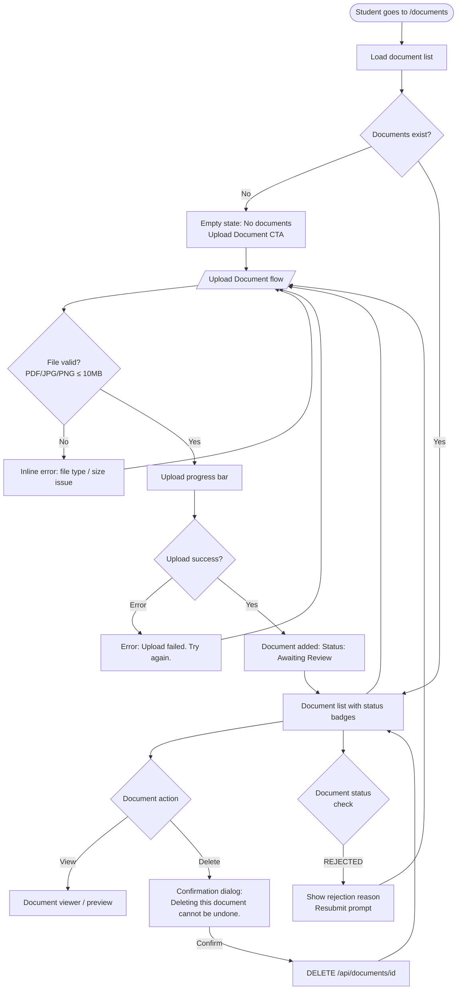

#### 4.1.4 Offer Response

```mermaid
flowchart TD
    A([Student receives offer notification]) --> B[Notification badge updates]
    B --> C[Student opens Dashboard]
    C --> D[Offer urgency component visible\nCountdown timer active]
    D --> E{Student action}
    E -- Accept --> F[Accept Offer dialog\nConfirm: Accept this room offer?\nRoom details shown]
    F -- Confirm --> G[POST /api/allocations/id/accept]
    G --> H{API success?}
    H -- Yes --> I[Allocation: ACCEPTED\nCheck-in deadline shown\nAll other applications WITHDRAWN\nNotification sent]
    I --> J([Dashboard: Shows accepted room details])
    H -- Error --> K[Error snackbar\nRetry available]
    E -- Decline --> L[Decline Offer dialog\nOptional: reason for declining]
    L -- Confirm decline --> M[POST /api/allocations/id/decline]
    M --> N[Allocation: DECLINED\nApplication returns to pool\nNotification sent]
    N --> O([Dashboard: Status resets])
    E -- Ignore -- offer deadline passes --> P[System: Offer EXPIRED\nRoom freed\nApplication returns to pool]
    P --> Q([Next offer or waiting list])
```

#### 4.1.5 Profile Management

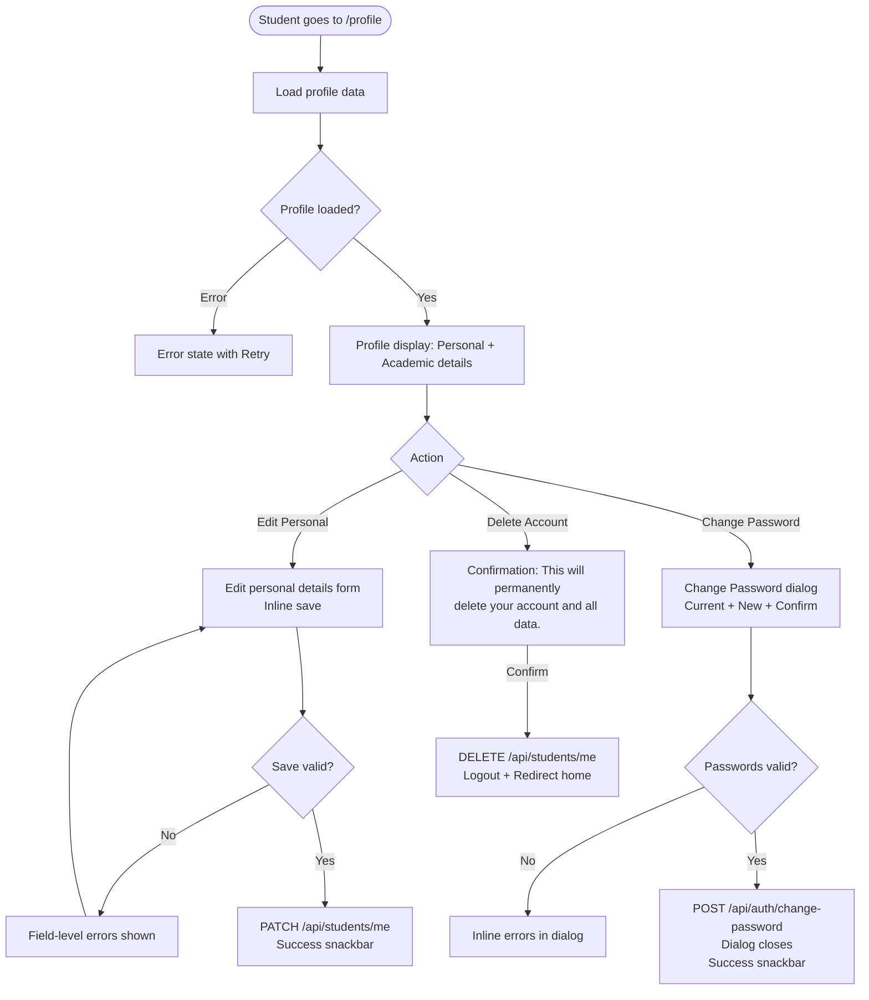

#### 4.1.6 Password Reset (Unauthenticated)

```mermaid
flowchart TD
    A([User on /login]) --> B[Click: Forgot Password]
    B --> C[/Forgot Password page/]
    C --> D[Enter email address]
    D --> E[POST /api/auth/forgot-password]
    E --> F[Show success message regardless\nof whether email is registered\nSecurity: no enumeration]
    F --> G[User checks email]
    G --> H{Clicks reset link}
    H -- Link expired --> I[/Reset Password page/\nError: link expired\nRequest new link]
    I --> C
    H -- Link valid --> J[/Reset Password page/\nNew Password + Confirm fields]
    J --> K{Form valid?}
    K -- No --> L[Inline errors]
    L --> J
    K -- Yes --> M[POST /api/auth/reset-password]
    M --> N{API response}
    N -- Error --> O[Error: Link may have expired.\nRequest a new one.]
    O --> C
    N -- 200 --> P[Success: Password reset.\nRedirect to login in 3 seconds]
    P --> Q([/login page/])
```

---

### 4.2 Admin Journeys

#### 4.2.1 Application Review

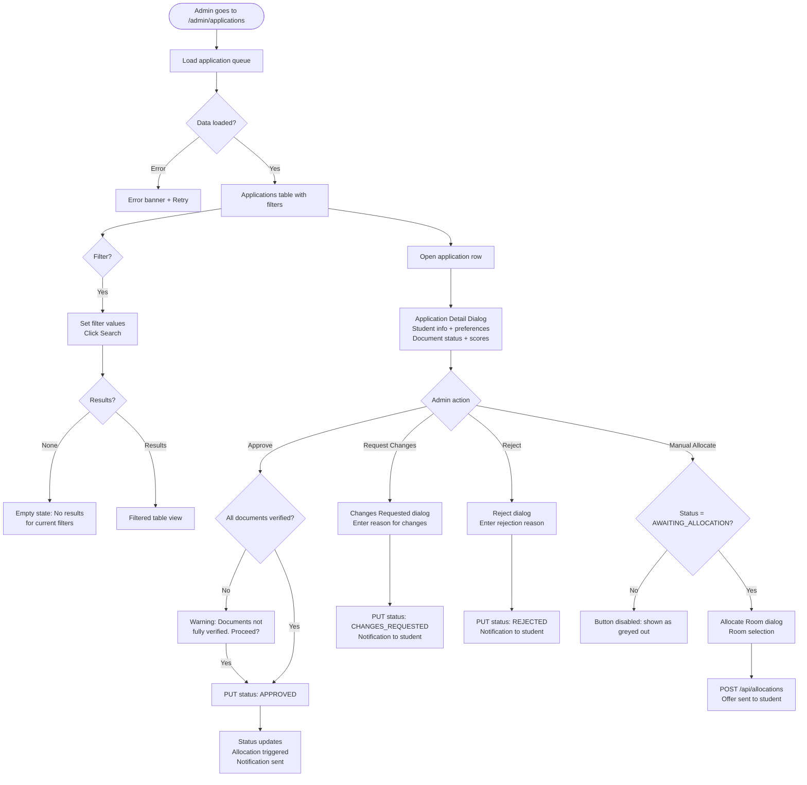

#### 4.2.2 Document Verification

```mermaid
flowchart TD
    A([Admin goes to /admin/documents]) --> B[Load pending documents queue]
    B --> C[Documents table: PENDING status]
    C --> D[Open document row / expand]
    D --> E[Document viewer: PDF/image preview\nStudent name + document type\nSubmission date]
    E --> F{Admin action}
    F -- Verify --> G[Confirmation: Mark this document as verified?\nThis is a platform-level action.]
    G --> H[PUT /api/documents/id/verify\nStatus: VERIFIED\nNotification to student]
    F -- Reject --> I[Reject dialog: Rejection reason (required)]
    I --> J[PUT status: REJECTED\nReason stored\nNotification: Not Accepted — Please Resubmit]
    F -- Add Comment --> K[Comment text area\nPost Comment button]
    K --> L[POST /api/documents/id/comments\nComment appears in thread]
```

#### 4.2.3 Building and Room Management

```mermaid
flowchart TD
    A([Admin: /admin/buildings]) --> B[Buildings list table]
    B --> C{Action}
    C -- Add Building --> D[Building Form dialog\nName + Address + Description\nGender restriction\nAccessibility features]
    D --> E{GEOCODING_ENABLED?}
    E -- Yes --> F[Nominatim address autocomplete\nMap preview if available]
    E -- No --> G[Plain address text input]
    F --> H[POST /api/buildings\nBuilding created]
    G --> H
    H --> I[Success snackbar\nBuilding appears in list]
    C -- Add Images --> J[Building Image upload dialog\nBulk upload — multiple files]
    J --> K[File validation + upload progress\nEach file shows individual progress]
    C -- Manage Rooms --> L[/admin/rooms filtered by building]
    L --> M{Action}
    M -- Add Room --> N[Room Form dialog\nRoom number + type + capacity\nFloor + accessibility]
    N --> O{Room number unique\nin this building?}
    O -- No --> P[Inline error: This room number\nalready exists in this building]
    P --> N
    O -- Yes --> Q[POST /api/buildings/id/rooms]
    M -- Bulk Add --> R[Bulk Room dialog\nRange: floor X rooms Y-Z\nAuto-generate numbers]
    M -- Edit Attributes --> S[Room Attributes dialog\nGender restriction + accessibility\nDesirability override]
```

#### 4.2.4 Staged Allocation Review

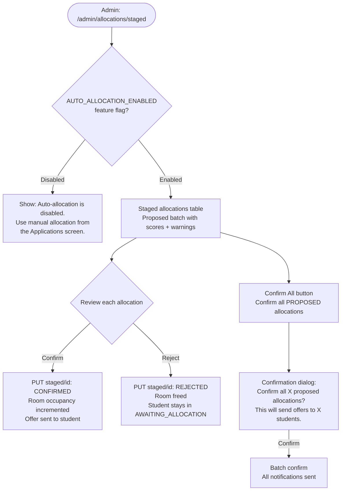

---

## 5. Screen Specifications

### 5.1 Home Page (`/home`)

- **Route:** `/home`
- **Guard:** None (public)
- **Purpose:** Landing page for unauthenticated users — introduces the platform, provides sign in / sign up CTAs.

**Desktop Layout:**
```
┌─────────────────────────────────────────────────────────┐
│  [Logo] Student Housing                    [Sign In]    │
├─────────────────────────────────────────────────────────┤
│                                                         │
│      Hero Section                                       │
│      "Find and manage student accommodation"            │
│      [Apply as Student]  [Manage Buildings]             │
│                                                         │
├─────────────────────────────────────────────────────────┤
│  Feature 1         Feature 2         Feature 3          │
│  (cards)           (cards)           (cards)            │
└─────────────────────────────────────────────────────────┘
```

**States:** Static — no loading states needed.

**Accessibility:** The first focusable element after page load should be the skip-to-content link (`<a href="#main-content" class="sr-only skip-link">Skip to content</a>`). This is currently absent on all pages.

---

### 5.2 Login Page (`/login`)

- **Route:** `/login`
- **Guard:** None (public)

**Layout:**
```
┌──────────────────────────────────────────┐
│  [Logo]                                  │
│                                          │
│  Sign In to Student Housing              │
│                                          │
│  [Email field]                           │
│  [Password field]  [Show/hide toggle]    │
│  [Forgot password? →]                    │
│                                          │
│  [Sign In]  (primary button, full-width) │
│                                          │
│  Don't have an account? [Sign Up]        │
└──────────────────────────────────────────┘
```

**States:**
- Default: Empty form
- Loading: "Sign In" button shows spinner, `aria-busy="true"`
- Error (credentials): Inline error below form — "Email or password is incorrect." (not field-level — do not reveal which is wrong)
- Error (account locked): "Your account has been temporarily locked due to multiple failed sign-in attempts. Try again in X minutes."

---

### 5.3 Student Dashboard (`/dashboard`)

- **Route:** `/dashboard`
- **Guard:** `AuthGuard + StudentGuard + EmailVerifiedGuard`
- **Purpose:** Student's home base — application status, required actions, documents summary, offer management.

**Desktop Layout (≥1024px):**
```
┌─────────────────────────────────────────────────────────────────┐
│  [Logo]  Student Housing        [🔔 3]  [Avatar ▼]              │
├─────────────────────────────────────────────────────────────────┤
│                                                                  │
│  Welcome back, [FirstName]                                       │
│  [New Application]  [Upload Documents]                          │
│                                                                  │
├──────────────────┬──────────────────────────────────────────────┤
│                  │                                              │
│  LEFT COLUMN     │  RIGHT COLUMN                               │
│                  │                                              │
│  Quick Actions   │  Document Status (scrollable)               │
│  ┌────────────┐  │  ┌────────────────────────────────────────┐ │
│  │ Edit Profile│  │  │ doc name         [Awaiting Review]     │ │
│  │ Contact    │  │  │ doc name         [Verified]            │ │
│  │ Support    │  │  │ doc name         [Not Accepted]  ⚠     │ │
│  └────────────┘  │  └────────────────────────────────────────┘ │
│                  │  [View All Documents]                        │
│  Application     │                                              │
│  Status          │                                              │
│  ┌────────────┐  │                                              │
│  │ [STATUS]   │  │                                              │
│  │ Code: xxx  │  │                                              │
│  │ Date: xxx  │  │                                              │
│  │ [View →]   │  │                                              │
│  └────────────┘  │                                              │
│                  │                                              │
│  My Room         │                                              │
│  ┌────────────┐  │                                              │
│  │ Room / bldg│  │                                              │
│  │ [Offer     │  │                                              │
│  │  expiry ⏰]│  │                                              │
│  │ [Accept]   │  │                                              │
│  │ [Decline]  │  │                                              │
│  └────────────┘  │                                              │
│                  │                                              │
│  History         │                                              │
└──────────────────┴──────────────────────────────────────────────┘
```

**Mobile Layout (< 768px):**
```
┌──────────────────────────────────────┐
│  [≡]  Student Housing  [🔔][Avatar]  │
├──────────────────────────────────────┤
│  Welcome back, [Name]                │
│  [New Application]                   │
├──────────────────────────────────────┤
│  ACTIVE OFFER (if applicable)        │
│  ┌───────────────────────────────┐   │
│  │ ⚠ Room Offered — Act Now      │   │
│  │ Building: Abc House, Rm 101   │   │
│  │ ⏰ Expires in 6 hours          │   │
│  │ [Accept]        [Decline]     │   │
│  └───────────────────────────────┘   │
├──────────────────────────────────────┤
│  Application Status                  │
│  [STATUS BADGE]  Code: APP-001       │
│  [View Details →]                    │
├──────────────────────────────────────┤
│  Documents (3 of 4 verified)         │
│  ⚠ 1 document requires resubmission │
│  [Manage Documents →]                │
├──────────────────────────────────────┤
│  Quick Actions                       │
│  [Edit Profile]  [Contact Support]   │
└──────────────────────────────────────┘
```

**Priority: When an offer exists, it must always render above all other cards**, with urgency styling. This is the highest-priority action on the dashboard.

**States:**

| State | Behaviour |
|---|---|
| Loading | Skeleton cards matching the layout |
| No application | Application Status card shows empty state with [Apply Now] CTA |
| Active offer | Offer card renders first, above Application Status, with urgency colouring |
| Offer accepted | Room details shown, check-in deadline with countdown |
| Error loading | Per-card error state with individual [Retry] buttons |

**Accessibility:**
- The "Active Offer" card when present must have `aria-live="polite"` on the expiry countdown
- Application status chip must have `aria-label="Application status: [human-readable status]"`
- Skip link target: `<main id="main-content">`

**Current issues in dashboard.component.html:**
- `style="margin-top: 10px; display: flex; align-items: center; gap: 8px; color: #f59e0b;"` — must be replaced with CSS class
- `style="margin-top: 15px; display: flex; gap: 10px;"` — must be replaced with CSS class
- `currentApplication.status.toUpperCase() === 'PENDING'` — must use enum `ApplicationStatus.PENDING`
- `currentApplication.status?.toUpperCase() === 'AWAITING_ALLOCATION'` — must use enum

---

### 5.4 Student Applications List (`/applications`)

- **Route:** `/applications`
- **Guard:** `AuthGuard + StudentGuard + EmailVerifiedGuard`

**Layout:** Card list (not table) for student-facing application view. Each card shows:
- Building name + address
- Application code
- Status badge (with student-facing label)
- Submission date
- Document completion indicator
- [View Details] button

**States:**
- Loading: Skeleton cards
- Empty: Empty state — "No applications yet" with [New Application] CTA
- List: Cards, newest first

---

### 5.5 Application Details (`/applications/:id`)

- **Route:** `/applications/:id`
- **Guard:** `AuthGuard + StudentGuard + EmailVerifiedGuard`

**Layout:** Timeline-style status history + current status detail + documents attached + offer actions if applicable.

**States:**
- Loading: Skeleton
- Error: Not found — friendly message + [Back to Applications] link

---

### 5.6 Student Documents (`/documents`)

- **Route:** `/documents`
- **Guard:** `AuthGuard + StudentGuard + EmailVerifiedGuard`

**Layout:** Document grid/list with status, upload date, and action buttons (view, delete, resubmit if rejected).

**Priority card — "Documents Requiring Attention":** When one or more documents are REJECTED, show a highlighted card at the top identifying which documents need resubmission, with direct [Resubmit] CTAs.

---

### 5.7 Admin Dashboard (`/admin`)

- **Route:** `/admin`
- **Guard:** `AuthGuard + AdminGuard`

**Layout:** Full admin shell with persistent sidebar (see 3.13.2) + summary statistics cards.

**Summary cards:**
- Total applications (with breakdown by status)
- Pending document reviews
- Active allocations
- Occupancy rate

---

### 5.8 Admin Applications (`/admin/applications`)

- **Route:** `/admin/applications`
- **Guard:** `AuthGuard + AdminGuard`

**Layout:** The existing implementation is good. Required additions:
1. Persistent sidebar (missing)
2. Skeleton loader (replace mat-spinner)
3. Proper empty state distinguishing "no data" from "no filter results"
4. `aria-label` on all icon-only action buttons

**Filter card:** Current implementation is well-designed. The date range filter (start + end) is correct. The status dropdowns showing `ModernStatusBadge` inside options is a good pattern — maintain it.

---

### 5.9 Admin Buildings (`/admin/buildings`)

**Required:** Conditional geocoding UI based on `GEOCODING_ENABLED` feature flag:
- Flag ON: Address input field with Nominatim autocomplete (already implemented), map preview when available
- Flag OFF: Plain address text inputs with no autocomplete or map component
- The layout must not shift or collapse when the flag changes state — reserve the same vertical space

---

### 5.10 Staged Allocations (`/admin/allocations/staged`)

**Required:** Feature flag conditional UI:
- `AUTO_ALLOCATION_ENABLED` = false: Show information banner — "Auto-allocation is currently disabled. Room offers must be sent manually from the Applications screen." with a [Go to Applications] link. No table or action buttons shown.
- `AUTO_ALLOCATION_ENABLED` = true: Full staged allocation table with batch confirm capability.

This is a clean conditional render — no skeleton needed for the flag check, just an instant render based on the flag state.

---

## 6. Interaction Patterns

### 6.1 Form Validation

**Timing Rules:**
1. Show errors on `blur` (field focusout event), not on keystroke
2. Show all errors on form submit attempt (even fields not yet touched)
3. On submit with server-side errors: map to field-level `mat-error` if field is known; show top-level error banner if not mappable to a specific field

**Error message tone:** Calm, constructive, action-guiding. "Email address is required" not "Invalid". "Enter a valid 13-digit South African ID number" not "Invalid ID".

**Error summary pattern** (for submit-time validation on multi-field forms):
When submit is attempted and multiple fields have errors, scroll to the top of the form and focus a summary element:

```html
<div role="alert" aria-live="assertive" id="form-error-summary"
     *ngIf="submitAttempted && form.invalid">
  <p>Please fix the following errors before submitting:</p>
  <ul>
    <li *ngFor="let error of formErrors">
      <a [href]="'#' + error.fieldId">{{ error.message }}</a>
    </li>
  </ul>
</div>
```

---

### 6.2 Loading States

| Context | Pattern | Duration Rule |
|---|---|---|
| Full page initial load | Skeleton loaders matching page layout | Immediate on navigate |
| Table data load | Table-shaped skeleton rows (matching column widths) | Immediate |
| Button action (submit/save) | Spinner inside button; button disabled | Immediate |
| Dialog confirmation action | Spinner inside dialog action button | Immediate |
| Background refresh | No visual change — update silently | — |
| File upload | Progress bar with percentage + cancel | Immediate on file select |
| Small component (status badge update) | No loader — update instantly | — |

**Skeleton implementation:** Use CSS `@keyframes shimmer` animation — a `linear-gradient` translating from -100% to 200% on the X axis, 1.5s, `ease-in-out`, infinite. The skeleton elements must precisely match the dimensions and positions of the content they replace.

---

### 6.3 Empty States

All empty states use the `EmptyStateComponent` (see Section 3.10). Rules:

1. Every list, table, and data surface must have a designed empty state
2. "No data" empty state (no records exist) must be visually distinct from "No filter results" (records exist, none match current filter)
3. Empty states must never be a blank white card or a `<p>No data</p>` — they must include an icon, a human title, a descriptive sentence, and a CTA where applicable
4. The generic `inbox` Material icon is used too broadly — each surface must use a contextually appropriate icon

**Context-appropriate icons:**

| Surface | Icon |
|---|---|
| Applications (no applications) | `description` |
| Documents (no documents) | `upload_file` |
| Buildings (no buildings) | `apartment` |
| Rooms (no rooms) | `meeting_room` |
| Activity logs (no logs) | `manage_search` |
| Notifications (none) | `notifications_none` |
| Waiting list (empty) | `queue` |
| General (fallback) | `info_outline` |

---

### 6.4 Destructive Actions

All destructive or irreversible actions require explicit confirmation.

**Trigger button rule:** The button that opens the confirmation dialog must NOT be styled in red/error colours. It may have a `color="warn"` style but only the confirmation button inside the dialog receives the error-colour treatment.

**Confirmation dialog template:**
```
┌─────────────────────────────────────────────┐
│  [Destructive Action Title]?                │
│                                             │
│  [Specific description of what will be     │
│  permanently removed/changed. State         │
│  that this action cannot be undone.]        │
│                                             │
│  [Impact: what the user will lose]          │
│                                             │
│        [Cancel]   [Confirm: Delete/Cancel]  │
└─────────────────────────────────────────────┘
```

**Rules:**
- Safe action (Cancel/Keep) always LEFT — first in tab order
- Destructive action always RIGHT — in error colour
- `Escape` key closes the dialog and takes no action
- Tab default is the safe action (Cancel)
- Dialog title uses imperative form of the destructive action

**Destructive flows in the system:**

| Action | Trigger | Confirmation Title | Key Message |
|---|---|---|---|
| Delete account | Profile page | "Delete Your Account?" | "This will permanently delete your account and all your documents. This cannot be undone." |
| Cancel application | Application detail | "Cancel This Application?" | "Cancelling will remove your application and your waiting list position. Submit a new application to rejoin." |
| Delete building | Building management | "Delete This Building?" | "All rooms and their allocation history will be permanently deleted." |
| Delete room | Room management | "Delete This Room?" | "Any pending allocations for this room will be cancelled." |
| Reject allocation | Staged allocation | "Reject This Allocation?" | "The student will return to the waiting list and may receive a different offer." |

---

### 6.5 Session Expiry

When a JWT token expires during an active session:

1. The `TokenExpiryInterceptor` must redirect to `/login` with query param `?reason=session_expired`
2. The login page must detect this param and show a dismissible info banner: "Your session has expired. Please sign in again to continue."
3. After login, redirect to the page the user was attempting to access (preserve the previous URL)
4. The banner must have `role="status"` and be announced via `aria-live="polite"`

---

### 6.6 Navigation Between Roles

When a user attempts to access a route outside their role (e.g., a student hitting `/admin`):
- Redirect to their home route (`/dashboard` for students)
- Do not show a "403 Forbidden" page — silently redirect
- No snackbar or error needed — this typically only happens on direct URL entry, not user action

---

## 7. Accessibility Standards

### 7.1 WCAG 2.1 AA Compliance

All components and screens must meet WCAG 2.1 Level AA. The following are non-negotiable requirements on every component:

| Criterion | Requirement |
|---|---|
| 1.1.1 Non-text Content | All images have descriptive `alt` text; decorative images have `alt=""` |
| 1.3.1 Info & Relationships | Labels associated with inputs via `for`/`id` or `aria-labelledby`; tables have `<th>` with `scope` |
| 1.3.3 Sensory Characteristics | Status is never conveyed by colour alone — always paired with text label and icon |
| 1.4.1 Use of Colour | Colour is supplementary — never the sole information channel |
| 1.4.3 Contrast Minimum | 4.5:1 for normal text; 3:1 for large text (≥18px regular or ≥14px bold) and UI components |
| 1.4.4 Resize Text | All text scalable to 200% without loss of content or functionality |
| 1.4.11 Non-text Contrast | Form inputs, buttons, focus indicators ≥3:1 against adjacent colours |
| 2.1.1 Keyboard | All functionality operable via keyboard |
| 2.1.2 No Keyboard Trap | Focus must not be trapped except intentionally in dialogs; dialogs support `Escape` to exit |
| 2.4.3 Focus Order | Focus order follows visual and logical reading sequence |
| 2.4.7 Focus Visible | Keyboard focus indicator always visible — never `outline: none` without alternative |
| 3.2.2 On Input | Changing a field value must not cause unexpected context change |
| 3.3.1 Error Identification | Errors identified in text describing what is wrong |
| 3.3.2 Labels or Instructions | Form labels always present; instructions before input, not only in placeholder |
| 4.1.2 Name, Role, Value | Custom components expose correct ARIA name, role, and state |
| 4.1.3 Status Messages | Status messages announced to assistive technology via ARIA live regions |

---

### 7.2 Required ARIA Patterns by Component

| Component | Required ARIA |
|---|---|
| Status badge | `role="status"` + `aria-label="Status: [human-readable label]"` |
| Form field | `<mat-label>` (Material handles `for`/`id` association); `aria-invalid="true"` on error; `aria-describedby` pointing to `mat-error` |
| Dialog | `role="dialog"` + `aria-modal="true"` + `aria-labelledby="[title-id]"` (MatDialog handles automatically — verify `aria-labelledby` is set) |
| Loading button | `aria-busy="true"` + `aria-label="Loading, please wait"` when in loading state |
| Error/success message | `role="alert"` for errors; `role="status"` for success; `aria-live` on container |
| Table | `<caption>` or `aria-label` on `<table>`; `scope="col"` on `<th>` |
| Sortable column | `aria-sort="ascending"` / `"descending"` / `"none"` on the `<th>` |
| File upload input | `aria-label="Upload [document type]"` |
| Upload progress | `role="progressbar"` + `aria-valuenow` + `aria-valuemin="0"` + `aria-valuemax="100"` |
| Skip link | First focusable element on every page, targets `#main-content` |
| Admin sidebar nav | `<nav aria-label="Main navigation">`; `aria-current="page"` on active item |
| Stepper | `aria-current="step"` on current step; step labels descriptive |
| Icon-only button | `aria-label="[action description]"` on the `<button>` element |
| Snackbar/Toast | `aria-live="polite"` (success/info) or `aria-live="assertive"` (error) |
| Offer countdown | `aria-live="polite"` on the countdown container (updates every minute) |

---

### 7.3 Keyboard Navigation Requirements

| Component | Required Keys |
|---|---|
| All buttons | `Enter`, `Space` to activate |
| All links | `Enter` to activate |
| Dialogs | `Escape` to close; `Tab`/`Shift+Tab` to cycle; focus trapped |
| Menus / dropdowns | Arrow keys to navigate; `Enter` to select; `Escape` to close |
| Tables with sorting | `Enter` or `Space` on sortable column header |
| File upload | `Enter` or `Space` to open file picker |
| Date picker | Full keyboard navigation through calendar |
| Navigation drawer (mobile) | `Escape` to close |
| Tabs | `Arrow keys` to navigate tabs; `Enter` or `Space` to activate |
| Admin sidebar | `Tab` through items; `Enter` to navigate |

---

### 7.4 Focus Management Rules

1. **On page/route load:** Focus moves to the `<h1>` of the new page. Angular Router events must trigger this via a `@HostListener('routeChange')` mechanism or equivalent.
2. **On dialog open:** Focus moves to the first focusable element inside the dialog (usually the close button or the first form field). `MatDialog` handles this automatically when `autoFocus` is not disabled.
3. **On dialog close:** Focus returns to the triggering element. `MatDialog` handles this automatically.
4. **On form submit error:** If a form-level error summary is shown, move focus to the summary element (`role="alert"`).
5. **On field-level error (blur):** Do NOT move focus — the error is announced via `aria-live`. Only move focus on form submit.
6. **Focus ring specification:** A 2px solid outline in `$accent-purple-dark` (#7c3aed) with 2px offset, visible on all interactive elements. Never `outline: none` without an equivalent custom focus indicator meeting 3:1 contrast.

Add to `styles.scss`:
```scss
:focus-visible {
  outline: 2px solid #{vars.$accent-purple-dark};
  outline-offset: 2px;
  border-radius: #{vars.$radius-sm};
}
```

---

### 7.5 Accessibility Audit Findings

The following issues were identified in the current implementation:

| # | WCAG Criterion | Component / Location | Issue | Severity | Remediation |
|---|---|---|---|---|---|
| A-001 | 2.4.7 Focus Visible | Global (`styles.scss`) | No explicit focus ring defined. Browser default may be removed by Material styling. | **Critical** | Add `:focus-visible` rule to `styles.scss` as specified above |
| A-002 | 4.1.2 Name, Role, Value | `app-modern-status-badge` | No `role="status"` or `aria-label` — screen readers cannot interpret status meaning | **Critical** | Add `role="status"` and `aria-label` to badge template |
| A-003 | 4.1.2 Name, Role, Value | `application-review.component.html` — `rate_review`, `tune`, `assignment_turned_in` icon buttons | Icon-only buttons have no accessible name | **Critical** | Add `aria-label="Review application [code]"` etc. |
| A-004 | 4.1.3 Status Messages | Notification/snackbar system | No ARIA live region configured on snackbar | **High** | Configure `politeness` on `MatSnackBar.open()` calls |
| A-005 | 1.3.3 Sensory Characteristics | Dashboard offer expiry (`dashboard.component.html`) | Expiry urgency communicated by `color: #f59e0b` inline style only — no text label distinguishing urgency from standard info | **High** | Replace with `OfferExpiryComponent` implementing full urgency spec |
| A-006 | 2.4.1 Bypass Blocks | All pages | No skip-to-main-content link exists | **High** | Add `<a href="#main-content" class="skip-link">Skip to content</a>` as first element on all page templates; add `id="main-content"` to `<main>` |
| A-007 | 1.4.3 Contrast | `modern-status-badge` — success states | `$success: #059669` on `#d1fae5` background achieves 2.8:1 — fails for normal text | **High** | Change foreground colour for success text to `#047857` (4.6:1 on `#d1fae5`) |
| A-008 | 1.4.1 Use of Colour | Admin table — allocation score `getScoreClass()` | Score uses colour classes (green/amber/red) without accessible tooltip or text label | **Medium** | Add `aria-label="Score: [value] ([high/medium/low])"` to score element |
| A-009 | 3.3.1 Error Identification | Auth forms (signup, login, etc.) | Error messages not audited — must confirm `aria-invalid` and `aria-describedby` are set on error fields | **Medium** | Audit all form components; add `aria-invalid="true"` and `aria-describedby` linkage |
| A-010 | 2.4.7 Focus Visible | `mat-mdc-card:hover` applies `transform: translateY(-4px)` | Hover transform on cards may cause visual disruption for keyboard-focused cards | **Low** | Restrict card hover lift to `.card-interactive` class; keep `.mat-mdc-card:focus-within` with static treatment |
| A-011 | 1.4.4 Resize Text | Global | Font size defined in `px` — must be in `rem` or `em` for user font-scaling | **Medium** | Convert `font-size` values in `_variables.scss` to `rem` equivalents (16px base = 1rem) |
| A-012 | 1.3.1 Info & Relationships | Admin tables | No `<caption>` or `aria-label` on `<table mat-table>` elements | **Medium** | Add `aria-label="Applications table"` etc. to each table |

---

## 8. Status Language and Communication Standards

All status labels displayed to users must use plain language. Enum names from the codebase must never appear in the user interface.

### 8.1 Application Status Labels

| Enum Code (Internal) | Student-Facing Label | Admin-Facing Label | Meaning |
|---|---|---|---|
| `PENDING` | "Application Received" | "Pending Review" | Submitted, not yet reviewed by admin |
| `UNDER_REVIEW` | "Under Review" | "Under Review" | Admin is actively reviewing |
| `CHANGES_REQUESTED` | "Changes Requested" | "Changes Requested" | Admin has requested student make changes |
| `APPROVED` | "Approved" | "Approved" | Approved by admin, in allocation pool |
| `AWAITING_ALLOCATION` | "On Waiting List" | "Awaiting Allocation" | Approved, waiting for a room to become available |
| `ALLOCATED` | "Room Offered" | "Allocated — Offer Sent" | Room has been offered to student |
| `REJECTED` | "Application Not Approved" | "Rejected" | Rejected by admin; see reason |
| `WITHDRAWN` | "Application Withdrawn" | "Withdrawn" | Student withdrew application |
| `CHECKED_IN` | "Checked In" | "Checked In — Active Resident" | Student has physically checked in |
| `EXPIRED` | "Application Expired" | "Expired" | Auto-expired after inactivity or timeout |
| `CANCELLED` | "Application Cancelled" | "Cancelled" | Cancelled by admin |

### 8.2 Allocation Status Labels

| Enum Code | Student-Facing Label | Admin-Facing Label |
|---|---|---|
| `OFFERED` | "Room Offered — Action Required" | "Offer Sent" |
| `ACCEPTED` | "Offer Accepted — Check-In Pending" | "Accepted" |
| `DECLINED` | "Offer Declined" | "Declined" |
| `ACTIVE` | "Checked In — Active Resident" | "Active" |
| `COMPLETED` | "Tenancy Completed" | "Completed" |
| `EXPIRED` | "Offer Expired" | "Expired" |
| `CHECK_IN_EXPIRED` | "Check-In Window Expired" | "Check-In Expired" |
| `TERMINATED` | "Tenancy Ended Early" | "Terminated" |
| `CANCELLED` | "Allocation Cancelled" | "Cancelled" |

### 8.3 Document Status Labels

| Enum Code | Student-Facing Label | Admin-Facing Label |
|---|---|---|
| `PENDING` | "Awaiting Review" | "Pending Verification" |
| `VERIFIED` | "Verified" | "Verified" |
| `REJECTED` | "Not Accepted — Please Resubmit" | "Rejected — Resubmission Required" |

### 8.4 Offer Urgency Communication

| Time Remaining | Text Format | Visual Treatment |
|---|---|---|
| > 3 days | "Offer expires in [X] days" | Info colour, `schedule` icon |
| 1–3 days | "Expires in [X] days — respond soon" | Warning colour, `warning` icon |
| < 24 hours | "Expires in [X] hours — respond now" | Error colour, `timer` icon, pulse animation |
| < 1 hour | "Expires in [X] minutes" | Error colour, full-width banner, large text |
| Expired | "This offer has expired" | Error colour, `timer_off` icon, no actions shown |

---

## 9. Design Gaps and Recommendations

| # | Gap | Affected Journey | Impact | Priority | Recommendation |
|---|---|---|---|---|---|
| UX-001 | No admin sidebar navigation — 17 admin routes exist but no menu links them | All admin journeys | Admins cannot discover or navigate between admin sections | **CRITICAL** | Implement persistent sidebar as specced in Section 3.13.2 |
| UX-002 | `_tokens.scss` conflicts with `_variables.scss` — two parallel token systems | All components | Risk of CSS cascade conflicts; developer confusion | **CRITICAL** | Deprecate and remove `_tokens.scss`; standardise on `_variables.scss` |
| UX-003 | Status badge missing 11 status values from Requirements.md | All screens with status indicators | Raw enum names display to users | **CRITICAL** | Add missing status configs to `ModernStatusBadgeComponent` |
| UX-004 | No prefers-reduced-motion support | All animated components | Accessibility failure for motion-sensitive users | **CRITICAL** | Add global reduced-motion media query to `styles.scss` |
| UX-005 | No skip-to-content link | All pages | Keyboard and screen reader users must tab through entire toolbar/nav on every page | **CRITICAL** | Add `<a href="#main-content" class="skip-link">` as first element in `app.component.html` |
| UX-006 | Icon-only buttons lack `aria-label` | Admin application review, admin tables generally | Keyboard/screen reader users cannot identify action buttons | **CRITICAL** | Add `aria-label` to all `mat-icon-button` elements |
| UX-007 | Offer expiry shows as plain date text — no urgency escalation | Student dashboard — offer response | Students miss offer deadlines | **HIGH** | Implement `OfferExpiryComponent` per Section 3.14 |
| UX-008 | All loading states use `mat-spinner` — no skeleton loaders | All data-loading screens | Blank white card flash on every page load; perceived performance poor | **HIGH** | Implement `SkeletonLoaderComponent` per Section 3.9 |
| UX-009 | Status badge has no `role="status"` or `aria-label` | All screens | Screen readers cannot communicate application/allocation/document status | **HIGH** | Add ARIA attributes to `ModernStatusBadgeComponent` template |
| UX-010 | Success colour `#059669` fails WCAG contrast on `#d1fae5` background | All screens with `status-approved` badges | Accessibility failure | **HIGH** | Change to `#047857` for text on light success background |
| UX-011 | Inline `style=""` attributes in `dashboard.component.html` | Student dashboard | Violations of CSS architecture; not responsive; not design-token compliant | **HIGH** | Replace all inline styles with SCSS classes using design tokens |
| UX-012 | Table empty state uses generic "No applications found" with `inbox` icon — no distinction between no-data and no-filter-results | Admin application review | Admin cannot determine if filters are too restrictive or if no applications exist | **HIGH** | Implement two distinct empty state messages per Section 6.3 |
| UX-013 | Status enum values used directly in conditional logic (`status.toUpperCase() === 'PENDING'`) | Dashboard, application review | Brittle string comparisons; will break if enum values change | **MEDIUM** | Always compare against `ApplicationStatus` enum values |
| UX-014 | Card hover `translateY(-4px)` applied globally to all `mat-mdc-card` | Admin management screens | Visual noise on data-display cards; inappropriate for table containers | **MEDIUM** | Restrict to `.card-interactive` class; remove global hover lift |
| UX-015 | Focus ring not explicitly defined in global styles | All interactive elements | Material may suppress browser default outlines; keyboard users lose focus indicator | **CRITICAL** | Add `:focus-visible` rule to `styles.scss` |
| UX-016 | `AUTO_ALLOCATION_ENABLED` flag not reflected in UI — staged allocation UI always shown | Admin staged allocation | Admin sees a screen with controls that do nothing when flag is off | **MEDIUM** | Implement flag-conditional render per Section 5.10 |
| UX-017 | `GEOCODING_ENABLED` flag not reflected in building form — address autocomplete shown regardless | Admin building form | Autocomplete component may fail silently when geocoding service is off | **MEDIUM** | Implement flag-conditional address input per Section 5.9 |
| UX-018 | No breadcrumb navigation | Admin sections > 1 level deep | Admin users lose context when navigating sub-sections | **MEDIUM** | Implement breadcrumbs for all routes > 1 level from the top nav |
| UX-019 | Mobile bottom navigation not implemented — students on mobile have no navigation | Student mobile experience | Mobile students cannot navigate between sections | **HIGH** | Implement bottom nav bar for student role on mobile breakpoint |
| UX-020 | Table headers missing `aria-label` on containing table | All admin tables | Screen reader announcements lack table context | **MEDIUM** | Add `aria-label` to all `<table mat-table>` elements |
| UX-021 | `application-submission` and `document-upload` routes in `/features/auth/` — part of the authenticated student flow placed in the auth feature folder | Developer clarity only — no user-facing impact | Routing architecture confusion; application submission is not an auth flow | **LOW** | Move to `/features/dashboard/` in a future refactor (Architecture.md concern) |
| UX-022 | `app-modern-status-badge` displays raw label via `text-transform: capitalize` — "awaiting_allocation" renders as "Awaiting_allocation" | All screens showing AWAITING_ALLOCATION | Broken label visible to students | **HIGH** | Set explicit `label` in badge config; remove `text-transform: capitalize` |
| UX-023 | Password show/hide toggle missing from login/signup forms | Auth flows | Users cannot verify their password input on mobile | **MEDIUM** | Add `<button mat-icon-button>` with `visibility`/`visibility_off` icon toggling `input[type]` between `password` and `text` |
| UX-024 | Landlord / Building Owner role not yet designed or implemented | Future admin journey | v2.0 requires BUILDING_OWNER role with different permissions and UI scope | **LOW (future)** | Identify scope gap — BUILDING_OWNER will need a separate dashboard shell, building-scoped navigation, and staff management UI. Design should be planned before v2.0 feature work begins. |

---

## 10. Implementation Guidance for Developers

### 10.1 Angular Material Usage Rules

| Rule | Detail |
|---|---|
| Use Material components | Never create a custom button, select, or dialog if an Angular Material equivalent exists. Extend via theme, not wrapper. |
| Theme via `mat.define-theme()` | All design token overrides applied in `custom-theme.scss`. Never hardcode `#hex` colours in component SCSS — use SCSS variables or CSS custom properties from `_variables.scss`. |
| No inline `style=""` | All styling via component-scoped SCSS. The inline styles in `dashboard.component.html` are a technical debt item to clear. |
| Responsive via `BreakpointObserver` | Use Angular CDK `BreakpointObserver` for component-level responsive logic. Use CSS media queries (via the `responsive()` mixin in `_mixins.scss`) for purely visual changes. |
| Icon usage | `<mat-icon aria-hidden="true">` for decorative icons; add `<span class="sr-only">Visible label</span>` for icons that convey standalone meaning. |
| `!important` usage | The current `custom-theme.scss` uses `!important` to override Material defaults. This is acceptable for theme-level overrides but must not be used in component-scoped SCSS. |

### 10.2 Design Token Usage

```scss
// ✅ Correct — uses design tokens
.offer-expiry-notice {
  display: flex;
  align-items: center;
  gap: vars.$space-2;
  color: vars.$warning;
  margin-top: vars.$space-3;
}

// ❌ Wrong — hardcoded values (current state in dashboard.component.html)
.offer-expiry-notice {
  margin-top: 10px;
  display: flex;
  align-items: center;
  gap: 8px;
  color: #f59e0b;
}
```

### 10.3 Status Badge Usage

Always provide the enum string value, not a hardcoded string:

```typescript
// ✅ Correct
<app-modern-status-badge [status]="AllocationStatus.OFFERED"></app-modern-status-badge>

// ❌ Wrong
<app-modern-status-badge status="OFFERED"></app-modern-status-badge>
```

The component accepts `string` so the template will not error on the wrong approach — this is a developer discipline rule, not a compiler-enforced one.

### 10.4 Component File Structure

```
components/
  {component-name}/
    {component-name}.component.ts       // Logic only — no business logic in templates
    {component-name}.component.html     // Template
    {component-name}.component.scss     // Scoped styles — tokens only, no raw values
    {component-name}.component.spec.ts  // Unit tests (currently absent — Phase 2 target)
```

### 10.5 SCSS Utility Class

Add `sr-only` utility class to `_utilities.scss` if not already present:

```scss
.sr-only {
  position: absolute;
  width: 1px;
  height: 1px;
  padding: 0;
  margin: -1px;
  overflow: hidden;
  clip: rect(0, 0, 0, 0);
  white-space: nowrap;
  border: 0;
}
```

Also add `skip-link` style:

```scss
.skip-link {
  position: absolute;
  top: -9999px;
  left: 0;
  padding: vars.$space-3 vars.$space-4;
  background: vars.$accent-purple-dark;
  color: white;
  font-weight: 600;
  z-index: 9999;
  border-radius: 0 0 vars.$radius-sm vars.$radius-sm;

  &:focus {
    top: 0;
  }
}
```

---

## 11. Diagrams

### 11.1 Information Architecture — Student Portal

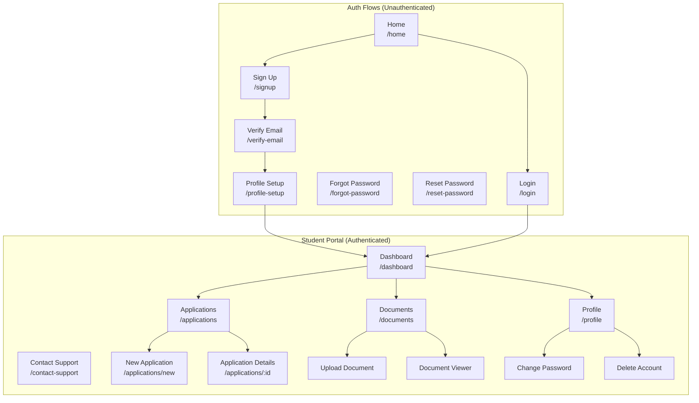

### 11.2 Information Architecture — Admin Portal

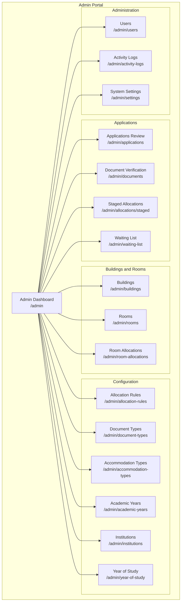

### 11.3 Application Status State Machine

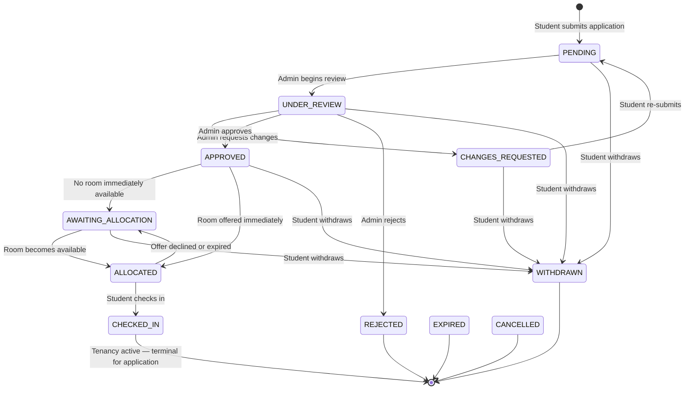

### 11.4 Allocation Status State Machine

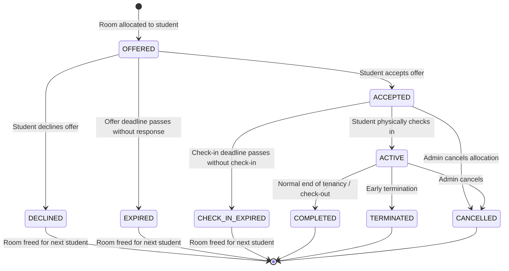

### 11.5 Document Verification Flow

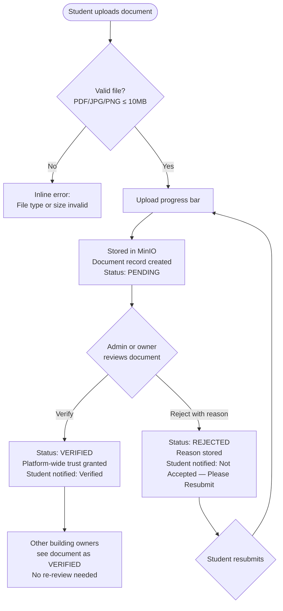

### 11.6 Offer Lifecycle Flow

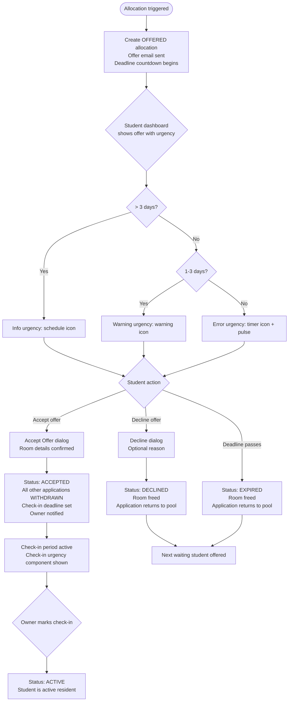

### 11.7 Feature Flag Conditional UI Flow

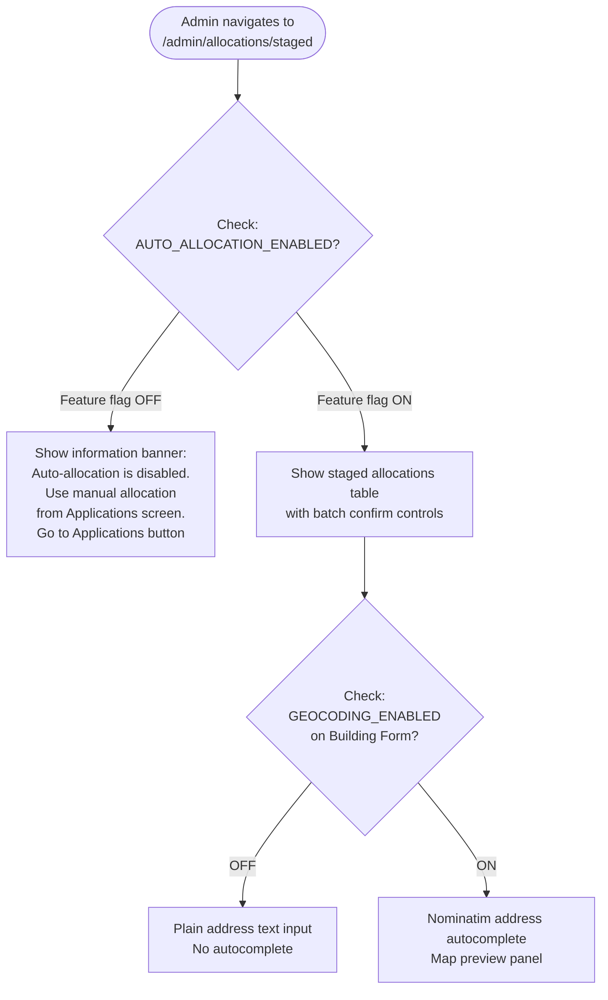

---

## 12. Appendix

### 12.1 Component Inventory

| Component | File Path | Type | States Covered | Accessibility Compliant | Notes |
|---|---|---|---|---|---|
| `AppComponent` | `app/app.component.ts` | Shell | — | Partial | Missing skip link; isHomePage check incomplete |
| `AppNavMenuComponent` | `app/shared/app-nav-menu.component.ts` | Shared | — | Unknown | Not reviewed in detail — requires audit |
| `ModernStatusBadgeComponent` | `app/shared/modern-status-badge/` | Generic | Partial (12/24 statuses) | No | Missing role/aria; missing 12 statuses; `text-transform:capitalize` breaks compound enums |
| `ErrorDisplayComponent` | `app/shared/error-display/` | Generic | Error, retry | Unknown | Used in admin application review — pattern is good |
| `DashboardComponent` | `app/features/dashboard/dashboard.component` | Page | Loading, loaded, no-app, offer | Partial | Inline styles; direct string enum comparisons; good overall structure |
| `ApplicationsComponent` | `app/features/dashboard/applications/` | Page | Loading | Unknown | Requires full review |
| `NewApplicationComponent` | `app/features/dashboard/applications/new-application/` | Page | — | Unknown | Multi-step form — requires stepper spec compliance |
| `ApplicationDetailsComponent` | `app/features/dashboard/applications/application-details/` | Page | — | Unknown | |
| `DocumentsComponent` | `app/features/dashboard/documents/` | Page | — | Unknown | |
| `ProfileComponent` | `app/features/dashboard/profile/` | Page | — | Unknown | |
| `HomeComponent` | `app/features/home/` | Page | — | Unknown | |
| `LoginComponent` | `app/features/auth/login/` | Page | Default, loading, error | Unknown | Missing password show/hide toggle |
| `SignupComponent` | `app/features/auth/signup/` | Page | Default, loading, error | Unknown | |
| `ProfileSetupComponent` | `app/features/auth/profile-setup/` | Page | — | Unknown | Multi-step — needs stepper spec |
| `ApplicationReviewComponent` (Admin) | `app/features/admin/application-review/` | Page | Loading, loaded, error, empty | Partial | Good dual desktop/mobile view; missing aria-labels on action buttons; no skeleton loader |
| `AdminDashboardComponent` | `app/features/admin/admin-dashboard/` | Page | — | Unknown | No sidebar shell currently |
| `BuildingManagementComponent` | `app/features/admin/building-management/` | Page | — | Unknown | Geocoding flag not conditionally rendered |
| `StagedAllocationComponent` | `app/features/admin/staged-allocation/` | Page | — | Unknown | Flag-conditional UI not implemented |
| `DocumentVerificationComponent` | `app/features/admin/document-verification/` | Page | — | Unknown | |

### 12.2 Requirements Cross-Reference

| Requirement Area | Requirement Summary | Design Impact | UISpec Section |
|---|---|---|---|
| AUTH-001–006 | Registration, email verification, profile setup | Sign-up flow, verification gate, profile setup stepper | 4.1.1, 5.2 |
| AUTH-007 | Password reset | Forgot/reset password screens | 4.1.6 |
| APP-001–010 | Application submission and management | Application form, documents, review, confirmation | 4.1.2, 5.4, 5.5 |
| DOC-001–008 | Document upload, management, platform verification | Document upload component, document status, admin verification | 3.11, 4.1.3, 4.2.2 |
| ALLOC-001–012 | Room allocation, offers, accept/decline, one-offer rule | Offer urgency component, accept/decline dialogs, allocation lifecycle | 3.14, 4.1.4, 4.2.1, 11.4, 11.6 |
| ALLOC-013 | Auto-allocation feature flag | Feature flag conditional UI in staged allocations | 5.10, 11.7 |
| GEOCODING | Geocoding feature flag | Conditional address input in building form | 5.9, 11.7 |
| NOTIFY-001–006 | Email + in-app notifications | Snackbar ARIA, notification badge in toolbar | 3.8 |
| STATUS | Application/Allocation/Document status machines | Status badge component, plain language labels | 2.1.3, 3.2, 8.1–8.4 |
| ROLE-001–004 | Role-based access: Student, Admin, Owner, Staff | Navigation per role, admin sidebar, owner registration UI (future) | 3.13, 9 (UX-024) |
| WCAG-AA | Accessibility compliance | All accessibility sections | 7.1–7.5 |
| v2.0 Multi-tenant pivot | BUILDING_OWNER role, tenant isolation | UX-024 flags future design gap; current spec covers v1.1 Admin role | 9 (UX-024) |

---

**Document End**

*This specification supersedes any prior informal design decisions or ad-hoc component implementations. All frontend development must align to the patterns, tokens, and specifications defined in this document.*
