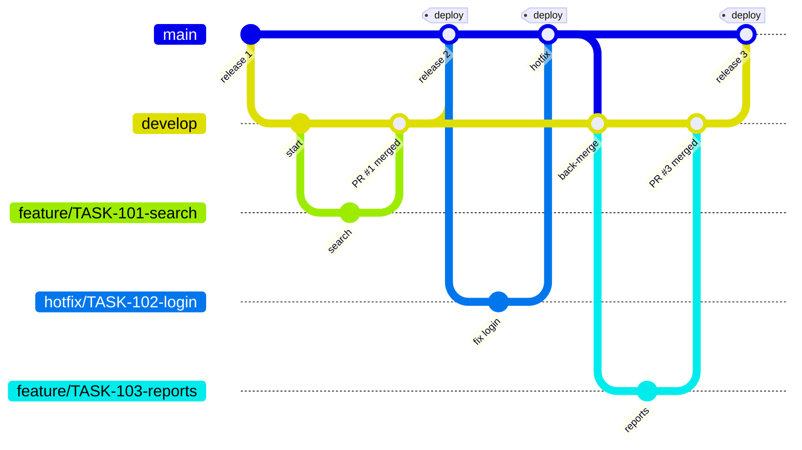
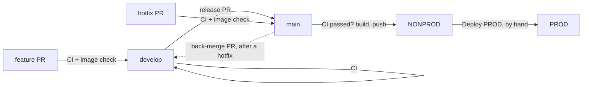

# Branching strategy

How code moves from a feature branch to PROD, and which GitHub Actions run at each step. Agreed
on 2026-11-03 as part of #373. The table at the end says which parts already work and which are
still to build.

## The branches

| Branch | What it holds | Who writes to it |
|---|---|---|
| `main` | What is released. NONPROD deploys every push to it; PROD deploys from it by hand | Pull requests only, from `develop` or a hotfix branch |
| `develop` | The next release, with every merged feature | Pull requests only, from feature branches or the back-merge |
| `feature/TASK-{id}-{slug}` | One issue's change | One person, from `develop` |
| `hotfix/TASK-{id}-{slug}` | One urgent fix for what is released | One person, from `main` |

Nobody commits directly to `main` or `develop`.

## The picture

A feature goes `develop` first, then out in a release. A hotfix starts from `main`, is released
on its own, and is merged back into `develop` so the next release keeps it.

`deploy` marks a merge into `main`: NONPROD deploys it on its own, then a person runs Deploy PROD.

## A feature

1. Branch `feature/TASK-{id}-{slug}` from `develop`.
2. Open a pull request into `develop`. CI runs the tests and the image build checks the
   Dockerfiles. This is the quality gate.
3. Merge. CI runs once more on `develop`, which catches two pull requests that pass alone but
   break together.

## A release

1. Open a pull request from `develop` into `main`. No CI and no image build run on it: every
   change in it has already passed both.
2. Merge it with a **merge commit, never a squash**. A squash makes `main` and `develop` look
   unrelated to Git, and every later release conflicts (that happened with #104).
3. Deploy NONPROD starts. It first checks that a successful CI run tested the same files (for a
   release, the push to `develop`; only paths CI ignores, such as docs, may differ), then builds
   the images, deploys NONPROD and saves the release. If CI failed or was cancelled on `develop`,
   it stops here: re-run CI on `develop`, then re-run the deploy.
4. Check NONPROD. Then run **Deploy PROD** on `main` with the NONPROD run id from the run's
   summary (`docs/PROD_RUNBOOK.md`).

## A hotfix

For a PROD bug that cannot wait for the next release.

1. Branch `hotfix/TASK-{id}-{slug}` from `main`.
2. Open a pull request into `main`. CI and the image build both run on it.
3. Merge it with a merge commit. NONPROD deploys it, after checking CI passed on the same files.
   If `main` changed after the hotfix branched, the merged files were never tested together and
   the check refuses the deploy. Merge `main` into the hotfix branch before merging the pull
   request, so its CI run tests exactly what will land.
4. Run **Deploy PROD** with that NONPROD run id, as for a release. A hotfix goes through NONPROD
   too: about five minutes, and the fix runs on a real server before students see it.
5. A workflow notices that `main` now has a change `develop` lacks, and opens a pull request from
   `main` into `develop`. Merge it. If it conflicts, resolve it on a branch from `develop`.

Skipping step 5 strands the fix on `main`: the next release would not have it on `develop`, and
`develop` and `main` would drift apart. That is how #288 sat on `main` for two months.

## What runs where

| Event | CI (tests) | Image build | Deploy |
|---|---|---|---|
| PR feature into `develop` | yes | build only | |
| Merge into `develop` | yes | | |
| PR `develop` into `main` | | | |
| PR hotfix into `main` | yes | build only | |
| Merge into `main` | | build and push | NONPROD, if CI passed on the released commit |
| Deploy PROD, by hand | | | PROD, the images NONPROD ran |
| `main` has changes `develop` lacks | | | opens the back-merge PR |

## What is built and what is still to do

| Part | State |
|---|---|
| NONPROD deploys `main`, Deploy PROD promotes a NONPROD run of `main` | Works (#338, #369) |
| Deploy PROD accepts runs from `main` only, enforced by the AWS deploy role | Works (#369) |
| NONPROD deploy survives a dropped connection | Works (#375) |
| No CI on the `main` push; Deploy NONPROD checks CI first | Works (#385), `tools/ci/ci-passed.sh` |
| No image build on release pull requests | Works (#376) |
| Hotfix branches from `main`, and the back-merge workflow | To build (#386). Needs `CONTRIBUTING.md` to allow branching from `main` for hotfixes |

Until the hotfix issue lands, `CONTRIBUTING.md` still says to branch from `develop` only, and that
rule wins.
