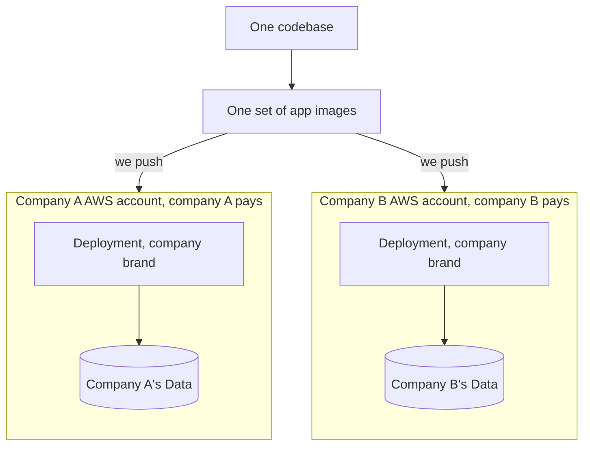
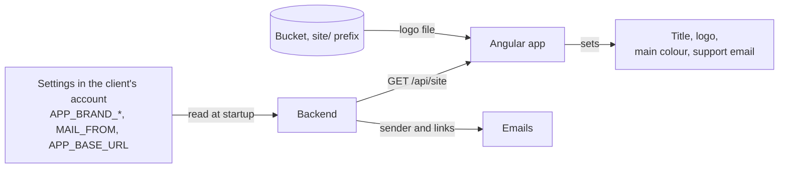
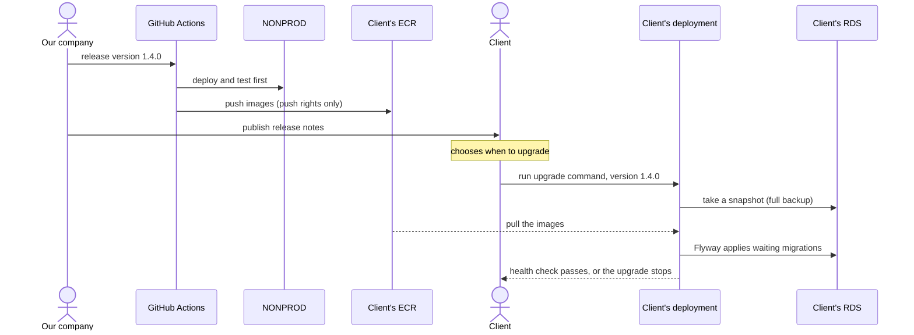
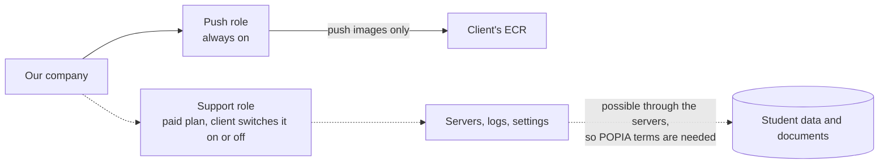
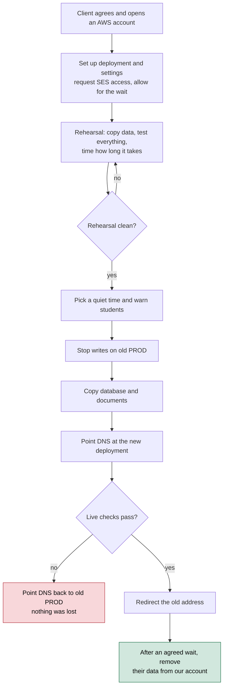
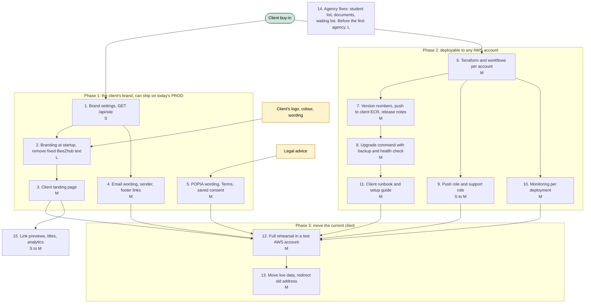

# Plan: One Deployment Per Company

**Status:** Proposed. Waiting for buy-in from the current client. Nothing is built, and work slices
are not filed as issues yet (#500 tracks these documents).
**Date:** 2026-11-05
**Why and which options:** [ADR-010](adr/ADR-010-client-branded-sites.md)

A client wants a site for their company only, so they can do their own marketing and students see
only their buildings.

**The plan in one line:** each company gets its own deployment in its own AWS account, from one
codebase, with settings for branding and company details.

The diagrams use Mermaid (charts written as text). GitHub draws them for you. In IntelliJ, enable the
Mermaid option in the Markdown plugin settings.

---

## 1. The model

One codebase produces one set of images. Each company runs them in its own AWS account, with its own
settings, data and bill. An agency is the same thing, with several companies in one database.

---

## 2. How branding works

One image reads its settings at startup, so nothing is rebuilt for a client.

Login does not change. Students and staff keep their email and password.

---

## 3. How a release reaches a client

We publish a version and the client decides when to take it. They are allowed to fall behind, but
only within the support policy.

**Support policy:** we support the latest two versions. Security fixes must be applied within 14 days,
or the contract says we no longer carry that risk. The 14 days is a starting suggestion.

**Each release note lists:** what changed, database migrations, new required settings, and security
fixes. The repo is private, so notes need a place clients can read.

---

## 4. Who can reach what

The client owns the account. What we can reach depends on the contract.

| | Client runs it | Client buys a support plan |
|---|---|---|
| Upgrades | Client runs the command | We can run it for them |
| Outages, backups, certificates | Client, using our runbook | Our company |
| Our access | Push images only | Wider role, which they control |

---

## 5. Moving the current client

They use PROD today, so this is live data. Nothing here starts without their agreement.

Things to plan for:

- **Old links.** Emails already sent link to `accommodation.beezhub.co.za`, so the old address needs
  to redirect for a while.
- **Logins.** If `JWT_SECRET` changes, students log in again. Passwords still work, because the
  password hashes move with the database.
- **Going back.** Going back is only clean before new data is saved on the new deployment. After that,
  new data would have to be copied back.
- **Old data.** The client's data must not stay in our account after the move, including backups.

---

## 6. Build order

A slice is one small piece of work that ships by itself, and each can become one issue later. Arrows
mean "needs this first".

These times are rough guesses for one person, where S is about a day, M a few days, and L a week or
more.

| Phase | Slices | Rough time |
|---|---|---|
| 1. The client's brand | 1 to 5 | About 3 to 4 weeks, plus legal advice and client content |
| 2. Deployable to any account | 6 to 11 | About 3 to 4 weeks |
| 3. Move the current client | 12, 13 | About 1 to 2 weeks, plus AWS's SES review |
| Later | 14, 15 | 15 can move earlier if marketing depends on WhatsApp links. 14 isn't needed until an agency signs |

**A useful side effect:** Phase 1 can ship on today's PROD. The client sees their own brand before any
AWS move, which should help with buy-in.

### How we know it works

| Test | Expected result |
|---|---|
| Install from scratch in an empty test AWS account, using only the runbook | Site comes up with the test brand |
| Run the upgrade across two versions, including a migration | App healthy, and a snapshot exists |
| Upgrade with a required setting missing | Clear failure, and the old version keeps running |
| Use the push role to read the database or a document | Refused |
| Look through every public page and email type | No "BeeZhub" text, except where you choose to keep it |
| Rehearse the data move, then compare row and file counts | Counts match, and a student can log in |

---

## 7. What to ask the current client

They are the only real use case, so their answers can change this plan.

**What they get:** their own address and brand, their own data in an account they own, and no
competitors on their site.

**What we need from them:**

- [ ] Are they willing to open an AWS account and pay AWS directly? The current size costs about $35
      to $47 a month, including VAT.
- [ ] Do they have someone with AWS skills, or do they want a support plan?
- [ ] Are they happy to run upgrades, and apply security fixes within the deadline?
- [ ] Which web address will they use? `rooms.client.co.za` is recommended, because a bare
      `client.co.za` could break their other systems (HSTS).
- [ ] Is a short outage acceptable for the move, and when is their quietest time? Avoid application
      and check-in periods.
- [ ] What logo, colour, wording and real stats should the site use?
- [ ] Which email sender do they want? Their own domain needs SPF and DKIM, DNS records that prove we
      may send for them.

**What to tell them early:**

- Version 1 covers logo, name and main colour, not a full redesign.
- The contract needs to cover student data under POPIA, support, licensing of the app, and what
  happens if either side ends the relationship.

**If they don't want their own AWS account:** we can run their copy in an account we own and charge
them. Most of this plan still applies.

## 8. Decisions still open for you

- [ ] **1. What happens to your AWS test deployment after the move?** Old PROD could become your AWS
      release test and demo, with example data, for about $35 to $47 a month. Otherwise, the client's
      site would be your only real AWS check, since NONPROD runs on Oracle.
- [ ] **2. Where do release notes live?** The repo is private, so clients need another place.
- [ ] **3. Monitoring.** Does each client have their own Grafana Cloud stack, or do you see them all in
      one place?
- [ ] **4. How much BeeZhub stays visible?** For example, a small "Powered by BeeZhub" in the footer.
- [ ] **5. Who holds the first admin login in a client's deployment?** Recommended: the client, unless
      they buy a support plan.
- [ ] **6. Pricing.** Do you agree with the proposal below, and what are the real prices?

### Pricing proposal

Recommended offer for the current client: a setup fee plus a yearly licence, with support as a
separate optional plan. The client pays AWS directly, so none of these fees cover their AWS bill.

| Income | How it works | Why it fits |
|---|---|---|
| **Yearly licence (main income)** | A fee per bed, which includes new versions | Steady income that grows with the client |
| **Setup fee** | One-off fee for the install, branding and data move | Pays for the work up front |
| **Support plan** | Optional yearly fee for running the deployment | Pays for the wider access and on-call work |
| **Agency plan** | Licence plus a fee per company they manage | Agencies earn from this, so they can pay more |
| **Paid add-ons** | Extra features, such as a separate brand per company | Only clients who want them pay |
| **Custom work** | Integrations and reports, at a day rate | Some of it can become features you resell |
| **Managed hosting** | We run the AWS account and add a margin | The fallback if a client doesn't want their own account |

Example only, with made-up numbers: R20 per bed per month × 500 beds = R10,000 a month. Test the real
price with the client.

Things to watch:

- **Enforcing the licence.** The app runs in the client's account, so we can't simply switch it off if
  they stop paying. The contract protects us, along with stopping new versions and security fixes.
- **Protecting the code.** Clients can reach the images in their account, which contain our code, so
  the licence terms need to cover copying and reuse.
- **Counting usage.** A fee per application is hard to check, because the push role can't see their
  data. Put bed numbers in the contract and review them each year.
- **Charging students.** Avoid a student application fee for now. It hurts the client's marketing and
  may raise legal questions.
- **Depending on one client.** With about one client expected in two years, the licence is unlikely to
  pay back the build quickly. Ask them to fund part of this work through the setup fee, since they
  asked for it.

---

## 9. What is not confirmed

This plan comes from reading the code on 2026-11-05. No code was run. Still to check:

- What is on PROD now, and how large the data is.
- That the current client is the same client who asked for this.
- That a tenant admin really can list all students.
