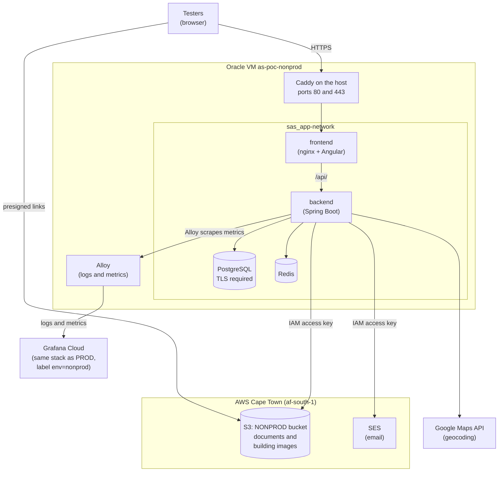
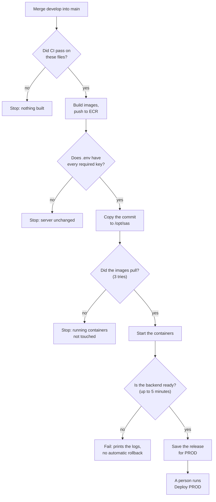

# NONPROD runbook

How NONPROD is deployed and operated. NONPROD is the test environment: every release runs here
first, and PROD then promotes the exact images that passed. PROD has its own
[runbook](PROD_RUNBOOK.md).

Server details below were checked on the host on 2026-11-04.

| What | Where |
|---|---|
| Site | `https://nonprod.beezhub.co.za` |
| DNS | A record to `84.12.109.37`, in the `beezhub.co.za` zone at SADomains until #344 |
| Server | Free Oracle Cloud VM `as-poc-nonprod`, `af-johannesburg-1`, Ampere A1 (`aarch64`), 2 OCPU, 12 GB, no swap, 45 GB disk, Ubuntu 24.04 |
| Stack | Docker Compose in `/opt/sas`, project `sas`, networks `sas_app-network` and `sas_monitoring-network` |
| Database | PostgreSQL 16 container `student-accommodation-local-db`, not published outside the server. Network connections must use TLS |
| Documents | S3 bucket `beezhub-sas-nonprod-documents` in `af-south-1`, reached with IAM user `sas-nonprod-app` (`infra/terraform/nonprod`) |
| Images | ECR in `af-south-1` (AWS's image registry), pulled by digest (a hash that names one exact build) |
| Settings | `/opt/sas/.env`, edited by hand on the server |
| Email | SES API in `af-south-1`, from `nonprod@beezhub.co.za`, with the same IAM user |
| Logs and metrics | Alloy on the server sends them to Grafana Cloud, the same stack as PROD, with the label `env=nonprod` |
| TLS | Caddy, a web server installed on the host and not in Compose. It gets the certificate and sends traffic to the frontend |

## What runs where

The application runs on one server and uses the same AWS services and Grafana Cloud stack as PROD.
Each box in the server is a container, apart from Caddy. A request reaches the backend through Caddy
and then nginx in the frontend container.



A presigned link is a temporary S3 address the backend creates, so the browser fetches a document
from S3 directly.

Deploys are left out of this picture, and [Deploy a release](#deploy-a-release) covers them.

## Access

Use the SSH alias from your `~/.ssh/config`, which carries the right key:

```bash
ssh nonprod
```

`ssh ubuntu@nonprod.beezhub.co.za` fails with a publickey error, because it does not use that key.

The server accepts one SSH key, `deploy@nonprod`, so your alias and GitHub Actions share it. If you
replace that key, update `~/.ssh/authorized_keys` on the server, your local key file and the
`SSH_PRIVATE_KEY` secret together, or you lock out either yourself or the deploy.

Logs and metrics are in Grafana Cloud at `https://friendlysamosa508.grafana.net`, shared with PROD.
Sign in with your Grafana Cloud account.

## Deploy a release

**The normal way.** Merge `develop` into `main` through a pull request. A merge into `develop` alone
deploys nothing.

The **Deploy NONPROD** workflow (`.github/workflows/deploy.yml`) then:

1. Checks that a successful CI run tested the same files, and stops if not.
2. Builds both images on GitHub's ARM runners and pushes them to ECR.
3. Checks that `/opt/sas/.env` has every key the Compose files need, and stops if not. Nothing on
   the server has changed at this point.
4. Copies the commit to `/opt/sas`, pulls the images and starts them. It then restarts any container
   whose mounted config file changed, and the log names it (`tools/deploy/restart-changed-config.sh`).
   Compose would otherwise leave that container running the old file.
5. Waits for readiness, then saves the release for PROD. The run summary shows the run id to promote.



**By hand.** Go to **Actions > Deploy NONPROD > Run workflow**. Pick `main` to redeploy the current
release, or `develop` to try `develop` before a release. PROD refuses a run that was not on `main`.

The workflow does nothing while the repository variable `NONPROD_ACTIVE` is not `true`.

To send a tested release on to PROD, see [Deploy a release](PROD_RUNBOOK.md#deploy-a-release) in the
PROD runbook.

### Things a deploy does not do

- **It does not write `.env`.** A new required key stops the deploy at step 3. See
  [Changing a setting](#changing-a-setting).
- **It does not update Caddy.** See [Changing Caddy](#changing-caddy).
- **It does not keep your files.** It deletes every file in `/opt/sas` that is not in the commit.
  Only `.env`, `.env.bak-*`, `.backup-*` and `frontend/node_modules` stay. Keep anything else, such
  as a database dump, outside `/opt/sas`.
- **It does not roll back.** An older image will not start against a newer schema, because
  `hbm2ddl.auto` is `validate` and there are no down-migrations. If a release applied a migration,
  fix forward. The run summary shows the schema version before the deploy.

## Changing a setting

Save a copy first, then edit the file on the server. The deploy keeps these copies.

```bash
cd /opt/sas
cp .env ".env.bak-$(date +%Y%m%d-%H%M%S)"
nano .env
```

Then run **Deploy NONPROD** by hand on `main`. `docker restart` is not enough, because a container
only reads new values when it is recreated.

`.env.example` documents every variable. If it says an empty value is valid, the key must still be
there: `KEY=` is a setting, a missing line is not. Never reuse a NONPROD secret in PROD.

## Changing Caddy

Caddy's real config is `/etc/caddy/Caddyfile`, a copy of `tools/caddy/Caddyfile`. After changing the
file in the repository and deploying it, copy it across by hand:

```bash
sudo cp /opt/sas/tools/caddy/Caddyfile /etc/caddy/Caddyfile
sudo systemctl restart caddy
```

`APP_HOSTNAME` and `ACME_EMAIL` are set with `sudo systemctl edit caddy`. A wrong or empty hostname
makes Caddy serve plain HTTP on port 80 with no clear error.

## Checks

From any machine:

```bash
curl -s https://nonprod.beezhub.co.za/health/readiness   # {"status":"UP"}
```

This one goes through Caddy, nginx and the backend to the database. `/` and `/health` answer from
nginx alone, so they can return 200 while the backend is down.

On the server:

```bash
docker ps                                       # every container, with its health
docker logs --tail 100 student-accommodation-back-end
journalctl -u caddy -n 50                       # Caddy's access log
df -h / && docker system df                     # disk space, see Disk below
```

### After a release

A green deploy only proves the backend answers its readiness check. Before you promote a release to
PROD, check the parts a user touches:

- Register a student with an address you can read. The verification email should arrive, and this
  should show `action=verificationEmailSent`:

  ```bash
  docker logs student-accommodation-back-end 2>&1 | grep 'action=verificationEmail' | tail -5
  ```

- Upload a document, then download it again.
- Open a building that has an image, and check that the image shows.
- In Grafana Cloud, run `{env="nonprod", level="error"}` and look for errors since the deploy.

**Only use addresses you own.** SES production access applies to the whole AWS account, so NONPROD
can email anyone. The IAM user limits who mail appears to come from, not who receives it. Do not load
real students' addresses onto NONPROD.

### Disk

The disk is 45 GB and was 35% full on 2026-11-04, after the old build cache and monitoring volumes
were removed. Check what is using it first:

```bash
df -h /
docker system df
```

Old images are what builds up now: each release leaves the previous one behind, and unused images
held 5.7 GB on that date. This removes every image no running container uses, and the next deploy
pulls what it needs again:

```bash
docker image prune --all
```

The build cache should stay empty, because the server has not built its own images since #337. If
`docker system df` shows one, it is safe to remove with `docker builder prune --all --force`.

Do not use `docker system prune --volumes`. The volumes hold the database.

### Using Compose on the server

`docker compose` stops with `required variable FRONTEND_IMAGE is missing a value`, even for `ps`,
because the deploy passes the image names in and they are not in `.env`. Read them from the running
containers first:

```bash
cd /opt/sas
export BACKEND_IMAGE=$(docker inspect student-accommodation-back-end --format '{{.Config.Image}}')
export FRONTEND_IMAGE=$(docker inspect student-accommodation-frontend --format '{{.Config.Image}}')
F="-f docker-compose.yml -f docker-compose.prod.yml -f docker-compose.deploy.yml -f docker-compose.aws.yml -f docker-compose.nonprod.yml"
docker compose $F ps
```

**Never add `-v` to `docker compose down`.** It deletes the Docker volumes, which hold the database,
and NONPROD has no database backups.

### Reaching a service that has no public port

Only the frontend has a port on the host, and it listens on the server itself only. For the rest,
run `curl` in a throwaway container on the Compose network:

```bash
docker run --rm --network sas_app-network curlimages/curl:latest -s \
  http://student-accommodation-back-end:8080/actuator/health/readiness
```

### Logs and metrics in Grafana Cloud

The stack holds both environments, so **every query needs the `env` label**. Without it you see PROD
and NONPROD mixed together. `docker logs` on the server holds only the last 30 MB per container.

Open **Explore** with the stack's Loki data source for logs:

```
{env="nonprod", level="error"}                                            every error
{env="nonprod", service="student-accommodation-back-end", level="error"}  backend errors
{env="nonprod", service=~"caddy|frontend", status_class="5xx"}            failed requests
```

Use its Prometheus data source for metrics. `up{env="nonprod",job="student-accommodation-backend"}`
should be `1`. `0` means Alloy cannot scrape the backend, usually because of
`PROMETHEUS_SCRAPE_PASSWORD`.

The dashboards are under **PROD dashboards** and open on `env=prod`. To see NONPROD, change the
filter at the top of the dashboard to `env=nonprod`. The README's Operations section lists every
label.

## Database

Open a `psql` shell. The container already holds the login, so you do not need a password:

```bash
docker exec -it student-accommodation-local-db sh -c 'psql -U "$POSTGRES_USER" -d "$POSTGRES_DB"'
```

Take a dump before anything risky, and save it outside `/opt/sas`:

```bash
DUMP="$HOME/sas-db-$(date -u +%Y%m%dT%H%M%SZ).dump"
docker exec student-accommodation-local-db sh -c 'pg_dump -U "$POSTGRES_USER" -d "$POSTGRES_DB" -Fc' > "$DUMP"
docker exec -i student-accommodation-local-db pg_restore --list < "$DUMP" | tail -5   # a truncated dump fails here
```

`pg_restore` is only installed inside the container, so the file is piped in.

Restores, and the order to restore the database and the bucket in, are in
[Backup and restore](BACKUP_AND_RESTORE.md#nonprod-and-local-compose).

### Developer access from your laptop

Postgres and the MinIO console have no host port and must never get one. Reach them over an SSH
tunnel to their fixed addresses on the compose network (`docker-compose.deploy.yml`). The addresses
do not change when a deploy recreates the containers, so the commands below can be saved in a GUI
client's connection profile.

```bash
ssh -N -L 15432:172.28.0.20:5432 nonprod   # Postgres: connect a client to localhost:15432
ssh -N -L 9001:172.28.0.30:9001 nonprod    # MinIO console: open http://localhost:9001
```

- Local port 15432, not 5432, on purpose: a local Postgres container already uses 5432, and a
  tunnel on the same port invites running a migration against the wrong database.
- Postgres: user `USER_DB`, password `PASSWORD_DB`, both from `/opt/sas/.env` on the server. The
  server requires TLS, so set the client's SSL mode to `require`.
- MinIO console: `S3_ACCESS_KEY` and `S3_SECRET_KEY` from the same file.
- Reading is routine. Do not change the schema by hand: `validate-on-migrate: true` makes the next
  deploy fail at startup on any DDL Flyway did not apply. Writes need a reason.
- After a deploy, `docker inspect -f '{{range .NetworkSettings.Networks}}{{.IPAddress}}{{end}}'
  student-accommodation-local-db` should still print `172.28.0.20`.

## When something goes wrong

| What you see | Why | What to do |
|---|---|---|
| The **CI passed on these files** job fails | CI failed, was cancelled or never ran on these files | Fix CI on `develop`, then release again |
| `/opt/sas/.env is missing keys` or `has empty values` | A new required key is not on the server yet, or has no value | Set the named keys, see [Changing a setting](#changing-a-setting), and re-run. Nothing was changed |
| `Host key verification failed` | The server's SSH host key changed, usually because it was rebuilt | Run `ssh-keyscan -t ed25519 nonprod.beezhub.co.za` and paste the result into the `SSH_KNOWN_HOSTS` variable |
| `the images could not be pulled in 3 tries` | The connection dropped, or the disk is full. The running containers were not touched | Check [Disk](#disk), then re-run |
| `readiness never came up` | The backend did not start, often because a migration failed | Read the logs at the end of the failed run. If a migration ran, fix forward |
| `No space left on device` | The disk is full | See [Disk](#disk) |
| The site has no HTTPS | Caddy has a wrong or empty `APP_HOSTNAME`, or port 80 is blocked | Check `journalctl -u caddy -n 50` and `sudo systemctl cat caddy` |
| `/grafana` returns 502, not 404 | The server's Caddyfile still sends it to the Grafana that was removed | See [Changing Caddy](#changing-caddy) |
| No `env="nonprod"` data in Grafana Cloud | Alloy cannot push, usually a wrong URL, user or token | Check `docker logs --tail 50 student-accommodation-alloy` for `401` or `403` |
| Emails do not arrive | SES refused the send, usually `AccessDenied` from a wrong key or sender | Search the backend log for `action=verificationEmailFailed`. The sender must be `nonprod@beezhub.co.za` |
| Uploads or building images fail with `AccessDenied` or `NoSuchBucket` | A wrong key or bucket in `.env`, or the Terraform in `infra/terraform/nonprod` has not been applied | Compare `S3_ACCESS_KEY` and `S3_BUCKET` with `/sas-nonprod/` in SSM and with `tf nonprod output` |

## Rebuild from nothing

Use this if the VM is lost. **These steps have not been rehearsed.** They are written from how the
server is set up today, so expect to fix small details as you go. The database lives only on this
VM, so a rebuild starts empty unless you have your own dumps. The documents are in S3 and survive,
but rows for them are lost with the database.

1. **Create the VM.** Oracle Cloud, `af-johannesburg-1`, Always Free Ampere A1, Ubuntu 24.04. Open
   ports 22, 80 and 443 in the subnet's security list.

2. **Open the same ports on the VM.** Oracle's firewall is separate from the VM's own rules, and both
   must allow the traffic. Port 22 is usually already open:

   ```bash
   sudo apt install iptables-persistent
   sudo iptables -I INPUT -p tcp -m state --state NEW -m tcp --dport 80 -j ACCEPT
   sudo iptables -I INPUT -p tcp -m state --state NEW -m tcp --dport 443 -j ACCEPT
   sudo netfilter-persistent save
   ```

3. **Point DNS at it.** Change the `nonprod` A record to the new public IP. Check the digits: PROD's
   first attempt pointed at someone else's server.

4. **Install Docker and Caddy.** Use Docker's and Caddy's own `apt` repositories, as the server does
   today. Then prepare the folder and sign out and back in:

   ```bash
   sudo usermod -aG docker ubuntu
   sudo mkdir -p /opt/sas && sudo chown ubuntu:ubuntu /opt/sas
   ```

5. **Connect GitHub.** Add the public half of the deploy key to `~/.ssh/authorized_keys`. Then set
   these in the `nonprod` GitHub environment:

   | Kind | Name | Value |
   |---|---|---|
   | Secret | `SSH_PRIVATE_KEY` | The private half of the deploy key |
   | Variable | `DEPLOY_HOST` | `nonprod.beezhub.co.za` |
   | Variable | `DEPLOY_USER` | `ubuntu` |
   | Variable | `SSH_KNOWN_HOSTS` | The output of `ssh-keyscan -t ed25519 nonprod.beezhub.co.za` |

   The repository variable `NONPROD_ACTIVE` must be `true`. Pulling images needs no change, because
   the role `sas-nonprod-ecr-pull` trusts the GitHub environment and not the server.

6. **Write `.env`.** Copy the template from your machine, then fill it in on the server. Section 0.2
   of the [operator runbook](OPERATOR_RUNBOOK.md) lists the secrets to generate, and they must not
   match PROD's. Set `ADMIN_BOOTSTRAP_EMAIL` and `ADMIN_BOOTSTRAP_PASSWORD` for the first admin. The
   NONPROD section of `.env.example` lists the values this environment needs, including the AWS key
   from SSM. The `GRAFANA_CLOUD_*` keys use the stack's URLs and users, and an API key with
   `logs:write` and `metrics:write`.

   ```bash
   scp .env.example nonprod:/opt/sas/.env
   ssh nonprod 'chmod 600 /opt/sas/.env && nano /opt/sas/.env'
   ```

   `nano` needs a terminal, so if it fails, run `ssh nonprod` first and edit from there.

7. **Deploy.** Run **Deploy NONPROD** by hand on `main`. If the first step stops on missing keys, add
   them and run it again.

8. **Start Caddy.** The deploy has now copied the Caddyfile to the server. Follow
   [Changing Caddy](#changing-caddy), and set `APP_HOSTNAME` and `ACME_EMAIL` before the restart.

9. **Create the first admin.** Sign in with the bootstrap login and change the password, as the app
   forces you to. Then remove the `ADMIN_BOOTSTRAP_PASSWORD` line from `.env`.

10. **Check it.** Run the [checks after a release](#after-a-release), and restore a dump if you have
    one ([Backup and restore](BACKUP_AND_RESTORE.md#nonprod-and-local-compose)).

## How NONPROD differs from PROD

Tracked in #378. The decision is to keep the free Oracle VM and configure it like PROD, because PROD
already takes the whole monthly budget.

| | NONPROD now | PROD | Issue |
|---|---|---|---|
| Server | Oracle A1, 12 GB, with PROD's container memory limits | EC2 `t4g.small`, 2 GB + 2 GB swap | Stays |
| Database | Postgres container, TLS required | RDS PostgreSQL 16, TLS required | Stays |
| AWS credentials | IAM user's access key | Instance role | Stays |
| Compose files | base + `prod` + `deploy` + `aws` + `nonprod` | base + `prod` + `deploy` + `aws` | Stays |
| Deploy | SSH | SSM | Stays |

These gaps are on purpose: NONPROD stays on the free Oracle VM, and the differences are listed in
`docker-compose.nonprod.yml`. S3, the SES API, Grafana Cloud and the AWS overlay all run here first,
so a fault in any of them shows here before PROD. The instance role, SSM, the RDS parameter group and
RDS upgrades are still tested only on PROD.

## Known gaps

- **No scheduled database backups.** The server has no cron job or systemd timer for the database.
  The only copies are the dumps someone takes by hand. The S3 bucket keeps old versions for 7 days.
- **No alerts and no uptime monitor.** NONPROD's metrics reach Grafana Cloud, but the alert rules
  only read `env="prod"`, so nothing tells you if NONPROD goes down. This is deliberate: an outage
  here pages nobody (#381).
- **Shared Grafana Cloud key.** NONPROD's `GRAFANA_CLOUD_API_KEY` is PROD's key, reused on 2026-11-04
  to unblock a release. It can only write logs and metrics, but replacing it for one environment
  affects the other. To fix this, create a key with `logs:write` and `metrics:write`, set it in
  `.env`, and run **Deploy NONPROD**.
- **Rebuild not rehearsed.** Nobody has followed [Rebuild from nothing](#rebuild-from-nothing) from
  start to finish.
- **#264:** Postgres has no developer access from outside the server.
- `docs/OPERATOR_RUNBOOK.md` was written for a DigitalOcean plan that was replaced. Where it differs
  from this file on NONPROD, such as `DEPLOY_USER` being `deploy` where the real value is `ubuntu`,
  this file is correct.
