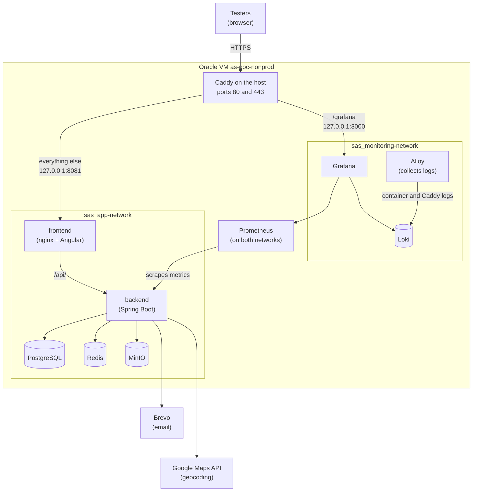
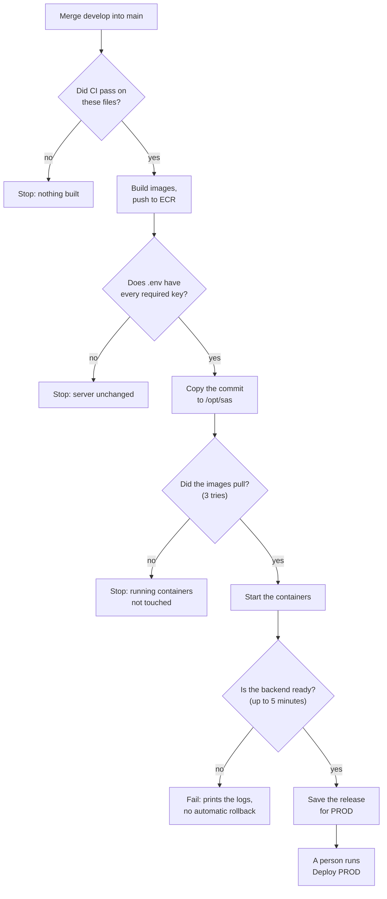
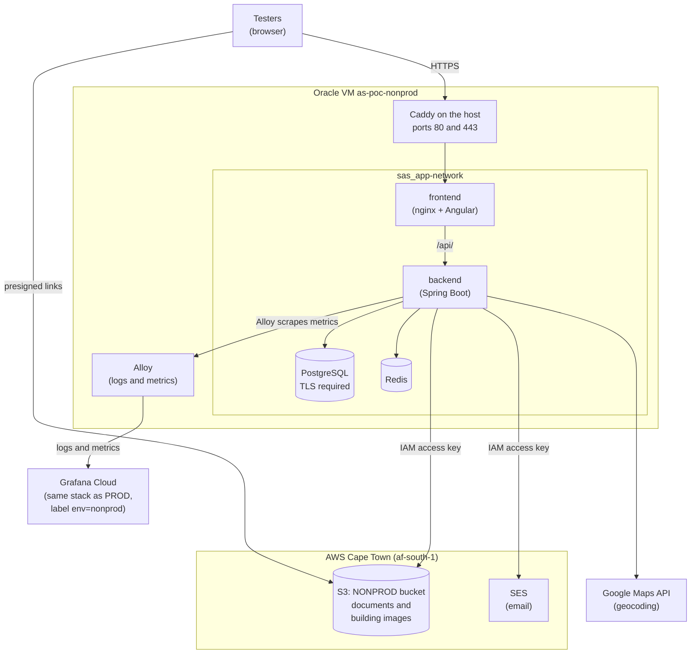

# NONPROD runbook

How NONPROD is deployed and operated. NONPROD is the test environment: every release runs here
first, and PROD then promotes the exact images that passed. PROD has its own
[runbook](PROD_RUNBOOK.md).

Server details below were checked on the host on 2026-11-04.

| What | Where |
|---|---|
| Site | `https://nonprod.beezhub.co.za` |
| DNS | A record to `84.12.109.37`, in the `beezhub.co.za` zone at SADomains until #344 |
| Server | Free Oracle Cloud VM `as-poc-nonprod`, `af-johannesburg-1`, Ampere A1 (`aarch64`), 2 OCPU, 12 GB, no swap, 45 GB disk, Ubuntu 24.04 |
| Stack | Docker Compose in `/opt/sas`, project `sas`, networks `sas_app-network` and `sas_monitoring-network` |
| Database | PostgreSQL 16 container `student-accommodation-local-db`, not published outside the server |
| Documents | MinIO container `student-accommodation-minio`, an S3-compatible store |
| Images | ECR in `af-south-1` (AWS's image registry), pulled by digest (a hash that names one exact build) |
| Settings | `/opt/sas/.env`, edited by hand on the server |
| Email | Brevo SMTP (`smtp-relay.brevo.com`) |
| Logs and metrics | Loki, Prometheus and Grafana containers on the same server |
| TLS | Caddy, a web server installed on the host and not in Compose. It gets the certificate and sends traffic to Grafana or the frontend |

## What runs where

This is NONPROD today. For the planned version, see [After #378 is done](#after-378-is-done).

Everything except email and maps runs on one server. Each box in the server is
a container, apart from Caddy. A request reaches the backend through Caddy and then nginx in the
frontend container.



Deploys are left out of this picture, and [Deploy a release](#deploy-a-release) covers them.

## Access

Use the SSH alias from your `~/.ssh/config`, which carries the right key:

```bash
ssh nonprod
```

`ssh ubuntu@nonprod.beezhub.co.za` fails with a publickey error, because it does not use that key.

The server accepts one SSH key, `deploy@nonprod`, so your alias and GitHub Actions share it. If you
replace that key, update `~/.ssh/authorized_keys` on the server, your local key file and the
`SSH_PRIVATE_KEY` secret together, or you lock out either yourself or the deploy.

Grafana is at `https://nonprod.beezhub.co.za/grafana`. Sign in with `GRAFANA_ADMIN_USER` (default
`admin`) and `GRAFANA_ADMIN_PASSWORD` from the server's `.env`.

## Deploy a release

**The normal way.** Merge `develop` into `main` through a pull request. A merge into `develop` alone
deploys nothing.

The **Deploy NONPROD** workflow (`.github/workflows/deploy.yml`) then:

1. Checks that a successful CI run tested the same files, and stops if not.
2. Builds both images on GitHub's ARM runners and pushes them to ECR.
3. Checks that `/opt/sas/.env` has every key the Compose files need, and stops if not. Nothing on
   the server has changed at this point.
4. Copies the commit to `/opt/sas`, pulls the images and starts them.
5. Waits for readiness, then saves the release for PROD. The run summary shows the run id to promote.



**By hand.** Go to **Actions > Deploy NONPROD > Run workflow**. Pick `main` to redeploy the current
release, or `develop` to try `develop` before a release. PROD refuses a run that was not on `main`.

The workflow does nothing while the repository variable `NONPROD_ACTIVE` is not `true`.

To send a tested release on to PROD, see [Deploy a release](PROD_RUNBOOK.md#deploy-a-release) in the
PROD runbook.

### Things a deploy does not do

- **It does not write `.env`.** A new required key stops the deploy at step 3. See
  [Changing a setting](#changing-a-setting).
- **It does not update Caddy.** See [Changing Caddy](#changing-caddy).
- **It does not keep your files.** It deletes every file in `/opt/sas` that is not in the commit.
  Only `.env`, `.env.bak-*`, `.backup-*` and `frontend/node_modules` stay. Keep anything else, such
  as a database dump, outside `/opt/sas`.
- **It does not roll back.** An older image will not start against a newer schema, because
  `hbm2ddl.auto` is `validate` and there are no down-migrations. If a release applied a migration,
  fix forward. The run summary shows the schema version before the deploy.

## Changing a setting

Save a copy first, then edit the file on the server. The deploy keeps these copies.

```bash
cd /opt/sas
cp .env ".env.bak-$(date +%Y%m%d-%H%M%S)"
nano .env
```

Then run **Deploy NONPROD** by hand on `main`. `docker restart` is not enough, because a container
only reads new values when it is recreated.

`.env.example` documents every variable. If it says an empty value is valid, the key must still be
there: `KEY=` is a setting, a missing line is not. Never reuse a NONPROD secret in PROD.

## Changing Caddy

Caddy's real config is `/etc/caddy/Caddyfile`, a copy of `tools/caddy/Caddyfile`. After changing the
file in the repository and deploying it, copy it across by hand:

```bash
sudo cp /opt/sas/tools/caddy/Caddyfile /etc/caddy/Caddyfile
sudo systemctl restart caddy
```

`APP_HOSTNAME` and `ACME_EMAIL` are set with `sudo systemctl edit caddy`. A wrong or empty hostname
makes Caddy serve plain HTTP on port 80 with no clear error.

## Checks

From any machine:

```bash
curl -s https://nonprod.beezhub.co.za/health/readiness   # {"status":"UP"}
```

This one goes through Caddy, nginx and the backend to the database. `/` and `/health` answer from
nginx alone, so they can return 200 while the backend is down.

On the server:

```bash
docker ps                                       # every container, with its health
docker logs --tail 100 student-accommodation-back-end
journalctl -u caddy -n 50                       # Caddy's access log
df -h / && docker system df                     # disk space, see Disk below
```

### After a release

A green deploy only proves the backend answers its readiness check. Before you promote a release to
PROD, check the parts a user touches:

- Register a student with an address you can read. The verification email should arrive, and this
  should show `action=verificationEmailSent`:

  ```bash
  docker logs student-accommodation-back-end 2>&1 | grep 'action=verificationEmail' | tail -5
  ```

- Upload a document, then download it again.
- Open a building that has an image, and check that the image shows.
- In Grafana, run `{env="nonprod", level="error"}` and look for errors since the deploy.

Use only addresses you own. Brevo's free plan allows 300 emails a day, shared with everything else
NONPROD sends.

### Disk

The disk is 45 GB and was 66% full on 2026-11-04. Docker's build cache held 16 GB of that. It is left
over from when the server built its own images, which stopped in #337, so it is safe to remove:

```bash
docker system df                 # see what can be freed first
docker builder prune --all --force
```

Unused images held another 3.4 GB. This removes every image no running container uses, and the next
deploy pulls what it needs again:

```bash
docker image prune --all
```

Do not use `docker system prune --volumes`. The volumes hold the database and the documents.

### Using Compose on the server

`docker compose` stops with `required variable FRONTEND_IMAGE is missing a value`, even for `ps`,
because the deploy passes the image names in and they are not in `.env`. Read them from the running
containers first:

```bash
cd /opt/sas
export BACKEND_IMAGE=$(docker inspect student-accommodation-back-end --format '{{.Config.Image}}')
export FRONTEND_IMAGE=$(docker inspect student-accommodation-frontend --format '{{.Config.Image}}')
F="-f docker-compose.yml -f docker-compose.prod.yml -f docker-compose.deploy.yml"
docker compose $F ps
```

**Never add `-v` to `docker compose down`.** It deletes the Docker volumes, which hold the database
and the documents, and NONPROD has no backups.

### Reaching a service that has no public port

Only the frontend and Grafana have a port on the host, and both listen on the server itself only.
For the rest, run `curl` in a throwaway container on the Compose network:

```bash
docker run --rm --network sas_app-network curlimages/curl:latest -s \
  http://student-accommodation-back-end:8080/actuator/health/readiness

docker run --rm --network sas_monitoring-network curlimages/curl:latest -s \
  http://student-accommodation-loki:3100/ready

docker run --rm --network sas_monitoring-network curlimages/curl:latest -s \
  http://student-accommodation-prometheus:9090/-/ready
```

### Logs in Grafana

Open **Explore** with the Loki data source. Loki keeps two weeks of logs, Prometheus keeps 30 days of
metrics, and `docker logs` holds only the last 30 MB per container.

```
{env="nonprod", level="error"}                                  every error
{service="student-accommodation-back-end", level="error"}       backend errors
{service=~"caddy|frontend", status_class="5xx"}                 failed requests
```

The README's Operations section lists every label.

## Database

Open a `psql` shell. The container already holds the login, so you do not need a password:

```bash
docker exec -it student-accommodation-local-db sh -c 'psql -U "$POSTGRES_USER" -d "$POSTGRES_DB"'
```

Take a dump before anything risky, and save it outside `/opt/sas`:

```bash
DUMP="$HOME/sas-db-$(date -u +%Y%m%dT%H%M%SZ).dump"
docker exec student-accommodation-local-db sh -c 'pg_dump -U "$POSTGRES_USER" -d "$POSTGRES_DB" -Fc' > "$DUMP"
docker exec -i student-accommodation-local-db pg_restore --list < "$DUMP" | tail -5   # a truncated dump fails here
```

`pg_restore` is only installed inside the container, so the file is piped in.

Restores, and the order to restore the database and the bucket in, are in
[Backup and restore](BACKUP_AND_RESTORE.md#nonprod-and-local-compose).

## When something goes wrong

| What you see | Why | What to do |
|---|---|---|
| The **CI passed on these files** job fails | CI failed, was cancelled or never ran on these files | Fix CI on `develop`, then release again |
| `/opt/sas/.env is missing keys` | A new required key is not on the server yet | Add the named keys, see [Changing a setting](#changing-a-setting), and re-run. Nothing was changed |
| `Host key verification failed` | The server's SSH host key changed, usually because it was rebuilt | Run `ssh-keyscan -t ed25519 nonprod.beezhub.co.za` and paste the result into the `SSH_KNOWN_HOSTS` variable |
| `the images could not be pulled in 3 tries` | The connection dropped, or the disk is full. The running containers were not touched | Check [Disk](#disk), then re-run |
| `readiness never came up` | The backend did not start, often because a migration failed | Read the logs at the end of the failed run. If a migration ran, fix forward |
| `No space left on device` | The disk is full | See [Disk](#disk) |
| The site has no HTTPS | Caddy has a wrong or empty `APP_HOSTNAME`, or port 80 is blocked | Check `journalctl -u caddy -n 50` and `sudo systemctl cat caddy` |
| `/grafana` shows the Angular app | The server's Caddyfile is old | See [Changing Caddy](#changing-caddy) |
| The Grafana login page keeps reloading | `GRAFANA_ROOT_URL` does not end in `/grafana` | Fix it in `.env`, see [Changing a setting](#changing-a-setting) |
| Emails do not arrive | Brevo's limit was reached, or its key is wrong | Search the backend log for `action=verificationEmailFailed`, and see section 4.5 of the [operator runbook](OPERATOR_RUNBOOK.md) |

## Rebuild from nothing

Use this if the VM is lost. **These steps have not been rehearsed.** They are written from how the
server is set up today, so expect to fix small details as you go. The database and the documents
live only on this VM, so a rebuild starts empty unless you have your own dumps.

1. **Create the VM.** Oracle Cloud, `af-johannesburg-1`, Always Free Ampere A1, Ubuntu 24.04. Open
   ports 22, 80 and 443 in the subnet's security list.

2. **Open the same ports on the VM.** Oracle's firewall is separate from the VM's own rules, and both
   must allow the traffic. Port 22 is usually already open:

   ```bash
   sudo apt install iptables-persistent
   sudo iptables -I INPUT -p tcp -m state --state NEW -m tcp --dport 80 -j ACCEPT
   sudo iptables -I INPUT -p tcp -m state --state NEW -m tcp --dport 443 -j ACCEPT
   sudo netfilter-persistent save
   ```

3. **Point DNS at it.** Change the `nonprod` A record to the new public IP. Check the digits: PROD's
   first attempt pointed at someone else's server.

4. **Install Docker and Caddy.** Use Docker's and Caddy's own `apt` repositories, as the server does
   today. Then prepare the folder and sign out and back in:

   ```bash
   sudo usermod -aG docker ubuntu
   sudo mkdir -p /opt/sas && sudo chown ubuntu:ubuntu /opt/sas
   ```

5. **Connect GitHub.** Add the public half of the deploy key to `~/.ssh/authorized_keys`. Then set
   these in the `nonprod` GitHub environment:

   | Kind | Name | Value |
   |---|---|---|
   | Secret | `SSH_PRIVATE_KEY` | The private half of the deploy key |
   | Variable | `DEPLOY_HOST` | `nonprod.beezhub.co.za` |
   | Variable | `DEPLOY_USER` | `ubuntu` |
   | Variable | `SSH_KNOWN_HOSTS` | The output of `ssh-keyscan -t ed25519 nonprod.beezhub.co.za` |

   The repository variable `NONPROD_ACTIVE` must be `true`. Pulling images needs no change, because
   the role `sas-nonprod-ecr-pull` trusts the GitHub environment and not the server.

6. **Write `.env`.** Copy the template from your machine, then fill it in on the server. Section 0.2
   of the [operator runbook](OPERATOR_RUNBOOK.md) lists the secrets to generate, and they must not
   match PROD's. Set `ADMIN_BOOTSTRAP_EMAIL` and `ADMIN_BOOTSTRAP_PASSWORD` for the first admin.

   ```bash
   scp .env.example nonprod:/opt/sas/.env
   ssh nonprod 'chmod 600 /opt/sas/.env && nano /opt/sas/.env'
   ```

   `nano` needs a terminal, so if it fails, run `ssh nonprod` first and edit from there.

7. **Deploy.** Run **Deploy NONPROD** by hand on `main`. If the first step stops on missing keys, add
   them and run it again.

8. **Start Caddy.** The deploy has now copied the Caddyfile to the server. Follow
   [Changing Caddy](#changing-caddy), and set `APP_HOSTNAME` and `ACME_EMAIL` before the restart.

9. **Create the first admin.** Sign in with the bootstrap login and change the password, as the app
   forces you to. Then remove the `ADMIN_BOOTSTRAP_PASSWORD` line from `.env`.

10. **Check it.** Run the [checks after a release](#after-a-release), and restore a dump if you have
    one ([Backup and restore](BACKUP_AND_RESTORE.md#nonprod-and-local-compose)).

## How NONPROD differs from PROD

Tracked in #378. The decision is to keep the free Oracle VM and configure it like PROD, because PROD
already takes the whole monthly budget.

| | NONPROD now | PROD | Issue |
|---|---|---|---|
| Server | Oracle A1, 12 GB | EC2 `t4g.small`, 2 GB + 2 GB swap | #382 adds PROD's memory limits |
| Database | Postgres container, no TLS | RDS PostgreSQL 16, TLS required | #380 |
| Documents | MinIO | S3, instance role | #379, #382 |
| Email | Brevo SMTP | SES API (`MAIL_TRANSPORT=ses-api`) | #382 |
| Monitoring | Grafana, Prometheus, Loki on the server | Alloy to Grafana Cloud | #381 |
| Compose files | base + `prod` + `deploy` | base + `prod` + `deploy` + `aws` | #382 |
| Deploy | SSH | SSM | Stays |

Until those issues are done, the `ses-api` mail path, S3 storage and `docker-compose.aws.yml` run
nowhere before PROD, so a fault in any of them first shows on PROD.

Three gaps stay on purpose: an IAM access key in place of an instance role, SSH deploys in place of
SSM, and a Postgres container in place of RDS.

### After #378 is done

**This is the plan, not what runs today.** It comes from #379, #380, #381 and #382, all still open.
The server stays the same free Oracle VM. MinIO, Brevo and the local monitoring containers go away,
and NONPROD uses the same AWS services and Grafana Cloud stack as PROD.



A presigned link is a temporary S3 address the backend creates, so the browser fetches a document
from S3 directly.

Deploys are left out of this picture because they keep working the same way: GitHub Actions pushes
the images to ECR and deploys over SSH, and the server pulls them from ECR.

| Part | Today | After | Issue |
|---|---|---|---|
| Documents and images | MinIO container | S3 bucket, reached with IAM user `sas-nonprod-app` | #379, #382 |
| Email | Brevo SMTP | SES API, from one allowed NONPROD sender | #379, #382 |
| Database | Postgres container, plain connections allowed | Same container, TLS required (`sslmode=require`) | #380 |
| Monitoring | Grafana, Prometheus and Loki on the server | Alloy sends to Grafana Cloud. `/grafana` on NONPROD returns 404 | #381 |
| Compose files | `base`, `prod`, `deploy` | Also `aws` and a new `nonprod` overlay | #382 |
| Memory limits | Backend 1G, frontend 256M, Redis 256M, Alloy 256M | Backend 1G, frontend 128M, Redis 128M, Alloy 384M, as on PROD | #382 |

Order: #379 first, because #382 needs its bucket and key. #380 can happen at any time. #381 follows
#340, which sets up PROD's Grafana Cloud stack.

When #382 lands, `/opt/sas/.env` also needs `EXAMPLE_DATA=true`. `docker-compose.aws.yml` refuses to
start without the key (#365). NONPROD keeps the example data, so its value is `true`, where PROD's is
`false`.

## Known gaps

- **No scheduled backups.** The server has no cron job or systemd timer for the database or MinIO.
  The only copies are the dumps someone takes by hand.
- **No uptime monitor.** Monitoring runs on the same server, so if the server dies nothing tells
  you. This is deliberate: the operator runbook sets one up for PROD only.
- **Rebuild not rehearsed.** Nobody has followed [Rebuild from nothing](#rebuild-from-nothing) from
  start to finish.
- **#264:** Postgres and MinIO have no developer access from outside the server.
- `docs/OPERATOR_RUNBOOK.md` was written for a DigitalOcean plan that was replaced. Where it differs
  from this file on NONPROD, such as `DEPLOY_USER` being `deploy` where the real value is `ubuntu`,
  this file is correct.
