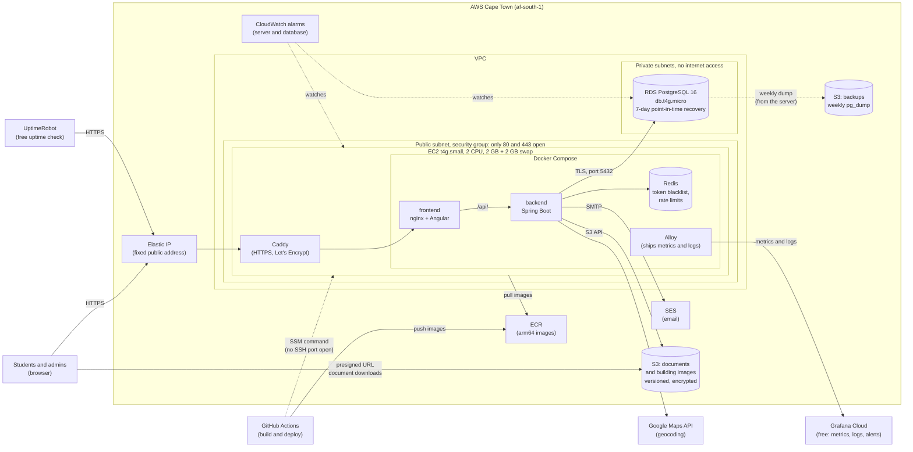
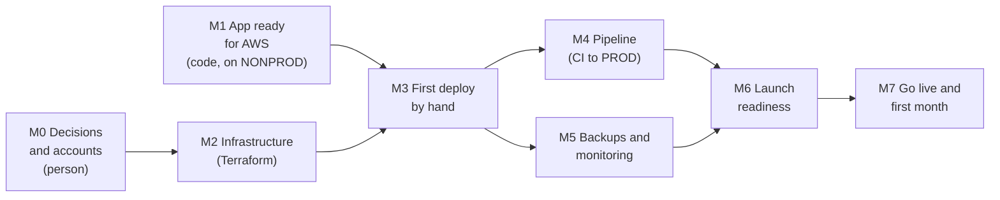

# PROD environment plan

Status: proposed, 2026-11-02. Supersedes the DigitalOcean plan in #244 and #251, both closed as not planned.

## Constraints

| Constraint | Value |
|---|---|
| Budget | $30 per month target; this plan is about $35 with 15% South African VAT, accepted for RDS |
| Users | about 500 at most, light traffic |
| Data | real student data (ID documents, personal details) from the first day |
| Provider | AWS |
| Region | Cape Town (`af-south-1`), so personal data stays in South Africa (POPIA) |

Real data from day one makes managed backups, a rehearsed restore and the POPIA basics launch blockers, not
follow-ups.

## Shape

One EC2 Graviton server runs the application containers with Docker Compose, behind Caddy on the host for TLS.
Nothing stateful that matters lives on the server:

- **PostgreSQL** moves to **RDS**, in a private subnet, with automated backups and point-in-time recovery.
- **Documents and building images** move from MinIO to **S3**. Uploads and building images go through the
  backend, as today. Documents download straight from S3 by presigned URL, which becomes reachable from
  browsers for the first time: MinIO's API port is not published in any deployed environment.
- **Monitoring** moves to Grafana Cloud's free plan, so the server only runs what serves users.

Losing the server costs only the Redis data (token blacklist and rate-limit counters). Rebuilding it is a
Terraform apply and a deploy, with no data restore.

Graviton is ARM (`arm64`), the same architecture as the Oracle NONPROD host, so one image build serves both.

Solid arrows are live traffic. Dotted arrows happen during deploys, backups or monitoring. The only ways in from
the internet are Caddy on ports 80 and 443, and presigned S3 URLs. Port 22 stays closed because deploys run
through SSM, and RDS has no public address: its security group accepts port 5432 from the server only.

## Components

| Component | Choice | Notes |
|---|---|---|
| Server | EC2 `t4g.small` (2 vCPU, 2 GB), Ubuntu 24.04 arm64 | 2 GB of swap. Set the CPU credit mode to `standard`, so a busy spell slows the server down instead of adding charges |
| Server disk | 15 GB gp3, encrypted | Holds only the OS, images, Redis and logs waiting to ship |
| Address | 1 Elastic IP | DNS points the PROD hostname at it |
| TLS | Caddy on the host, `tools/caddy/Caddyfile` | Unchanged from NONPROD. The `/grafana` route is dropped |
| Database | RDS PostgreSQL 16, `db.t4g.micro` (2 vCPU, 1 GB), single AZ, 20 GB gp3 | Encrypted, not publicly accessible, deletion protection on, 7-day automated backups with point-in-time recovery |
| Documents | S3 bucket, versioning on, SSE-S3 encryption, all public access blocked | Replaces MinIO. A lifecycle rule expires old versions after 35 days |
| Offsite DB copy | Weekly `pg_dump` to a separate S3 backup bucket | A copy outside RDS, in case the RDS instance and its snapshots are deleted by mistake |
| Cache | Redis container | `appendonly yes`, as today |
| Images | ECR, pulled by digest | The server never builds. PROD runs the exact bytes NONPROD ran |
| Email | SES in `af-south-1` | Replaces Brevo's 300-a-day free plan. Domain verified and production access granted (#330). The backend sends over SMTP, which needs credentials from a send-only IAM user rather than the instance role; Terraform keeps them in SSM (`infra/terraform/prod/email.tf`) |
| Secrets | SSM Parameter Store, standard tier | Free. The deploy writes `/opt/sas/.env` from it instead of hand edits |
| Monitoring | Grafana Cloud free plan, fed by Alloy | Grafana, Prometheus and Loki do not run on the server |
| Uptime | UptimeRobot free plan | Outside check, alerts by email |
| Health alarms | CloudWatch: EC2 status check with auto-recover, EC2 CPU credits, RDS CPU, free storage, free memory | |
| Deploy access | SSM Run Command from GitHub Actions through an OIDC role | No SSH key stored in GitHub, no open port 22 |

## Budget

Prices from the AWS public price list for `af-south-1`, published 2026-10-29. Traffic, storage and email volume
are estimates for 500 users.

| Item | Size | On-demand $/month | 1-year reserved $/month |
|---|---|---|---|
| EC2 `t4g.small` | $0.0217/hour, or $0.0137/hour reserved | 15.84 | 10.00 |
| RDS `db.t4g.micro` | $0.021/hour, or $0.014/hour reserved | 15.33 | 10.22 |
| RDS storage | 20 GB gp3 at $0.151/GB | 3.02 | 3.02 |
| RDS automated backups | free up to the database size | 0.00 | 0.00 |
| EBS gp3 | 15 GB at $0.1047/GB | 1.57 | 1.57 |
| Elastic IP | $0.005/hour | 3.65 | 3.65 |
| S3 documents and weekly dumps | ~15 GB at $0.0274/GB, plus requests | ~0.50 | ~0.50 |
| Data out to the internet, including S3 downloads | ~10 GB; the first 100 GB a month is free across all regions, then $0.154/GB | 0.00 | 0.00 |
| SES and CloudWatch alarms | | ~0.80 | ~0.80 |
| Secrets Manager | the RDS master password, generated by RDS and rotated once a year (#407) | 0.40 | 0.40 |
| SSM Parameter Store, Grafana Cloud, UptimeRobot | free tiers | 0.00 | 0.00 |
| **Total before VAT** | | **~$41.10** | **~$30.15** |
| **Total with 15% VAT** | | **~$47.30** | **~$34.70** |

Cape Town costs more than other regions. Same setup, on demand, before VAT:

| Region | EC2 `t4g.small` | RDS `db.t4g.micro` | Total | vs Cape Town |
|---|---|---|---|---|
| Cape Town (`af-south-1`) | $0.0217/hour | $0.021/hour | ~$40.70 | |
| Ireland (`eu-west-1`) | $0.0184/hour | $0.017/hour | ~$34.60 | about 15% cheaper |
| North Virginia (`us-east-1`) | $0.0168/hour | $0.016/hour | ~$32.35 | about 20% cheaper |

Cape Town stays: the saving is about $6 to $8 a month, and any other region moves student data out of South
Africa, which POPIA section 72 only allows under extra conditions.

The reserved prices are 1-year, no-upfront reservations: a promise to pay the hourly rate for a year, whether
or not the server and database run. Run on demand for the first month to prove `t4g.small` and `db.t4g.micro`
are enough, then buy both reservations. Set AWS Budgets alerts at $35 and $45.

## Alternatives considered

| Option | $/month with VAT | Why not |
|---|---|---|
| EC2 with Postgres in a container, documents in S3 | ~$26.60 on demand, ~$19.90 reserved | Fits $30, but backups and restores are ours to run, and there is no point-in-time recovery |
| EC2 `t4g.medium` + RDS on demand | ~$85 | Over budget, and 4 GB is not needed once the database is off the server |
| ECS Fargate + ALB + RDS + ElastiCache | ~$163 | Over budget. The ALB alone is ~$29 |
| EC2 + Supabase | $25 for Supabase Pro alone | No African region, so ~170 ms per query from Cape Town, or data leaves South Africa. The free plan has no backups and pauses after a week of inactivity |
| AWS Lightsail | | Not offered in Cape Town |
| Second Oracle Always Free VM in `af-johannesburg-1` | ~$3.50 | Cheapest, but PROD stays on AWS. No SLA, and idle free instances can be reclaimed |

## Application changes

### MinIO to S3

Done in #331. The backend uses the AWS SDK for Java v2 (`S3Client`, `S3Presigner`) instead of the MinIO SDK.
The MinIO container stays locally and on NONPROD, where the same client reaches it over the S3 API.

| Where | Result |
|---|---|
| `StorageConfig` | Builds the client. Path-style addressing for MinIO, virtual-hosted for `*.amazonaws.com` |
| Settings | Keep their `MINIO_*` names, so existing `.env` files still work. PROD sets `S3_ENDPOINT=https://s3.af-south-1.amazonaws.com`, `S3_REGION=af-south-1`, `S3_CREDENTIALS=aws-instance-role`, `S3_CREATE_BUCKET=false` |
| Credentials | `aws-instance-role` uses the SDK's instance profile provider with IMDSv2. From a container the instance needs a metadata hop limit of 2 (#335) |
| `StorageBucketService` | Skips bucket creation when `S3_CREATE_BUCKET=false`. Terraform owns the bucket |
| `BuildingImageService` | Goes through `FileStorageService` like documents, so `S3FileStorageService` is the only class that talks to storage |
| Health | `StorageHealthIndicator`, reported as `storage` in `/actuator/health` |
| Bucket CORS rule | Not needed. Documents download through `/api/documents/download` and building images stream through the backend (GH-268), so the browser never fetches from storage |
| `OrphanFileCleanupJob` | Unchanged. Its `{role}/` and `buildings/` prefix rules apply to S3 keys the same way |

The first run against a real S3 bucket is a step in the first PROD deploy (#336).

### PostgreSQL to RDS

- `DB_URL=jdbc:postgresql://<rds-endpoint>:5432/<db>?sslmode=require`. RDS for PostgreSQL 16 requires TLS by
  default.
- The compose overlay disables `db` and `minio`, and must also `!override` the backend's `depends_on` down to
  `redis`. Compose starts a dependency regardless of its profile, which is the trap #246 describes.
- The first boot runs every Flyway migration against the empty database. The deploy's smoke check already allows
  for a slow first boot.
- `tools/grafana/provisioning/datasources/datasource.yml` hardcodes `db:5432`. Grafana Cloud cannot reach a
  private RDS, so PROD drops that datasource.
- The deploy's "Record the pre-deploy schema version" step uses `docker exec` on the `db` container. For PROD it
  runs `psql` against RDS from the server instead.

## Road to PROD

Tracked in #329. Each milestone's issues carry the detail; this section is the order and the reason for it.

M0 and M1 start together. The longest external wait is SES production access, which AWS reviews by hand, so it
is requested first.

| Milestone | Issues | Done when |
|---|---|---|
| **M0. Decisions and accounts** | #330 AWS account, SES production access, hostname, POPIA information officer, deploy gate. #287 where CI runs | Region enabled, root has MFA, budgets alerts set, SES access requested, each decision recorded |
| **M1. App ready for AWS** | #331 MinIO to S3. #332 PROD compose overlay. #333 Alloy memory limit. #334 load test | NONPROD runs on a NONPROD S3 bucket, and the load test says `t4g.small` and `db.t4g.micro` hold |
| **M2. Infrastructure** | #335 Terraform | `terraform apply` builds the environment from nothing; the server reaches RDS and S3 |
| **M3. First deploy by hand** | #336 | PROD loads over HTTPS, an admin can log in, and the steps are a runbook |
| **M4. Pipeline** | #337 images to ECR by digest. #338 PROD deploy workflow over SSM | A change reaches PROD through CI with no manual step on the server |
| **M5. Backups and monitoring** | #339 backups and restore drills. #340 monitoring and alerting | Three restore drills have worked; a test alert from each source reached a person |
| **M6. Launch readiness** | #341 go or no-go checklist | Every line is a yes |
| **M7. Go live** | #342 | Reservations bought after 30 days, and this document matches reality |

The first PROD deploy is by hand before CI is wired, for the reason #243 gave: surprises surface far faster in a
terminal than through CI logs, and CI then automates a procedure already known to work.

**Deploy gate.** Branch protection and environment required reviewers are unavailable on this private
repository's current GitHub plan ("Upgrade to GitHub Pro or make this repository public"). The gate is either a
manual `workflow_dispatch`, which is free, or GitHub Team at about $4 per user per month. Decided in #330.

## Risks

| Risk | Mitigation |
|---|---|
| One server is a single point of failure | Auto-recover alarm. No data lives on it, so a replacement is a Terraform apply and a deploy |
| RDS runs in one availability zone | An AZ outage means downtime until AWS recovers it. Multi-AZ doubles the RDS line, about +$15 a month reserved |
| `db.t4g.micro` has 1 GB of memory | CloudWatch alarm on free memory. Move to `db.t4g.small` if the load test or real use needs it, about +$10 a month reserved |
| Budget is about $4 over the original $30 | Budgets alerts. The reservations are what keep it at ~$34 |
| Reservations lock in a size for a year | Buy them only after the first month on demand |
| A deploy with a migration cannot be rolled back by redeploying | Record the schema version before each deploy. Point-in-time recovery to just before the deploy is now the undo |
| S3 downloads are billed as data out | The first 100 GB a month is free and the estimate is ~10 GB. Past that it is $0.154/GB. The `sas-prod-data-out` budget emails at 80 GB used and when 100 GB is forecast (#340) |

## Open decisions

- PROD hostname and who owns its DNS records.
- Terraform from the start, or the console first and Terraform afterwards.
- Who is the POPIA information officer.
