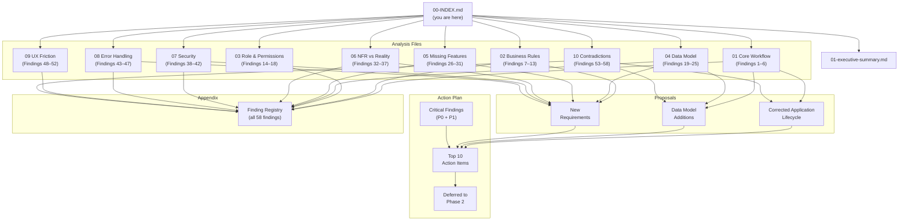

# MVP Analysis — Master Index

This document is the entry point for the MVP readiness audit of the Student Accommodation Management System. The analysis covers 10 areas across workflow completeness, business rules, security, data model, UX, and more — producing 58 globally-numbered findings with concrete proposals and a prioritised action plan.

The system is designed as a **multi-tenant SaaS platform** serving multiple educational institutions.

---

## File Relationship Map

---

## Table of Contents

### Overview

| File | Title | Summary |
|------|-------|---------|
| [00-INDEX.md](./00-INDEX.md) | Master Index | This file — entry point, file map, and finding counts. |
| [01-executive-summary.md](./01-executive-summary.md) | Executive Summary | MVP gap score, readiness radar, and critical findings overview. |

### Analysis (Findings 1–58)

| File | Title | Findings | Summary |
|------|-------|----------|---------|
| [01-core-workflow-completeness.md](./analysis/01-core-workflow-completeness.md) | Core Workflow Completeness | 1–6 | Missing academic year, offer acceptance, check-in/out, application periods, renewal, and post-allocation experience. |
| [02-business-rule-enforcement.md](./analysis/02-business-rule-enforcement.md) | Business Rule Enforcement | 7–13 | Weak duplicate check, no expiry task, untracked doc validity, gender bypass, unstructured special requirements, no first-year priority, contradictory "final" rule. |
| [03-role-permission-gaps.md](./analysis/03-role-permission-gaps.md) | Role & Permission Gaps | 14–18 | Empty Landlord role, no waiting list visibility, no bulk processing, no roommate info, confusing API identifiers. |
| [04-data-model-gaps.md](./analysis/04-data-model-gaps.md) | Data Model Gaps | 19–25 | Missing pricing, funding, lease, amenity, and accommodation type entities; missing floor number and notification preferences. |
| [05-missing-mvp-features.md](./analysis/05-missing-mvp-features.md) | Missing MVP Features | 26–31 | No bulk import, no broadcast announcements, no funding export, no support tickets, minimal reporting, no SaaS onboarding. |
| [06-nfr-vs-reality.md](./analysis/06-nfr-vs-reality.md) | NFR vs Reality | 32–37 | No rate limiting, no virus scanning, no WCAG compliance, no i18n, no API versioning, no GDPR export. |
| [07-security-concerns.md](./analysis/07-security-concerns.md) | Security Concerns | 38–42 | Error leakage, role hierarchy risk, no JWT revocation, no content-type validation, MinIO cleanup gap on deletion. |
| [08-error-handling-edge-cases.md](./analysis/08-error-handling-edge-cases.md) | Error Handling & Edge Cases | 43–47 | Unsafe institution/building/room deletion, zombie user state, email and MinIO failure handling. |
| [09-ux-workflow-friction.md](./analysis/09-ux-workflow-friction.md) | UX & Workflow Friction | 48–52 | Jargon status labels, no post-allocation guidance, unclear doc rejection, no room browsing, registration friction. |
| [10-contradictions.md](./analysis/10-contradictions.md) | Contradictions | 53–58 | Missing "Under Review" status, missing amenities, missing budget field, missing support tickets, unused Redis, unversioned APIs. |

### Proposals

| File | Title | Summary |
|------|-------|---------|
| [corrected-application-lifecycle.md](./proposals/corrected-application-lifecycle.md) | Corrected Application Lifecycle | Revised status enums, offer acceptance flow, check-in/out, expiry — full state diagram. |
| [data-model-additions.md](./proposals/data-model-additions.md) | Data Model Additions | 5 new entities (AcademicYear, RoomPricing, StudentFunding, LeaseAgreement, Amenity) + modifications to existing entities. |
| [new-requirements.md](./proposals/new-requirements.md) | New Requirements | 17 new FRs, 4 new BRs, 5 new NFRs, and 2 updated BRs — ready to merge into BUSINESS_REQUIREMENTS.md. |

### Action Plan

| File | Title | Summary |
|------|-------|---------|
| [critical-findings.md](./action-plan/critical-findings.md) | Critical Findings (P0 + P1) | All 36 findings that must be resolved before MVP launch, with acceptance criteria. |
| [top-10-action-items.md](./action-plan/top-10-action-items.md) | Top 10 Action Items | Ordered implementation plan with dependency graph, work descriptions, and acceptance criteria. |
| [deferred-to-phase-2.md](./action-plan/deferred-to-phase-2.md) | Deferred to Phase 2 | 18 items that can wait until after MVP launch, with workarounds and rationale. |

### Appendix

| File | Title | Summary |
|------|-------|---------|
| [finding-registry.md](./appendix/finding-registry.md) | Finding Registry | Single flat table of all 58 findings with category, priority, and links to source and proposal files. |

---

## Finding Counts

### By Category

| Category | Count | Description |
|----------|-------|-------------|
| DEFECT | 9 | Existing code or logic that is incorrect |
| MISSING-CRITICAL | 8 | Absent functionality that blocks MVP launch |
| MISSING-IMPORTANT | 22 | Absent functionality needed before UAT |
| IMPROVEMENT | 7 | Working features that need enhancement |
| CONTRADICTION | 8 | Requirements doc says X, implementation does Y |
| **Total** | **54** | *4 findings appear under CONTRADICTION that overlap with MISSING/DEFECT categories* |

> Note: 58 unique findings total. The counts above reflect the primary category assignment per finding.

### By Priority

| Priority | Count | Meaning |
|----------|-------|---------|
| P0 — Showstopper | 8 | MVP cannot ship without this |
| P1 — Critical | 28 | Must fix before UAT |
| P2 — Important | 22 | Should fix, but has workaround |
| **Total** | **58** | |

### By Category x Priority

| Category | P0 | P1 | P2 | Total |
|----------|----|----|-----|-------|
| DEFECT | 1 | 8 | 0 | **9** |
| MISSING-CRITICAL | 7 | 1 | 0 | **8** |
| MISSING-IMPORTANT | 0 | 14 | 8 | **22** |
| IMPROVEMENT | 0 | 1 | 6 | **7** |
| CONTRADICTION | 0 | 4 | 4 | **8** |
| **Total** | **8** | **28** | **18** | **54** |
