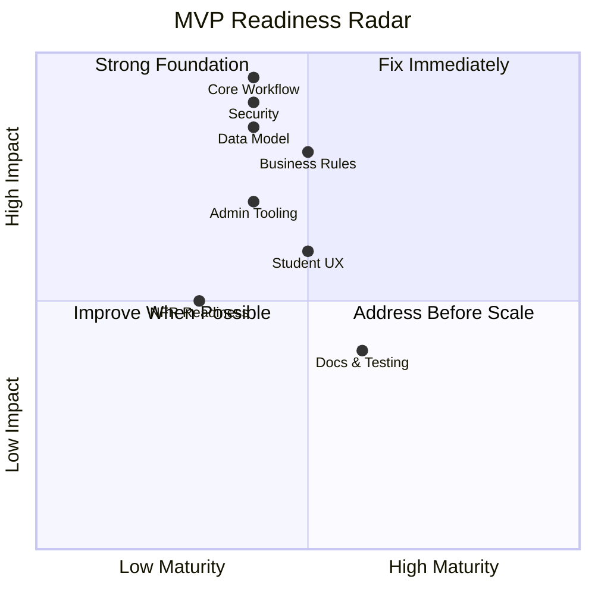

# Executive Summary

## Overview

The Student Accommodation Management System has a solid technical foundation — a working Spring Boot backend with JWT authentication, an Angular frontend with role-based routing, and core workflows for application submission, document upload, and room allocation. However, the system is **not yet MVP-ready**. Critical gaps prevent it from operating through a complete intake cycle: there is no academic year entity to scope applications across periods, no offer-acceptance step for students, no pricing or funding model to track revenue, and no lease agreement to formalize occupancy. Security gaps (no rate limiting, error message leakage, broken role hierarchy) pose deployment risks. The data model lacks 5 entities that are essential for real-world operations. On the positive side, the existing allocation engine (scoring, waiting list, staged proposals) is well-designed, the notification system works end-to-end, and the multi-tenant architecture via Institution-Building relationships provides a workable SaaS foundation. With the 8 P0 findings addressed, the system can reach a deployable MVP state.

---

## Critical Findings (P0 — Showstoppers)

These 8 findings **must be resolved** before the system can ship. Without them, the system cannot complete a single intake cycle or be safely deployed.

| # | Title | Category | Area | Analysis File |
|---|-------|----------|------|---------------|
| [1](analysis/01-core-workflow-completeness.md#finding-1-no-academic-year--period-entity) | No Academic Year Entity | MISSING-CRITICAL | Data Model | [01-core-workflow](analysis/01-core-workflow-completeness.md) |
| [2](analysis/01-core-workflow-completeness.md#finding-2-no-student-offer-acceptance-step) | No Student Offer Acceptance | MISSING-CRITICAL | Workflow | [01-core-workflow](analysis/01-core-workflow-completeness.md) |
| [7](analysis/02-business-rule-enforcement.md#finding-7-br-001--duplicate-application-check-is-too-weak) | Duplicate Check Too Weak | DEFECT | Backend | [02-business-rules](analysis/02-business-rule-enforcement.md) |
| [19](analysis/04-data-model-gaps.md#finding-19-no-pricing--fee-model-on-rooms) | No Pricing / Fee Model | MISSING-CRITICAL | Data Model | [04-data-model](analysis/04-data-model-gaps.md) |
| [20](analysis/04-data-model-gaps.md#finding-20-no-student-funding--sponsorship-tracking) | No Student Funding Tracking | MISSING-CRITICAL | Data Model | [04-data-model](analysis/04-data-model-gaps.md) |
| [21](analysis/04-data-model-gaps.md#finding-21-no-lease--contract-agreement-entity) | No Lease / Contract Entity | MISSING-CRITICAL | Data Model | [04-data-model](analysis/04-data-model-gaps.md) |
| [26](analysis/05-missing-mvp-features.md#finding-26-no-bulk-data-import-for-students-or-rooms) | No Bulk Data Import | MISSING-CRITICAL | Backend | [05-missing-features](analysis/05-missing-mvp-features.md) |
| [32](analysis/06-nfr-vs-reality.md#finding-32-no-rate-limiting-anywhere-nfr-008) | No Rate Limiting | MISSING-CRITICAL | Security | [06-nfr-vs-reality](analysis/06-nfr-vs-reality.md) |

---

## MVP Gap Score

### Score: 4.5 / 10

**Justification:**

The system earns credit for a functional authentication flow, a well-structured allocation engine with scoring and waiting lists, working document upload to MinIO, email notifications with templates, and a reasonable frontend with role-based routing. However, it loses significant ground because:

- **No financial model at all** — pricing, funding, and lease entities are entirely absent. A student accommodation system that cannot track what students pay or how they're funded is incomplete at its core.
- **The workflow ends at allocation** — there is no offer acceptance, no check-in, no check-out. The system cannot confirm a student actually moved in.
- **No temporal scoping** — without academic years, the system cannot distinguish between this year's applications and next year's, making it a one-shot tool rather than a sustainable platform.
- **Security gaps** — no rate limiting on auth endpoints, error messages leak internals, role hierarchy allows Landlords to act as Students.
- **No admin bulk operations** — onboarding 500+ rooms or processing 200 applications requires one-by-one API calls.

The score reflects a system that demonstrates competent engineering but has not yet implemented the business domain deeply enough for real-world use.

---

## MVP Readiness Radar

Scores across 8 key dimensions (1 = not started, 10 = production-ready):

| Dimension | Score | Notes |
|-----------|-------|-------|
| Core Workflow Completeness | 4 | Application → Allocation works, but no offer acceptance, no check-in/out, no academic year scoping. |
| Business Rule Enforcement | 5 | Most rules are implemented but several are weak (duplicate check) or missing (expiry, first-year priority, gender enforcement in manual allocation). |
| Security Posture | 4 | JWT auth works, CORS configured, but no rate limiting, error leakage, broken role hierarchy, no content-type validation. |
| Data Model Completeness | 4 | 24 entities cover auth and allocation, but 5 critical entities are missing (AcademicYear, Pricing, Funding, Lease, Amenity). |
| UX / Student Experience | 5 | Application flow works end-to-end in the UI, but post-allocation is empty, status labels are jargon, no room browsing. |
| Admin Tooling | 4 | CRUD exists for all entities, but no bulk import, no bulk status updates, no funding export, no broadcast messaging. |
| Non-Functional Readiness | 3 | No rate limiting, no API versioning, no virus scanning, no WCAG compliance, no i18n. Monitoring and logging are minimal. |
| Documentation & Testing | 6 | Business requirements doc exists. Unit tests cover services and controllers. TestContainers for integration. But test coverage gaps in edge cases and no E2E suite yet. |

**Reading the chart:** Items in the top-left quadrant ("Fix Immediately") are high-impact areas with low maturity — these are where the 8 P0 findings cluster. Items in the bottom-right ("Address Before Scale") are lower impact but more mature — these can be deferred to Phase 2.

---

## Findings Distribution

### By Category

| Category | Description | Count |
|----------|-------------|-------|
| DEFECT | Existing code or logic that is incorrect | 9 |
| MISSING-CRITICAL | Absent functionality that blocks MVP launch | 8 |
| MISSING-IMPORTANT | Absent functionality needed before UAT | 22 |
| IMPROVEMENT | Working features that need enhancement | 7 |
| CONTRADICTION | Requirements doc says X, implementation does Y | 8 |
| **Total** | | **54** |

### By Priority

| Priority | Meaning | Count |
|----------|---------|-------|
| P0 | MVP cannot ship | 8 |
| P1 | Must fix before UAT | 28 |
| P2 | Should fix, has workaround | 22 |
| **Total** | | **58** |

### Cross-Tabulation (Category x Priority)

| Category | P0 | P1 | P2 | Total |
|----------|----|----|-----|-------|
| DEFECT | 1 | 8 | 0 | **9** |
| MISSING-CRITICAL | 7 | 1 | 0 | **8** |
| MISSING-IMPORTANT | 0 | 14 | 8 | **22** |
| IMPROVEMENT | 0 | 1 | 6 | **7** |
| CONTRADICTION | 0 | 4 | 4 | **8** |
| **Total** | **8** | **28** | **18** | **54** |

> 58 unique findings. Some findings share a finding number but are counted once in the registry. The total of 54 in the cross-tabulation reflects the primary categorisation; 4 CONTRADICTION findings overlap with MISSING or DEFECT categories (e.g., Finding #54 is both a contradiction and a data model gap tracked under Finding #22).

---

## What's Next

1. **Start with the [Top 10 Action Items](action-plan/top-10-action-items.md)** — they are ordered by dependency and priority.
2. **Review the [Critical Findings](action-plan/critical-findings.md)** for all P0 and P1 items with acceptance criteria.
3. **Use the [Proposals](proposals/)** as implementation blueprints — they include Mermaid diagrams, field specs, and migration strategies.
4. **Consult the [Finding Registry](appendix/finding-registry.md)** when you need to trace a finding back to its analysis.
5. **Defer items listed in [Deferred to Phase 2](action-plan/deferred-to-phase-2.md)** — they have documented workarounds for launch.
