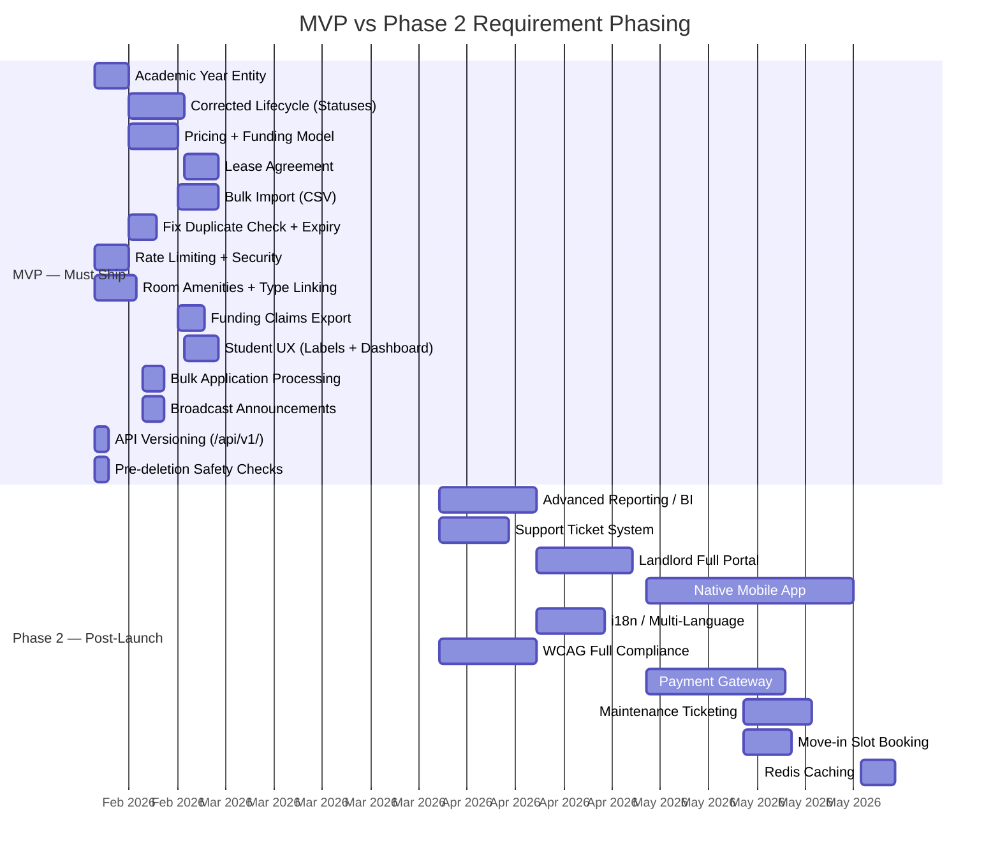

# Deferred to Phase 2

These items are documented in the business requirements or identified during analysis but are **not required for MVP**. They can be implemented after the initial launch without blocking core operations.

---

## Deferred Items

| # | Item | Source | Rationale for Deferral | MVP Workaround |
|---|---|---|---|---|
| D1 | Advanced Reporting (BI dashboards, trends) | [Finding #30](../analysis/05-missing-mvp-features.md#finding-30-minimal-reporting-capabilities) | Basic stats endpoint covers MVP needs | Admin uses SQL queries or basic dashboard |
| D2 | Support Ticket System | FR-042, FR-043, [Finding #29](../analysis/05-missing-mvp-features.md#finding-29-no-support-ticket-system-fr-042043) | External email handles MVP support volume | Contact Support page shows email/phone |
| D3 | Native Mobile App | NFR, Section 11.1 | Responsive web works on mobile | PWA or mobile browser |
| D4 | i18n / Multi-Language | NFR-018, [Finding #35](../analysis/06-nfr-vs-reality.md#finding-35-no-internationalization--multi-language-nfr-018) | English-only covers initial market | Strings in templates for future extraction |
| D5 | WCAG 2.1 AA Full Compliance | NFR-017, [Finding #34](../analysis/06-nfr-vs-reality.md#finding-34-no-wcag-21-aa-compliance-nfr-017) | Fix critical items only for MVP | Lighthouse audit + fix top issues |
| D6 | Virus Scanning on Uploads | NFR-009, [Finding #33](../analysis/06-nfr-vs-reality.md#finding-33-no-virus--malware-scanning-on-file-uploads-nfr-009) | MIME validation covers basic risk | Server-side content-type check |
| D7 | Redis Caching Layer | Section 5.2, [Finding #57](../analysis/10-contradictions.md#finding-57-section-52--redis-mentioned-but-not-used) | No performance bottleneck at MVP scale | Direct DB queries with pagination |
| D8 | Payment Gateway Integration | Section 6.1 | Revenue tracked via pricing + exports for now | External billing system |
| D9 | Landlord Full Portal | [Finding #14](../analysis/03-role-permission-gaps.md#finding-14-landlord-role-has-zero-dedicated-functionality) | Admin manages all buildings for MVP | Basic read-only Landlord dashboard |
| D10 | Move-in Slot Booking | Analysis 5 | Manual coordination via announcements | Admin emails students their move-in time |
| D11 | Maintenance Ticketing | BUSINESS_REQUIREMENTS.md implied | External email for MVP | Contact support page |
| D12 | In-App Direct Messaging | Implied | Email notifications cover communication | Existing NotificationService |
| D13 | Document 12-Month Validity Check | BR-007, [Finding #9](../analysis/02-business-rule-enforcement.md#finding-9-br-007--12-month-document-validity-not-tracked) | Admin manually checks document age | Add `validUntil` field later |
| D14 | Notification Preferences | [Finding #25](../analysis/04-data-model-gaps.md#finding-25-no-notification-preferences) | All users receive all notifications | Add opt-out later |
| D15 | Room Browsing Before Application | [Finding #51](../analysis/09-ux-workflow-friction.md#finding-51-no-roombuilding-browsing-before-application) | Students select building preference from dropdown | Enable building detail view later |
| D16 | Roommate Information Display | [Finding #17](../analysis/03-role-permission-gaps.md#finding-17-students-cannot-view-roommate-information) | Students learn roommates at check-in | Add to "My Accommodation" in Phase 2 |
| D17 | GDPR Data Export | NFR-024/026, [Finding #37](../analysis/06-nfr-vs-reality.md#finding-37-no-gdpr-data-export-endpoint-nfr-024026) | Delete account exists. Export is additive. | Manual data request via admin |
| D18 | Budget Constraint in Application | FR-012, [Finding #55](../analysis/10-contradictions.md#finding-55-fr-012--budget-constraints-field-not-present) | NSFAS-funded students have fixed rates | Add `maxBudget` field in Phase 2 |

---

## Phase Diagram

---

## Decision Criteria Used

An item was deferred if **all** of the following were true:
1. The system can operate without it for the first intake cycle.
2. There is a manual workaround available (email, SQL query, admin action).
3. It does not block revenue collection (pricing/funding) or legal compliance (lease).
4. It does not create a security vulnerability (rate limiting is NOT deferrable).
