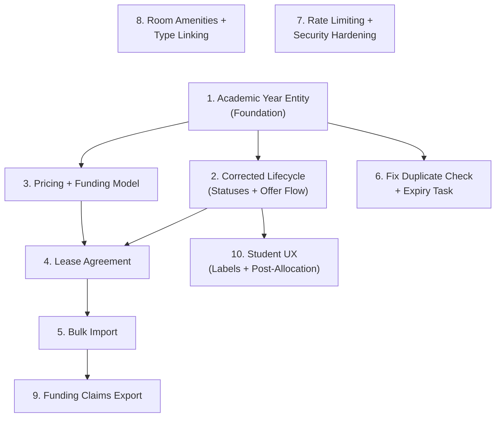

# Top 10 Action Items

Ordered by priority and dependency. Complete these to reach MVP readiness.

---

## Dependency Graph

---

## Action 1: Create Academic Year Entity

**Priority:** P0
**Findings:** [#1](../analysis/01-core-workflow-completeness.md#finding-1-no-academic-year--period-entity), [#4](../analysis/01-core-workflow-completeness.md#finding-4-no-application-period-management), [#5](../analysis/01-core-workflow-completeness.md#finding-5-no-re-application--renewal-flow)
**Dependencies:** None — this is the foundation.

**Work:**
- Create `AcademicYear` entity with fields: `name`, `startDate`, `endDate`, `applicationOpenDate`, `applicationCloseDate`, `isCurrent`.
- Add `academicYear` FK to `Application` and `RoomAllocation`.
- Create CRUD controller for admin management.
- Add validation in `ApplicationService.submitApplication()` to check application window.
- Flyway migration + seed default academic year.

**Acceptance Criteria:**
- Admin can create/edit academic years via API.
- Applications are rejected outside the open window with a clear error message.
- Existing data is migrated to a default academic year.

---

## Action 2: Implement Corrected Application & Allocation Lifecycle

**Priority:** P0
**Findings:** [#2](../analysis/01-core-workflow-completeness.md#finding-2-no-student-offer-acceptance-step), [#3](../analysis/01-core-workflow-completeness.md#finding-3-no-check-in--check-out-process), [#53](../analysis/10-contradictions.md#finding-53-fr-015--under-review-status-does-not-exist)
**Dependencies:** Action 1 (Academic Year).

**Work:**
- Add `UNDER_REVIEW`, `CHANGES_REQUESTED`, `EXPIRED`, `CANCELLED` to `ApplicationStatus`.
- Create `AllocationStatus` enum: `OFFERED`, `ACCEPTED`, `DECLINED`, `ACTIVE`, `COMPLETED`, `TERMINATED`.
- Replace `RoomAllocation.status` String with `AllocationStatus` enum.
- Add `checkInDate`, `checkOutDate` to `RoomAllocation`.
- Create student endpoints: `POST /api/allocations/{id}/accept`, `POST /api/allocations/{id}/decline`.
- Create admin endpoints: `POST /api/allocations/{id}/check-in`, `POST /api/allocations/{id}/check-out`.
- Update `canTransitionTo()` for all new transitions.
- Add email templates for new statuses.

**Acceptance Criteria:**
- Full lifecycle from PENDING through ACTIVE to COMPLETED works end-to-end.
- Student can accept/decline offers.
- Admin can record check-in/check-out.

---

## Action 3: Implement Pricing & Funding Model

**Priority:** P0
**Findings:** [#19](../analysis/04-data-model-gaps.md#finding-19-no-pricing--fee-model-on-rooms), [#20](../analysis/04-data-model-gaps.md#finding-20-no-student-funding--sponsorship-tracking)
**Dependencies:** Action 1 (Academic Year needed for pricing periods).

**Work:**
- Create `RoomPricing` entity (building + accommodation type + academic year → rate).
- Create `StudentFunding` entity (student + funding type + reference + proof document).
- Create CRUD controllers for both.
- Add `StudentFunding` section to student profile.
- Add funding type to application submission flow.

**Acceptance Criteria:**
- Admin can set room pricing per building/year.
- Student can record their funding type (NSFAS, bursary, self-funded).
- Funding proof document can be uploaded and linked.

---

## Action 4: Implement Lease Agreement

**Priority:** P0
**Findings:** [#21](../analysis/04-data-model-gaps.md#finding-21-no-lease--contract-agreement-entity)
**Dependencies:** Action 2 (Offer acceptance flow), Action 3 (Pricing for locked rate).

**Work:**
- Create `LeaseAgreement` entity.
- Add `leaseTemplate` text field to `Building`.
- When student accepts offer: generate `LeaseAgreement` with locked price, terms version, lease dates.
- Add `GET /api/allocations/{id}/lease` for student to view their lease.

**Acceptance Criteria:**
- Lease created automatically when student accepts offer.
- Lease records the price, terms version, and signed timestamp.
- Student can view their lease from the dashboard.

---

## Action 5: Implement Bulk Import

**Priority:** P0
**Findings:** [#26](../analysis/05-missing-mvp-features.md#finding-26-no-bulk-data-import-for-students-or-rooms)
**Dependencies:** Action 1 (rooms need academic year context), Action 3 (rooms may need pricing).

**Work:**
- Create `POST /api/admin/rooms/import` — CSV upload with validation.
- Create `POST /api/admin/students/import` — CSV upload with validation.
- Return detailed results: imported count, failed count, error details per row.
- Support dry-run mode (`?dryRun=true`) for validation without committing.

**Acceptance Criteria:**
- Admin can upload 500+ rooms in one CSV. All valid rows are created.
- Invalid rows are reported with row number and error message.
- Dry-run mode validates without persisting.

---

## Action 6: Fix Duplicate Application Check + Implement Expiry Task

**Priority:** P0 (duplicate) + P1 (expiry)
**Findings:** [#7](../analysis/02-business-rule-enforcement.md#finding-7-br-001--duplicate-application-check-is-too-weak), [#8](../analysis/02-business-rule-enforcement.md#finding-8-br-004--no-application-expiry-scheduled-task)
**Dependencies:** Action 1 (academic year for scoping), Action 2 (EXPIRED status).

**Work:**
- Update `submitApplication()` to check all active statuses within the current academic year.
- Create `ApplicationExpiryService` with `@Scheduled` nightly task.
- Expire PENDING and CHANGES_REQUESTED applications older than 30 days.
- Send expiry notification to affected students.

**Acceptance Criteria:**
- Student with APPROVED application cannot submit another for the same year.
- Applications idle > 30 days are automatically set to EXPIRED.
- Student receives notification on expiry.

---

## Action 7: Rate Limiting + Security Hardening

**Priority:** P0 (rate limiting) + P1 (error masking, role hierarchy, token revocation)
**Findings:** [#32](../analysis/06-nfr-vs-reality.md#finding-32-no-rate-limiting-anywhere-nfr-008), [#38](../analysis/07-security-concerns.md#finding-38-runtime-exception-leaks-internal-messages), [#39](../analysis/07-security-concerns.md#finding-39-role-hierarchy--landlord-inherits-student-permissions), [#40](../analysis/07-security-concerns.md#finding-40-no-jwt-revocation-on-password-change), [#41](../analysis/07-security-concerns.md#finding-41-file-upload-content-type-not-validated-server-side), [#42](../analysis/07-security-concerns.md#finding-42-delete-account-may-not-remove-minio-files)
**Dependencies:** None.

**Work:**
- Add Bucket4j rate limiting to auth endpoints.
- Mask RuntimeException messages in global handler.
- Change role hierarchy to flat: `ADMIN > LANDLORD`, `ADMIN > STUDENT` (no LANDLORD > STUDENT).
- Add `tokenVersion` to `AppUser`, increment on password change, validate in JWT filter.
- Add Apache Tika MIME validation on file upload.
- Fix delete account to remove MinIO files before DB records.

**Acceptance Criteria:**
- 6th login attempt in 1 minute returns 429.
- RuntimeException returns generic message + trace ID.
- Landlord cannot access `/api/student` endpoints.
- Password change invalidates previous tokens.
- Renamed .exe → .pdf upload is rejected.
- Account deletion removes all MinIO files.

---

## Action 8: Room Amenities + AccommodationType Linking

**Priority:** P1
**Findings:** [#22](../analysis/04-data-model-gaps.md#finding-22-no-room-amenities--features-data), [#23](../analysis/04-data-model-gaps.md#finding-23-accommodationtype-not-linked-to-room), [#54](../analysis/10-contradictions.md#finding-54-fr-031--amenities-and-features-missing-from-room)
**Dependencies:** None.

**Work:**
- Create `Amenity` entity + join tables.
- Add `accommodationType` FK to `Room`.
- Change `Application.preferredAccommodationType` from String to FK.
- Update room search to support amenity filtering.
- Update scoring algorithm to factor accommodation type match.

**Acceptance Criteria:**
- Admin can create amenities and tag rooms.
- Student can filter rooms by amenity during application.
- Room type preference influences allocation scoring.

---

## Action 9: Funding Claims Export

**Priority:** P1
**Findings:** [#28](../analysis/05-missing-mvp-features.md#finding-28-no-data-export-for-funding-claims)
**Dependencies:** Action 3 (funding model), Action 4 (lease with locked price).

**Work:**
- Create `GET /api/admin/export/allocations` — CSV with student, room, building, funding type, locked price.
- Create `GET /api/admin/export/funding-claims` — filtered by funding type (NSFAS).
- Add date range and academic year filters.

**Acceptance Criteria:**
- Admin can export NSFAS claims CSV with student details, reference numbers, and locked rates.
- Export filters by academic year and building.

---

## Action 10: Student UX — Status Labels + Post-Allocation Dashboard

**Priority:** P1
**Findings:** [#48](../analysis/09-ux-workflow-friction.md#finding-48-application-status-labels-are-technical-jargon), [#49](../analysis/09-ux-workflow-friction.md#finding-49-no-post-allocation-guidance-for-students), [#6](../analysis/01-core-workflow-completeness.md#finding-6-incomplete-post-allocation-experience)
**Dependencies:** Action 2 (new statuses to display).

**Work:**
- Create status label mapping in frontend (internal → display).
- Build "My Accommodation" dashboard section showing room details, building info, move-in instructions, roommate names.
- Add "Action Required" cards for rejected documents and pending offers.

**Acceptance Criteria:**
- Student sees "Approved — Finding Your Room" instead of "AWAITING_ALLOCATION".
- Allocated student sees room number, building, floor, and roommate first names.
- Rejected document shows admin comment and re-upload button on dashboard.
