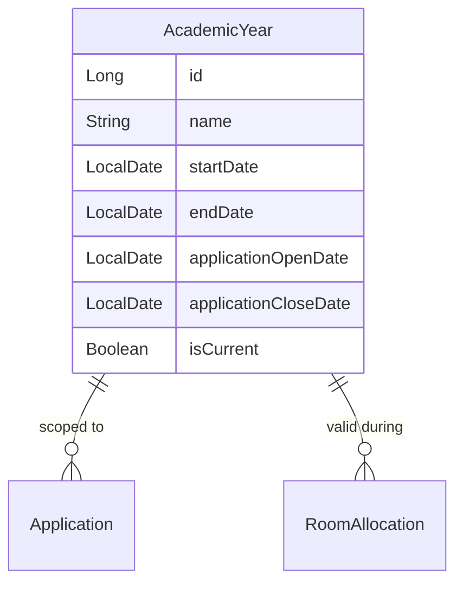
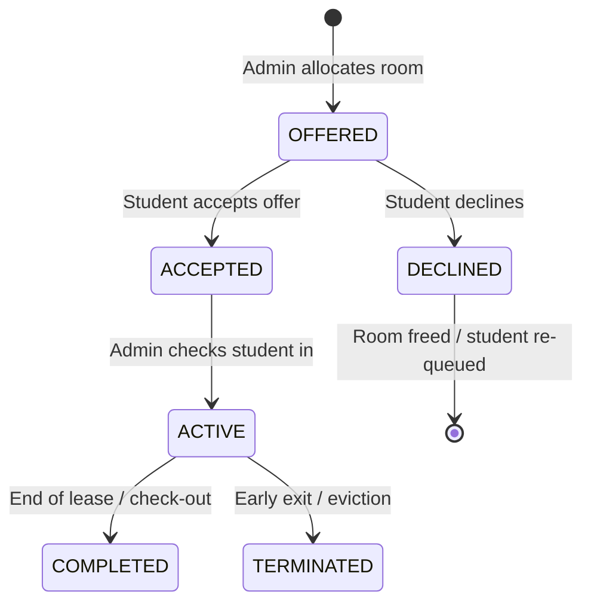

# Analysis 1: Core Workflow Completeness

## Scope

Trace the complete happy path for a student from registration to living in an allocated room, and verify every step is functional. This system is planned as a **SaaS platform** serving multiple institutions.

---

## Finding 1: No Academic Year / Period Entity

**Category:** MISSING-CRITICAL
**Priority:** P0
**Affected Area:** Data Model / Backend

### Description
The system has no concept of an academic cycle. `Application` relies on `LocalDate.now()` and `applicationDate` for implicit timing. There is no `AcademicYear` entity to group applications, allocations, or define open/close periods. The application code generator (`APP-YYYY-XXX`) uses the calendar year, not an academic year.

### Impact
- Cannot open applications for next year while current year is still active.
- Cannot enforce BR-001 ("one active application per academic year") because "academic year" is undefined.
- Reporting across years is impossible — all data is a flat timeline.
- For SaaS: different institutions may have different academic calendars. Without this entity, the platform cannot support them simultaneously.

### Evidence
- `ApplicationService.generateApplicationCode()` uses `LocalDate.now().getYear()`.
- `Application` entity has no `academicYear` field or relationship.
- `BR-001` references "per academic year" but the concept is not modelled.

### Recommendation
Create an `AcademicYear` entity with `name`, `startDate`, `endDate`, `applicationOpenDate`, `applicationCloseDate`, `isCurrent` flag. Link to `Application` and `RoomAllocation`.



---

## Finding 2: No Student Offer Acceptance Step

**Category:** MISSING-CRITICAL
**Priority:** P0
**Affected Area:** Business Rules / Workflow

### Description
The allocation workflow jumps from admin confirmation directly to `ACTIVE`. There is no step where the student explicitly accepts or declines the room offer. The student is passive — they are assigned a room without consent to the specific room, building, or associated costs.

### Impact
- Legal risk: no record of the student agreeing to the allocation terms or fees.
- Operational risk: students may not show up, blocking rooms for others with no recourse.
- For SaaS: different institutions may have different acceptance policies. Without this step, the platform cannot enforce them.

### Evidence
- `RoomAllocationController.confirmStagedAllocation` sets status to `ACTIVE` immediately.
- `RoomAllocation` entity has no `OFFERED` or `ACCEPTED` status.
- No student-facing endpoint to accept or decline an offer.

### Recommendation
Introduce `OFFERED` and `ACCEPTED` statuses in `RoomAllocation`. Add student endpoints:
- `POST /api/allocations/{id}/accept` — Student accepts, status moves to `ACCEPTED`.
- `POST /api/allocations/{id}/decline` — Student declines, room freed, student returns to waiting list.



---

## Finding 3: No Check-in / Check-out Process

**Category:** MISSING-IMPORTANT
**Priority:** P1
**Affected Area:** Backend / Workflow

### Description
There is no workflow to record when a student physically moves in or out. `RoomAllocation` has `allocationDate` (creation timestamp) and `endDate`, but no `checkInDate` or `checkOutDate`. The only way to end an allocation is the admin-only `PATCH /{id}/end` endpoint which sets status to `COMPLETED`.

### Impact
- Inaccurate occupancy data: student was allocated but never arrived.
- No key handover tracking.
- Cannot manage room turnover/cleaning schedules.
- For SaaS: institutions need audit-quality proof of occupancy for funding claims (NSFAS).

### Evidence
- `RoomAllocation` entity: fields are `allocationDate`, `status`, `endDate`, `allocationMethod`.
- No `checkInDate`, `checkOutDate`, or `checkInConfirmedBy` fields.
- No student-initiated check-out request endpoint.

### Recommendation
Add `checkInDate`, `checkOutDate`, `checkInConfirmedBy` fields to `RoomAllocation`. Add endpoints:
- `POST /api/allocations/{id}/check-in` (Admin confirms key handover)
- `POST /api/allocations/{id}/check-out-request` (Student initiates departure)
- `POST /api/allocations/{id}/check-out` (Admin confirms room vacated)

---

## Finding 4: No Application Period Management

**Category:** MISSING-IMPORTANT
**Priority:** P1
**Affected Area:** Backend / Admin

### Description
There is no mechanism for admins to open or close application windows. Students can submit applications at any time, year-round. There is no `SystemSetting` or `AcademicYear` field controlling whether applications are currently being accepted.

### Impact
- Admins cannot control intake volume or timing.
- Students may apply outside the intended window and expect service.
- For SaaS: each institution needs independent control over their application periods.

### Evidence
- `ApplicationController.submitApplication` has no date-range validation.
- `SystemSetting` exists but no `applications.open` or `applications.close` setting was found.

### Recommendation
This is addressed by [Finding #1](#finding-1-no-academic-year--period-entity). The `AcademicYear` entity should include `applicationOpenDate` and `applicationCloseDate`. `ApplicationService.submitApplication` should validate that the current date falls within the open period.

---

## Finding 5: No Re-Application / Renewal Flow

**Category:** MISSING-IMPORTANT
**Priority:** P1
**Affected Area:** Workflow

### Description
A current resident cannot apply for next year's accommodation while still occupying their current room. The duplicate application check (`existsByStudent_IdAndStatus(PENDING)`) would block submission. Even if bypassed, there is no academic year scoping to distinguish this year's allocation from next year's application.

### Impact
- Students must wait until their current allocation ends before applying, risking homelessness.
- Institutions cannot plan next year's occupancy in advance.

### Evidence
- `ApplicationService.submitApplication` checks `existsByStudent_IdAndStatus(studentId, PENDING)`.
- No `academicYear` field on `Application` to scope the duplicate check.

### Recommendation
After implementing [Finding #1](#finding-1-no-academic-year--period-entity), update the duplicate check:
```java
applicationRepository.existsByStudent_IdAndAcademicYear_IdAndStatusIn(
    studentId, currentAcademicYear.getId(), List.of(PENDING, APPROVED, AWAITING_ALLOCATION, ALLOCATED)
);
```

---

## Finding 6: Incomplete Post-Allocation Student Experience

**Category:** MISSING-IMPORTANT
**Priority:** P1
**Affected Area:** Frontend / UX

### Description
Once a student is allocated a room, the system provides no further guidance. The student dashboard shows the allocation but:
- No move-in instructions or key collection information.
- No building rules or emergency contacts.
- No lease/agreement to review or sign.
- No roommate visibility.

### Impact
- Students will contact admin offices directly, defeating the purpose of the self-service system.
- First-year students especially will be confused about next steps.

### Evidence
- `Dashboard` component shows allocation status but no post-allocation action items.
- No endpoint returning move-in instructions or building-specific information.

### Recommendation
Add a "My Accommodation" section to the student dashboard showing:
- Room details (building, floor, room number, capacity, roommates)
- Move-in date and instructions
- Building contact information
- Link to lease agreement (once [Finding #20](#finding-20-no-leasecontract-entity) is resolved)

---

## Checkpoint Status

| Checkpoint | Status | Finding |
|---|---|---|
| Register, verify email, log in | PASS | — |
| Complete profile | PASS | — |
| Submit application with preferences | PASS | — |
| Upload required documents | PASS | — |
| Admin sees application + documents | PASS | — |
| Admin verifies/rejects documents with comments | PASS | — |
| Admin approves/rejects application | PASS | — |
| Admin moves to allocation phase | PASS | — |
| Admin allocates room (manual or batch) | PASS | — |
| Student notified at every status change | PASS | — |
| Student sees allocation on dashboard | PASS | — |
| Student sees clear accommodation summary | **FAIL** | [#6](#finding-6-incomplete-post-allocation-student-experience) |
| Check-out process at end of period | **FAIL** | [#3](#finding-3-no-check-in--check-out-process) |
| Re-application / renewal for next period | **FAIL** | [#5](#finding-5-no-re-application--renewal-flow) |
| Student accepts/declines room offer | **FAIL** | [#2](#finding-2-no-student-offer-acceptance-step) |
| Application periods controlled by admin | **FAIL** | [#4](#finding-4-no-application-period-management) |
| Academic year scoping | **FAIL** | [#1](#finding-1-no-academic-year--period-entity) |

## Summary

| # | Title | Category | Priority |
|---|---|---|---|
| 1 | No Academic Year Entity | MISSING-CRITICAL | P0 |
| 2 | No Student Offer Acceptance Step | MISSING-CRITICAL | P0 |
| 3 | No Check-in / Check-out Process | MISSING-IMPORTANT | P1 |
| 4 | No Application Period Management | MISSING-IMPORTANT | P1 |
| 5 | No Re-Application / Renewal Flow | MISSING-IMPORTANT | P1 |
| 6 | Incomplete Post-Allocation Experience | MISSING-IMPORTANT | P1 |
