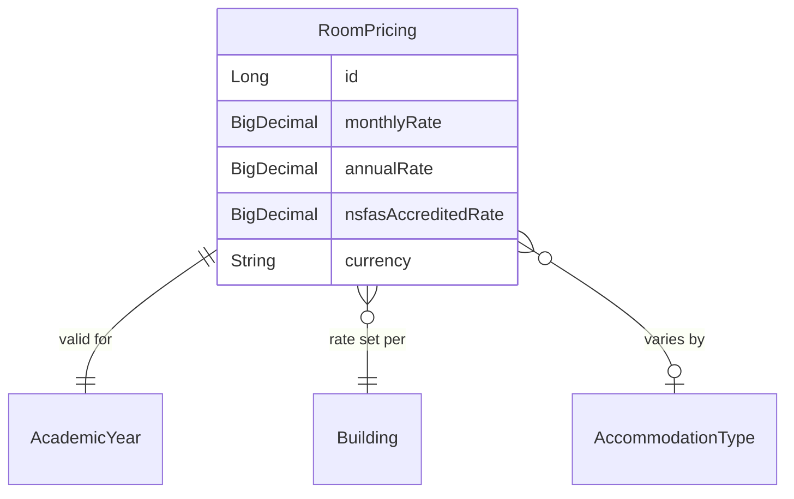
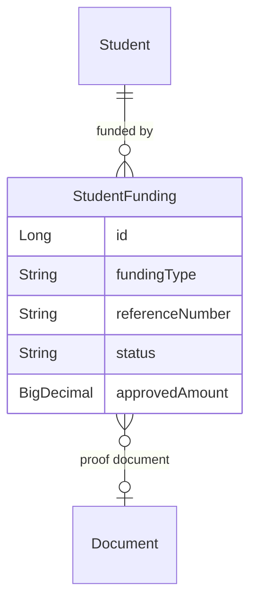
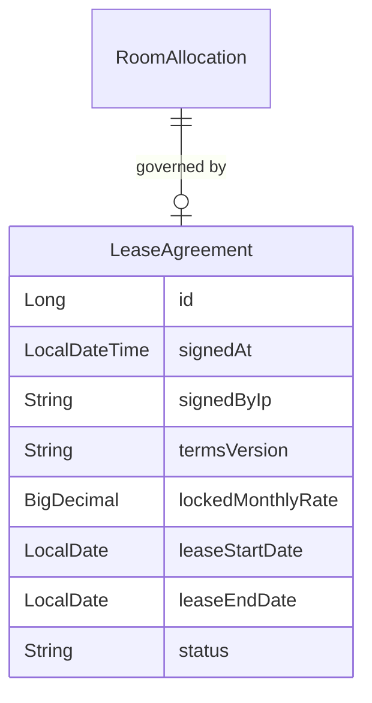
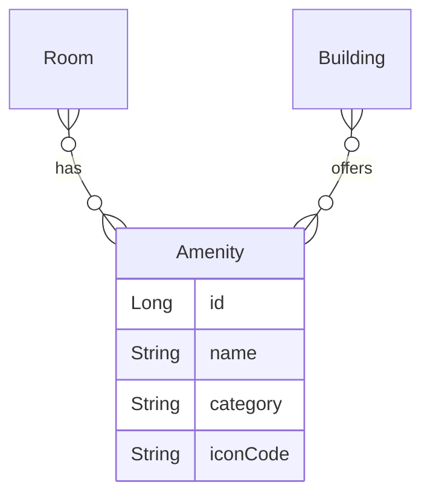

# Analysis 4: Data Model Gaps & Issues

## Scope

Audit the 24-entity data model for missing structures needed to support business rules, SaaS operations, and funding/revenue workflows. The NSFAS-funded building model is confirmed as a real requirement.

---

## Finding 19: No Pricing / Fee Model on Rooms

**Category:** MISSING-CRITICAL
**Priority:** P0
**Affected Area:** Data Model / Revenue

### Description
There is no monetary field anywhere in the data model. `Room`, `Building`, `AccommodationType`, and `RoomAllocation` have no price, rate, or cost fields. The system cannot track how much accommodation costs, which is essential for:
- Generating NSFAS funding claims.
- Billing self-funded students.
- Reporting revenue per building/institution.

### Impact
- Cannot operate as a business — there is no way to know what a room costs.
- NSFAS claims require a per-student cost figure linked to a specific allocation period.
- For SaaS: pricing is the foundation of the revenue model.

### Evidence
- `Room` entity: `roomNumber`, `capacity`, `currentOccupancy`, `status` — no price field.
- `Building` entity: `name`, `address`, `description`, `totalFloors` — no rate field.
- `RoomAllocation` entity: no `agreedPrice` or `costAtTimeOfAllocation` field.

### Recommendation
Create `RoomPricing` entity:

Also add `lockedPrice` to `RoomAllocation` to snapshot the rate at the time of allocation.

---

## Finding 20: No Student Funding / Sponsorship Tracking

**Category:** MISSING-CRITICAL
**Priority:** P0
**Affected Area:** Data Model / Revenue

### Description
Most students in the South African accommodation market are funded by NSFAS (National Student Financial Aid Scheme) or institutional bursaries. The system has no way to track:
- Whether a student is NSFAS-funded, bursary-funded, or self-funded.
- The student's funding reference number.
- Proof-of-funding document linkage.
- Claim status per allocation.

### Impact
- Cannot generate NSFAS claim reports (the primary revenue channel for funded buildings).
- Cannot differentiate funded vs self-funded students for billing purposes.
- Admins must track funding status in external spreadsheets.

### Evidence
- No `StudentFunding`, `Sponsor`, or `FundingSource` entity exists.
- `Student` entity has no `fundingType` or `nsfasReferenceNumber` field.
- `Application` entity has no funding-related fields.

### Recommendation
Create `StudentFunding` entity:

`fundingType` values: `NSFAS`, `BURSARY`, `SELF_FUNDED`, `INSTITUTIONAL_AID`.

---

## Finding 21: No Lease / Contract Agreement Entity

**Category:** MISSING-CRITICAL
**Priority:** P0
**Affected Area:** Data Model / Legal

### Description
`RoomAllocation` tracks residency (which student is in which room) but not the legal agreement. There is no entity representing:
- The lease/contract terms the student agreed to.
- The date they accepted.
- The specific price locked at signing time.
- The version of terms they accepted.

### Impact
- No legal audit trail of student consent.
- If prices change, there is no record of what price a specific student agreed to.
- For SaaS: different buildings (potentially different landlords) will have different lease templates.

### Evidence
- `RoomAllocation` entity: `allocationDate`, `status`, `endDate` — no agreement fields.
- No `LeaseAgreement` or `Contract` entity.

### Recommendation
Create `LeaseAgreement` entity:

`status` values: `PENDING_SIGNATURE`, `SIGNED`, `EXPIRED`, `TERMINATED`.

---

## Finding 22: No Room Amenities / Features Data

**Category:** MISSING-IMPORTANT
**Priority:** P1
**Affected Area:** Data Model / Search

### Description
FR-031 requires rooms to have "Amenities and features." Currently, `Room` only has `roomNumber`, `capacity`, `status`. `RoomAttributes` adds `accessibilityCompliant` and `genderRestriction` but nothing else — no wifi, en-suite, furnished, catered, parking, laundry, etc.

### Impact
- Students cannot filter or express preferences for room features.
- The allocation algorithm cannot factor amenities into scoring.
- For SaaS: building operators will want to advertise their facilities.

### Evidence
- `Room` entity: no amenities field.
- `RoomAttributes` entity: only `accessibilityCompliant`, `genderRestriction`, `minYearOfStudy`, `maxYearOfStudy`.

### Recommendation
Create an `Amenity` entity and a join table:

Categories: `ROOM_FEATURE` (en-suite, furnished), `BUILDING_FACILITY` (gym, laundry, wifi), `SERVICE` (catered, cleaning).

---

## Finding 23: AccommodationType Not Linked to Room

**Category:** DEFECT
**Priority:** P1
**Affected Area:** Data Model

### Description
`AccommodationType` exists as a standalone entity with `name`, `description`, `isActive`. Students select an accommodation type in their application (`preferredAccommodationType` — a plain string field). But `Room` has no `accommodationType` relationship. There is no way to match a student's preference to actual rooms.

### Impact
- The accommodation type preference is decorative — it cannot influence room allocation.
- Admins must mentally map room numbers to types.

### Evidence
- `Application.preferredAccommodationType` — `String` field (not a FK).
- `Room` entity — no `accommodationType` field or relationship.
- `AccommodationType` entity — not referenced by `Room`.

### Recommendation
Add `@ManyToOne AccommodationType accommodationType` to `Room`. Change `Application.preferredAccommodationType` from `String` to a `@ManyToOne` FK. Update the scoring algorithm to boost matches.

---

## Finding 24: No Floor Number on Room

**Category:** MISSING-IMPORTANT
**Priority:** P2
**Affected Area:** Data Model

### Description
`Building` has `totalFloors` but `Room` has no `floorNumber` field. This prevents:
- Floor-based filtering (e.g., ground floor for accessibility).
- Floor-based room numbering display.
- Floor-based allocation rules (e.g., first-years on lower floors).

### Evidence
- `Room` entity: `roomNumber` (String), `capacity`, `status` — no floor field.
- `Building` entity: `totalFloors` (Integer) — used for building info only.

### Recommendation
Add `Integer floorNumber` to `Room`. Validate `floorNumber <= building.totalFloors`.

---

## Finding 25: No Notification Preferences

**Category:** MISSING-IMPORTANT
**Priority:** P2
**Affected Area:** Data Model

### Description
Users receive both email notifications (`Notification` entity) and in-app notifications (`UserNotification` entity). There is no mechanism for users to control their notification preferences (e.g., opt out of email, receive in-app only).

### Evidence
- No `NotificationPreference` or `UserSettings` entity.
- `NotificationService` sends emails unconditionally.

### Recommendation
Add `NotificationPreference` entity or fields on `AppUser` (`emailNotificationsEnabled`, `inAppNotificationsEnabled`). Check preferences before sending.

---

## Verification Summary

| Data Model Area | Status | Finding |
|---|---|---|
| Academic Year / Period | **MISSING** | [#1](01-core-workflow-completeness.md#finding-1-no-academic-year--period-entity) |
| Pricing / Fees | **MISSING** | [#19](#finding-19-no-pricing--fee-model-on-rooms) |
| Funding / Sponsorship | **MISSING** | [#20](#finding-20-no-student-funding--sponsorship-tracking) |
| Lease / Contract | **MISSING** | [#21](#finding-21-no-lease--contract-agreement-entity) |
| Room Amenities | **MISSING** | [#22](#finding-22-no-room-amenities--features-data) |
| AccommodationType → Room link | **BROKEN** | [#23](#finding-23-accommodationtype-not-linked-to-room) |
| Floor Number | **MISSING** | [#24](#finding-24-no-floor-number-on-room) |
| Notification Preferences | **MISSING** | [#25](#finding-25-no-notification-preferences) |
| Application → Document linkage | **OK** — `Document` links to `Application` via FK | — |
| Waiting List priority | **OK** — computed on-the-fly by scoring service | — |
| Building ↔ Institution | **OK** — ManyToMany with join table | — |

## Summary

| # | Title | Category | Priority |
|---|---|---|---|
| 19 | No Pricing / Fee Model | MISSING-CRITICAL | P0 |
| 20 | No Student Funding Tracking | MISSING-CRITICAL | P0 |
| 21 | No Lease / Contract Entity | MISSING-CRITICAL | P0 |
| 22 | No Room Amenities Data | MISSING-IMPORTANT | P1 |
| 23 | AccommodationType Not Linked to Room | DEFECT | P1 |
| 24 | No Floor Number on Room | MISSING-IMPORTANT | P2 |
| 25 | No Notification Preferences | MISSING-IMPORTANT | P2 |
