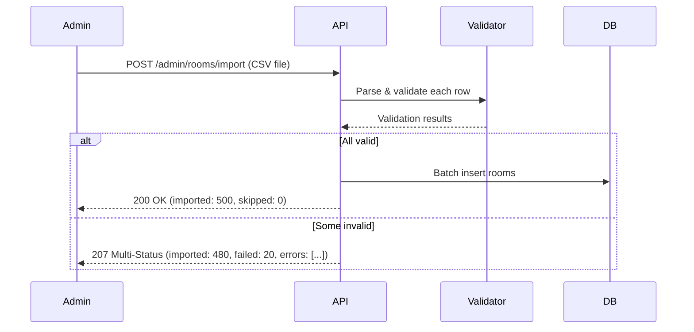
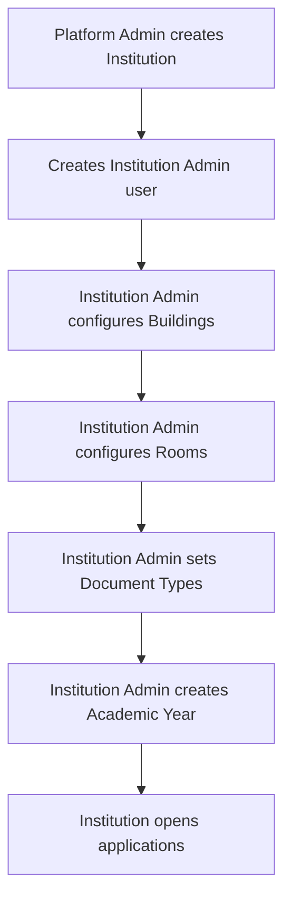

# Analysis 5: Missing MVP Features

## Scope

Identify features that are standard for an end-to-end student accommodation SaaS platform but are absent from the current implementation.

---

## Finding 26: No Bulk Data Import for Students or Rooms

**Category:** MISSING-CRITICAL
**Priority:** P0
**Affected Area:** Backend / Admin Operations

### Description
There are no endpoints for bulk importing students or rooms via CSV/Excel. All creation is single-entity via `POST` endpoints. When onboarding a new institution with 200 buildings and 5,000 rooms, an admin would need to click "Create Room" 5,000 times.

### Impact
- Initial system setup is operationally impossible at scale.
- Onboarding new SaaS tenants (institutions) would take weeks of manual data entry.
- Room data often comes from existing institutional systems in spreadsheet format.

### Evidence
- `RoomController.createRoom()` — single room only.
- `StudentController.createStudent()` — single student only.
- No `BatchController` or `/import` endpoints found.

### Recommendation
Create batch import endpoints:
- `POST /api/admin/rooms/import` — accepts CSV with columns: `buildingName`, `roomNumber`, `capacity`, `floorNumber`, `accommodationType`.
- `POST /api/admin/students/import` — accepts CSV with columns: `email`, `firstName`, `lastName`, `studentNumber`, `institutionName`, `yearOfStudy`.

---

## Finding 27: No Broadcast / Announcement System

**Category:** MISSING-IMPORTANT
**Priority:** P1
**Affected Area:** Backend / Communication

### Description
`NotificationService` handles transactional emails (application approved, document rejected, etc.) but there is no mechanism for admins to send ad-hoc announcements to groups of students.

### Impact
- Cannot communicate "Water outage in Building A tonight" or "Application deadline extended."
- Admins must use external email tools, fragmenting communication.
- For SaaS: institution admins need to communicate with their own students without involving platform operators.

### Evidence
- `EmailService`: all methods are specific notification types (e.g., `sendApplicationApprovedEmail`).
- No `AnnouncementController` or `BroadcastService`.

### Recommendation
Add `POST /api/admin/announcements` with targeting options:
- All students
- Students in a specific building
- Students with a specific application status
- Students at a specific institution

---

## Finding 28: No Data Export for Funding Claims

**Category:** MISSING-IMPORTANT
**Priority:** P1
**Affected Area:** Backend / Reporting

### Description
NSFAS and bursary sponsors require periodic reports of accommodated students with costs. The system has `ActivityLogController.exportActivityLogs` (CSV export) but no endpoint to export allocation/funding data.

### Impact
- Finance teams must manually compile NSFAS claims from the database.
- Delays in claims mean delays in revenue for funded buildings.

### Evidence
- `AdminStatsController`: basic counts only (`getDashboardStats`, `getOccupancyStats`).
- No `/api/admin/export/allocations` or `/api/admin/export/claims` endpoint.

### Recommendation
Add `GET /api/admin/export/allocations` (CSV) with filters for academic year, building, institution, funding type. After [Finding #20](04-data-model-gaps.md#finding-20-no-student-funding--sponsorship-tracking) is resolved, add `GET /api/admin/export/funding-claims` for NSFAS-formatted reports.

---

## Finding 29: No Support Ticket System (FR-042/043)

**Category:** MISSING-IMPORTANT
**Priority:** P2
**Affected Area:** Frontend / Backend

### Description
FR-042 and FR-043 require a support ticket system where students submit tickets and staff respond. The frontend has a "Contact Support" page, but it appears to be a static information page — there is no ticket entity, no ticket API, and no ticket management UI for admins.

### Impact
- Student issues are handled outside the system (email, phone), losing traceability.
- For SaaS: support tracking per institution is important for service level management.

### Evidence
- `ContactSupportComponent` exists in frontend.
- No `SupportTicket` entity in backend.
- No `/api/support-tickets` endpoints.

### Recommendation
Defer to Phase 2. For MVP, the Contact Support page should display the institution's support email and phone number (configurable per institution via `SystemSetting`).

---

## Finding 30: Minimal Reporting Capabilities

**Category:** IMPROVEMENT
**Priority:** P2
**Affected Area:** Admin Dashboard

### Description
`AdminStatsController` provides two endpoints: `getDashboardStats()` (aggregate counts) and `getOccupancyStats()` (room occupancy). There are no historical trends, no pipeline metrics (applications by stage), no gender distribution reports, and no financial summaries.

### Evidence
- `AdminStatsService.getDashboardStats()`: returns total counts.
- `AdminStatsService.getOccupancyStats()`: current occupancy per building.
- No time-series or trend data.

### Recommendation
For MVP, add basic pipeline metrics to the dashboard: applications by status (pie chart data), occupancy trend by month (line chart data). Full BI reporting can be deferred to Phase 2.

---

## Finding 31: No SaaS Tenant Onboarding Flow

**Category:** MISSING-IMPORTANT
**Priority:** P1
**Affected Area:** Backend / SaaS Architecture

### Description
The system architecture supports multi-tenancy via the `Institution ↔ Building` ManyToMany relationship. However, there is no self-service onboarding flow for a new institution to:
- Register their institution.
- Configure their buildings and rooms.
- Set up their admin users.
- Configure their document requirements.
- Define their academic calendar.

All of this must be done by a platform superadmin manually.

### Impact
- Scaling the SaaS to new clients requires manual setup per institution.
- No clear data isolation between institutions (a global admin sees everything).

### Evidence
- `InstitutionController.createInstitution()` — admin-only, no self-service.
- All admin endpoints operate globally, not scoped to an institution.
- No `Institution.adminUsers` relationship for institution-level admins.

### Recommendation
For MVP: document the manual onboarding process. For post-MVP: introduce institution-scoped admin roles and a self-service onboarding wizard.

---

## Feature Coverage Summary

| Feature Area | Status | Finding |
|---|---|---|
| Bulk Import (Students/Rooms) | **MISSING** | [#26](#finding-26-no-bulk-data-import-for-students-or-rooms) |
| Broadcast Announcements | **MISSING** | [#27](#finding-27-no-broadcast--announcement-system) |
| Funding Claims Export | **MISSING** | [#28](#finding-28-no-data-export-for-funding-claims) |
| Support Tickets (FR-042/043) | **MISSING** | [#29](#finding-29-no-support-ticket-system-fr-042043) |
| Advanced Reporting | **BASIC** | [#30](#finding-30-minimal-reporting-capabilities) |
| SaaS Tenant Onboarding | **MISSING** | [#31](#finding-31-no-saas-tenant-onboarding-flow) |
| Check-in Slot Booking | **MISSING** — Phase 2 | — |
| Maintenance Ticketing | **MISSING** — Phase 2 | — |

## Summary

| # | Title | Category | Priority |
|---|---|---|---|
| 26 | No Bulk Data Import | MISSING-CRITICAL | P0 |
| 27 | No Broadcast Announcements | MISSING-IMPORTANT | P1 |
| 28 | No Funding Claims Export | MISSING-IMPORTANT | P1 |
| 29 | No Support Ticket System | MISSING-IMPORTANT | P2 |
| 30 | Minimal Reporting | IMPROVEMENT | P2 |
| 31 | No SaaS Tenant Onboarding | MISSING-IMPORTANT | P1 |
