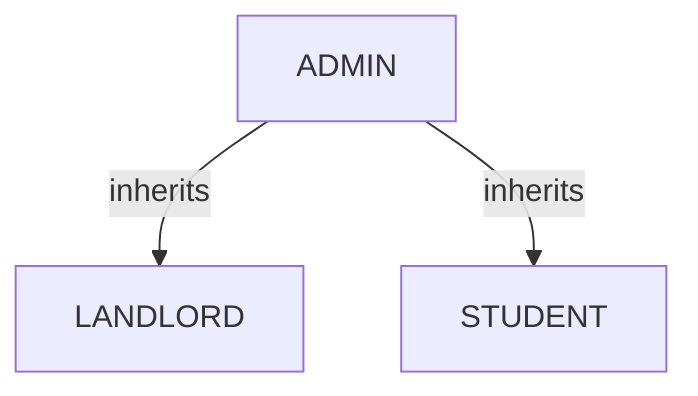

# Analysis 7: Security Concerns

## Scope

Identify security vulnerabilities beyond standard configuration, focusing on authentication abuse, authorization bypass, data exposure, and SaaS multi-tenant risks.

---

## Finding 38: Runtime Exception Leaks Internal Messages

**Category:** DEFECT
**Priority:** P1
**Affected Area:** Backend — `RestResponseExceptionHandler`

### Description
The global exception handler catches `RuntimeException` and returns `ex.getMessage()` directly in the API response body. Unhandled exceptions (e.g., database constraint violations, null pointers, configuration errors) expose internal system details to the client.

### Impact
- Attackers can trigger edge cases and reverse-engineer database schema, table names, or internal logic from error messages.
- Stack trace fragments may leak in production.

### Evidence
- `RestResponseExceptionHandler.java` handles `RuntimeException` and `IllegalStateException` by passing the exception message to the error response DTO.
- Custom exceptions (e.g., `RoomCapacityExceededException`) are safe — they have controlled messages. The risk is the catch-all handlers.

### Recommendation
Replace the generic handler's message with:
```java
"An unexpected error occurred. Reference: " + generateTraceId()
```
Log the full exception server-side with the trace ID for debugging. Keep all custom exception messages as-is.

---

## Finding 39: Role Hierarchy — LANDLORD Inherits STUDENT Permissions

**Category:** DEFECT
**Priority:** P1
**Affected Area:** Backend — `SecurityConfig`

### Description
The role hierarchy is defined as `ROLE_ADMIN > ROLE_LANDLORD > ROLE_STUDENT`. This means a Landlord user inherits all `STUDENT`-level permissions. While most student endpoints have ownership checks (preventing a Landlord from accessing another student's data), this inheritance is architecturally wrong — Landlords and Students are distinct user types, not a hierarchy.

### Impact
- A Landlord user could potentially access student self-service endpoints (e.g., `POST /api/student` to create a student profile for themselves).
- Expands the attack surface unnecessarily.
- For SaaS: if external property managers have Landlord accounts, they should not have any student capabilities.

### Evidence
- `SecurityConfig.java`:
  ```java
  roleHierarchy.setHierarchy("ROLE_ADMIN > ROLE_LANDLORD \n ROLE_LANDLORD > ROLE_STUDENT");
  ```
- Student endpoints rely on `@PreAuthorize("hasRole('STUDENT')")` — which Landlord passes due to inheritance.

### Recommendation
Change to flat hierarchy:
```java
roleHierarchy.setHierarchy("ROLE_ADMIN > ROLE_LANDLORD \n ROLE_ADMIN > ROLE_STUDENT");
```
This keeps Admin above both but makes Landlord and Student independent branches.



---

## Finding 40: No JWT Revocation on Password Change

**Category:** MISSING-IMPORTANT
**Priority:** P1
**Affected Area:** Backend — Authentication

### Description
When a user changes their password (`POST /api/auth/change-password`), the system updates the password hash but does not invalidate existing JWT tokens. A stolen token remains valid until its natural expiry (up to 10 hours for users, 4 hours for admins).

### Impact
- If an account is compromised, changing the password does not immediately lock out the attacker.
- The attacker's existing token continues to work.

### Evidence
- `AuthService.changePassword()`: updates password in database, returns success. No token blacklist or version bump.
- JWT is stateless — no server-side session store to invalidate.

### Recommendation
Implement a lightweight token invalidation mechanism:
- **Option A:** Add `tokenVersion` (integer) to `AppUser`. Increment on password change. Validate `tokenVersion` in `JwtAuthenticationFilter` on every request.
- **Option B:** Maintain a short-lived blacklist (Redis or in-memory cache) of revoked tokens for the duration of the token's remaining TTL.

---

## Finding 41: File Upload Content-Type Not Validated Server-Side

**Category:** MISSING-IMPORTANT
**Priority:** P1
**Affected Area:** Backend — `DocumentService`

### Description
File uploads are validated for extension (PDF, JPG, PNG) and size (10MB) on the frontend. The backend `application.yml` sets max file size but there is no server-side validation that the file's actual content matches its declared MIME type. A malicious user could rename an executable to `.pdf` and upload it.

### Impact
- Stored files in MinIO could contain unexpected content types.
- Admins downloading documents via presigned URLs could be served malicious files.

### Evidence
- Frontend `DocumentService.validateFile()`: checks extension and size.
- Backend `DocumentService.uploadDocuments()`: stores files in MinIO, creates `Document` records, but no content-type sniffing.

### Recommendation
Add server-side MIME type validation using Apache Tika or similar:
```java
String detectedType = tika.detect(file.getInputStream());
if (!ALLOWED_TYPES.contains(detectedType)) {
    throw new InvalidFileTypeException("File content does not match allowed types");
}
```

---

## Finding 42: Delete Account May Not Remove MinIO Files

**Category:** DEFECT
**Priority:** P1
**Affected Area:** Backend — `AuthService`

### Description
`POST /api/auth/delete-account` deletes the user's account. It is unclear whether this cascades to:
- `Document` records in the database (likely yes, via JPA cascade).
- Actual file blobs stored in MinIO (likely **no** — JPA cascade doesn't trigger MinIO deletion).

### Impact
- Orphaned files remain in MinIO consuming storage.
- GDPR non-compliance: personal documents persist after account deletion.

### Evidence
- `AuthService.deleteAccount()` deletes the `AppUser` entity.
- `Document` entity has `@ManyToOne Student` — cascade behavior depends on the Student deletion path.
- `MinioBucketService` has delete methods but they must be explicitly called.

### Recommendation
Ensure the delete account flow:
1. Fetches all `Document` records for the user.
2. Deletes each file from MinIO via `MinioBucketService`.
3. Then deletes the database records.
Wrap in a transaction with MinIO deletions happening first (idempotent).

---

## Security Verification Summary

| Security Area | Status | Finding |
|---|---|---|
| Rate Limiting | **MISSING** | [#32](06-nfr-vs-reality.md#finding-32-no-rate-limiting-anywhere-nfr-008) |
| Error Leakage | **DEFECT** | [#38](#finding-38-runtime-exception-leaks-internal-messages) |
| AuthN (JWT) | **STRONG** | — |
| AuthZ (RBAC) | **STRONG** — with hierarchy flaw | [#39](#finding-39-role-hierarchy--landlord-inherits-student-permissions) |
| IDOR Protection | **STRONG** — ownership checks in service layer | — |
| Input Validation | **STRONG** — `@Valid` on DTOs | — |
| SQL Injection | **PROTECTED** — JPA parameterized queries | — |
| Token Revocation | **MISSING** | [#40](#finding-40-no-jwt-revocation-on-password-change) |
| File Content Validation | **MISSING** | [#41](#finding-41-file-upload-content-type-not-validated-server-side) |
| Data Deletion (GDPR) | **DEFECT** | [#42](#finding-42-delete-account-may-not-remove-minio-files) |

## Summary

| # | Title | Category | Priority |
|---|---|---|---|
| 38 | Runtime Exception Leaks Messages | DEFECT | P1 |
| 39 | Role Hierarchy: LANDLORD Inherits STUDENT | DEFECT | P1 |
| 40 | No JWT Revocation on Password Change | MISSING-IMPORTANT | P1 |
| 41 | File Upload Content-Type Not Validated | MISSING-IMPORTANT | P1 |
| 42 | Delete Account May Not Remove MinIO Files | DEFECT | P1 |
