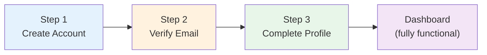

# Analysis 9: UX & Workflow Friction Points

## Scope

Identify places where the user experience causes confusion or frustration, evaluated from both the student and admin perspectives.

---

## Finding 48: Application Status Labels Are Technical Jargon

**Category:** IMPROVEMENT
**Priority:** P1
**Affected Area:** Frontend / UX

### Description
Application statuses displayed to students use internal enum names: `PENDING`, `APPROVED`, `AWAITING_ALLOCATION`, `ALLOCATED`, `REJECTED`. These are developer terms, not user-friendly language. A first-year student seeing "AWAITING_ALLOCATION" will not understand what it means.

### Impact
- Confusion and support inquiries from students who don't understand their status.
- Poor perception of the platform's professionalism.
- For SaaS: each institution may want customized status labels.

### Evidence
- `ApplicationStatus` enum values are used directly in API responses and displayed in the frontend.
- `ModernStatusBadgeComponent` displays the raw status string.

### Recommendation
Add a display label mapping in the frontend:

| Internal Status | Student-Facing Label |
|---|---|
| `PENDING` | "Application Submitted — Under Review" |
| `APPROVED` | "Application Approved" |
| `AWAITING_ALLOCATION` | "Approved — Finding Your Room" |
| `ALLOCATED` | "Room Assigned" |
| `REJECTED` | "Application Not Successful" |

Keep internal enum values for API contracts; only change the display layer.

---

## Finding 49: No Post-Allocation Guidance for Students

**Category:** MISSING-IMPORTANT
**Priority:** P1
**Affected Area:** Frontend / UX

### Description
Once allocated, the student dashboard shows room assignment details but provides no next-step instructions. There is no:
- Move-in date or time slot.
- Key collection instructions.
- Building rules or emergency contacts.
- Lease agreement to review/sign.
- Roommate information.

### Impact
- Students are left wondering "What do I do now?" — the system's value drops at the most critical moment.
- Admin offices get flooded with calls.

### Evidence
- `DashboardComponent` shows allocation status card.
- No "My Accommodation" detail page with move-in instructions.
- No post-allocation action items or checklist.

### Recommendation
Create a "My Accommodation" section on the student dashboard that appears after allocation. It should display:
- Room details (building, floor, room number, capacity)
- Move-in date/instructions (configurable per building)
- Building contact info
- Roommate names (first name + year only)
- Link to lease agreement (once [Finding #21](04-data-model-gaps.md#finding-21-no-lease--contract-agreement-entity) is implemented)
- Emergency contacts

---

## Finding 50: Document Rejection Path Unclear for Students

**Category:** IMPROVEMENT
**Priority:** P2
**Affected Area:** Frontend / UX

### Description
When an admin rejects a document, the student receives an email and in-app notification. However, the path to re-upload is not immediately obvious:
- The student must navigate to their documents page.
- Find the rejected document.
- Understand the rejection reason (via `DocumentComment`).
- Upload a replacement.

There is no guided re-upload flow or prominent alert on the dashboard.

### Evidence
- `DocumentVerificationComponent` (admin side) allows rejection with comment.
- `DocumentsComponent` (student side) shows document statuses.
- No dashboard alert saying "Action Required: Re-upload your rejected ID Document."

### Recommendation
Add a prominent "Action Required" card on the student dashboard when any document has `REJECTED` status. The card should:
- Name the rejected document and show the admin's comment.
- Provide a direct "Re-upload" button that opens the upload dialog pre-configured for that document type.

---

## Finding 51: No Room/Building Browsing Before Application

**Category:** MISSING-IMPORTANT
**Priority:** P2
**Affected Area:** Frontend

### Description
Students cannot browse available rooms or buildings before submitting an application. The application form allows selecting a "preferred building" and "accommodation type," but students cannot see what's actually available, what the buildings look like, or what amenities they offer.

### Impact
- Students make blind preferences.
- Leads to dissatisfaction when allocated a building they know nothing about.
- For SaaS: building operators want to showcase their properties.

### Evidence
- `RoomBrowserComponent` exists but is marked as deferred from MVP.
- No public `/api/buildings/browse` or `/api/rooms/browse` endpoint for unauthenticated or student users.

### Recommendation
For MVP: enable a read-only building browser accessible to authenticated students showing building name, address, description, total capacity, and available room count. Full room-level browsing can be Phase 2.

---

## Finding 52: Two-Step Registration Creates Confusion

**Category:** IMPROVEMENT
**Priority:** P2
**Affected Area:** Frontend / Onboarding

### Description
Registration requires two separate steps: account creation (`signup`) and profile completion (`profile-setup`). Between these steps, the user is logged in but the system is largely unusable. The frontend handles this with guards that redirect to profile setup, but the experience feels disconnected.

### Impact
- Users may think registration is complete after step 1.
- The two-step flow feels like two different systems.

### Evidence
- `signup` route creates `AppUser` only.
- `profile-setup` route creates `Student` entity.
- `EmailVerifiedGuard` and routing logic redirect correctly, but the UX flow feels fragmented.

### Recommendation
For MVP: ensure the signup → verify email → profile setup flow is presented as a single continuous wizard with progress indicators (e.g., "Step 1 of 3: Create Account", "Step 2 of 3: Verify Email", "Step 3 of 3: Complete Profile"). No backend changes needed — this is a frontend flow improvement.

---

## Friction Summary

| Area | User | Severity | Finding |
|---|---|---|---|
| Status labels | Student | Medium | [#48](#finding-48-application-status-labels-are-technical-jargon) |
| Post-allocation void | Student | High | [#49](#finding-49-no-post-allocation-guidance-for-students) |
| Rejected doc re-upload | Student | Medium | [#50](#finding-50-document-rejection-path-unclear-for-students) |
| Room browsing | Student | Medium | [#51](#finding-51-no-roombuilding-browsing-before-application) |
| Registration flow | Student | Low | [#52](#finding-52-two-step-registration-creates-confusion) |
| Bulk processing | Admin | High | See [Finding #16](03-role-permission-gaps.md#finding-16-no-admin-bulk-application-processing) |
| Application ordering | Admin | Medium | No FIFO/priority queue — admin picks from flat list |

## Summary

| # | Title | Category | Priority |
|---|---|---|---|
| 48 | Status Labels Are Jargon | IMPROVEMENT | P1 |
| 49 | No Post-Allocation Guidance | MISSING-IMPORTANT | P1 |
| 50 | Document Rejection Path Unclear | IMPROVEMENT | P2 |
| 51 | No Room/Building Browsing | MISSING-IMPORTANT | P2 |
| 52 | Two-Step Registration Friction | IMPROVEMENT | P2 |
