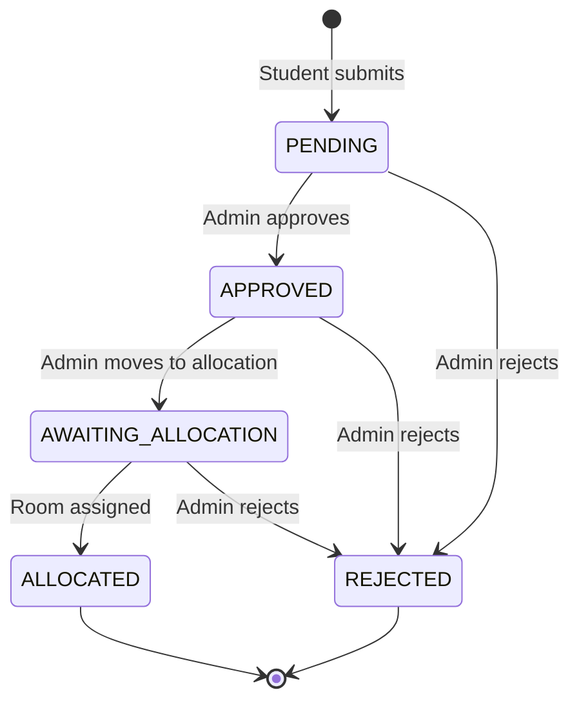
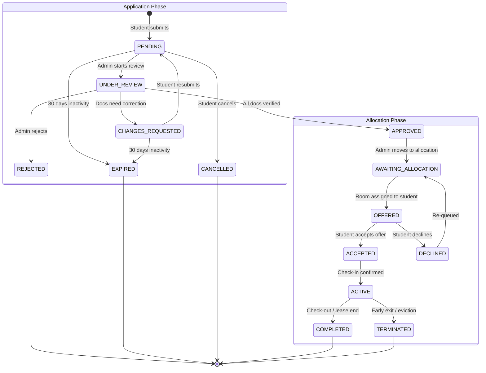

# Proposal: Corrected Application & Allocation Lifecycle

## Problem

The current lifecycle has gaps identified across multiple findings:

| Gap | Finding |
|---|---|
| No academic year scoping | [#1](../analysis/01-core-workflow-completeness.md#finding-1-no-academic-year--period-entity) |
| No student offer acceptance | [#2](../analysis/01-core-workflow-completeness.md#finding-2-no-student-offer-acceptance-step) |
| No check-in/check-out | [#3](../analysis/01-core-workflow-completeness.md#finding-3-no-check-in--check-out-process) |
| Missing "Under Review" status | [#53](../analysis/10-contradictions.md#finding-53-fr-015--under-review-status-does-not-exist) |
| No application expiry | [#8](../analysis/02-business-rule-enforcement.md#finding-8-br-004--no-application-expiry-scheduled-task) |
| No renewal flow | [#5](../analysis/01-core-workflow-completeness.md#finding-5-no-re-application--renewal-flow) |

---

## Current Workflow



**Problems:** No review visibility, no student acceptance, no expiry, no check-in/out, no termination.

---

## Proposed Corrected Workflow

### Application Statuses (`ApplicationStatus` enum)

| Status | Trigger | Description |
|---|---|---|
| `PENDING` | Student submits | Initial state. Editable by student. |
| `UNDER_REVIEW` | Admin opens application | Admin is actively reviewing. Locked for edits. |
| `CHANGES_REQUESTED` | Admin requests changes | Sent back to student for docs/info. |
| `APPROVED` | Admin approves | All docs verified. Eligible for allocation. |
| `REJECTED` | Admin rejects | Terminal state. Reason provided. |
| `EXPIRED` | System (30-day timer) | Auto-cancelled after inactivity (BR-004). |
| `CANCELLED` | Student cancels | Voluntary withdrawal. |

### Allocation Statuses (`AllocationStatus` enum — new)

| Status | Trigger | Description |
|---|---|---|
| `OFFERED` | Admin allocates room | Room reserved. Student notified. Acceptance deadline starts. |
| `ACCEPTED` | Student accepts offer | Student agrees to terms/lease. |
| `DECLINED` | Student declines offer | Room freed. Student returns to waiting list or exits. |
| `ACTIVE` | Admin confirms check-in | Student physically moved in. Keys handed over. |
| `COMPLETED` | End of lease / check-out | Student moves out. Room marked available. |
| `TERMINATED` | Admin action | Eviction, early exit, or contract breach. |

### Complete State Machine



---

## Implementation Changes

### 1. Enum Updates

**`ApplicationStatus.java`** — Add: `UNDER_REVIEW`, `CHANGES_REQUESTED`, `EXPIRED`, `CANCELLED`.

Update `canTransitionTo()`:
```
PENDING → UNDER_REVIEW, EXPIRED, CANCELLED
UNDER_REVIEW → APPROVED, REJECTED, CHANGES_REQUESTED
CHANGES_REQUESTED → PENDING, EXPIRED
APPROVED → AWAITING_ALLOCATION, REJECTED
AWAITING_ALLOCATION → ALLOCATED, REJECTED
```

**Create `AllocationStatus.java`** — Replace the current `String status` on `RoomAllocation`:
```
OFFERED, ACCEPTED, DECLINED, ACTIVE, COMPLETED, TERMINATED
```

### 2. New Endpoints

| Method | Path | Role | Purpose |
|---|---|---|---|
| `POST` | `/api/allocations/{id}/accept` | STUDENT | Accept room offer |
| `POST` | `/api/allocations/{id}/decline` | STUDENT | Decline room offer |
| `POST` | `/api/allocations/{id}/check-in` | ADMIN | Confirm physical check-in |
| `POST` | `/api/allocations/{id}/check-out` | ADMIN | Confirm check-out |

### 3. Scheduled Tasks

| Task | Schedule | Logic |
|---|---|---|
| Expire stale applications | Nightly 2 AM | `PENDING` or `CHANGES_REQUESTED` with `updatedAt` > 30 days → `EXPIRED` |
| Expire unaccepted offers | Nightly 2 AM | `OFFERED` with `createdAt` > 7 days → `DECLINED` (auto), room freed |

### 4. Database Migration

```sql
ALTER TABLE application ADD COLUMN IF NOT EXISTS academic_year_id BIGINT;
ALTER TABLE room_allocation ALTER COLUMN status TYPE VARCHAR(20);
-- Migrate existing string statuses to new enum values
UPDATE room_allocation SET status = 'ACTIVE' WHERE status = 'ACTIVE';
UPDATE room_allocation SET status = 'COMPLETED' WHERE status = 'COMPLETED';
```

### 5. Notification Updates

Add email templates for:
- `UNDER_REVIEW` — "Your application is being reviewed."
- `CHANGES_REQUESTED` — "Action Required: Please update your documents."
- `OFFERED` — "You've been offered a room! Accept within 7 days."
- `EXPIRED` — "Your application has expired due to inactivity."
