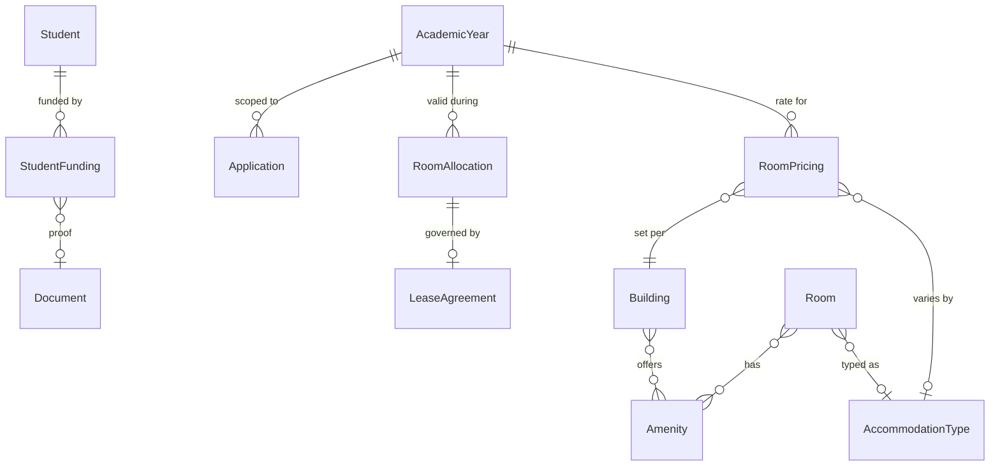

# Proposal: Data Model Additions

## Problem

The current 24-entity data model lacks structures for money, time periods, legal agreements, and room features. These gaps are documented in:

| Gap | Finding |
|---|---|
| No academic year | [#1](../analysis/01-core-workflow-completeness.md#finding-1-no-academic-year--period-entity) |
| No pricing model | [#19](../analysis/04-data-model-gaps.md#finding-19-no-pricing--fee-model-on-rooms) |
| No funding tracking | [#20](../analysis/04-data-model-gaps.md#finding-20-no-student-funding--sponsorship-tracking) |
| No lease agreement | [#21](../analysis/04-data-model-gaps.md#finding-21-no-lease--contract-agreement-entity) |
| No room amenities | [#22](../analysis/04-data-model-gaps.md#finding-22-no-room-amenities--features-data) |
| AccommodationType orphaned | [#23](../analysis/04-data-model-gaps.md#finding-23-accommodationtype-not-linked-to-room) |

---

## Proposed Entity Relationship Diagram (Additions Only)

New entities shown in context with existing ones (existing entities in regular boxes, new entities highlighted).

---

## New Entities — Full Field Specifications

### 1. `AcademicYear`

Addresses: [Finding #1](../analysis/01-core-workflow-completeness.md#finding-1-no-academic-year--period-entity), [Finding #5](../analysis/01-core-workflow-completeness.md#finding-5-no-re-application--renewal-flow), [Finding #7](../analysis/02-business-rule-enforcement.md#finding-7-br-001--duplicate-application-check-is-too-weak)

| Field | Type | Constraints | Description |
|---|---|---|---|
| `id` | `Long` | PK, auto-generated | |
| `name` | `String` | Unique, not null, max 20 | e.g., "2025/2026" |
| `startDate` | `LocalDate` | Not null | Academic year start |
| `endDate` | `LocalDate` | Not null | Academic year end |
| `applicationOpenDate` | `LocalDate` | | When applications open |
| `applicationCloseDate` | `LocalDate` | | When applications close |
| `isCurrent` | `Boolean` | Default false | Only one should be true |
| `createdAt` | `LocalDateTime` | Not updatable | |
| `updatedAt` | `LocalDateTime` | | |

**Relationships:**
- `OneToMany → Application`
- `OneToMany → RoomAllocation`
- `OneToMany → RoomPricing`

---

### 2. `RoomPricing`

Addresses: [Finding #19](../analysis/04-data-model-gaps.md#finding-19-no-pricing--fee-model-on-rooms)

| Field | Type | Constraints | Description |
|---|---|---|---|
| `id` | `Long` | PK | |
| `building` | `Building` | FK, not null | Rate is set per building |
| `accommodationType` | `AccommodationType` | FK, nullable | Varies by room type (single, double) |
| `academicYear` | `AcademicYear` | FK, not null | Rate valid for this year |
| `monthlyRate` | `BigDecimal` | Precision 10, scale 2 | Monthly accommodation cost |
| `annualRate` | `BigDecimal` | Precision 10, scale 2 | Annual accommodation cost |
| `nsfasAccreditedRate` | `BigDecimal` | Precision 10, scale 2, nullable | NSFAS capped rate (if applicable) |
| `currency` | `String` | Default "ZAR" | |
| `createdAt` | `LocalDateTime` | Not updatable | |
| `updatedAt` | `LocalDateTime` | | |

**Unique constraint:** (`building_id`, `accommodation_type_id`, `academic_year_id`)

---

### 3. `StudentFunding`

Addresses: [Finding #20](../analysis/04-data-model-gaps.md#finding-20-no-student-funding--sponsorship-tracking)

| Field | Type | Constraints | Description |
|---|---|---|---|
| `id` | `Long` | PK | |
| `student` | `Student` | FK, not null | |
| `fundingType` | `String` | Not null | `NSFAS`, `BURSARY`, `SELF_FUNDED`, `INSTITUTIONAL_AID` |
| `referenceNumber` | `String` | Nullable | NSFAS ref or bursary number |
| `status` | `String` | Not null | `PENDING_VERIFICATION`, `VERIFIED`, `REJECTED` |
| `approvedAmount` | `BigDecimal` | Nullable | Approved funding amount |
| `proofDocument` | `Document` | FK, nullable | Link to uploaded proof |
| `academicYear` | `AcademicYear` | FK, not null | Funding valid for this year |
| `createdAt` | `LocalDateTime` | Not updatable | |
| `updatedAt` | `LocalDateTime` | | |

---

### 4. `LeaseAgreement`

Addresses: [Finding #21](../analysis/04-data-model-gaps.md#finding-21-no-lease--contract-agreement-entity), [Finding #2](../analysis/01-core-workflow-completeness.md#finding-2-no-student-offer-acceptance-step)

| Field | Type | Constraints | Description |
|---|---|---|---|
| `id` | `Long` | PK | |
| `roomAllocation` | `RoomAllocation` | FK, unique, not null | One lease per allocation |
| `termsVersion` | `String` | Not null | Version of terms signed |
| `termsContent` | `String` | Text/CLOB | Snapshot of lease text at signing |
| `lockedMonthlyRate` | `BigDecimal` | Precision 10, scale 2 | Rate at time of signing |
| `leaseStartDate` | `LocalDate` | Not null | Contractual start |
| `leaseEndDate` | `LocalDate` | Not null | Contractual end |
| `signedAt` | `LocalDateTime` | Nullable | When student signed |
| `signedByIp` | `String` | Nullable | IP address at signing |
| `status` | `String` | Not null | `PENDING_SIGNATURE`, `SIGNED`, `EXPIRED`, `TERMINATED` |
| `createdAt` | `LocalDateTime` | Not updatable | |
| `updatedAt` | `LocalDateTime` | | |

---

### 5. `Amenity`

Addresses: [Finding #22](../analysis/04-data-model-gaps.md#finding-22-no-room-amenities--features-data), [Finding #54](../analysis/10-contradictions.md#finding-54-fr-031--amenities-and-features-missing-from-room)

| Field | Type | Constraints | Description |
|---|---|---|---|
| `id` | `Long` | PK | |
| `name` | `String` | Unique, not null, max 50 | e.g., "WiFi", "En-suite Bathroom" |
| `category` | `String` | Not null | `ROOM_FEATURE`, `BUILDING_FACILITY`, `SERVICE` |
| `iconCode` | `String` | Nullable | Material icon identifier |
| `createdAt` | `LocalDateTime` | Not updatable | |

**Join tables:**
- `room_amenities` (`room_id`, `amenity_id`)
- `building_amenities` (`building_id`, `amenity_id`)

---

## Modifications to Existing Entities

| Entity | Change | Rationale |
|---|---|---|
| `Application` | Add `@ManyToOne AcademicYear academicYear` | Scope applications to a year |
| `Application` | Change `preferredAccommodationType` from `String` to `@ManyToOne AccommodationType` | Proper FK relationship |
| `Application` | Add `BigDecimal maxBudget` (nullable) | [Finding #55](../analysis/10-contradictions.md#finding-55-fr-012--budget-constraints-field-not-present) |
| `Room` | Add `@ManyToOne AccommodationType accommodationType` | [Finding #23](../analysis/04-data-model-gaps.md#finding-23-accommodationtype-not-linked-to-room) |
| `Room` | Add `Integer floorNumber` | [Finding #24](../analysis/04-data-model-gaps.md#finding-24-no-floor-number-on-room) |
| `RoomAllocation` | Change `status` from `String` to `AllocationStatus` enum | Type safety |
| `RoomAllocation` | Add `LocalDateTime checkInDate`, `checkOutDate` | [Finding #3](../analysis/01-core-workflow-completeness.md#finding-3-no-check-in--check-out-process) |
| `RoomAllocation` | Add `@ManyToOne AcademicYear academicYear` | Year scoping |
| `RoomAllocation` | Add `BigDecimal lockedPrice` | Price snapshot at allocation |
| `Building` | Add `String leaseTemplate` (Text) | Per-building lease terms |

---

## Migration Strategy

1. Create new tables (`academic_year`, `room_pricing`, `student_funding`, `lease_agreement`, `amenity`, `room_amenities`, `building_amenities`) via Flyway migration.
2. Insert a default `AcademicYear` record for the current period.
3. Update `application` table: add `academic_year_id` column, backfill existing records to the default year.
4. Update `room_allocation` table: add `academic_year_id`, `check_in_date`, `check_out_date`, `locked_price` columns.
5. Update `room` table: add `accommodation_type_id`, `floor_number` columns.
6. Migrate existing `room_allocation.status` string values to the new enum.
