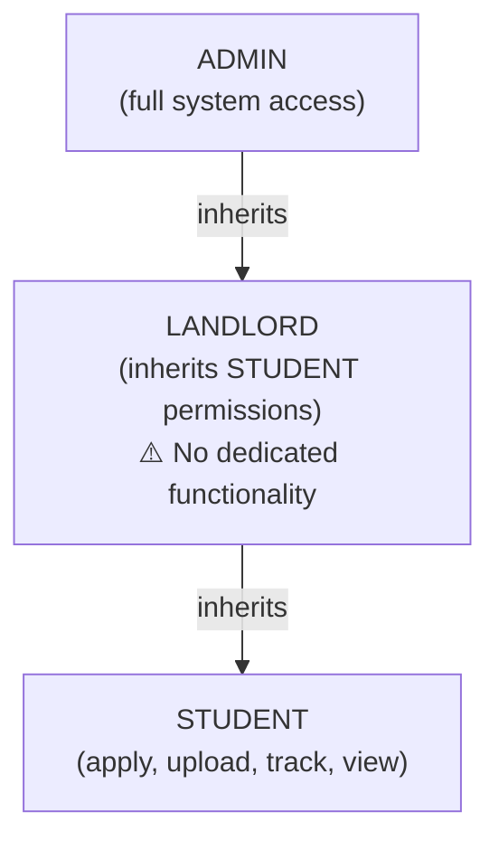
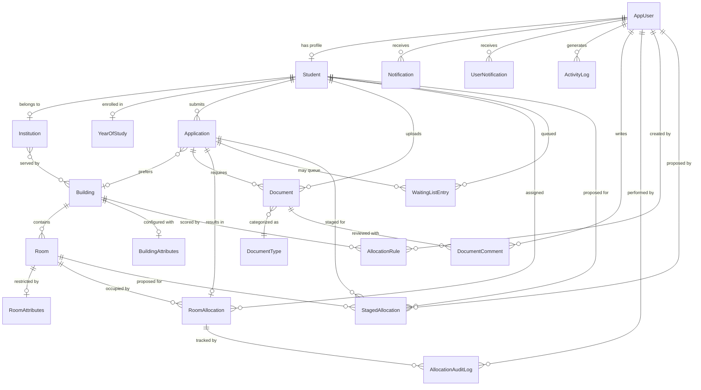
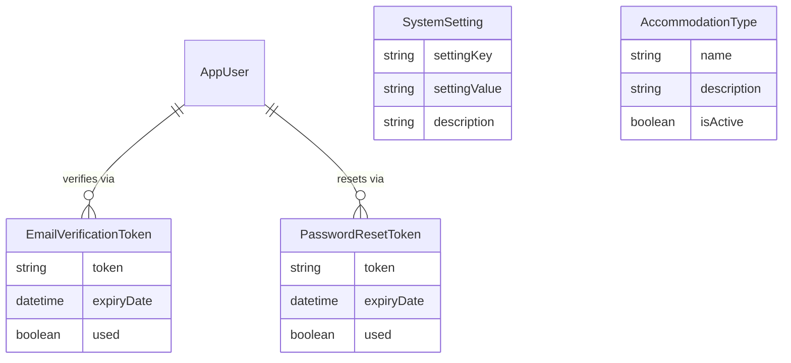
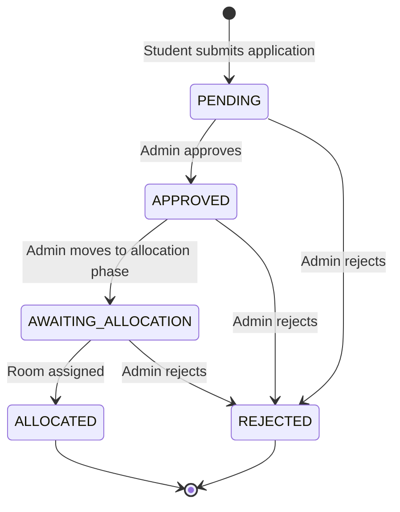
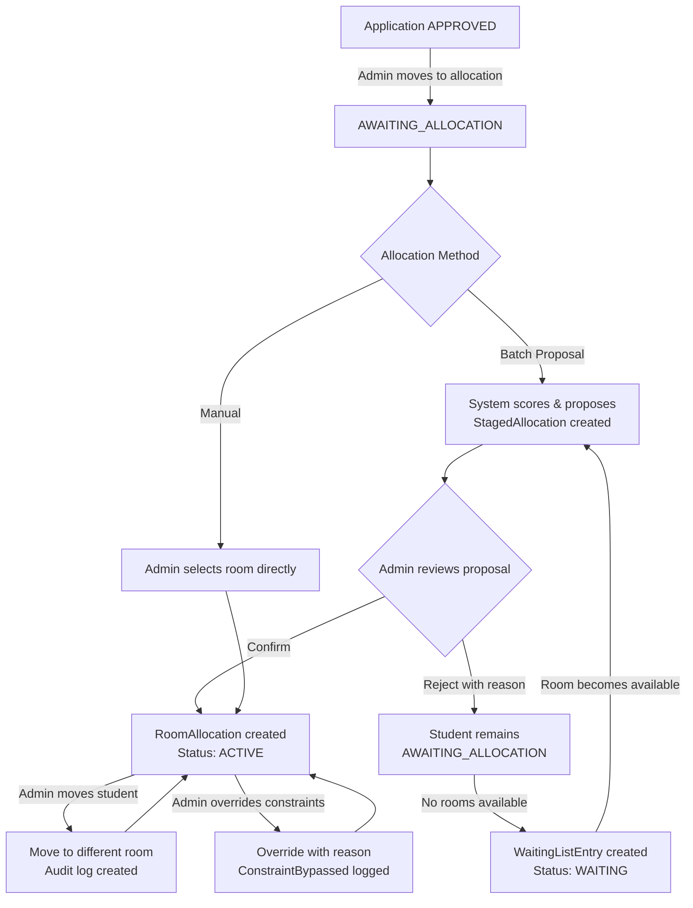
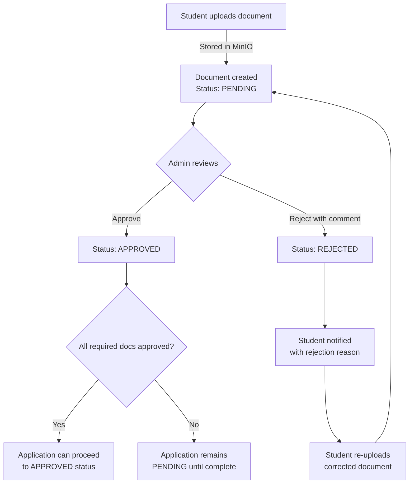
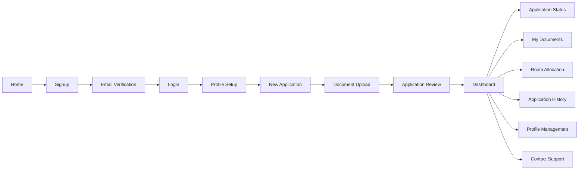
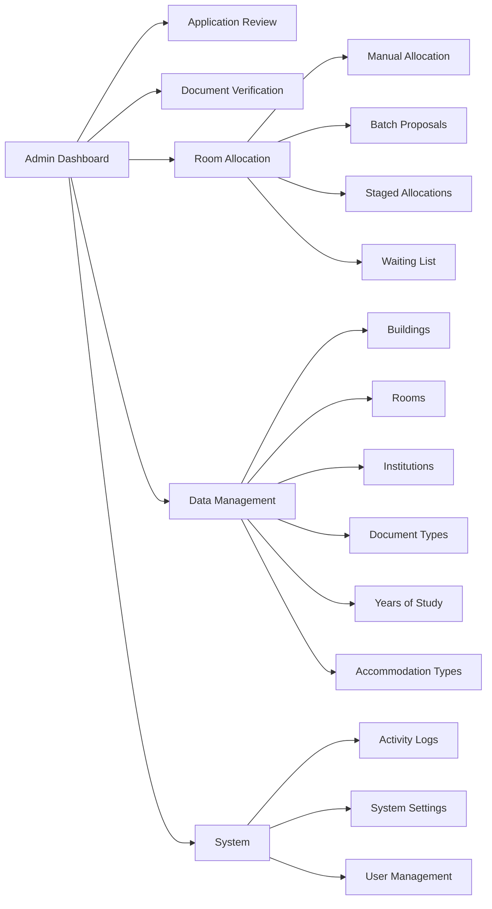
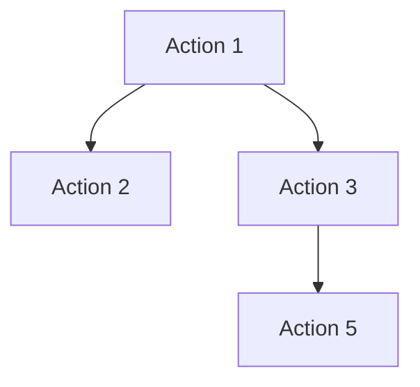

# MVP Requirements Analysis Prompt for AI Agents

## Your Role

You are a senior business analyst and systems architect performing an MVP readiness audit on a **Student Accommodation Management System**. Your job is to:

1. **Identify defects** in the existing requirements and implementation
2. **Find missing requirements** that are critical for an MVP
3. **Suggest improvements** that directly serve the system's core goal
4. **Flag contradictions** between documented requirements and actual implementation
5. **Prioritize findings** so the team knows what to fix first

The system's core goal is: **To manage student accommodations end-to-end — from application submission through document verification, room allocation, and occupancy tracking — for one or more educational institutions.**

---

## System Context

### Technology Stack
- **Backend:** Spring Boot 3.5.7, Java 17+, PostgreSQL, Flyway migrations
- **Frontend:** Angular 19+ (standalone components), Angular Material
- **File Storage:** MinIO (S3-compatible)
- **Auth:** JWT-based stateless authentication with role hierarchy (ADMIN > LANDLORD > STUDENT)
- **Email:** SMTP with Thymeleaf templates, async sending with retry
- **Notifications:** Email (Notification entity) + In-app bell (UserNotification entity)
- **API Docs:** SpringDoc OpenAPI / Swagger UI
- **Testing:** JUnit 5, Mockito, TestContainers, Playwright (E2E)

### User Roles

| Role | Description |
|------|-------------|
| **STUDENT** | Applies for accommodation, uploads documents, tracks status, views allocation |
| **ADMIN** | Reviews applications, verifies documents, manages rooms/buildings, allocates rooms, manages system configuration |
| **LANDLORD** | Property manager role (exists in enum but has no dedicated functionality) |



### Current Data Model (24 Entities)

#### Entity Reference Table

| Entity | Purpose | Key Relationships |
|--------|---------|-------------------|
| **AppUser** | Base user account | email, password, role, emailVerified, mustChangePassword |
| **Student** | Student profile | → AppUser, → Institution, → YearOfStudy |
| **Institution** | Educational institution | ↔ Building (ManyToMany) |
| **YearOfStudy** | Academic year level | ← Student |
| **Building** | Accommodation building | → Room (OneToMany), ↔ Institution (ManyToMany) |
| **BuildingAttributes** | Building-level constraints | → Building (OneToOne) — some fields DEPRECATED |
| **Room** | Individual room | → Building, → RoomAttributes, ← RoomAllocation |
| **RoomAttributes** | Room eligibility rules | genderRestriction, accessibility, yearOfStudy min/max |
| **AccommodationType** | Types of accommodation | name, description, isActive |
| **Application** | Accommodation application | → Student, → Building (preferred), status workflow |
| **Document** | Uploaded student document | → Student, → Application, → DocumentType |
| **DocumentType** | Required/optional doc categories | typeName, isRequired |
| **DocumentComment** | Admin review comments on docs | → Document, → AppUser (admin) |
| **RoomAllocation** | Active room assignment | → Student, → Room, → Application |
| **StagedAllocation** | Proposed allocation (batch) | → Student, → Room, → Application, score, warnings |
| **AllocationRule** | Scoring weights for allocation | → Building, preferenceMatchWeight, desirabilityWeight, accessibilityWeight |
| **WaitingListEntry** | Students awaiting room | → Student, → Application, status |
| **AllocationAuditLog** | Allocation change history | actionType (MOVE, OVERRIDE, DELETE, FORCE_ALLOCATE), reason |
| **Notification** | Email notification record | type, status (PENDING/SENT/FAILED/RETRYING), retryCount |
| **UserNotification** | In-app bell notification | type, title, message, isRead |
| **ActivityLog** | System-wide audit trail | action, entityType, entityId, description, ipAddress, metadata |
| **SystemSetting** | Key-value configuration | settingKey, settingValue |
| **EmailVerificationToken** | Email verification tokens | token, expiryDate, used |
| **PasswordResetToken** | Password reset tokens | token, expiryDate, used |

#### Entity Relationship Diagram — Core Domain



#### Entity Relationship Diagram — Auth & System



### Application Status Workflow



Valid transitions are enforced in `ApplicationStatus.canTransitionTo()`.

### Room Allocation Workflow



### Document Verification Workflow



### Notification Flow

```mermaid
flowchart LR
    subgraph Triggers
        T1[Application status change]
        T2[Document status change]
        T3[Room allocated]
        T4[Document comment added]
    end

    subgraph Async Processing
        T1 & T2 & T3 & T4 -->|@Async| NS[NotificationService]
        NS --> E[Email via SMTP]
        NS --> IN[In-app UserNotification]
    end

    subgraph Email Retry
        E -->|Success| SENT[Status: SENT]
        E -->|Failure| FAILED[Status: FAILED]
        FAILED -->|Scheduled retry\nmax 3 attempts| E
    end

    subgraph Frontend
        IN -->|Polled every 30s| BELL[Notification Bell]
    end
```

### Key Business Rules (Documented)
- BR-001: Students can only have one active application per academic year
- BR-002: Applications require all mandatory documents before processing
- BR-003: Room assignments are final once confirmed
- BR-004: Applications expire after 30 days without required documents
- BR-005: Documents must be less than 10MB in size
- BR-006: Only PDF, JPG, and PNG formats are accepted
- BR-007: Documents remain valid for 12 months from upload
- BR-008: Rejected documents must be re-uploaded with corrections
- BR-009: Room capacity cannot be exceeded
- BR-010: Gender-specific accommodation rules apply where applicable
- BR-011: Special requirements must be considered in room allocation
- BR-012: First-year students receive priority for certain room types

### Existing API Surface (~150+ endpoints across 21 controllers)

**Auth:** login, signup, email verification, password reset, change password, delete account
**Students:** CRUD, search by name/number/email/institution/year
**Applications:** submit, list, search, status update, full details with doc checklist, review progress save, move to allocation
**Documents:** upload single/multiple, info with presigned URL, download, status update, search, comments CRUD
**Rooms:** CRUD, search (number, building, capacity, accessibility, availability)
**Buildings:** CRUD, search, by-institution
**Room Allocations:** CRUD, allocate-by-application, eligibility check, eligible rooms, batch propose (max 50), staged confirm/reject, batch confirm, move student, override constraints, waiting list management, rescore
**Admin:** user management (create admin/landlord, list, delete), dashboard stats, occupancy stats, allocation rules CRUD, activity logs with CSV export, system settings, room/building attributes
**Notifications:** list, mark read, mark all read, delete
**Reference Data:** institutions, years of study, document types, accommodation types — all with CRUD + search

### Existing Frontend Pages

#### Student Journey



#### Admin Journey



---

## Your Analysis Tasks

Perform each of the following analyses. For each finding, classify it as:

- **DEFECT** — Something is broken, contradictory, or implemented incorrectly
- **MISSING-CRITICAL** — A requirement that MUST exist for the MVP to function
- **MISSING-IMPORTANT** — A requirement that significantly improves MVP quality but isn't a blocker
- **IMPROVEMENT** — An enhancement that makes the system better at its core goal
- **CONTRADICTION** — A mismatch between documented requirements and actual implementation

And assign a priority:
- **P0** — MVP cannot ship without this
- **P1** — Should be fixed before MVP but has a workaround
- **P2** — Nice to have for MVP, important for post-MVP

---

### Analysis 1: Core Workflow Completeness

Trace the complete happy path for a student from registration to living in an allocated room. Identify any step that is missing, incomplete, or broken.

**Checkpoints to verify:**
- [ ] Can a student register, verify email, and log in?
- [ ] Can a student complete their profile with all required fields?
- [ ] Can a student submit an application with preferences?
- [ ] Can a student upload all required documents?
- [ ] Can an admin see the application and all its documents?
- [ ] Can an admin verify/reject each document with comments?
- [ ] Can an admin approve/reject the application?
- [ ] Can an admin move an approved application to the allocation phase?
- [ ] Can an admin allocate a room (manually or via batch proposal)?
- [ ] Does the student get notified at every status change?
- [ ] Can the student see their room allocation on their dashboard?
- [ ] Can the student see a clear summary of their accommodation details?
- [ ] What happens at the end of the allocation period? Is there a check-out process?
- [ ] Is there a re-application or renewal flow for the next academic period?

---

### Analysis 2: Business Rule Enforcement

For each documented business rule, verify whether it is actually enforced in the implementation:

| Rule | Question |
|------|----------|
| BR-001 | Is "one active application per academic year" enforced? Is "academic year" defined as an entity? |
| BR-002 | Does the system block application processing if mandatory documents are missing? Or is it just a visual checklist? |
| BR-003 | Can room assignments be changed after confirmation? (Note: admin can MOVE students — does this contradict BR-003?) |
| BR-004 | Is the 30-day expiration timer implemented? Is there a scheduled task that expires stale applications? |
| BR-005 | Is the 10MB limit enforced on both frontend and backend? |
| BR-006 | Are file format restrictions enforced on both frontend and backend? |
| BR-007 | Is the 12-month document validity enforced? Is there a check at allocation time? |
| BR-008 | When a document is rejected, is the student forced to re-upload before the application can proceed? |
| BR-009 | Is room capacity enforced with optimistic locking? What happens under concurrent requests? |
| BR-010 | Are gender restrictions enforced in both the scoring/filtering algorithm and manual allocation? |
| BR-011 | How are "special requirements" matched to rooms? Is it just a text field or structured data? |
| BR-012 | How is first-year priority implemented? Is it in the scoring weights or a hard constraint? |

---

### Analysis 3: Role & Permission Gaps

Examine each role and identify functionality gaps:

**STUDENT role:**
- Can students see WHY their application was rejected (not just the status)?
- Can students see which specific documents were rejected and the admin's comments?
- Can students re-upload a rejected document without starting a new application?
- Can students cancel a pending application?
- Can students see their position on the waiting list?
- Can students view their current room details (building, room number, roommates)?
- Can students report maintenance issues with their room?

**ADMIN role:**
- Can admins see a consolidated view of a student's complete application package?
- Can admins bulk-approve/reject applications?
- Can admins see room utilization trends over time?
- Can admins export allocation data for reporting?
- Can admins configure application periods (open/close dates)?
- Can admins send announcements to all students?
- Can admins handle edge cases (student withdrawals, swaps, transfers)?

**LANDLORD role:**
- The LANDLORD role exists in the UserRole enum but appears to have NO dedicated functionality
- Is this intentional for MVP? If so, it should be documented
- If landlords are property managers, what should they be able to do?

---

### Analysis 4: Data Model Gaps & Issues

Examine the data model for missing entities, fields, or relationships:

- [ ] **Academic Year / Period**: Applications reference "per academic year" but there's no AcademicYear entity. How is this tracked?
- [ ] **Lease / Contract**: There's no lease or accommodation contract entity. How does a student formally accept their allocation? What are the terms?
- [ ] **Pricing / Fees**: The business requirements mention Financial Department as a stakeholder, but there's no pricing on rooms, no fee tracking, no payment entity
- [ ] **Room Amenities**: FR-031 requires "amenities and features" but Room only has number, capacity, status — no amenities field
- [ ] **Floor Information**: Building has totalFloors, but Room has no floor number field
- [ ] **RoomType**: AccommodationType exists but isn't linked to Room — rooms don't have a type field
- [ ] **Application-Document Linkage**: When a document is rejected and re-uploaded, does the new document replace the old one or create a duplicate?
- [ ] **Waiting List Priority**: WaitingListEntry has no priority/position field in the entity, but the API returns priorityScore — is this computed on-the-fly?
- [ ] **Notification Preferences**: Can users opt out of email notifications? There's no preference entity
- [ ] **Building-Institution Relationship**: A building can serve multiple institutions (ManyToMany). Is this requirement clear? Can a room in a building restricted to Institution A be allocated to a student from Institution B?

---

### Analysis 5: Missing MVP Features

Based on the system's core goal of managing student accommodations, identify features that are conspicuously absent:

**Check-in / Check-out:**
- Is there a check-in process when a student moves into their room?
- Is there a check-out process at the end of the allocation period?
- How does the system know when to mark a room as available again?

**Lease / Agreement Management:**
- How does a student formally accept their room offer?
- Is there a deadline to accept? What happens if they don't respond?
- Are there accommodation rules/terms the student must agree to?

**Academic Calendar Integration:**
- Is there a concept of application periods (open date, close date)?
- Can admins set deadlines for document submission?
- Is there a concept of the current academic year/semester?

**Communication:**
- FR-042 and FR-043 require a support ticket system — is it implemented?
- Can admins communicate directly with specific students about their applications?
- Are there email templates for all critical communications?

**Reporting:**
- Can admins generate occupancy reports?
- Can admins see gender distribution across buildings?
- Can admins see application pipeline metrics (submitted, approved, allocated, rejected rates)?
- Is there an export function for external reporting tools?

**Bulk Operations:**
- Can admins import student data in bulk (e.g., from a CSV from the institution)?
- Can admins import room data in bulk?
- Can admins process applications in bulk (mass approve/reject)?

---

### Analysis 6: Non-Functional Requirements vs. Reality

Compare documented NFRs to actual implementation:

| NFR | Documented | Actual Status |
|-----|-----------|---------------|
| NFR-001 | Support 10,000 concurrent users | Is there load testing? Connection pool is 10 — is that enough? |
| NFR-005 | HTTPS encryption | Is HTTPS configured or left to deployment? |
| NFR-008 | XSS, CSRF, SQL Injection protection | Is CSRF disabled (common in JWT apps)? Are inputs sanitized? |
| NFR-009 | File uploads scanned for malware | Is there any virus scanning integration? |
| NFR-010 | Audit logs for critical operations | ActivityLog exists — are ALL critical operations logged? |
| NFR-011 | 99.5% uptime | Is there health check endpoint? Monitoring? |
| NFR-012 | Automated backup | Are database backups configured? |
| NFR-015 | Mobile responsive | Styling audit scores 5.5/10 — is mobile truly usable? |
| NFR-017 | WCAG 2.1 AA | Is there any accessibility testing? Aria labels? Keyboard navigation? |
| NFR-018 | Multi-language support | Is i18n implemented? |
| NFR-024 | GDPR compliance | Can users export their data? Can they request full deletion? |
| NFR-026 | Data portability & deletion | Delete account exists — does it delete ALL associated data (documents, applications, allocations)? |

---

### Analysis 7: Security Concerns

Identify potential security issues:

- [ ] Is there rate limiting on login attempts (brute force protection)?
- [ ] Is there rate limiting on the password reset endpoint (email bombing)?
- [ ] Are document downloads properly authorized (can Student A download Student B's documents)?
- [ ] Is there input validation on all API endpoints (not just frontend)?
- [ ] Are SQL injection vectors covered by parameterized queries (JPA should handle this)?
- [ ] Is there protection against IDOR (Insecure Direct Object Reference) — can a student access another student's application by guessing the ID?
- [ ] Are admin endpoints truly inaccessible to students (check both route guards and backend @PreAuthorize)?
- [ ] Is the JWT secret key hardcoded or environment-variable based?
- [ ] Is there a mechanism to revoke JWT tokens (e.g., on password change)?
- [ ] Are file uploads validated for content type (not just extension)?

---

### Analysis 8: Error Handling & Edge Cases

Identify scenarios that may not be handled:

- What happens if a student's institution is deleted while they have an active application?
- What happens if a building is deleted while it has occupied rooms?
- What happens if a room is deleted while a student is allocated to it?
- What happens if an admin deletes a document type that existing documents reference?
- What happens when two admins try to allocate the same room to different students simultaneously?
- What happens if the email server is down during application approval?
- What happens if MinIO is unavailable during document upload?
- What happens if a student registers but never completes profile setup — do they get stuck?
- Can a student have multiple profiles (one per institution)?

---

### Analysis 9: UX & Workflow Friction Points

Identify places where the user experience may cause confusion or frustration:

**Student Perspective:**
- After submitting an application, is the next step (upload documents) clearly communicated?
- If a document is rejected, is the reason visible and the re-upload path obvious?
- If the student is on the waiting list, do they know their position and estimated timeline?
- Is the application status language clear (e.g., "AWAITING_ALLOCATION" is jargon — should it say "Approved — Finding you a room")?
- Can students see which buildings/rooms are available before applying?

**Admin Perspective:**
- Is there a clear workflow to process applications in order (FIFO, priority, etc.)?
- When reviewing documents, can the admin see the document and the application simultaneously?
- Is there a way to flag an application for follow-up without approving/rejecting?
- Can admins see how many rooms are available before starting batch allocation?
- Are there dashboards that help admins make allocation decisions?

---

### Analysis 10: Contradictions Between Requirements and Implementation

Specifically look for:

1. **FR-012** mentions "Budget constraints" in application preferences — is this field present in the Application entity or form?
2. **FR-015** mentions "Under Review" as a status — but the actual statuses are PENDING, APPROVED, AWAITING_ALLOCATION, ALLOCATED, REJECTED. There's no UNDER_REVIEW.
3. **FR-031** mentions "Amenities and features" — Room has no amenities. RoomAttributes only tracks accessibility and gender restriction.
4. **FR-042/FR-043** require a support ticket system — the frontend has a "Contact Support" page but is there actual ticket tracking?
5. **Section 5.2** mentions Redis for caching — is Redis actually used anywhere?
6. **Section 6.1** mentions "Payment Gateway" integration — there's no payment model at all.
7. **BR-001** says "one active application per academic year" — but the duplicate check uses `existsByStudent_IdAndStatus(PENDING)`, not an academic year constraint.
8. **BR-003** says "Room assignments are final once confirmed" — but there's a MOVE endpoint and OVERRIDE endpoint.
9. **BR-004** says "Applications expire after 30 days" — is there a scheduled task to enforce this?
10. **BR-007** says "Documents remain valid for 12 months" — is this tracked or checked anywhere?
11. **The LANDLORD role** is documented as "Property Managers" but has zero dedicated endpoints or UI pages.
12. **NFR-023** requires API versioning — are APIs versioned (`/api/v1/...`) or unversioned (`/api/...`)?

---

## Output Format

### Output Directory Structure

**All analysis output MUST be written to multiple markdown files** inside the `docs/mvp-analysis/` directory. Do NOT produce a single monolithic document. Organise findings into the following file structure:

```
docs/mvp-analysis/
│
├── 00-INDEX.md                          # Master index — links to every other file
│
├── 01-executive-summary.md              # Executive summary, MVP gap score, readiness radar
│
├── analysis/                            # One file per analysis area
│   ├── 01-core-workflow-completeness.md
│   ├── 02-business-rule-enforcement.md
│   ├── 03-role-permission-gaps.md
│   ├── 04-data-model-gaps.md
│   ├── 05-missing-mvp-features.md
│   ├── 06-nfr-vs-reality.md
│   ├── 07-security-concerns.md
│   ├── 08-error-handling-edge-cases.md
│   ├── 09-ux-workflow-friction.md
│   └── 10-contradictions.md
│
├── proposals/                           # Forward-looking recommendations
│   ├── corrected-application-lifecycle.md
│   ├── data-model-additions.md
│   └── new-requirements.md
│
├── action-plan/                         # Prioritised work items
│   ├── critical-findings.md
│   ├── top-10-action-items.md
│   └── deferred-to-phase-2.md
│
└── appendix/                            # Supporting reference material
    └── finding-registry.md              # Flat table of ALL findings across all files
```

#### File Rules

1. **00-INDEX.md** — This is the entry point. It MUST contain:
   - A brief (2-3 sentence) purpose statement
   - A Mermaid `graph` showing how the files relate to each other
   - A linked table of contents listing every file with its title and a one-line summary
   - A counts summary (total findings by category and priority)

2. **Each analysis file** (`analysis/01-*.md` through `analysis/10-*.md`) — MUST contain:
   - A header referencing the analysis number and title
   - A brief scope statement (what this analysis covers)
   - All findings for that analysis area, using the Finding Format below
   - A summary table at the bottom listing all findings in that file with their category and priority

3. **Each proposal file** (`proposals/*`) — MUST contain:
   - The proposed change with full Mermaid diagrams
   - Rationale referencing specific findings by number (e.g., "Addresses Finding #12 from `analysis/04-data-model-gaps.md`")
   - Cross-links back to the relevant analysis files

4. **Each action plan file** (`action-plan/*`) — MUST contain:
   - Cross-links to the findings that drive each item
   - Clear acceptance criteria for each item

5. **finding-registry.md** — A single flat table of ALL findings across all analysis files:

   ```markdown
   | # | Title | Category | Priority | Analysis File | Proposal File |
   |---|-------|----------|----------|---------------|---------------|
   | 1 | ...   | DEFECT   | P0       | [01-core-workflow](analysis/01-core-workflow-completeness.md) | [data-model-additions](proposals/data-model-additions.md) |
   ```

#### Cross-Referencing Between Files

- When one file references a finding from another file, use a relative markdown link:
  `See [Finding #5: No Academic Year Entity](analysis/04-data-model-gaps.md#finding-5-no-academic-year-entity)`
- When a proposal addresses multiple findings, list all of them with links.
- When an action item is derived from findings, link back to each source finding.

---

### Diagram Requirements

**All diagrams in your output MUST use Mermaid syntax.** Use the appropriate Mermaid diagram type for the content:

| Use Case | Mermaid Type |
|----------|-------------|
| Workflows, processes, decision trees | `flowchart TD` or `flowchart LR` |
| State transitions | `stateDiagram-v2` |
| Entity relationships | `erDiagram` |
| Sequence of interactions between components | `sequenceDiagram` |
| Timelines or phases | `gantt` |
| Architecture overviews | `graph TD` |

When recommending new workflows, data model changes, or architectural additions, include a Mermaid diagram to make the recommendation concrete and unambiguous.

---

### Finding Format

Structure each finding as follows. Use the **finding number as a global sequence** across all analysis files (Finding #1 in file `01-*`, continuing where the last file left off in file `02-*`, etc.), so the finding-registry table has unique IDs.

```markdown
## Finding [NUMBER]: [SHORT TITLE]

**Category:** DEFECT | MISSING-CRITICAL | MISSING-IMPORTANT | IMPROVEMENT | CONTRADICTION
**Priority:** P0 | P1 | P2
**Affected Area:** [Backend | Frontend | Data Model | Business Rules | Security | UX | Documentation]

### Description
[Clear description of what's wrong, missing, or could be improved]

### Impact
[What happens if this isn't fixed — who is affected and how]

### Evidence
[Reference specific files, endpoints, entities, or requirements]

### Recommendation
[Concrete actionable suggestion for how to resolve this]

[Include a Mermaid diagram if the recommendation involves a new workflow, data model change, state machine, or architectural decision]
```

---

## Summary Deliverables — File-by-File Specifications

### `01-executive-summary.md`

This file MUST contain:

1. **Executive Summary** — 5-10 sentence overview of MVP readiness

2. **Critical Findings Table** — All P0 items in a table with category, affected area, and a link to the full finding

3. **MVP Gap Score** — Rate the system on a 1-10 scale for MVP readiness, with justification

4. **MVP Readiness Radar** — A visual summary of system maturity across key dimensions. Use a Mermaid `quadrantChart` or a table showing scores (1-10) for each area:
   - Core Workflow Completeness
   - Business Rule Enforcement
   - Security Posture
   - Data Model Completeness
   - UX / Student Experience
   - Admin Tooling
   - Non-Functional Readiness
   - Documentation & Testing

5. **Findings Distribution** — A summary table showing finding counts broken down by category and priority

---

### `proposals/corrected-application-lifecycle.md`

If the current workflow has gaps, provide a complete corrected lifecycle as a Mermaid `stateDiagram-v2` covering the full student journey from registration through check-out/renewal. Include:
- The current workflow (for comparison)
- The proposed corrected workflow
- A table listing each change and the finding(s) that drive it

---

### `proposals/data-model-additions.md`

If new entities or fields are recommended, provide:
- A Mermaid `erDiagram` showing ONLY the additions and how they connect to the existing model
- A table listing each new entity/field with rationale and the finding(s) that drive it
- For new entities: list all proposed fields with types

---

### `proposals/new-requirements.md`

New FRs and BRs that should be added to the business requirements document, written in the same format as the existing document (`FR-XXX`, `BR-XXX`). Group them by section (matching the sections in `docs/BUSINESS_REQUIREMENTS.md`):
- Functional Requirements (FR-044+)
- Business Rules (BR-013+)
- Non-Functional Requirements (NFR-028+)

Each new requirement MUST link back to the finding(s) that justify it.

---

### `action-plan/critical-findings.md`

All P0 findings in a single table with:
- Finding number and title (linked to source file)
- Category
- Affected area
- Recommended action (one-liner)
- Acceptance criteria

---

### `action-plan/top-10-action-items.md`

An ordered list of the top 10 things to fix/build first. Each item MUST include:
- A clear description of the work
- Which findings it addresses (linked)
- Acceptance criteria
- Dependencies on other action items (if any)


Include a Mermaid `flowchart` showing the dependency order of the action items.

---

### `action-plan/deferred-to-phase-2.md`

Documented requirements that can safely be moved to Phase 2 without impacting MVP viability. Include:
- A table listing each deferred requirement with rationale for deferral
- A Mermaid `gantt` chart showing the recommended phasing:

```mermaid
gantt
    title MVP vs Phase 2 Requirement Phasing
    dateFormat X
    axisFormat %s
    section MVP (Must Have)
    [List MVP items here]        :0, 1
    section Phase 2 (Deferred)
    [List deferred items here]   :1, 2
```



---

## Important Notes for AI Agents

- **Write to multiple files.** Do NOT produce a single document. Follow the directory structure above exactly. Create the `docs/mvp-analysis/` directory and all subdirectories (`analysis/`, `proposals/`, `action-plan/`, `appendix/`), then write each file individually.
- **Use Mermaid for all diagrams.** Never use ASCII art, box-drawing characters, or plain-text diagrams. Every visual representation of a workflow, state machine, entity relationship, sequence, or architecture MUST be a fenced Mermaid code block. This includes diagrams in findings, recommendations, and summary deliverables.
- **Use global finding numbers.** Findings are numbered sequentially across all analysis files. File `analysis/01-*` starts at Finding #1. If it ends at Finding #7, then `analysis/02-*` starts at Finding #8. The `appendix/finding-registry.md` file is the single source of truth for the full numbered list.
- **Cross-link aggressively.** Every proposal must link to the findings it addresses. Every action item must link to its source findings. Every deferred item must explain why it's safe to defer with finding references.
- **Read the actual code** before making claims about what is or isn't implemented. The system context above is a summary — the real source of truth is the codebase.
- **Be specific.** Don't say "security could be improved." Say "The `/api/documents/download/{documentId}` endpoint should verify the requesting user owns the document or is an admin."
- **Be practical.** An MVP doesn't need to be perfect. Focus findings on what would actually block or embarrass a real deployment.
- **Consider the end users.** A first-year student using this system should be able to apply for a room without calling IT support.
- **Don't pad findings.** If something works fine, don't invent problems. Quality over quantity.
- **Reference the business requirements document** (`docs/BUSINESS_REQUIREMENTS.md`) when flagging contradictions.
- **Reference the test plan** (`backend/TEST_PLAN.md` and `docs/TEST_PLAN.md`) when noting untested areas.
